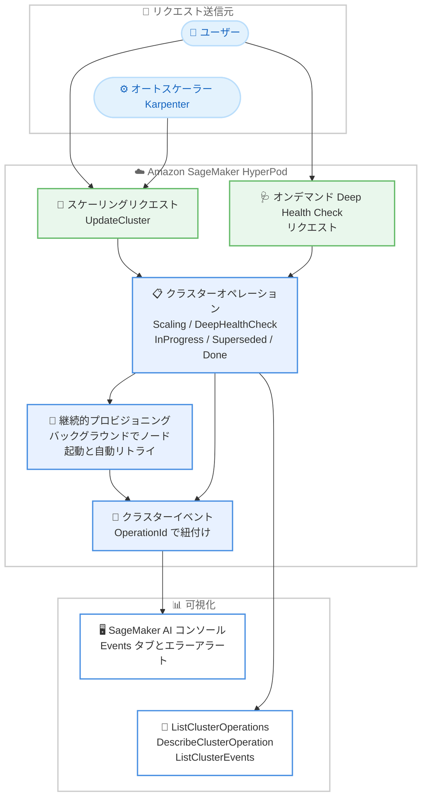

# Amazon SageMaker HyperPod - クラスターオペレーション (スケーリング・オンデマンド Deep Health Check リクエストの追跡)

**リリース日**: 2026 年 11 月 17 日
**サービス**: Amazon SageMaker HyperPod
**機能**: クラスターオペレーション (Cluster Operations)

📊 [このアップデートのインフォグラフィックを見る](https://takech9203.github.io/aws-news-summary/20261117-sagemaker-hyperpod-cluster-ops.html)

## 概要

Amazon SageMaker HyperPod がクラスターオペレーション (Cluster Operations) を発表しました。スケーリングリクエストとオンデマンド Deep Health Check リクエストを、送信から完了まで一貫して可視化できる機能です。リクエストでエラーが発生した場合、SageMaker AI コンソールにアラートが表示され、そのリクエストのエラーイベントに直接移動できます。

HyperPod の継続的プロビジョニング (Continuous Provisioning) では、キャパシティが利用可能になり次第バックグラウンドでノードをオンライン化し、失敗したノードを自動的にリトライし、複数のスケーリングリクエストを同時に実行できます。クラスターオペレーションにより、各リクエストがいつ完了したか、クラスター上のアクティビティがどのリクエストによって引き起こされたかを把握できます。スケールアップが目標台数に達しなかった場合は、失敗理由に直接アクセスできます。

本機能は、大規模な基盤モデルのトレーニングや推論基盤を HyperPod で運用する ML プラットフォームチームや、Karpenter などのオートスケーラーと組み合わせてクラスターを動的にスケールさせるユーザーに特に有用です。新しい `ListClusterOperations` API と `DescribeClusterOperation` API を使用すれば、独自のダッシュボード、アラート、CI/CD パイプラインにも同じ可視性を組み込めます。

**アップデート前の課題**

継続的プロビジョニングはバックグラウンドで非同期に動作するため、以下の課題がありました。

- 以前はスケーリングリクエストの進行状況を送信から完了まで一貫して追跡する手段がなく、クラスターイベント全体から関連する情報を手作業で探す必要があった
- 以前は複数のスケーリングリクエストを同じインスタンスグループに送信した場合、どのリクエストが実際にクラスターを変更したのかを判別できなかった
- 以前はスケールアップが目標台数に達しなかった場合、無関係なクラスターアクティビティの中から失敗理由を特定する必要があった
- 以前はオンデマンド Deep Health Check の完了時刻や影響を受けたインスタンスを確認する専用の仕組みがなかった

**アップデート後の改善**

今回のアップデートにより、リクエスト単位での追跡が可能になりました。

- 今回のアップデートにより、スケーリングおよびオンデマンド Deep Health Check のリクエストごとにクラスターオペレーションが自動作成され、送信から完了までの状態 (進行中・完了・新しいリクエストによる置き換え) と各インスタンスグループへの変更内容を追跡できるようになった
- 今回のアップデートにより、HyperPod が記録するイベントがオペレーションに紐付けられ、特定のリクエストに関するイベントのみを絞り込んで確認できるようになった
- 今回のアップデートにより、エラー発生時には SageMaker AI コンソールのアラートから該当リクエストのエラーイベントへ直接移動できるようになった
- 今回のアップデートにより、`ListClusterOperations` / `DescribeClusterOperation` API を通じて独自の監視基盤にオペレーション情報を統合できるようになった

## アーキテクチャ図



スケーリングやオンデマンド Deep Health Check のリクエストごとにクラスターオペレーションが自動作成され、継続的プロビジョニングが記録するイベントがオペレーションに紐付けられます。結果はコンソールの Events タブと API の両方から確認できます。

## サービスアップデートの詳細

### 主要機能

1. **リクエスト単位の追跡 (クラスターオペレーション)**
   - スケーリングまたはオンデマンド Deep Health Check のリクエストごとにオペレーションが自動作成される
   - 送信から完了までの状態 (`InProgress` / `Superseded` / `Done`) を追跡できる
   - 各インスタンスグループに対する変更内容 (現在数・目標数・最小数の変化) を確認できる
   - 既存のワークフローへの変更は不要で、すべてのリクエストに対して自動的に作成される

2. **イベントのオペレーション紐付け**
   - HyperPod がリクエスト処理中に記録するイベントが、そのオペレーションにリンクされる
   - 特定のリクエストに関するイベントのみを絞り込んで確認でき、無関係なクラスターアクティビティを除外できる
   - スケールアップが目標台数に達しなかった場合、該当オペレーションを開いて失敗理由に直接アクセスできる

3. **同時リクエストの判別**
   - Karpenter などのオートスケーラーが同じインスタンスグループに複数のリクエストを送信した場合でも、各オペレーションが完了したか、より新しいリクエストに置き換えられたか (`Superseded`) を判別できる
   - どのリクエストが実際にクラスターを変更したのかを明確に特定できる

4. **コンソールと API の両方で確認可能**
   - SageMaker AI コンソールでは、クラスターの Events タブにオペレーションが表示される
   - エラー発生時はコンソールにアラートが表示され、該当リクエストのエラーイベントへ直接移動できる
   - 新しい `ListClusterOperations` / `DescribeClusterOperation` API と、`ListClusterEvents` の `OperationId` フィルターにより、独自のダッシュボード、アラート、CI/CD パイプラインに統合できる

## 技術仕様

### クラスターオペレーションの属性

| 項目 | 詳細 |
|------|------|
| オペレーションタイプ | `Scaling` (スケーリング)、`DeepHealthCheck` (オンデマンド Deep Health Check) |
| ステータス | `InProgress` (進行中)、`Superseded` (新しいリクエストに置き換え)、`Done` (完了) |
| スケーリング詳細 | インスタンスグループごとの変更前後の `CurrentCount` / `TargetCount` / `MinCount` |
| Deep Health Check 詳細 | 対象インスタンスグループ、インスタンス ID、チェック種別 (`InstanceStress` / `InstanceConnectivity` / `MultiNodeTrainingValidation`) |
| 作成条件 | すべてのスケーリング・オンデマンド Deep Health Check リクエストに対して自動作成 |
| 前提 | 継続的プロビジョニング (`NodeProvisioningMode: Continuous`) を使用するクラスター |

### API 変更履歴

| 日付 | サービス | 変更内容 |
|------|----------|----------|
| 2026/11/13 | [Amazon SageMaker Service](https://awsapichanges.com/archive/changes/b4312b-api.sagemaker.html) | 3 new 6 updated api methods - `ListClusterOperations` / `DescribeClusterOperation` の新規追加、`ListClusterEvents` / `DescribeClusterEvent` への `OperationId` 対応など |

### 新規 API の例

`DescribeClusterOperation` のレスポンス構造 (抜粋) は以下のとおりです。

```json
{
  "OperationId": "string",
  "ClusterArn": "string",
  "Type": "Scaling",
  "Status": "Done",
  "CreationTime": "2026-11-17T08:00:00Z",
  "ScalingDetails": [
    {
      "InstanceGroupName": "training-group",
      "Status": "Done",
      "Original": { "CurrentCount": 8, "TargetCount": 8, "MinCount": 4 },
      "Desired": { "CurrentCount": 16, "TargetCount": 16, "MinCount": 4 }
    }
  ]
}
```

## 設定方法

### 前提条件

1. SageMaker HyperPod クラスターが作成済みであること
2. クラスターが継続的プロビジョニング (`NodeProvisioningMode: Continuous`) を使用していること
3. AWS CLI または SDK が最新バージョンに更新されていること

### 手順

#### ステップ 1: クラスターオペレーションの一覧を取得する

```bash
aws sagemaker list-cluster-operations \
  --cluster-name my-hyperpod-cluster \
  --type Scaling \
  --sort-by CreationTime \
  --sort-order Descending
```

指定したクラスターのスケーリングオペレーションを作成日時の降順で一覧表示します。`--status InProgress` を指定すれば進行中のオペレーションのみに絞り込めます。

#### ステップ 2: 特定のオペレーションの詳細を確認する

```bash
aws sagemaker describe-cluster-operation \
  --cluster-name my-hyperpod-cluster \
  --operation-id <operation-id>
```

オペレーションのステータスと、各インスタンスグループの変更前後のインスタンス数 (スケーリングの場合) や対象インスタンス (Deep Health Check の場合) を確認します。スケールアップが目標台数に達していない場合の調査起点になります。

#### ステップ 3: オペレーションに紐付くイベントを絞り込む

```bash
aws sagemaker list-cluster-events \
  --cluster-name my-hyperpod-cluster \
  --operation-id <operation-id> \
  --sort-by EventTime \
  --sort-order Descending
```

`--operation-id` フィルターにより、特定のリクエストに関するイベントのみを取得します。無関係なクラスターアクティビティを除外して、失敗理由やエラーイベントに直接アクセスできます。コンソールの場合は、クラスターの Events タブから同じ情報を確認できます。

## メリット

### ビジネス面

- **運用調査時間の短縮**: リクエスト単位でイベントを絞り込めるため、スケーリング失敗時の原因特定が迅速になり、トレーニングジョブの開始遅延を最小化できる
- **追加コストなし**: 継続的プロビジョニングを使用するクラスターでは追加料金なしで利用でき、既存ワークフローの変更も不要
- **大規模トレーニングの信頼性向上**: 大規模トレーニングジョブの前に実行したオンデマンド Deep Health Check の完了と影響範囲を確認してからジョブを開始できる

### 技術面

- **リクエストとクラスター変更の対応付け**: 複数の同時スケーリングリクエストのうち、どれが実際にクラスターを変更したか (`Done` / `Superseded`) を API で判別できる
- **監視基盤への統合**: `ListClusterOperations` / `DescribeClusterOperation` API により、独自ダッシュボード、アラート、CI/CD パイプラインにオペレーション情報を組み込める
- **イベントのノイズ除去**: `ListClusterEvents` の `OperationId` フィルターで、特定リクエストのイベントのみを抽出でき、トラブルシューティングの精度が向上する

## デメリット・制約事項

### 制限事項

- 継続的プロビジョニングを使用する SageMaker HyperPod クラスターが対象
- 対象となるオペレーションタイプはスケーリングとオンデマンド Deep Health Check の 2 種類
- 新しい API を使用するには AWS CLI / SDK の更新が必要

### 考慮すべき点

- Karpenter などのオートスケーラーを使用している場合、短時間に多数のオペレーションが作成されるため、監視基盤に統合する際はフィルタリング (タイプ・ステータス・期間) を活用するとよい
- オペレーションのステータスが `Superseded` の場合、そのリクエストの変更は新しいリクエストに置き換えられているため、最終的なクラスター状態は最新のオペレーションで確認する必要がある

## ユースケース

### ユースケース 1: スケールアップ失敗の原因調査

**シナリオ**: トレーニング用インスタンスグループを 8 台から 16 台にスケールアップしたが、目標台数に達していない。原因を特定したい。

**実装例**:
```bash
# 進行中・完了済みのスケーリングオペレーションを確認
aws sagemaker list-cluster-operations \
  --cluster-name training-cluster \
  --type Scaling

# 該当オペレーションのイベントのみを抽出
aws sagemaker list-cluster-events \
  --cluster-name training-cluster \
  --operation-id <operation-id>
```

**効果**: 無関係なクラスターアクティビティを除外し、該当リクエストの失敗理由 (キャパシティ不足、設定エラーなど) に直接アクセスできる。コンソールではアラートからエラーイベントへ直接移動できる。

### ユースケース 2: 大規模トレーニング前の Deep Health Check 確認

**シナリオ**: 大規模トレーニングジョブの開始前にオンデマンド Deep Health Check を実行し、完了と対象インスタンスを確認してからジョブを投入したい。

**実装例**:
```bash
aws sagemaker list-cluster-operations \
  --cluster-name training-cluster \
  --type DeepHealthCheck \
  --sort-by CreationTime \
  --sort-order Descending \
  --max-results 1

aws sagemaker describe-cluster-operation \
  --cluster-name training-cluster \
  --operation-id <operation-id>
```

**効果**: Deep Health Check がいつ完了したか、どのインスタンスが対象だったか、どのチェック (InstanceStress、InstanceConnectivity、MultiNodeTrainingValidation) が実行されたかを確認し、クラスターの健全性を担保した状態でジョブを開始できる。

### ユースケース 3: Karpenter によるオートスケーリングの可視化

**シナリオ**: 推論トラフィックのバーストに応じて Karpenter が同じインスタンスグループに複数のスケーリングリクエストを送信している。どのリクエストが実際にクラスターを変更したかを CI/CD や監視ダッシュボードで追跡したい。

**実装例**:
```bash
# 直近 1 時間のスケーリングオペレーションを取得して監視基盤へ連携
aws sagemaker list-cluster-operations \
  --cluster-name inference-cluster \
  --type Scaling \
  --creation-time-after "$(date -u -d '1 hour ago' +%Y-%m-%dT%H:%M:%SZ)"
```

**効果**: 各オペレーションが `Done` (クラスターを変更) か `Superseded` (新しいリクエストに置き換え) かを判別でき、オートスケーリングの挙動を正確に可視化できる。

## 料金

クラスターオペレーションは追加料金なしで利用できます。継続的プロビジョニングを使用する SageMaker HyperPod クラスターで自動的に有効になり、既存のワークフローへの変更は不要です。SageMaker HyperPod 自体の料金は、使用するインスタンスタイプと稼働時間に基づいて課金されます。

## 利用可能リージョン

SageMaker HyperPod が利用可能なすべての AWS リージョンで提供されます。

## 関連サービス・機能

- **SageMaker HyperPod 継続的プロビジョニング**: 本機能の前提となるプロビジョニングモード。キャパシティが利用可能になり次第バックグラウンドでノードをオンライン化し、失敗したノードを自動リトライする
- **SageMaker HyperPod Deep Health Check**: インスタンスのストレステストや接続性、マルチノードトレーニングの検証を行うヘルスチェック機能。オンデマンド実行分が本機能の追跡対象となる
- **Karpenter (HyperPod オートスケーリング)**: HyperPod クラスターのオートスケーラー。Karpenter が送信したスケーリングリクエストもオペレーションとして追跡できる
- **Amazon EventBridge / CloudWatch**: `ListClusterOperations` API と組み合わせて、独自のアラートやダッシュボードを構築できる

## 参考リンク

- 📊 [インフォグラフィック](https://takech9203.github.io/aws-news-summary/20261117-sagemaker-hyperpod-cluster-ops.html)
- [公式発表 (What's New)](https://aws.amazon.com/about-aws/whats-new/2026/11/sagemaker-hyperpod-cluster-ops/)
- [ドキュメント (SageMaker HyperPod Cluster Operations)](https://docs.aws.amazon.com/sagemaker/latest/dg/sagemaker-hyperpod-cluster-operations.html)
- [API 変更履歴 (awsapichanges.com)](https://awsapichanges.com/archive/changes/b4312b-api.sagemaker.html)
- [料金ページ (Amazon SageMaker AI)](https://aws.amazon.com/sagemaker-ai/pricing/)

## まとめ

SageMaker HyperPod のクラスターオペレーションにより、継続的プロビジョニング環境でのスケーリングとオンデマンド Deep Health Check のリクエストを、送信から完了まで追加コストなしで追跡できるようになりました。複数の同時リクエストやオートスケーラー経由の変更が多い環境では、トラブルシューティングの効率が大きく向上します。継続的プロビジョニングを使用している場合は自動的に有効化されるため、まずはコンソールの Events タブでオペレーションを確認し、必要に応じて `ListClusterOperations` API を監視基盤に統合することを推奨します。
