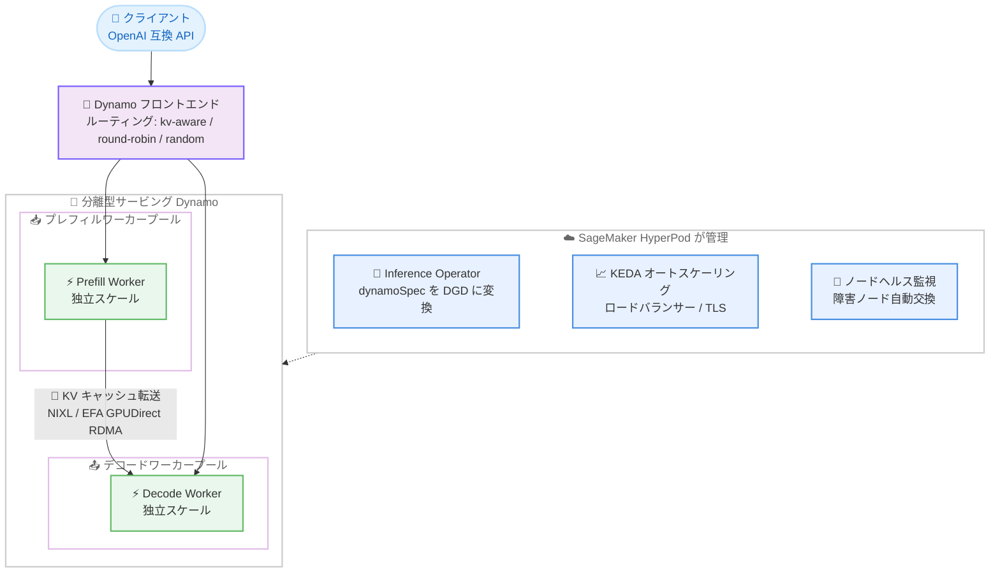

# Amazon SageMaker HyperPod - Inference での NVIDIA Dynamo サポートによる分離型・マルチノード推論

**リリース日**: 2026 年 11 月 17 日
**サービス**: Amazon SageMaker HyperPod
**機能**: HyperPod Inference における NVIDIA Dynamo サポート (分離型サービング・マルチノード推論)

📊 [このアップデートのインフォグラフィックを見る](https://takech9203.github.io/aws-news-summary/20261117-sagemaker-hyperpod-nvidia-dynamo.html)

## 概要

Amazon SageMaker HyperPod Inference が、NVIDIA Dynamo をサービングランタイムとしてサポートしました。NVIDIA Dynamo は vLLM、SGLang、TensorRT-LLM などの推論エンジンの上で動作し、複数の GPU やノードにまたがってエンジンを協調させるオープンソースの推論フレームワークです。これにより、単一インスタンスには収まらない大規模モデルの提供や、長いプロンプトでもトークン生成速度を維持する分離型 (disaggregated) サービングが可能になります。

Dynamo の管理は HyperPod の Inference Operator アドオンを通じて行われるため、ユーザーが分散サービングインフラを自前で構築・運用する必要はありません。HyperPod が EFA ネットワーキング、GPU キャパシティ管理、障害ノードの自動交換、エンドポイント登録、オートスケーリング、オブザーバビリティを担います。

大規模な基盤モデル (LLM) を自己ホストで推論提供する ML プラットフォームチームや、長文コンテキストを扱う推論ワークロードでスループットとレイテンシーの両立に課題を抱えるユーザーに特に有用なアップデートです。

**アップデート前の課題**

- 単一インスタンスの GPU メモリを超える大規模モデルを提供するには、分散サービングスタックを自前で構築・運用する必要があった
- プロンプトが長い場合、プレフィル (プロンプト処理) とデコード (トークン生成) が同じ GPU を奪い合い、他のリクエストのトークン生成が遅くなっていた
- プレフィルとデコードのリソースを独立してスケールできず、ワークロード特性に応じた最適化が難しかった
- KV キャッシュを考慮したルーティングを実現するには独自の仕組みが必要だった

**アップデート後の改善**

- マルチノードサービングにより、1 つのモデルを複数ノードにまたがる単一ワーカーとして提供できるようになった (ノードはギャングスケジューリングで一括配置)
- 分離型サービングにより、プレフィルとデコードを別々の GPU プールに分割し、それぞれ独立してサイジング・スケールできるようになった
- KV キャッシュ対応ルーティング (kv-aware) により、キャッシュ済みコンテキストを持つワーカーへリクエストを振り分け、再計算を削減してスループットを向上できるようになった
- Dynamo オペレーター、Grove、KAI スケジューラのインストール・アップグレード、EFA 設定、エンドポイント登録、KEDA によるオートスケーリングを HyperPod が管理するようになった

## アーキテクチャ図



分離型サービングでは、プレフィルとデコードが別々のワーカープールで動作し、KV キャッシュは NIXL を介して EFA 経由で転送されます。インフラ管理やオートスケーリングは HyperPod が担います。

## サービスアップデートの詳細

### 主要機能

1. **マルチノードサービング**
   - 単一インスタンスに収まらない大規模モデルを、複数ノードにまたがる 1 つのワーカーとして提供できる
   - `nodesPerReplica` でワーカーを構成するノード数を指定し、テンソル並列 (`tensorParallelism`) やパイプライン並列と組み合わせて GPU をノード間に分割
   - ワーカーを構成するノードはギャングスケジューリングされ、全ノードが揃うまで配置されない (部分的な配置は発生しない)
   - マルチノードワーカーには EFA デバイスを持つインスタンスタイプが必須

2. **分離型サービング (Disaggregated Serving)**
   - プレフィル (プロンプト処理) とデコード (トークン生成) を別々のワーカープールに分割
   - 各ロールのレプリカ数、並列度、インスタンスタイプ、オートスケーリングを独立して設定可能
   - KV キャッシュはプレフィルワーカーからデコードワーカーへ NVIDIA Inference Xfer Library (NIXL) を介して転送され、対応インスタンスでは EFA + GPUDirect RDMA を使用
   - 長いプロンプトが他のリクエストのトークン生成を妨げなくなる

3. **KV キャッシュ対応ルーティング**
   - Dynamo フロントエンドは OpenAI 互換の HTTP API を公開し、`routingMode` でルーティング方式を選択
   - `kv-aware` (デフォルト): リクエストと KV キャッシュの重なりが最も大きいワーカーへルーティングし、再計算を削減してスループットを向上
   - `round-robin` / `random` も選択可能

4. **マネージドな Dynamo 運用**
   - HyperPod Inference アドオン (v3.0.0-eksbuild.1) が Dynamo オペレーター 1.6.2、Grove、KAI スケジューラを一括でインストール・アップグレード
   - AWS Deep Learning Containers が vLLM / SGLang / TensorRT-LLM 向けの Dynamo ランタイムイメージ (EFA 対応版含む) を提供
   - Inference Operator がロードバランサー、TLS 証明書、SageMaker AI エンドポイント登録、KEDA によるオートスケーリングを管理
   - ノードヘルスの監視と障害ノードの自動交換

### 2 つのデプロイアプローチ

| 項目 | `InferenceEndpointConfig` + `dynamoSpec` | `DynamoGraphDeployment` (DGD) 直接作成 |
|------|------|------|
| モデルダウンロード、エンドポイント登録、ロードバランサー、TLS | HyperPod が管理 | 自分で設定 |
| オートスケーリング | HyperPod が管理 (KEDA) | 自分で設定 |
| EFA / KV 転送設定 | インスタンスタイプから自動設定 | 自分で設定 |
| 想定ユース | ほとんどのデプロイ | 既存の DGD マニフェストがある場合や、`dynamoSpec` 未対応の設定が必要な場合 |

## 技術仕様

### サービングモード

| モード | 内容 |
|------|------|
| Aggregated サービング | 各ワーカーがプレフィルとデコードの両方を実行。モデルが 1 ノードに収まらない場合はワーカーを複数ノードに拡張可能 |
| Disaggregated サービング | プレフィルとデコードを独立したワーカープールに分離。KV キャッシュは NIXL で転送 |

### 対応推論エンジンとランタイムイメージ

| `modelServer` | 標準イメージ | EFA イメージ |
|------|------|------|
| `vllm` | `public.ecr.aws/deep-learning-containers/dynamo:1.6.2-vllm-runtime-v1` | `public.ecr.aws/deep-learning-containers/dynamo:1.6.2-efa-vllm-runtime-v1` |
| `sglang` | `public.ecr.aws/deep-learning-containers/dynamo:1.6.2-sglang-runtime-v1` | `public.ecr.aws/deep-learning-containers/dynamo:1.6.2-efa-sglang-runtime-v1` |
| `trtllm` | `public.ecr.aws/deep-learning-containers/dynamo:1.6.2-trtllm-runtime-v1` | `public.ecr.aws/deep-learning-containers/dynamo:1.6.2-efa-trtllm-runtime-v1` |

同一リリースの NVIDIA GPU Cloud (NGC) イメージも使用できます。

### KV 転送パス (主なインスタンスタイプ)

| インスタンスタイプ | GPU 数 | GPUDirect RDMA | 単一ノードロール | マルチノードロール |
|------|------|------|------|------|
| ml.p5.48xlarge、ml.p5e.48xlarge、ml.p5en.48xlarge、ml.p6-b200/b300.48xlarge | 8 | 対応 | EFA + GPUDirect RDMA | EFA + GPUDirect RDMA |
| ml.p6e-gb200.36xlarge | 4 | 対応 | EFA + GPUDirect RDMA | EFA + GPUDirect RDMA |
| ml.g7e.12xlarge〜48xlarge | 2〜8 | 対応 | TCP | EFA + GPUDirect RDMA |
| ml.p4d/p4de.24xlarge、ml.g6e.12xlarge 以上 | 4〜8 | 非対応 | TCP | EFA (ホストメモリ経由) |
| ml.g5 系 (EFA なし) | 1〜8 | 非対応 | TCP | 非対応 |

エンジンによる制約もあります: vLLM は EFA 転送に対応、TensorRT-LLM は単一ノードロールで `cache_transceiver_config.backend` を `NIXL` に設定した場合のみ EFA (マルチノードは TCP)、SGLang はすべて TCP です。

### API 変更履歴

本アップデートは Kubernetes カスタムリソース (`InferenceEndpointConfig` の `dynamoSpec` フィールドおよび `DynamoGraphDeployment`) と EKS アドオンの更新により提供されるため、SageMaker API 自体の直接的な変更はありません。

## 設定方法

### 前提条件

1. Amazon EKS でオーケストレーションされた SageMaker HyperPod クラスターが作成済みであること
2. ワーカー用の GPU インスタンスが用意されていること (マルチノードワーカーには EFA デバイス付きインスタンスタイプが必須)
3. アドオンがインストールする Dynamo プラットフォーム (1.6.2) と同一リリースの Dynamo ランタイムイメージを使用すること

### 手順

#### ステップ 1: アドオンで Dynamo を有効化

```bash
aws eks update-addon \
    --cluster-name $EKS_CLUSTER_NAME \
    --addon-name amazon-sagemaker-hyperpod-inference \
    --addon-version v3.0.0-eksbuild.1 \
    --configuration-values file://addon-config.json \
    --resolve-conflicts OVERWRITE \
    --region $REGION
```

HyperPod Inference アドオンを更新し、設定ファイルに `"dynamo": { "enabled": true }` を含めることで Dynamo オペレーター、Grove、KAI スケジューラをインストールします。`--resolve-conflicts OVERWRITE` は既存設定を渡した値で置き換えるため、現在の設定値を取得してから追記します。コンソールからアドオンをインストールする場合、Dynamo はデフォルトで有効です。

#### ステップ 2: `dynamoSpec` 付きの `InferenceEndpointConfig` を作成

```yaml
apiVersion: inference.sagemaker.aws.amazon.com/v1
kind: InferenceEndpointConfig
metadata:
  name: my-endpoint
  namespace: default
spec:
  modelName: my-endpoint
  endpointName: my-endpoint
  instanceType: ml.p5.48xlarge
  invocationEndpoint: v1/chat/completions
  modelSourceConfig:
    modelSourceType: huggingface
    huggingFaceModel:
      modelId: {{HUGGING_FACE_MODEL_ID}}
      tokenSecretRef:
        name: {{SECRET_NAME}}
        key: token
  dynamoSpec:
    modelServer: vllm
    frontend:
      routingMode: kv-aware
    disaggregation:
      prefill:
        replicas: 1
        tensorParallelism: 4
      decode:
        replicas: 1
        tensorParallelism: 4
  worker:
    image: public.ecr.aws/deep-learning-containers/dynamo:1.6.2-efa-vllm-runtime-v1
    modelInvocationPort:
      containerPort: 8000
    modelVolumeMount:
      name: model-weights
    resources: {}
```

`dynamoSpec` で推論エンジン、ルーティングモード、サービングモード (aggregation または disaggregation のどちらか一方) を指定します。GPU 数は `tensorParallelism` などから Inference Operator が自動算出するため、`worker.resources` に `nvidia.com/gpu` を設定しません。モデルは Hugging Face のほか、Amazon S3、Amazon FSx、Kubernetes ボリュームからも読み込めます。

#### ステップ 3: マニフェストの適用とデプロイの確認

```bash
kubectl apply -f endpoint.yaml
kubectl get inferenceendpointconfig my-endpoint -n default \
    -o jsonpath='{.status.state}'
```

マニフェストを適用し、エンドポイントの状態を確認します。状態が `DeploymentComplete` になればデプロイ完了です。失敗時は `DynamoSpecInvalid` や `DynamoPodsUnschedulable` などの理由が status に記録されます。

#### ステップ 4: テストリクエストの送信

```bash
kubectl port-forward -n default svc/my-endpoint-frontend 8000:8000
curl http://localhost:8000/v1/chat/completions \
    -H "Content-Type: application/json" \
    -d '{"model": "{{MODEL_NAME}}", "messages": [{"role": "user", "content": "Hello"}]}'
```

フロントエンドサービスにポートフォワードし、OpenAI 互換 API でテストリクエストを送信して応答を確認します。

## メリット

### ビジネス面

- **インフラ構築コストの削減**: 分散サービングスタックの自前構築・運用が不要になり、エンジニアリングコストを削減できる
- **GPU 投資の最大化**: KV キャッシュ対応ルーティングと分離型サービングにより GPU 使用効率が向上し、同じスループットをより少ないリソースで実現できる
- **大規模モデル活用の加速**: 単一インスタンスに収まらない最先端の大規模モデルを自己ホストで提供可能になる

### 技術面

- **プレフィル / デコードの独立スケーリング**: ワークロード特性 (長文プロンプト重視か生成量重視か) に応じて各ロールを個別に最適化できる
- **高速な KV キャッシュ転送**: 対応インスタンスでは EFA + GPUDirect RDMA により、GPU 間で KV キャッシュを低レイテンシーで転送できる
- **再計算の削減**: kv-aware ルーティングによりキャッシュ済みコンテキストを再利用し、Time to First Token を短縮できる
- **運用の自動化**: アドオンによる一括アップグレード、KEDA オートスケーリング、障害ノードの自動交換により運用負荷が低い

## デメリット・制約事項

### 制限事項

- EKS オーケストレーションの HyperPod クラスターが対象 (Slurm オーケストレーションは対象外)
- マルチノードワーカーには EFA デバイス付きインスタンスタイプが必須 (EFA なしのインスタンスタイプでは Inference Operator が設定を拒否)
- 既存の `InferenceEndpointConfig` に `dynamoSpec` を追加・削除したり、aggregation と disaggregation を切り替えたりすることはできない (リソースの削除・再作成が必要)
- `pdSpec`、`intelligentRoutingSpec`、`kvCacheSpec`、スケールトゥゼロとの併用は不可 (`DynamoSpecInvalid` となる)
- `dataParallelism` は vLLM の単一ノードワーカーのみサポートされ、パイプライン並列との併用は不可
- マルチノードワーカーは本リリースでは HyperPod Task Governance と併用できない
- SGLang の KV 転送はすべてのインスタンスタイプで TCP となる

### 考慮すべき点

- フロントエンドはクラスター内で認証を持たないため、VPC CNI アドオンでネットワークポリシーの適用を有効化し、サービングポートへのアクセスを制限することが推奨される
- DGD を直接作成する場合、ロードバランサー、TLS、エンドポイント登録、オートスケーリング、NetworkPolicy の設定は自分で行う必要がある
- 大規模モデルはダウンロードに時間がかかるため、`maxDeployTimeInSeconds` を十分に大きく設定しないと `DynamoDeployTimeout` で失敗する可能性がある
- フロントエンドやプラットフォームコンポーネントは GPU 不要のため、ml.c5.4xlarge 以上などの CPU インスタンスグループを追加して GPU ノードのキャパシティを節約するのが望ましい
- Dynamo エンドポイントのポッドは Pod Security Standard の `baseline` を満たすが `restricted` は満たさない

## ユースケース

### ユースケース 1: 単一インスタンスに収まらない超大規模モデルの提供

**シナリオ**: 数百 GB 規模の重みを持つ大規模モデルを自己ホストで提供したいが、ml.p5.48xlarge (8 GPU) 1 台では GPU メモリが不足する。

**実装例**:
```yaml
dynamoSpec:
  modelServer: vllm
  aggregation:
    nodesPerReplica: 2
    tensorParallelism: 16
```

**効果**: 2 ノード (計 16 GPU) にまたがる単一ワーカーとしてモデルを提供できる。ノードはギャングスケジューリングで一括配置され、EFA 設定は Inference Operator が自動で行う。

### ユースケース 2: 長文プロンプトを扱う RAG / ドキュメント分析基盤

**シナリオ**: 長大なコンテキストを含む RAG アプリケーションで、長いプロンプトのプレフィル処理が他のリクエストのトークン生成を遅延させている。

**実装例**:
```yaml
dynamoSpec:
  modelServer: vllm
  frontend:
    routingMode: kv-aware
  disaggregation:
    prefill:
      replicas: 2
      tensorParallelism: 4
    decode:
      replicas: 1
      tensorParallelism: 4
```

**効果**: プレフィルとデコードが別の GPU プールで動作するため、長文プロンプトの処理が他リクエストの生成速度に影響しない。プレフィル側だけを増強するなど、ワークロードに合わせたサイジングが可能。

### ユースケース 3: マルチターン会話でのレイテンシー最適化

**シナリオ**: チャットアプリケーションで、同じ会話のリクエストが毎回異なるワーカーに割り当てられ、コンテキストの再計算によるレイテンシー増加が発生している。

**実装例**:
```yaml
dynamoSpec:
  modelServer: vllm
  frontend:
    routingMode: kv-aware
  aggregation:
    tensorParallelism: 8
```

**効果**: kv-aware ルーティングにより、キャッシュ済みコンテキストとの重なりが最大のワーカーへリクエストが振り分けられ、再計算が削減されて Time to First Token が短縮、全体のスループットも向上する。

## 料金

本機能自体に追加料金はありません。SageMaker HyperPod の利用料金は、クラスターを構成するインスタンスの稼働時間に基づいて課金されます。分離型サービングや kv-aware ルーティングによる GPU 使用効率の向上により、同等のスループットをより少ないインスタンスで実現できる可能性があります。詳細は [Amazon SageMaker の料金ページ](https://aws.amazon.com/sagemaker/pricing/)を参照してください。

## 利用可能リージョン

- 米国: バージニア北部、オハイオ、北カリフォルニア、オレゴン
- 欧州: フランクフルト、ストックホルム、アイルランド、ロンドン、スペイン
- アジアパシフィック: 東京、ムンバイ、ハイデラバード、シンガポール、シドニー、ジャカルタ、メルボルン
- 南米: サンパウロ

## 関連サービス・機能

- **Amazon EKS**: HyperPod クラスターのオーケストレーションレイヤー。Dynamo は EKS アドオン経由でインストールされる
- **AWS Deep Learning Containers**: vLLM / SGLang / TensorRT-LLM 向けの Dynamo ランタイムイメージ (EFA 対応版含む) を提供
- **Elastic Fabric Adapter (EFA)**: マルチノードワーカーのノード間通信と、GPUDirect RDMA による高速な KV キャッシュ転送を実現
- **KEDA**: `dynamoSpec` を使用したエンドポイントのワーカーオートスケーリングを担う Kubernetes イベント駆動オートスケーラー
- **NVIDIA NIXL / Grove / KAI Scheduler**: KV キャッシュ転送ライブラリ、および Dynamo と共にアドオンがインストールするスケジューリングコンポーネント

## 参考リンク

- 📊 [インフォグラフィック](https://takech9203.github.io/aws-news-summary/20261117-sagemaker-hyperpod-nvidia-dynamo.html)
- [公式発表 (What's New)](https://aws.amazon.com/about-aws/whats-new/2026/11/sagemaker-hyperpod-nvidia-dynamo/)
- [ドキュメント: Deploy models with Managed NVIDIA Dynamo on HyperPod](https://docs.aws.amazon.com/sagemaker/latest/dg/sagemaker-hyperpod-model-deployment-dynamo.html)
- [NVIDIA Dynamo ドキュメント](https://docs.nvidia.com/dynamo/)
- [Amazon SageMaker HyperPod](https://aws.amazon.com/sagemaker/ai/hyperpod/)
- [料金ページ](https://aws.amazon.com/sagemaker/pricing/)

## まとめ

SageMaker HyperPod Inference が NVIDIA Dynamo をマネージドでサポートし、単一インスタンスに収まらない大規模モデルのマルチノード推論と、プレフィル / デコードを分離した効率的なサービングが、分散インフラを自前で構築することなく利用できるようになりました。大規模 LLM の自己ホスト推論を運用しているチームは、HyperPod Inference アドオン v3.0.0 への更新と `dynamoSpec` によるデプロイを検討することを推奨します。導入時は EFA 対応インスタンスの選定と VPC CNI のネットワークポリシー有効化を忘れずに計画してください。
