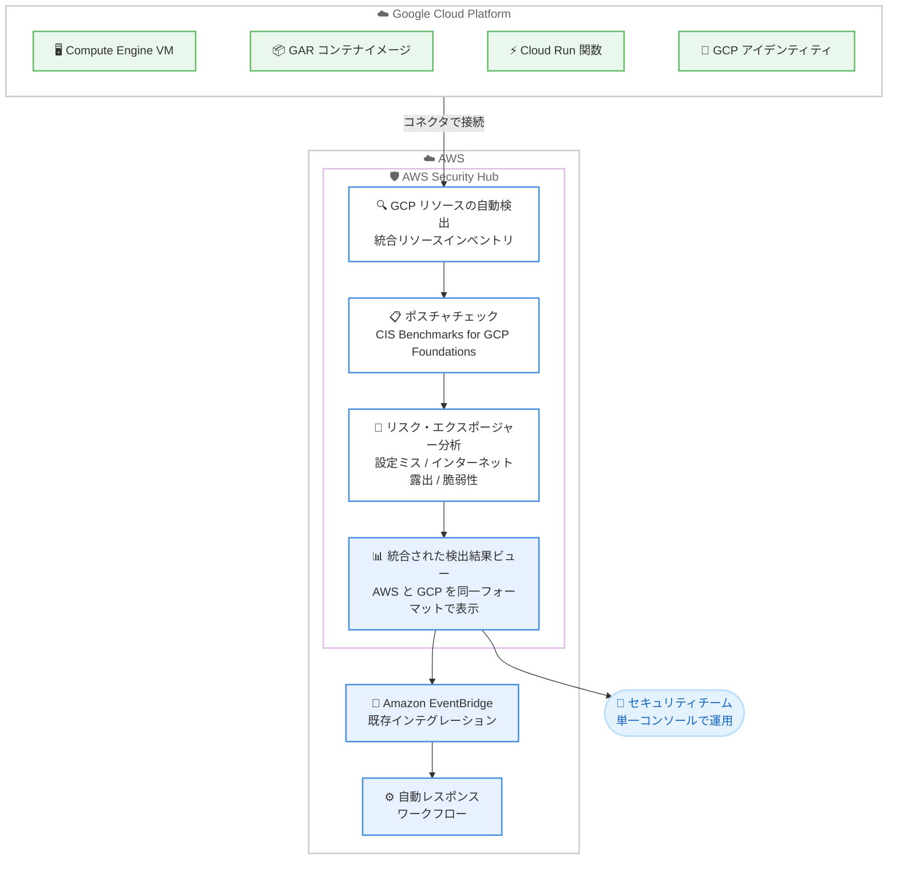

# AWS Security Hub - Google Cloud Platform への統合セキュリティ管理の拡張

**リリース日**: 2026 年 11 月 17 日
**サービス**: AWS Security Hub
**機能**: Google Cloud Platform (GCP) リソースのモニタリング対応

📊 [このアップデートのインフォグラフィックを見る](https://takech9203.github.io/aws-news-summary/20261117-security-hub-gcp.html)

## 概要

AWS Security Hub が Google Cloud Platform (GCP) リソースのモニタリングに対応し、リスク分析、クラウドセキュリティポスチャ管理 (CSPM)、脆弱性管理、セキュリティレスポンス管理を AWS と GCP の両クラウドに拡張しました。既存の Microsoft Azure 環境のモニタリングサポートに加えて、Security Hub は AWS と GCP の環境全体のリスクを単一の統合されたエクスペリエンスで検出し、対応できるようになります。

AWS と GCP の両方でワークロードを運用する多くのお客様は、これまで環境ごとに別々のセキュリティツールを運用する必要があり、リスクを全体的に優先順位付けしたり、一貫した対応を行ったりすることが困難でした。今回のアップデートにより、Security Hub は GCP リソースを自動的に検出し、設定ミス、インターネットへの露出、ソフトウェア脆弱性を評価します。AWS と GCP の検出結果は同じ優先順位付けされたビューに同じ検出結果フォーマットで表示され、同じ自動化ワークフローを利用できるため、セキュリティチームはツールを切り替えることなく 1 つのコンソールから運用できます。

GCP リソースのモニタリングには、GCP とのインテグレーション作成時に開始される独立した 30 日間の無料トライアルが含まれます。トライアル終了後は、同等の AWS リソースをモニタリングする場合と同じ料金で GCP リソースをモニタリングできます。

**アップデート前の課題**

- AWS と GCP でワークロードを運用する場合、環境ごとに別々のセキュリティツールを運用する必要があった
- クラウドごとにツールが分かれているため、組織全体のリスクを全体的に優先順位付けすることが困難だった
- 検出結果のフォーマットや対応ワークフローがツールごとに異なり、一貫したセキュリティ対応ができなかった

**アップデート後の改善**

- Security Hub が GCP リソースを自動的に検出し、設定ミス、インターネットへの露出、ソフトウェア脆弱性を評価できるようになった
- AWS と GCP の検出結果が同じ優先順位付けされたビューに同じフォーマットで表示され、1 つのコンソールから運用できるようになった
- 既存の Amazon EventBridge インテグレーションを通じて、GCP の検出結果にも自動対応を適用できるようになった

## アーキテクチャ図



Security Hub はコネクタを通じて GCP リソースを自動検出し、ポスチャチェックとリスク分析を実行します。AWS と GCP の検出結果は同じビューに統合され、既存の EventBridge インテグレーションによる自動レスポンスを利用できます。

## サービスアップデートの詳細

### 主要機能

1. **GCP リソースの自動検出と統合リソースインベントリ**
   - GCP の仮想マシン (Compute Engine VM)、Google Artifact Registry (GAR) のコンテナイメージ、Cloud Run 関数、GCP アイデンティティを自動的に検出
   - 検出したリソースを AWS リソースと合わせて統合リソースインベントリとして管理
   - API ではコネクタを使用して GCP の組織またはプロジェクトを接続し、セキュリティポスチャをモニタリング可能

2. **ポスチャチェックとリスク・エクスポージャー分析**
   - CIS Benchmarks for Google Cloud Platform Foundations を含むセキュリティ標準に対するポスチャチェックを提供
   - GCP リソースの設定ミス、インターネットへの露出、ソフトウェア脆弱性を評価
   - リスク分析とエクスポージャー分析により、両クラウドを横断してリスクを全体的に優先順位付け

3. **統合された検出結果ビューと自動レスポンス**
   - AWS と GCP の検出結果が同じ優先順位付けされたビューに、同じ検出結果フォーマットで表示される
   - 既存の EventBridge インテグレーションを通じた自動レスポンスを GCP の検出結果にも適用可能
   - 同じ自動化ワークフローを利用できるため、ツールを切り替えずに 1 つのコンソールから運用可能

4. **CSPM と脆弱性管理の独立したインテグレーション**
   - AWS Security Hub CSPM へのインテグレーション (ポスチャ管理チェック) を独立して作成可能
   - Amazon Inspector へのインテグレーション (脆弱性管理) を独立して作成可能
   - Amazon Inspector は GCP の Compute Engine VM インスタンス、GAR のコンテナイメージ、Cloud Run 関数に対する脆弱性管理に対応

## 技術仕様

### GCP モニタリングの対応範囲

| 項目 | 詳細 |
|------|------|
| 対象リソース | GCP 仮想マシン (VM)、Google Artifact Registry (GAR) コンテナイメージ、Cloud Run 関数、GCP アイデンティティ |
| 評価内容 | 設定ミス、インターネットへの露出、ソフトウェア脆弱性 |
| セキュリティ標準 | CIS Benchmarks for Google Cloud Platform Foundations を含む |
| 接続方法 | コネクタで GCP の組織またはプロジェクトを接続 |
| 検出結果フォーマット | AWS の検出結果と同じフォーマット・同じビューに統合 |
| 自動レスポンス | 既存の EventBridge インテグレーションを利用 |
| 無料トライアル | GCP とのインテグレーション作成時に開始される独立した 30 日間 |
| 独立インテグレーション | AWS Security Hub CSPM (ポスチャ管理)、Amazon Inspector (脆弱性管理) |

### API 変更履歴

| 日付 | サービス | 変更内容 |
|------|----------|----------|
| 2026/11/17 | [securityhub](https://awsapichanges.com/archive/changes/a370bc-securityhub.html) | 20 updated api methods - Google Cloud のサポートを追加。コネクタ API で GCP の組織またはプロジェクトを接続し、セキュリティポスチャをモニタリング可能 |
| 2026/11/17 | [inspector2](https://awsapichanges.com/archive/changes/a370bc-inspector2.html) | 11 updated api methods - 脆弱性管理を GCP の Compute Engine VM インスタンス、GAR のコンテナイメージ、Cloud Run 関数に拡張 |

## 設定方法

### 前提条件

1. AWS Security Hub が有効化されていること
2. 接続対象の Google Cloud Platform の組織またはプロジェクトへのアクセス権限があること
3. インテグレーションを作成する AWS リージョンが対応リージョンであること (利用可能リージョンのセクションを参照)

### 手順

#### ステップ 1: GCP とのインテグレーションを作成する

Security Hub コンソールから Google Cloud Platform とのインテグレーションを作成します。コネクタを使用して GCP の組織またはプロジェクトを接続します。インテグレーションの作成時点で、GCP リソースをモニタリングする独立した 30 日間の無料トライアルが開始されます。詳細な手順は [AWS Security Hub ドキュメント](https://docs.aws.amazon.com/securityhub/latest/userguide/what-is-securityhub-v2.html) を参照してください。

#### ステップ 2: GCP リソースの検出結果を確認する

インテグレーション作成後、Security Hub が GCP リソース (VM、GAR コンテナイメージ、Cloud Run 関数、アイデンティティ) を自動的に検出し、設定ミス、インターネットへの露出、ソフトウェア脆弱性を評価します。AWS と GCP の検出結果は同じ優先順位付けされたビューに表示されるため、統合リソースインベントリとあわせて確認します。

#### ステップ 3: 自動レスポンスを設定する

既存の EventBridge インテグレーションを通じて、GCP の検出結果に対する自動レスポンスを設定します。AWS の検出結果と同じフォーマット・同じ自動化ワークフローを利用できるため、既存の対応フローをそのまま適用できます。

#### ステップ 4: 必要に応じて CSPM と Inspector のインテグレーションを個別に作成する

ポスチャ管理チェックのみが必要な場合は AWS Security Hub CSPM への、脆弱性管理のみが必要な場合は Amazon Inspector への GCP インテグレーションを、AWS Security Hub とは独立して作成できます。

## メリット

### ビジネス面

- **マルチクラウドセキュリティ運用の一元化**: AWS、GCP、Azure のセキュリティを 1 つのコンソールで管理でき、環境ごとに別々のツールを運用するコストと負荷を削減できる
- **リスクの全体的な優先順位付け**: 両クラウドの検出結果が同じ優先順位付けされたビューに表示されるため、組織全体で最も重要なリスクから対応できる
- **導入リスクの低減**: 独立した 30 日間の無料トライアルにより、コストをかけずに GCP モニタリングの価値を評価できる

### 技術面

- **自動リソース検出**: GCP の VM、GAR コンテナイメージ、Cloud Run 関数、アイデンティティを自動的に検出し、手動でのインベントリ管理が不要
- **統一された検出結果フォーマット**: AWS と GCP の検出結果が同じフォーマットで提供されるため、既存の分析・対応プロセスを変更せずに適用できる
- **既存の自動化資産の再利用**: EventBridge インテグレーションによる既存の自動レスポンスワークフローを GCP の検出結果にもそのまま活用できる

## デメリット・制約事項

### 制限事項

- 中東 (UAE)、中東 (バーレーン)、アジアパシフィック (台北)、アジアパシフィック (ニュージーランド) の各リージョンからは GCP とのインテグレーションを作成できない
- 発表時点で対象として明示されている GCP リソースは、VM、GAR コンテナイメージ、Cloud Run 関数、アイデンティティである
- 無料トライアルは 30 日間で、トライアル終了後は GCP リソースのモニタリングに料金が発生する

### 考慮すべき点

- GCP の組織またはプロジェクトを接続するため、GCP 側でのアクセス権限の設定と管理が必要になる
- トライアル終了後の料金は、同等の AWS リソースをモニタリングする場合と同じ料金体系であるため、モニタリング対象の GCP リソース量に応じたコストを事前に見積もることが望ましい
- ポスチャ管理のみ、または脆弱性管理のみが必要な場合は、Security Hub CSPM または Amazon Inspector の独立したインテグレーションの利用を検討する

## ユースケース

### ユースケース 1: AWS と GCP のマルチクラウド環境におけるセキュリティ運用の統合

**シナリオ**: AWS をメインに利用しつつ、データ分析ワークロードを GCP で運用している企業で、セキュリティチームが環境ごとに別々のツールを使用しており、運用負荷が高くリスクの見落としが懸念されている。

**実装例**:
```
1. Security Hub から GCP 組織とのインテグレーションを作成
2. GCP リソース (VM、GAR、Cloud Run、アイデンティティ) の
   自動検出と統合リソースインベントリを確認
3. AWS と GCP の検出結果を同じ優先順位付けされた
   ビューで確認し、対応順序を決定
```

**効果**: セキュリティチームがツールを切り替えることなく、1 つのコンソールから両クラウドのリスクを全体的に優先順位付けして対応できる。

### ユースケース 2: CIS Benchmarks に基づく GCP 環境のポスチャ管理

**シナリオ**: コンプライアンス要件として CIS Benchmarks への準拠が求められており、AWS 環境は Security Hub CSPM でチェックしているが、GCP 環境は手動監査に頼っている。

**実装例**:
```
1. GCP プロジェクトとのインテグレーションを作成
2. CIS Benchmarks for Google Cloud Platform Foundations に
   対するポスチャチェックの結果を確認
3. 設定ミスやインターネットへの露出が検出されたリソースを
   優先的に是正
```

**効果**: GCP 環境のポスチャチェックが自動化され、AWS 環境と同じ運用プロセスで CIS Benchmarks への準拠状況を継続的に把握できる。

### ユースケース 3: EventBridge を活用した GCP 検出結果への自動対応

**シナリオ**: AWS の検出結果に対しては EventBridge 経由でチケット起票や通知の自動化を構築済みだが、GCP の検出結果は手動でトリアージしており対応が遅れがちになっている。

**実装例**:
```
1. GCP とのインテグレーションを作成し、GCP の検出結果を
   Security Hub に集約
2. 既存の EventBridge ルールの対象に GCP の検出結果を含める
   (検出結果フォーマットは AWS と共通)
3. 重要度の高い検出結果について、チケット起票・通知・
   修復ワークフローを自動実行
```

**効果**: 既存の自動化資産を再利用して GCP の検出結果にも一貫した自動対応を適用でき、対応までの時間を短縮できる。

## 料金

GCP リソースのモニタリングには、GCP とのインテグレーション作成時に開始される独立した 30 日間の無料トライアルが含まれます。トライアル終了後は、同等の AWS リソースをモニタリングする場合と同じ料金で GCP リソースをモニタリングできます。

詳細は [AWS Security Hub 料金ページ](https://aws.amazon.com/security-hub/pricing/) を参照してください。

## 利用可能リージョン

Security Hub が利用可能なすべての AWS リージョンから GCP とのインテグレーションを作成できます。ただし、以下のリージョンは除きます。

- 中東 (UAE)
- 中東 (バーレーン)
- アジアパシフィック (台北)
- アジアパシフィック (ニュージーランド)

## 関連サービス・機能

- **AWS Security Hub CSPM**: GCP に対するポスチャ管理チェックのインテグレーションを、AWS Security Hub とは独立して作成可能
- **Amazon Inspector**: GCP の Compute Engine VM インスタンス、GAR コンテナイメージ、Cloud Run 関数に対する脆弱性管理のインテグレーションを独立して作成可能
- **Amazon EventBridge**: 既存のインテグレーションを通じて、GCP の検出結果に対する自動レスポンスを実現
- **Microsoft Azure モニタリング**: Security Hub は既に Azure 環境のモニタリングをサポートしており、今回の GCP 対応により 3 つのクラウドを横断する統合セキュリティ管理が可能

## 参考リンク

- 📊 [インフォグラフィック](https://takech9203.github.io/aws-news-summary/20261117-security-hub-gcp.html)
- [公式発表 (What's New)](https://aws.amazon.com/about-aws/whats-new/2026/11/security-hub-gcp/)
- [AWS Security Hub ドキュメント](https://docs.aws.amazon.com/securityhub/latest/userguide/what-is-securityhub-v2.html)
- [料金ページ](https://aws.amazon.com/security-hub/pricing/)
- [AWS Security Hub 製品ページ](https://aws.amazon.com/security-hub/)

## まとめ

AWS Security Hub が GCP リソースのモニタリングに対応し、既存の Azure サポートとあわせて、マルチクラウド環境のセキュリティを 1 つのコンソールで統合管理できるようになりました。AWS と GCP の検出結果が同じフォーマット・同じビューに統合され、既存の EventBridge 自動化をそのまま活用できる点が大きな価値です。AWS と GCP の両方でワークロードを運用している場合は、独立した 30 日間の無料トライアルを利用して、統合セキュリティ管理の効果を評価することを推奨します。
