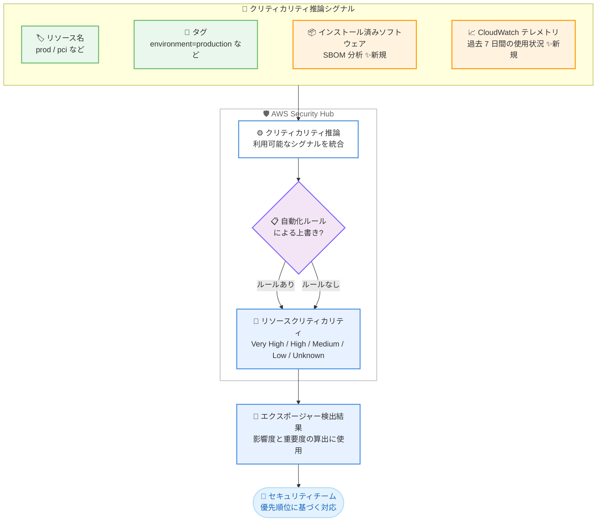

# AWS Security Hub - インストール済みソフトウェアと使用状況によるリソースクリティカリティの推論

**リリース日**: 2026 年 11 月 17 日
**サービス**: AWS Security Hub
**機能**: インストール済みソフトウェアとリソース使用状況に基づくリソースクリティカリティの推論

📊 [このアップデートのインフォグラフィックを見る](https://takech9203.github.io/aws-news-summary/20261117-security-hub-resource-criticality.html)

## 概要

AWS Security Hub が、リソースクリティカリティ (リソースがビジネスにとってどれだけ重要かを示す指標) を判定するシグナルとして、インストール済みソフトウェアとリソース使用状況を追加しました。Security Hub はクリティカリティを使用してエクスポージャー検出結果 (exposure findings) をランク付けするため、中央のセキュリティチームは最も重要なリソースに影響するエクスポージャーを優先的に対処できます。

Security Hub はこれまでも、リソースのタグと名前からクリティカリティを推論していました。しかし、タグ付けが一貫していないリソースはクリティカリティが「Unknown」となることが多く、そのエクスポージャーの優先順位付けが困難でした。今回のアップデートにより、インストール済みソフトウェアとリソース使用状況が追加シグナルとなり、タグ付けや設定を一切行わなくても、より多くのリソースが意味のあるクリティカリティを受け取れるようになります。例えば、データベースエンジンを実行し安定したトラフィックを処理している EC2 インスタンスは、監視エージェントのみを実行しアイドル状態のインスタンスよりも高いクリティカリティを受け取ります。

これらのシグナルは Security Hub Essentials プランに追加料金なしで含まれており、新たな有効化作業も不要です。

**アップデート前の課題**

- クリティカリティの推論はリソースのタグと名前のみに依存していた
- タグ付けが一貫していないリソースはクリティカリティが「Unknown」となり、エクスポージャーの優先順位付けが困難だった
- 意味のあるクリティカリティを得るには、組織全体で一貫したタグ付け運用が必要だった

**アップデート後の改善**

- インストール済みソフトウェア (SBOM) とリソース使用状況 (CloudWatch メトリクス) が推論シグナルに追加された
- タグ付けや追加設定なしで、より多くのリソースが意味のあるクリティカリティを受け取れるようになった
- クリティカリティに基づくエクスポージャー検出結果のランク付けの精度が向上し、重要なリソースへの対応を優先できるようになった

## アーキテクチャ図



Security Hub は 4 種類のシグナル (リソース名、タグ、インストール済みソフトウェア、CloudWatch テレメトリ) を統合して各リソースのクリティカリティを推論し、エクスポージャー検出結果の重要度算出に利用します。自動化ルールが設定されている場合は、推論結果よりもルールが常に優先されます。

## サービスアップデートの詳細

### 主要機能

1. **インストール済みソフトウェアによる推論 (新規シグナル)**
   - Security Hub がモニタリングするコンピューティングリソースについて、ソフトウェア部品表 (SBOM) を分析し、リソース上にインストールされているソフトウェアを特定
   - データベースエンジン、ID・アクセスサービス、メッセージブローカーなどを実行するリソースは、監視エージェントのみを実行するリソースよりも高いクリティカリティと判定される
   - クリティカリティの根拠として「データを保存するソフトウェアを実行している」といった理由が記録される

2. **CloudWatch テレメトリによる推論 (新規シグナル)**
   - リクエスト数、呼び出し数、メッセージ数、消費キャパシティ、データベース接続数、ネットワークトラフィックなど、リソース使用状況を測定する Amazon CloudWatch メトリクスを読み取る
   - 過去 7 日間の使用状況を、同一アカウント・同一リージョン内の同じタイプの他リソースと比較して相対的に評価
   - メトリクスはクリティカリティの推論のみに使用され、メトリクス値自体は表示されない

3. **複数シグナルの統合とソースの可視化**
   - リソースで利用可能なシグナルを 1 つのクリティカリティに統合。利用できないシグナルがあってもクリティカリティが下がることはない
   - リソース詳細の「How this was determined」から、どのソースがクリティカリティを決定したか、および各ソースの理由を確認可能
   - リソース固有のシグナルが見つからない場合のクリティカリティは「Unknown」となり、リソースタイプのみに基づく判定は行われない

4. **自動化ルールによる上書き**
   - 自動化ルールを作成して、条件に一致するリソースにクリティカリティを明示的に設定可能
   - 自動化ルールは推論されたクリティカリティよりも常に優先される
   - ルールで設定された場合、推論されたシグナルは「Inferred signals (overridden)」として表示される

## 技術仕様

### クリティカリティ推論の仕様

| 項目 | 詳細 |
|------|------|
| クリティカリティのレベル | Very High、High、Medium、Low、Unknown |
| 推論シグナル | リソース名、タグ、インストール済みソフトウェア (新規)、CloudWatch テレメトリ (新規) |
| ソフトウェア分析の情報源 | ソフトウェア部品表 (SBOM) |
| 使用状況の評価期間 | 過去 7 日間 |
| 使用状況の比較対象 | 同一アカウント・同一リージョン内の同じリソースタイプ |
| 上書き方法 | 自動化ルール (推論よりも常に優先) |
| エクスポージャー検出結果への影響 | 影響度と重要度の算出に使用 (Unknown は影響しない) |
| 対象プラン | Security Hub Essentials (追加料金なし、有効化作業不要) |

### API の対応

API では [GetResourcesV2](https://docs.aws.amazon.com/securityhub/1.0/APIReference/API_GetResourcesV2.html) オペレーションが `ResourceCriticality` でクリティカリティを返し、`CriticalitySources` でソースの一覧を返します。各ソースは `Source` と `Reason` を持ちます。

| Source の値 | 意味 |
|------|------|
| `AutomationRule` | 自動化ルールによる設定 |
| `ResourceName` | リソース名からの推論 |
| `TagInference` | タグからの推論 |
| `InstalledSoftwareAndPackageInference` | インストール済みソフトウェアからの推論 (新規) |
| `CloudWatchTelemetryInference` | CloudWatch テレメトリからの推論 (新規) |

### API 変更履歴

| 日付 | サービス | 変更内容 |
|------|----------|----------|
| 2026/11/17 | [securityhub](https://awsapichanges.com/archive/changes/a370bc-securityhub.html) | 20 updated api methods - タグ、CloudWatch メトリクス、SBOM データからのリソースクリティカリティ推論のサポートを追加 |

## 設定方法

### 前提条件

1. AWS Security Hub (Essentials プラン) が有効化されていること
2. リソースインベントリが利用可能であること (Security Hub はサービスリンク設定レコーダーを通じて AWS リソースを記録)
3. 組織全体のリソースを確認する場合は、委任された管理者アカウントを使用すること

### 手順

#### ステップ 1: リソースのクリティカリティを確認する

Security Hub コンソールの [Resources] ページを開き、[Criticality] 列で各リソースのクリティカリティを確認します。[Resource criticality] でソート、フィルタリング、グループ化が可能です。新しいシグナルは自動的に適用されるため、有効化作業は不要です。

#### ステップ 2: クリティカリティの判定根拠を確認する

リソースを選択して詳細を開き、クリティカリティの横にある [How this was determined] を選択します。[Resource criticality] パネルに、各ソース (Automation rule、Tags、Resource name、Installed software and packages、CloudWatch telemetry) とその判定理由が表示されます。例えば、CloudWatch テレメトリのソースには「このアカウントとリージョンの 40 個の Lambda 関数の中で使用状況は 92 パーセンタイル」といった理由が表示されます。

#### ステップ 3: API でクリティカリティを取得する

```bash
aws securityhub get-resources-v2 \
  --filters '{"CompositeFilters": [{"StringFilters": [{"FieldName": "resource_criticality", "Filter": {"Value": "VERY_HIGH", "Comparison": "EQUALS"}}]}]}'
```

GetResourcesV2 API を使用して、クリティカリティが Very High のリソースを抽出しています。レスポンスの `ResourceCriticality` フィールドにクリティカリティが、`CriticalitySources` フィールドに判定ソースと理由が含まれます。

#### ステップ 4: 必要に応じて自動化ルールで上書きする

推論結果がビジネス上の重要度と一致しない場合は、自動化ルールを作成して、条件に一致するリソースにクリティカリティを明示的に設定します。自動化ルールは推論されたクリティカリティよりも常に優先されます。

## メリット

### ビジネス面

- **優先順位付けの精度向上**: 最も重要なリソースに影響するエクスポージャーから対応できるため、限られたセキュリティリソースを効果的に配分できる
- **タグ運用への依存を軽減**: 一貫したタグ付けが行われていない環境でも、意味のあるクリティカリティが自動的に付与される
- **追加コストなし**: Security Hub Essentials プランに追加料金なしで含まれ、新たな有効化作業も不要

### 技術面

- **実態に基づく評価**: 実際にインストールされているソフトウェアと実際の使用状況という客観的なシグナルに基づいてクリティカリティが判定される
- **判定根拠の透明性**: どのソースがクリティカリティを決定したか、および各ソースの理由を確認できる
- **柔軟な上書き**: 自動化ルールにより、組織固有の基準でクリティカリティを明示的に制御できる

## デメリット・制約事項

### 制限事項

- インストール済みソフトウェアの分析は、Security Hub がモニタリングするコンピューティングリソースが対象
- CloudWatch テレメトリの比較は、同一アカウント・同一リージョン内の同じリソースタイプとの相対評価であり、メトリクスの値自体は表示されない
- リソース固有のシグナルが見つからない場合、クリティカリティは「Unknown」のままとなる (リソースタイプのみでの判定は行われない)

### 考慮すべき点

- 使用状況やインストール済みソフトウェアなどのシグナルは時間とともに変化するため、リソースのクリティカリティも変化する可能性がある
- エクスポージャー検出結果の重要度には、その検出結果を評価した時点のクリティカリティが使用されるため、再評価されるまで現在のクリティカリティと重要度が一致しない場合がある
- 推論結果が組織のビジネス上の重要度と異なる場合は、自動化ルールでの上書きを検討する必要がある

## ユースケース

### ユースケース 1: タグ付けが不完全な環境でのエクスポージャー優先順位付け

**シナリオ**: 複数のアカウントを運用する組織で、タグ付けポリシーの適用が徹底されておらず、多くのリソースのクリティカリティが「Unknown」となっている。中央のセキュリティチームは、どのエクスポージャーから対応すべきか判断に迷っている。

**実装例**:
```
1. Security Hub コンソールの [Resources] ページで
   [Resource criticality] によるグループ化を実施
2. 新しいシグナルにより Very High / High と判定された
   リソースのエクスポージャー検出結果を確認
3. [Impact assessment] タブでリソースクリティカリティを
   確認し、対応順序を決定
```

**効果**: タグ付けの整備を待たずに、データベースエンジンを実行し高トラフィックを処理するリソースなど、ビジネス上重要なリソースのエクスポージャーから優先的に対応できる。

### ユースケース 2: アイドルリソースと本番リソースの切り分け

**シナリオ**: 開発者が検証用に起動したまま放置している EC2 インスタンスと、本番ワークロードを処理するインスタンスが同一アカウントに混在しており、同じ脆弱性が検出された場合にどちらを先に修正すべきか判断したい。

**実装例**:
```
1. リソース詳細の [How this was determined] で判定根拠を確認
   - 本番インスタンス: データベースエンジンを実行、
     使用状況が高パーセンタイル → High 以上
   - 検証用インスタンス: 監視エージェントのみ、
     アイドル状態 → 低いクリティカリティ
2. エクスポージャー検出結果の重要度に基づき
   本番インスタンスの修正を優先
```

**効果**: 同じ脆弱性でも、実際の使用状況とインストール済みソフトウェアに基づいて修正の優先順位を合理的に決定できる。

### ユースケース 3: 自動化ルールと推論の組み合わせによる運用

**シナリオ**: 基幹システムのリソースには明示的に Very High を設定しつつ、それ以外のリソースは自動推論に任せたい。

**実装例**:
```
1. 基幹システムのリソースに一致する条件 (タグやアカウント ID) で
   自動化ルールを作成し、クリティカリティを Very High に設定
2. その他のリソースは、ソフトウェアと使用状況を含む
   推論シグナルによる自動判定に任せる
3. GetResourcesV2 API の CriticalitySources で
   設定ソース (AutomationRule / 推論) を定期的に監査
```

**効果**: 明示的な管理が必要な重要リソースと、自動推論で十分なリソースを組み合わせた、運用負荷の低いクリティカリティ管理を実現できる。

## 料金

今回追加されたシグナル (インストール済みソフトウェアと CloudWatch テレメトリ) は、Security Hub Essentials プランに追加料金なしで含まれます。新たな有効化作業も不要です。

Security Hub 自体の料金の詳細は [AWS Security Hub 料金ページ](https://aws.amazon.com/security-hub/pricing/) を参照してください。

## 利用可能リージョン

Security Hub が利用可能なすべての AWS リージョンで利用できます。詳細は [AWS リージョン別サービス表](https://aws.amazon.com/about-aws/global-infrastructure/regional-product-services/) を参照してください。

## 関連サービス・機能

- **Amazon CloudWatch**: リソース使用状況の測定に使用されるメトリクス (リクエスト数、呼び出し数、消費キャパシティなど) を提供。Security Hub はこれらを読み取ってクリティカリティを推論する
- **ソフトウェア部品表 (SBOM)**: Security Hub がコンピューティングリソース上のインストール済みソフトウェアを特定するために分析する情報。2026 年 11 月には SBOM 関連の新 API (GetSoftwareV2 など) もリリースされている
- **Security Hub 自動化ルール**: 推論されたクリティカリティを明示的に上書きする手段。ルールは推論よりも常に優先される
- **エクスポージャー検出結果**: クリティカリティが影響度と重要度の算出に使用される検出結果。[Impact assessment] タブでリソースクリティカリティを確認できる

## 参考リンク

- 📊 [インフォグラフィック](https://takech9203.github.io/aws-news-summary/20261117-security-hub-resource-criticality.html)
- [公式発表 (What's New)](https://aws.amazon.com/about-aws/whats-new/2026/11/security-hub-resource-criticality/)
- [ドキュメント: Resources in Security Hub](https://docs.aws.amazon.com/securityhub/latest/userguide/resources-adv.html)
- [AWS Security Hub 製品ページ](https://aws.amazon.com/security-hub/)
- [料金ページ](https://aws.amazon.com/security-hub/pricing/)
- [AWS リージョン別サービス表](https://aws.amazon.com/about-aws/global-infrastructure/regional-product-services/)

## まとめ

AWS Security Hub のリソースクリティカリティ推論に、インストール済みソフトウェアとリソース使用状況という実態に基づくシグナルが追加され、タグ付けが不完全な環境でもエクスポージャー検出結果の優先順位付けの精度が大幅に向上しました。Security Hub Essentials プランで追加料金・追加設定なしに利用できるため、まずは [Resources] ページでクリティカリティとその判定根拠を確認し、必要に応じて自動化ルールによる上書きを検討することを推奨します。
