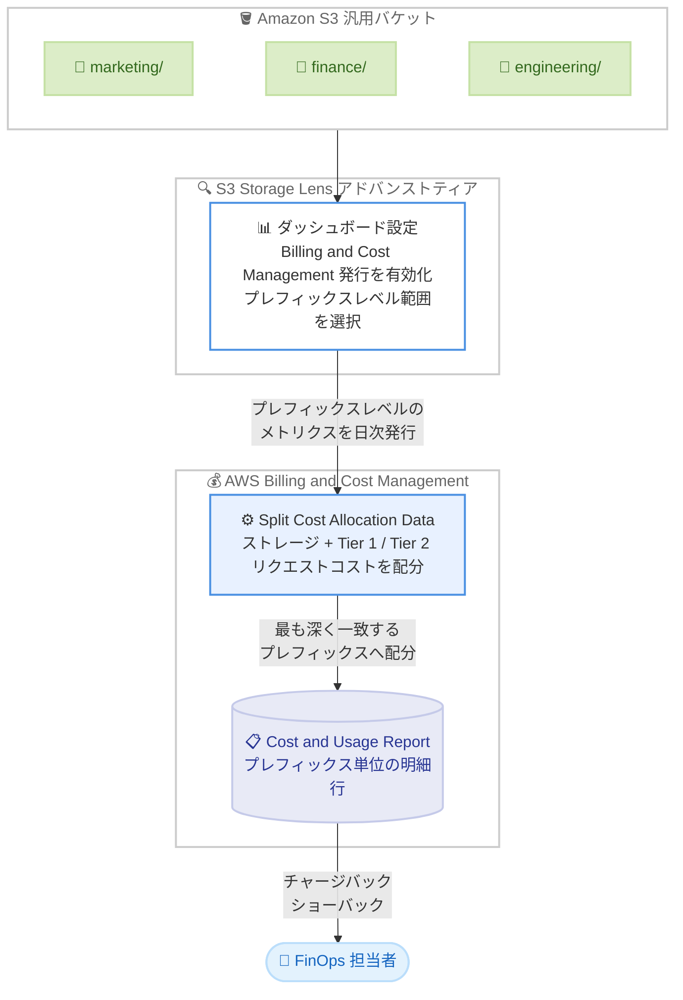

# AWS Billing and Cost Management - Split Cost Allocation Data の Amazon S3 対応

**リリース日**: 2026 年 11 月 17 日
**サービス**: AWS Billing and Cost Management (AWS Cost and Usage Report)、Amazon S3
**機能**: Split Cost Allocation Data for Amazon S3

📊 [このアップデートのインフォグラフィックを見る](https://takech9203.github.io/aws-news-summary/20261117-split-cost-allocation-data-s3.html)

## 概要

AWS Split Cost Allocation Data が Amazon S3 に対応しました。共有された Amazon S3 汎用バケットのストレージコストとリクエストコストを、バケット内のプレフィックス単位で AWS Cost and Usage Report (CUR) に配分できるようになります。

多くの組織では、`marketing/` や `finance/` のように異なるプレフィックスを使用して、1 つのバケットに複数のチーム、アプリケーション、テナントのデータを格納しています。今回のアップデートにより、Amazon S3 Storage Lens がプレフィックスレベルのストレージおよびリクエストメトリクスを AWS Billing and Cost Management に発行し、Billing and Cost Management がバケットのストレージコストと Tier 1 / Tier 2 リクエストコストを、選択したプレフィックスレベルの範囲内で最も深く一致するプレフィックスに配分します。各プレフィックスの明細行には完全なプレフィックスパスが AWS 生成コスト配分タグとして付与されるため、トップレベルプレフィックス、チーム、アプリケーション単位でコストを集計し、バケット全体の請求額と照合できます。

チャージバック (コスト請求) やショーバック (コスト可視化) の実現、S3 コストを押し上げているプレフィックスの特定に活用できる、FinOps 担当者や共有バケットを運用する組織向けのアップデートです。

**アップデート前の課題**

このアップデート以前は、共有バケットのコストをプレフィックス単位で把握するために多くの作業が必要でした。

- CUR ではバケット単位のコストしか確認できず、プレフィックス単位でのコスト配分ができなかった
- プレフィックス単位の配分には、S3 Inventory や Storage Lens レポートを基にしたカスタムパイプラインの構築が必要だった
- 料金計算ロジックを自前で実装・保守する必要があり、正確なチャージバックの実現が困難だった

**アップデート後の改善**

今回のアップデートにより、マネージドな仕組みでプレフィックス単位のコスト配分が可能になりました。

- CUR 上でプレフィックス単位のストレージコストと Tier 1 / Tier 2 リクエストコストを直接確認できるようになった
- カスタムパイプラインや独自の料金計算ロジックが不要になった
- AWS 生成コスト配分タグ (`aws:s3:PrefixLevel1` 〜 `aws:s3:PrefixLevel15`、`aws:s3:BucketName`) により、チームやアプリケーション単位の集計が容易になった

## アーキテクチャ図



S3 Storage Lens がプレフィックスレベルのメトリクスを AWS Billing and Cost Management に発行し、Billing and Cost Management がバケットのコストをプレフィックス単位に配分して CUR に明細行として出力する流れを示しています。

## サービスアップデートの詳細

### 主要機能

1. **プレフィックス単位のコスト配分**
   - 汎用バケットのストレージコスト (全ストレージクラス対象) と Tier 1 / Tier 2 リクエストコストを、バケット内のプレフィックスに配分
   - 選択したプレフィックスレベル範囲内で、最も深く一致するプレフィックスにコストを割り当て
   - バケット自体の明細行は合計の使用量とコストを保持したまま、追加の明細行として配分結果を出力

2. **プレフィックスレベル範囲の選択**
   - S3 Storage Lens ダッシュボード設定で `MinDepth` と `MaxDepth` (いずれも 1〜15 の整数) を指定し、コストを報告するプレフィックスの深さの範囲を選択
   - 未指定の場合のデフォルトは `MinDepth`=1、`MaxDepth`=3
   - `MaxDepth` - `MinDepth` は最大 4 (最大 5 つの隣接するプレフィックスレベルを報告可能)

3. **AWS 生成コスト配分タグ**
   - プレフィックスの明細行に `aws:s3:PrefixLevel1` 〜 `aws:s3:PrefixLevel15` タグが付与され、最も深く一致したレベルまでのプレフィックスパスの各セグメントを保持
   - `aws:s3:BucketName` タグにバケット名を保持
   - これらのタグはデフォルトで非アクティブのため、Billing and Cost Management コンソールのコスト配分タグページでアクティブ化が必要 (反映まで最大 24 時間)

4. **未配分コストの明示**
   - プレフィックスに属さないルートレベルオブジェクトのコストなど、配分されなかった S3 コストはバケットレベルの未配分 (unattributed) カテゴリとして記録
   - 未配分の明細行では `aws:s3:PrefixLevel1` の値は `(unattributed)` となる

## 技術仕様

### 機能仕様

| 項目 | 詳細 |
|------|------|
| 対象バケット | 汎用バケットのみ (ディレクトリバケット、テーブルバケット、ベクターバケットは対象外) |
| 配分対象コスト | ストレージコスト (全ストレージクラス)、Tier 1 / Tier 2 リクエストコスト |
| プレフィックス区切り文字 | S3 Storage Lens 設定の `PrefixDelimiter` は `/` (スラッシュ) である必要あり |
| プレフィックスレベル | 1〜15、報告範囲は最大 5 つの隣接レベル |
| プレフィックス数上限 | 設定した深さにおいてバケットあたり 10,000 プレフィックスまで (超過時はより浅いレベルへフォールバック) |
| 明細行の粒度 | 日次 (時間単位ではない)。使用量のないプレフィックスには明細行なし |
| 設定 API | S3 Storage Lens 設定の `CostAndUsageReportsPublish` メンバー |
| 有効化可能なアカウント | AWS Organizations の管理アカウント、またはスタンドアロンアカウント |

### API 変更履歴

今回のアップデートに直接対応する API 変更は、AWS API Changes フィード (直近 7 日間) には含まれていません。機能の設定は既存の S3 Storage Lens 設定 API に追加された `CostAndUsageReportsPublish` メンバーと、Billing and Cost Management コンソールの Cost Management preferences で行います。

### 明細行数の見積もり式

```text
月間の追加明細行数 = (使用量のあるプレフィックス数 + 1) × 使用量のある使用タイプ数 (最大 2) × 月の日数
```

例: 最深レベルに 2,000 プレフィックスがあり、毎日ストレージとリクエストの両方の使用がある場合、30 日間で最大 (2,000 + 1) × 2 × 30 = 120,060 行が追加されます。

## 設定方法

### 前提条件

1. S3 Storage Lens のアドバンストティアダッシュボードを使用していること (無料ティアでは利用不可)
2. S3 Storage Lens 設定の `PrefixDelimiter` が `/` であること
3. Split Cost Allocation Data の有効化は、AWS Organizations の管理アカウントまたはスタンドアロンアカウントから行うこと
4. CUR (レガシー CUR または CUR 2.0) のエクスポート設定で Split Cost Allocation Data とリソース ID を含めること

### 手順

#### ステップ 1: S3 Storage Lens で Billing and Cost Management 発行を有効化

S3 コンソールの Storage Lens ダッシュボード設定 (アドバンストティア) で、AWS Billing and Cost Management への発行を有効化し、対象バケットとプレフィックスレベルの範囲 (`MinDepth` / `MaxDepth`) を選択します。API で設定する場合は、Storage Lens 設定の `CostAndUsageReportsPublish` メンバーを使用します。

#### ステップ 2: Billing and Cost Management で Split Cost Allocation Data を有効化

AWS Billing and Cost Management コンソールの Cost Management preferences で、Split Cost Allocation Data の対象として Amazon S3 を選択します。あわせて、CUR エクスポート設定で Split Cost Allocation Data とリソース ID を含めるよう構成します。

#### ステップ 3: コスト配分タグのアクティブ化と CUR の確認

Billing and Cost Management コンソールのコスト配分タグページで、`aws:s3:PrefixLevel1` 〜 `aws:s3:PrefixLevel15` および `aws:s3:BucketName` タグをアクティブ化します (反映まで最大 24 時間)。次回の日次 Storage Lens メトリクス発行後、プレフィックスのコストデータが CUR に表示されます。

## メリット

### ビジネス面

- **チャージバック / ショーバックの実現**: 共有バケットのコストをチーム、アプリケーション、テナント単位で正確に配賦でき、コストの説明責任を明確化できる
- **コスト最適化の促進**: どのプレフィックスが S3 コストを押し上げているかを特定し、ライフサイクルポリシーやストレージクラスの見直しなど、的を絞った最適化が可能になる
- **運用コストの削減**: カスタムパイプラインの構築・保守や独自の料金計算ロジックが不要になり、FinOps チームの工数を削減できる

### 技術面

- **マネージドな配分処理**: S3 Storage Lens のメトリクスを基に Billing and Cost Management が自動でコストを計算・配分するため、独自実装が不要
- **CUR との統合**: 既存の CUR 分析基盤 (Amazon Athena、Amazon QuickSight など) をそのまま活用してプレフィックス単位の分析が可能
- **タグベースの柔軟な集計**: AWS 生成コスト配分タグにより、任意のプレフィックスレベルでの集計やバケット全体との照合が容易

## デメリット・制約事項

### 制限事項

- 汎用バケットのみ対応 (ディレクトリバケット、テーブルバケット、ベクターバケットは対象外)
- 配分対象はストレージコストと Tier 1 / Tier 2 リクエストコストのみ。アノテーションのストレージ / リクエストコスト、クロスリージョンレプリケーションのリクエストコストは含まれない
- 設定した深さでバケットあたり 10,000 プレフィックスまで。超過した場合はより浅いレベル (最小 `MinDepth`) にフォールバックし、`MinDepth` のレベルでも超過する場合はそのバケットのプレフィックスコストデータは生成されない
- 報告できるのは最大 5 つの隣接するプレフィックスレベル (`MaxDepth` - `MinDepth` は 4 以内)
- S3 Storage Lens アドバンストティアが必要 (無料ティアでは利用不可)

### 考慮すべき点

- Requester Pays が有効なバケットでは、バケット所有者以外の AWS アカウントからのリクエストの割合が大きい場合、プレフィックスレベルのリクエストコスト見積もりの精度が低下する
- プレフィックスに属さないルートレベルオブジェクトのコストは未配分カテゴリに計上されるため、ルート直下へのオブジェクト配置が多いバケットでは配分されないコストが増える
- プレフィックス数が多いバケットでは CUR の明細行数が大きく増加するため、CUR を分析する際のクエリコストやデータ量に注意が必要
- コストはあくまで見積もり (estimated cost) であり、正式な請求額の算出基盤ではない

## ユースケース

### ユースケース 1: マルチテナント SaaS におけるテナント別チャージバック

**シナリオ**: SaaS 事業者が 1 つの共有バケットに `tenant-a/`、`tenant-b/` のようにテナントごとのプレフィックスでデータを格納しており、各テナントへの正確なコスト請求が必要。

**実装例**:
```text
1. Storage Lens アドバンストティアダッシュボードで対象バケットの
   Billing and Cost Management 発行を有効化 (MinDepth=1, MaxDepth=1)
2. Billing and Cost Management で Split Cost Allocation Data の
   Amazon S3 を有効化
3. CUR を Athena でクエリし、aws:s3:PrefixLevel1 タグで
   テナント別にコストを集計
```

**効果**: テナントごとのストレージ / リクエストコストを日次で把握でき、使用量に応じた正確な課金やコスト按分が可能になる。

### ユースケース 2: 部門別ショーバックによるコスト意識の向上

**シナリオ**: データレイク用の共有バケットに `marketing/`、`finance/`、`engineering/` のように部門別プレフィックスでデータを格納しており、部門ごとのコストを可視化したい。

**実装例**:
```text
1. MinDepth=1、MaxDepth=3 でプレフィックスレベルの発行を設定
2. aws:s3:PrefixLevel1 〜 aws:s3:PrefixLevel3 タグをアクティブ化
3. QuickSight ダッシュボードで部門別・プロジェクト別の
   コスト推移を可視化し、各部門に共有
```

**効果**: 部門ごとの S3 コストが可視化され、不要データの削除やライフサイクルポリシー適用など、各部門の自発的なコスト最適化を促進できる。

### ユースケース 3: コストを押し上げているプレフィックスの特定と最適化

**シナリオ**: S3 のコストが増加傾向にあるが、バケット単位のコストしか見えず、どのワークロードが原因か特定できない。

**実装例**:
```text
1. コストが大きいバケットで Billing and Cost Management 発行を有効化
2. CUR をクエリし、プレフィックス別のストレージコストと
   Tier 1 / Tier 2 リクエストコストをランキング
3. コスト上位のプレフィックスに対して、ストレージクラスの変更や
   S3 ライフサイクルポリシーの適用を検討
```

**効果**: コスト増加の原因となっているプレフィックス (ワークロード) をデータに基づいて特定し、効果の大きい箇所から優先的に最適化できる。

## 料金

Split Cost Allocation Data for Amazon S3 自体に追加料金はありません。S3 Storage Lens アドバンストティアの料金のみが適用されます。Billing and Cost Management への発行自体にも追加料金はかかりません。

S3 Storage Lens アドバンストティアの料金の詳細は [Amazon S3 の料金ページ](https://aws.amazon.com/s3/pricing/) を参照してください。

## 利用可能リージョン

S3 Storage Lens アドバンストメトリクスが利用可能なすべての AWS 商用リージョンで利用できます。

## 関連サービス・機能

- **Amazon S3 Storage Lens**: プレフィックスレベルのストレージ / リクエストメトリクスを Billing and Cost Management に発行する役割を担う。アドバンストティアが必要
- **AWS Cost and Usage Report (CUR)**: プレフィックス単位の明細行が出力される先。レガシー CUR と CUR 2.0 の両方に対応
- **Split Cost Allocation Data (ECS / EKS / ネットワーキング)**: 既存の Split Cost Allocation Data は ECS タスク / EKS ポッド単位のコンテナコスト配分や、NAT ゲートウェイなど共有ネットワークリソースのコスト配分に対応しており、今回 S3 が追加された
- **AWS コスト配分タグ**: `aws:s3:PrefixLevel1` 〜 `aws:s3:PrefixLevel15`、`aws:s3:BucketName` の AWS 生成タグを使用してコストを集計

## 参考リンク

- 📊 [インフォグラフィック](https://takech9203.github.io/aws-news-summary/20261117-split-cost-allocation-data-s3.html)
- [公式発表 (What's New)](https://aws.amazon.com/about-aws/whats-new/2026/11/split-cost-allocation-data-s3/)
- [AWS Cost and Usage Reports 製品ページ](https://aws.amazon.com/aws-cost-management/aws-cost-and-usage-reporting/)
- [ドキュメント: Understanding split cost allocation data](https://docs.aws.amazon.com/cur/latest/userguide/split-cost-allocation-data.html#split-cost-allocation-data-s3)
- [ドキュメント: Estimating Amazon S3 costs by prefix with S3 Storage Lens](https://docs.aws.amazon.com/AmazonS3/latest/userguide/storage-lens-cost-and-usage-reports.html)
- [料金ページ: Amazon S3 pricing](https://aws.amazon.com/s3/pricing/)

## まとめ

共有 S3 バケットのプレフィックス単位コスト配分が、カスタムパイプライン不要のマネージド機能として CUR に統合されました。複数チームやテナントでバケットを共有している組織は、チャージバック / ショーバックの精度向上とコスト最適化の起点として、S3 Storage Lens アドバンストティアダッシュボードでの Billing and Cost Management 発行の有効化を検討することを推奨します。
