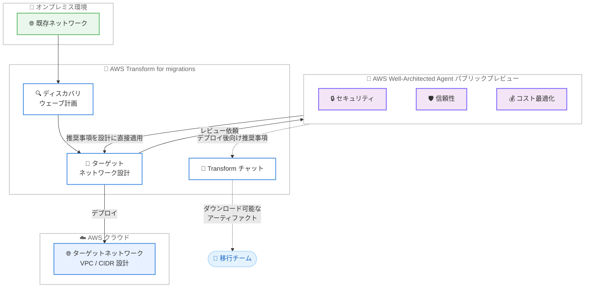

# AWS Transform - Well-Architected Agent によるネットワーク設計レビュー

**リリース日**: 2026 年 11 月 17 日
**サービス**: AWS Transform
**機能**: Well-Architected Agent によるターゲットネットワークのレビュー

📊 [このアップデートのインフォグラフィックを見る](https://takech9203.github.io/aws-news-summary/20261117-transform-well-architected-agent.html)

## 概要

AWS Transform for migrations が、インフラストラクチャの AWS への移行・モダナイゼーションの過程で、ターゲットネットワークに対する Well-Architected レビューを組み込むようになりました。このレビューは、現在パブリックプレビュー中の AWS Well-Architected Agent によって提供され、セキュリティ、信頼性、コスト最適化の 3 つの柱にわたる最新のベストプラクティスに基づく推奨事項を生成します。

推奨事項はターゲットネットワークの設計に直接適用されるため、デプロイ後にインフラストラクチャを修正する手戻りを回避できます。大規模なオンプレミスネットワークを AWS へ移行する組織にとって、計画段階で設計の改善機会を把握できることは、移行プロジェクトの品質とスピードの両面で大きな価値があります。

**アップデート前の課題**

ネットワーク移行における設計上のギャップは、従来はデプロイ後に顕在化することが多く、以下の課題がありました。

- 設計の不備がデプロイ後に発覚し、修正コストが高額になっていた
- 追加のレビューと更新のサイクルが必要になり、移行スケジュールが遅延していた
- Well-Architected のベストプラクティス適用には、専門家による手動レビューが必要だった

**アップデート後の改善**

今回のアップデートにより、以下が可能になりました。

- 計画段階で Well-Architected Agent による改善機会の特定が可能になった
- 推奨事項がターゲットネットワーク設計に直接適用され、デプロイ後の修正が不要になった
- デプロイ後に実施すべき推奨事項は、AWS Transform のチャットからダウンロード可能なアーティファクトとして文書化されるようになった

## アーキテクチャ図



AWS Transform が生成するターゲットネットワーク設計を Well-Architected Agent がレビューし、推奨事項を設計に直接適用します。デプロイ後に対応すべき推奨事項は、チャットからダウンロード可能なアーティファクトとして提供されます。

## サービスアップデートの詳細

### 主要機能

1. **計画段階での Well-Architected レビュー**
   - 移行・モダナイゼーションの過程で、ターゲットネットワークに対する Well-Architected レビューを自動実施
   - セキュリティ、信頼性、コスト最適化の 3 つの柱にわたる最新のベストプラクティスを参照
   - デプロイ前に設計ギャップを特定することで、高コストな手戻りを回避

2. **推奨事項の設計への直接適用**
   - レビュー結果がターゲットネットワーク設計に直接反映される
   - 例: 非 RFC1918 アドレスを使用したスポーク VPC の再アドレッシングや、CIDR 割り当てのガバナンス強化といった推奨事項を設計に適用

3. **デプロイ後向け推奨事項のアーティファクト化**
   - ネットワーク稼働後に実施すべき推奨事項は、AWS Transform チャットからダウンロード可能なアーティファクトとして文書化
   - 移行チームは稼働後に自身の AWS アカウントで推奨事項に対応可能

### AWS Well-Architected Agent について

今回のレビューを提供する AWS Well-Architected Agent は、パブリックプレビュー中の AI 駆動のクラウド最適化サービスです。公式ドキュメントによると、以下の特徴があります。

- AWS 環境を継続的に分析し、コスト、セキュリティ、パフォーマンス、レジリエンスにわたるパーソナライズされた推奨事項を優先度付きで提供
- リソース、アプリケーション、アーキテクチャの 3 つのレベルで推奨事項を生成
- IaC コードの更新など、すぐにデプロイ可能な修正を含む処方的ガイダンスを提供
- 1 つのエージェントプロファイルで最大 1,000 の AWS アカウントを分析可能

## 技術仕様

### 対象となる Well-Architected の柱

| 柱 | レビュー内容の例 |
|------|------|
| セキュリティ | ネットワーク境界、アクセス制御に関するベストプラクティス |
| 信頼性 | ネットワーク構成の冗長性、障害耐性に関する設計 |
| コスト最適化 | CIDR 割り当てのガバナンス、リソース構成の最適化 |

### 推奨事項の適用方法

| 適用タイミング | 提供方法 |
|------|------|
| デプロイ前 | ターゲットネットワーク設計に直接適用 |
| デプロイ後 | AWS Transform チャットからダウンロード可能なアーティファクトとして提供 |

## 設定方法

### 前提条件

1. AWS アカウントと AWS Transform for migrations へのアクセス
2. AWS Well-Architected Agent の利用資格 (有料サポートプランに含まれる。公式ドキュメントによると Business+ 以上のサポートプラン: Business+、Enterprise On-Ramp、Enterprise Support、Unified Operations)
3. 移行対象のオンプレミスネットワーク情報

### 手順

#### ステップ 1: AWS Transform for migrations を開始

AWS Transform コンソールから migrations のジョブを開始し、ディスカバリとウェーブ計画を実施します。既存ネットワークの情報をもとに、ターゲットネットワークの設計が生成されます。

#### ステップ 2: Well-Architected レビュー結果の確認

ターゲットネットワーク設計の生成過程で、Well-Architected Agent によるレビューが実施され、推奨事項が設計に直接適用されます。適用された推奨事項の内容を確認します。

#### ステップ 3: デプロイ後向け推奨事項の取得

AWS Transform チャットから、デプロイ後に実施すべき推奨事項のアーティファクトをダウンロードします。ネットワーク稼働後、自身の AWS アカウントでこれらの推奨事項に対応します。

## メリット

### ビジネス面

- **移行コストの削減**: デプロイ後の設計修正に伴う高額な手戻りコストを回避できる
- **移行スケジュールの短縮**: 追加のレビュー・更新サイクルが不要になり、移行プロジェクトの遅延リスクを低減できる
- **移行品質の向上**: AWS のベストプラクティスに準拠したネットワーク設計を最初から採用できる

### 技術面

- **計画段階でのギャップ検出**: デプロイ前にセキュリティ、信頼性、コスト最適化の観点から設計ギャップを特定できる
- **自動適用による省力化**: 推奨事項が設計に直接適用されるため、手動での設計修正作業が削減される
- **稼働後の改善計画**: デプロイ後向けの推奨事項がアーティファクトとして文書化され、稼働後の改善活動に活用できる

## デメリット・制約事項

### 制限事項

- AWS Well-Architected Agent は現在パブリックプレビューであり、仕様が変更される可能性がある
- Well-Architected Agent は有料サポートプランに含まれる形で提供される (公式ドキュメントによると Business+ 以上のサポートプランが必要)
- レビュー対象はセキュリティ、信頼性、コスト最適化の 3 つの柱であり、Well-Architected フレームワークの全ての柱を網羅するものではない

### 考慮すべき点

- AI が生成する推奨事項であるため、適用前に内容を十分にレビューすることが推奨される
- デプロイ後向けの推奨事項は自動適用されないため、アーティファクトをもとに計画的に対応する必要がある

## ユースケース

### ユースケース 1: 大規模オンプレミスネットワークの AWS 移行

**シナリオ**: 数百のサブネットを持つ大規模なオンプレミスネットワークを AWS に移行する企業が、移行後の設計修正リスクを最小化したい。

**実装例**:
```
1. AWS Transform for migrations でディスカバリとウェーブ計画を実施
2. ターゲットネットワーク設計時に Well-Architected レビューが自動実施される
3. CIDR 割り当てガバナンスなどの推奨事項が設計に直接適用される
```

**効果**: デプロイ前にベストプラクティス準拠の設計が完成し、稼働後の修正サイクルを回避できる。

### ユースケース 2: IP アドレス枯渇への対応を含むネットワーク再設計

**シナリオ**: RFC1918 アドレス空間が枯渇しつつある企業が、移行を機にアドレス設計を見直したい。

**実装例**:
```
1. AWS Transform がターゲットネットワーク設計を生成
2. Well-Architected Agent が非 RFC1918 アドレスを使用した
   スポーク VPC の再アドレッシングを推奨
3. 推奨事項が設計に適用された状態でデプロイ
```

**効果**: アドレス枯渇の課題を移行と同時に解消し、将来の拡張性を確保できる。

### ユースケース 3: 移行後の継続的な改善計画の策定

**シナリオ**: 移行チームが、ネットワーク稼働後に実施すべき改善項目を体系的に管理したい。

**実装例**:
```
1. AWS Transform チャットからデプロイ後向け推奨事項の
   アーティファクトをダウンロード
2. 推奨事項を自社の改善バックログに登録
3. 稼働後に AWS アカウント上で順次対応
```

**効果**: 移行完了後も Well-Architected ベストプラクティスに基づく継続的な改善を計画的に実施できる。

## 料金

AWS Well-Architected Agent は AWS Support によって提供され、有料サポートプランに含まれます。公式ドキュメントによると、Business+ 以上のサポートプラン (Business+、Enterprise On-Ramp、Enterprise Support、Unified Operations) で利用可能です。

AWS Transform の料金については、[AWS Transform の料金ページ](https://aws.amazon.com/transform/pricing/)を参照してください。

## 利用可能リージョン

本機能は商用 AWS リージョンで利用可能です。詳細は [AWS リージョンのドキュメント](https://docs.aws.amazon.com/global-infrastructure/latest/regions/aws-regions.html)を参照してください。

なお、Well-Architected Agent のプロファイルは米国東部 (バージニア北部)、米国東部 (オハイオ)、米国西部 (オレゴン) でホストされ、そこから全ての商用リージョンのリソースをスキャンします。

## 関連サービス・機能

- **AWS Well-Architected Tool**: Well-Architected フレームワークに基づくワークロードレビューを実施するサービス。Well-Architected Agent は同コンソールから利用可能
- **AWS Trusted Advisor**: Well-Architected Agent は Trusted Advisor などの最適化サービスの検出結果を取り込み、パーソナライズと優先度付けを追加する
- **AWS Transform for migrations**: ディスカバリ、ウェーブ計画からネットワーク変換、カットオーバーまでの移行ライフサイクルを agentic AI で自動化するサービス

## 参考リンク

- 📊 [インフォグラフィック](https://takech9203.github.io/aws-news-summary/20261117-transform-well-architected-agent.html)
- [公式発表 (What's New)](https://aws.amazon.com/about-aws/whats-new/2026/11/transform-well-architected-agent/)
- [AWS Well-Architected Agent ドキュメント](https://docs.aws.amazon.com/wellarchitected/latest/userguide/agent.html)
- [AWS Transform 製品ページ](https://aws.amazon.com/transform/)
- [AWS リージョン一覧](https://docs.aws.amazon.com/global-infrastructure/latest/regions/aws-regions.html)

## まとめ

AWS Transform for migrations に Well-Architected Agent によるターゲットネットワークのレビューが組み込まれ、移行の計画段階でセキュリティ、信頼性、コスト最適化のベストプラクティスを設計に直接適用できるようになりました。大規模なネットワーク移行を計画している組織は、デプロイ後の手戻りを削減するために本機能の活用を検討することを推奨します。Well-Architected Agent はパブリックプレビューのため、仕様変更の可能性がある点には留意してください。
