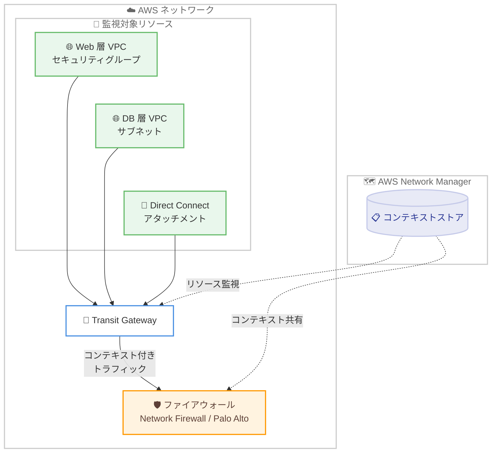

# AWS Transit Gateway - ファイアウォールへのリソースコンテキスト共有によるセグメンテーションポリシー

**リリース日**: 2026 年 11 月 17 日
**サービス**: AWS Transit Gateway / AWS Network Manager / AWS Network Firewall
**機能**: Context sharing with security services (セキュリティサービスとのコンテキスト共有)

📊 [このアップデートのインフォグラフィックを見る](https://takech9203.github.io/aws-news-summary/20261117-transit-gateway-firewall-context-sharing.html)

## 概要

AWS Transit Gateway が、アタッチされたファイアウォールなどのセキュリティサービスへのリソースコンテキスト共有をサポートしました。これにより、IP アドレスだけでなく、Amazon VPC、VPC サブネット、VPC セキュリティグループ、Transit Gateway アタッチメントをファイアウォールポリシーで直接参照できるようになります。

Transit Gateway はファイアウォールに送信するトラフィックにリソースコンテキストを埋め込むため、ファイアウォールは最初のパケットから適切なポリシーを適用できます。たとえば、Web 層とデータベース層のセキュリティグループ間のトラフィックに脅威保護を適用する、開発 VPC から本番 VPC への到達をブロックする、AWS Direct Connect や AWS Site-to-Site VPN アタッチメント経由で AWS に入るトラフィックに共通の検査ポリシーを適用する、短命な AWS Lambda 関数がトラフィックを送信した瞬間からポリシーを適用する、といった制御を IP アドレスの変化に応じたルール更新なしで実現できます。

利用を開始するには、AWS Network Manager でコンテキストストアを作成し、Transit Gateway を関連付けます。コンテキストストアは関連付けられた Transit Gateway に接続されたリソースを監視し、そのコンテキストをファイアウォールと共有します。AWS Network Firewall および Palo Alto Networks Software Firewalls が、IP ベースのルールと併用する形でリソースコンテキストを使用したポリシーをサポートします。

**アップデート前の課題**

- アタッチされたファイアウォールは IP アドレスでトラフィックをセグメント化する必要があり、IP アドレスベースのルールは計画と維持が困難だった
- リソースタグによるセグメンテーションでは、ファイアウォールが定期的にタグと IP アドレスを同期する方式のため、同期の合間に起動した新しいワークロードを見逃す可能性があった
- IP アドレスが変化するたびにファイアウォールルールの更新が必要だった

**アップデート後の改善**

- VPC、サブネット、セキュリティグループ、Transit Gateway アタッチメントといった AWS 上のワークロード定義に基づいてセグメンテーションを適用できるようになった
- Transit Gateway がトラフィックにリソースコンテキストを埋め込むため、ファイアウォールが最初のパケットから正しいポリシーを適用できるようになった
- 短命な Lambda 関数のような動的なワークロードにも、トラフィック送信開始と同時にポリシーを適用できるようになった

## アーキテクチャ図



AWS Network Manager のコンテキストストアが Transit Gateway に接続されたリソースを監視し、そのコンテキストをファイアウォールと共有します。Transit Gateway はファイアウォールへ送信するトラフィックにリソースコンテキストを埋め込むため、ファイアウォールは最初のパケットからリソースベースのポリシーを適用できます。

## サービスアップデートの詳細

### 主要機能

1. **リソースコンテキストによるファイアウォールポリシー**
   - IP アドレスに加えて、VPC、VPC サブネット、VPC セキュリティグループ、Transit Gateway アタッチメントをポリシーで参照可能
   - AWS 上のワークロードやアタッチメントの定義に基づいたセグメンテーションを適用
   - IP アドレスの変化に応じたルール更新が不要

2. **コンテキストストア (AWS Network Manager)**
   - グローバルネットワーク内にコンテキストストアを作成し、Transit Gateway を関連付けて利用
   - 関連付けられた Transit Gateway に接続されたリソースのコンテキストを監視し、セキュリティサービスと共有
   - 複数リージョンの Transit Gateway を 1 つのコンテキストストアに関連付け可能 (リソースコンテキストには各リソースのリージョン情報を含む)

3. **ファーストパケットからのポリシー適用**
   - Transit Gateway がトラフィックにリソースコンテキストを埋め込み、ファイアウォールが最初のパケットから正しいポリシーを適用
   - タグ同期方式と異なり、新規ワークロードの見逃しが発生しない
   - 短命な Lambda 関数のような動的ワークロードにも即座に適用可能

4. **対応ファイアウォール**
   - AWS Network Firewall: コンテキスト対応のステートフルルールグループで、Network Manager コンテキストストアを参照する ContextSets を通じて AWS リソース ID をルールで参照可能
   - Palo Alto Networks Software Firewalls: IP ベースのルールと併用する形でリソースコンテキストを使用したポリシーをサポート

## 技術仕様

### コンテキスト共有の仕組みと制限

| 項目 | 詳細 |
|------|------|
| コンテキストストアの作成場所 | AWS Network Manager のグローバルネットワーク内 |
| グローバルネットワークあたりのコンテキストストア数 | 1 つ |
| Transit Gateway あたりの関連付け可能なコンテキストストア数 | 1 つ |
| 共有されるリソースコンテキスト | VPC、サブネット、セキュリティグループ、Transit Gateway アタッチメント |
| 対象トラフィック | タイプが AWS Network Firewall または Gateway Load Balancer の Transit Gateway ネットワークファンクションアタッチメント経由でルーティングされるトラフィックのみ |
| セキュリティグループの上限 | リソースコンテキストに含まれるセキュリティグループは最大 5 つ (6 つ以上関連付けられている場合、セキュリティグループ情報は含まれない) |
| リージョン間ピアリング | リージョン間 Transit Gateway ピアリングアタッチメントをまたぐコンテキスト共有は不可 |

### API変更履歴

| 日付 | サービス | 変更内容 |
|------|----------|----------|
| 2026/11/16 | [networkmanager](https://awsapichanges.com/archive/changes/f1785c-networkmanager.html) | 12 new api methods - コンテキストストア関連 API の追加 (CreateContextStore、AssociateContextStore、ListContexts、ListContextChanges、GetContextVersion など) |
| 2026/11/16 | [network-firewall](https://awsapichanges.com/archive/changes/f1785c-network-firewall.html) | 2 new 9 updated api methods - コンテキスト対応ステートフルルールグループのサポート。Network Manager コンテキストストアを参照する ContextSets により AWS リソース ID をルールで参照可能 |

### 追加された主な API (AWS Network Manager)

```bash
# コンテキストストアのライフサイクル管理
CreateContextStore / GetContextStore / UpdateContextStore / DeleteContextStore / ListContextStores

# Transit Gateway との関連付け管理
AssociateContextStore / DisassociateContextStore
GetContextStoreAssociation / ListContextStoreAssociations

# コンテキストの参照
ListContexts / ListContextChanges / GetContextVersion
```

## 設定方法

### 前提条件

1. グローバルネットワークを作成し、リソースコンテキストを共有したい Transit Gateway を登録していること
2. ファイアウォールをネットワークファンクションアタッチメント経由で Transit Gateway に接続し、検査が必要なトラフィックをアタッチメントにルーティングしていること
3. AWS Network Manager でコンテキストストアとその Transit Gateway 関連付けを作成・管理する権限を持っていること

### 手順

#### ステップ1: コンテキストストアの作成

```bash
aws networkmanager create-context-store \
  --global-network-id global-network-0123456789abcdef0 \
  --description "Context store for TGW firewall segmentation"
```

グローバルネットワーク内にコンテキストストアを作成します。グローバルネットワークあたり 1 つのコンテキストストアを作成できます。

#### ステップ2: Transit Gateway の関連付け

```bash
aws networkmanager associate-context-store \
  --context-store-id <context-store-id> \
  --transit-gateway-arn arn:aws:ec2:ap-northeast-1:123456789012:transit-gateway/tgw-0123456789abcdef0
```

コンテキストストアに Transit Gateway を関連付けます。関連付け後、コンテキストストアは Transit Gateway に接続されたリソースの監視を開始します。複数リージョンの Transit Gateway を同一のコンテキストストアに関連付けることができます。

#### ステップ3: コンテキストの確認とファイアウォールポリシーの設定

```bash
# 収集されたリソースコンテキストの一覧を確認
aws networkmanager list-contexts \
  --context-store-id <context-store-id>
```

コンテキストストアに収集されたリソースコンテキスト (VPC、サブネット、セキュリティグループ、アタッチメント) を確認します。個々のコンテキストレコードの参照には Network Manager API または AWS CLI を使用します (コンソールではコンテキストストアと関連付けの表示のみ)。その後、AWS Network Firewall のコンテキスト対応ステートフルルールグループなど、ファイアウォール側でリソースコンテキストを参照するポリシーを設定します。

## メリット

### ビジネス面

- **運用コストの削減**: IP アドレスの変化に応じたファイアウォールルールの更新が不要になり、セグメンテーションポリシーの維持負荷を大幅に軽減
- **セキュリティリスクの低減**: タグ同期の合間に新規ワークロードを見逃すリスクがなくなり、最初のパケットからポリシーを確実に適用
- **ガバナンスの向上**: 開発 VPC から本番 VPC への到達ブロックなど、環境分離ポリシーを AWS 上のリソース定義に基づいて宣言的に適用可能

### 技術面

- **意図ベースのセグメンテーション**: IP アドレスではなく VPC、サブネット、セキュリティグループ、アタッチメントといったワークロードの論理的な定義でポリシーを記述可能
- **動的ワークロードへの即時適用**: 短命な Lambda 関数がトラフィックを送信した瞬間からポリシーを適用可能
- **マルチリージョン対応**: 複数リージョンの Transit Gateway を 1 つのコンテキストストアに関連付けでき、リソースコンテキストに各リソースのリージョン情報を含む
- **ハイブリッド接続の検査**: Direct Connect や Site-to-Site VPN アタッチメント経由で AWS に入るトラフィックへの共通検査ポリシーの適用が容易

## デメリット・制約事項

### 制限事項

- グローバルネットワークあたりコンテキストストアは 1 つまで
- Transit Gateway は 1 つのコンテキストストアにのみ関連付け可能
- コンテキスト共有は、タイプが AWS Network Firewall または Gateway Load Balancer の Transit Gateway ネットワークファンクションアタッチメント経由でルーティングされるトラフィックのみ対象
- リソースコンテキストに含まれるセキュリティグループは最大 5 つ (リソースに 6 つ以上のセキュリティグループが関連付けられている場合、コンテキストにセキュリティグループ情報が含まれない)
- リージョン間 Transit Gateway ピアリングアタッチメントをまたぐリソースコンテキストの共有は不可
- 中東 (バーレーン) および中東 (UAE) リージョンでは利用不可

### 考慮すべき点

- 事前にグローバルネットワークの作成と Transit Gateway の登録、およびネットワークファンクションアタッチメント経由でのファイアウォール接続が必要
- 個々のコンテキストレコードの参照は API または AWS CLI 経由のみで、コンソールではコンテキストストアと関連付けの表示に限られる
- 対応ファイアウォールは現時点で AWS Network Firewall と Palo Alto Networks Software Firewalls

## ユースケース

### ユースケース1: Web 層と DB 層の間のマイクロセグメンテーション

**シナリオ**: 3 層アーキテクチャにおいて、Web 層からデータベース層へのトラフィックにのみ脅威保護を適用したい。オートスケーリングによりインスタンスの IP アドレスは頻繁に変化する。

**実装例**:
```
1. コンテキストストアを作成し、Transit Gateway を関連付け
2. AWS Network Firewall のコンテキスト対応ステートフルルールグループで、
   Web 層セキュリティグループ -> DB 層セキュリティグループのトラフィックを
   ContextSets で指定し、IPS 検査を適用
```

**効果**: スケールイン・スケールアウトで IP アドレスが変化してもルール更新が不要になり、セキュリティグループの定義に基づいた一貫した脅威保護を実現できる。

### ユースケース2: 開発環境から本番環境への到達ブロック

**シナリオ**: 同一の Transit Gateway に接続された開発 VPC と本番 VPC の間で、開発環境から本番環境へのアクセスを確実に遮断したい。

**実装例**:
```
1. コンテキストストアで開発 VPC と本番 VPC のコンテキストを共有
2. ファイアウォールポリシーで「開発 VPC -> 本番 VPC」のトラフィックを
   VPC ID ベースで拒否するルールを定義
```

**効果**: VPC の CIDR 変更や VPC 追加のたびに IP ベースのルールを見直す必要がなくなり、環境分離ポリシーを宣言的に維持できる。

### ユースケース3: ハイブリッド接続トラフィックへの共通検査ポリシー

**シナリオ**: オンプレミスから Direct Connect および Site-to-Site VPN 経由で AWS に入るすべてのトラフィックに、共通のインスペクションポリシーを適用したい。

**実装例**:
```
1. コンテキストストアに Transit Gateway を関連付け、
   Direct Connect / VPN アタッチメントのコンテキストを共有
2. ファイアウォールポリシーでアタッチメントタイプを条件に
   共通の検査ルールを定義
```

**効果**: 接続回線の追加や変更があっても、アタッチメント単位のポリシーがそのまま適用され、ハイブリッド環境の入口対策を一元化できる。

## 料金

公式発表には本機能に関する追加料金の記載はありません。AWS Transit Gateway のデータ処理料金とアタッチメント料金、および AWS Network Firewall などのファイアウォール側の料金が通常どおり適用されます。最新の料金は各サービスの料金ページを確認してください。

## 利用可能リージョン

AWS Transit Gateway が利用可能なすべての商用 AWS リージョンで利用できます。ただし、中東 (バーレーン) と中東 (UAE) は除きます。AWS GovCloud (US-East) および AWS GovCloud (US-West) リージョンでも利用可能です。

## 関連サービス・機能

- **AWS Network Manager**: コンテキストストアの作成・管理と Transit Gateway の関連付けを行うサービス。グローバルネットワークにコンテキストストアを配置する
- **AWS Network Firewall**: コンテキスト対応ステートフルルールグループにより、ContextSets を通じてコンテキストストアのリソースコンテキストをルールで参照可能
- **Transit Gateway ネットワークファンクションアタッチメント**: ファイアウォールを Transit Gateway に接続する仕組み。コンテキスト共有は AWS Network Firewall または Gateway Load Balancer タイプのアタッチメント経由のトラフィックが対象
- **AWS Direct Connect / AWS Site-to-Site VPN**: これらのアタッチメント経由で AWS に入るトラフィックにも、アタッチメントベースの共通検査ポリシーを適用可能

## 参考リンク

- 📊 [インフォグラフィック](https://takech9203.github.io/aws-news-summary/20261117-transit-gateway-firewall-context-sharing.html)
- [公式発表 (What's New)](https://aws.amazon.com/about-aws/whats-new/2026/11/transit-gateway-firewall-context-sharing/)
- [ドキュメント: Context sharing with security services](https://docs.aws.amazon.com/network-manager/latest/tgwnm/context-stores.html)
- [AWS Transit Gateway 製品ページ](https://aws.amazon.com/transit-gateway/)
- [料金ページ](https://aws.amazon.com/transit-gateway/pricing/)

## まとめ

AWS Transit Gateway のコンテキスト共有により、ファイアウォールのセグメンテーションポリシーを IP アドレスではなく VPC、サブネット、セキュリティグループ、アタッチメントといった AWS リソースの定義に基づいて記述できるようになりました。IP ベースルールの維持負荷やタグ同期によるワークロード見逃しの課題を解消し、最初のパケットから確実にポリシーを適用できます。Transit Gateway 配下でファイアウォールによる East-West 検査やハイブリッド接続の検査を行っている場合は、AWS Network Manager でのコンテキストストア作成から検証を開始することを推奨します。
