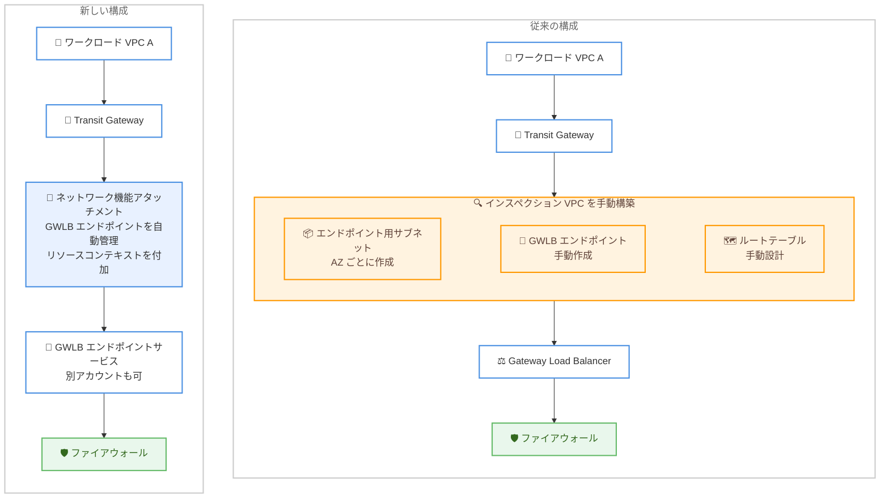

# AWS Transit Gateway - Gateway Load Balancer とのネイティブ統合

**リリース日**: 2026 年 11 月 17 日
**サービス**: AWS Transit Gateway, Gateway Load Balancer
**機能**: ネットワーク機能アタッチメント (Network Function Attachment) による Gateway Load Balancer のネイティブ統合

📊 [このアップデートのインフォグラフィックを見る](https://takech9203.github.io/aws-news-summary/20261117-transit-gateway-gwlb-integration.html)

## 概要

AWS Transit Gateway が、Gateway Load Balancer タイプのネットワーク機能アタッチメント (Network Function Attachment) をサポートしました。これにより、ファイアウォールなどのセキュリティアプライアンスをフロントする Gateway Load Balancer の VPC エンドポイントサービスに対して、Transit Gateway を直接接続できるようになります。

従来、Transit Gateway と Gateway Load Balancer を組み合わせた集中型トラフィック検査では、専用のインスペクション VPC を構築し、エンドポイント用サブネットやルートテーブルを細かく設計・管理する必要がありました。今回のアップデートでは、Transit Gateway が選択したアベイラビリティゾーンに Gateway Load Balancer エンドポイントを自動的に作成・管理するため、こうした複雑な VPC 設定が不要になります。エンドポイントサービスは別の AWS アカウントにあっても構いません。

さらに、ネットワーク機能アタッチメントはセキュリティサービスとのコンテキスト共有をサポートします。Transit Gateway は、ファイアウォールに送信するトラフィックに Transit Gateway アタッチメント、VPC、サブネット、セキュリティグループなどのリソースコンテキストを付加します。ファイアウォールは IP アドレスに加えてこれらのコンテキストを利用し、セグメンテーションポリシーを適用できます。マルチ VPC 環境で集中型のネットワークセキュリティを運用するネットワーク管理者やセキュリティチームにとって、構成の簡素化とポリシー精度の向上を同時に実現するアップデートです。

**アップデート前の課題**

- Transit Gateway と Gateway Load Balancer を連携させるには、専用のインスペクション VPC を作成し、アベイラビリティゾーンごとにエンドポイント用サブネットと GWLB エンドポイントを手動で構築する必要があった
- アプライアンスモードの有効化や、インスペクション VPC 内のルートテーブル設計など、構成が複雑で設定ミスによる非対称ルーティングのリスクがあった
- ファイアウォールが参照できる情報は基本的に IP アドレスベースであり、VPC やセキュリティグループといった AWS リソースの文脈に基づくポリシー適用が難しかった

**アップデート後の改善**

- Transit Gateway のアタッチメントとして GWLB の VPC エンドポイントサービスを直接指定でき、インスペクション VPC や専用サブネット、ルートテーブルの作成が不要になった
- 選択したアベイラビリティゾーン (最大 16) に対して Transit Gateway が GWLB エンドポイントを自動作成・管理し、AZ の追加・削除もアタッチメントの変更操作だけで完結するようになった
- コンテキスト共有により、ファイアウォールがアタッチメント、VPC、サブネット、セキュリティグループなどのリソースコンテキストを使ったセグメンテーションポリシーを適用できるようになった
- エンドポイントサービスが別アカウントにある構成 (ファイアウォール・アズ・ア・サービスを含む) もサポートされ、クロスアカウントのセキュリティ運用が容易になった

## アーキテクチャ図



従来はインスペクション VPC 内にサブネット、GWLB エンドポイント、ルートテーブルを手動で構築する必要がありましたが、新しいネットワーク機能アタッチメントでは Transit Gateway がエンドポイントサービスへの接続を直接管理します。

## サービスアップデートの詳細

### 主要機能

1. **Gateway Load Balancer タイプのネットワーク機能アタッチメント**
   - Transit Gateway のアタッチメントタイプとして「Network Function」が追加され、GWLB の VPC エンドポイントサービスを直接指定して接続できる
   - Transit Gateway が、選択したアベイラビリティゾーンごとに 1 つの GWLB エンドポイントを自動作成・管理する
   - アタッチメントの作成・変更・削除は Transit Gateway の所有者が実施し、作成時に最大 16 のアベイラビリティゾーンを指定できる
   - エンドポイントサービス側が接続承認を必要とする場合、アタッチメントはサービス所有者が承認するまで `pendingAcceptance` 状態となる

2. **クロスアカウント対応**
   - GWLB エンドポイントサービスは Transit Gateway と別の AWS アカウントに配置できる
   - エンドポイントサービス所有者は `transit-gateway-attachment` という新しい許可タイプで、Transit Gateway 所有者のアカウント (ルート ARN) に接続を許可する
   - 自社で展開するファイアウォールアプライアンスのほか、ファイアウォール・アズ・ア・サービス (FWaaS) の利用にも適用できる

3. **セキュリティサービスとのコンテキスト共有**
   - Transit Gateway は、ファイアウォールへ送信するトラフィックに Transit Gateway アタッチメント、VPC、サブネット、セキュリティグループといったリソースコンテキストを付加する
   - ファイアウォールは IP アドレスに加えてこれらのコンテキストを参照し、リソース単位のセグメンテーションポリシーを適用できる
   - 同日の API 更新では、AWS Network Manager にコンテキスト共有関連の API (12 メソッド) が追加され、AWS Network Firewall ではコンテキスト対応のステートフルルールグループがサポートされた

4. **運用のシンプル化**
   - アベイラビリティゾーンの追加・削除はアタッチメントの変更操作のみで完結し、AZ 追加時は該当 AZ に GWLB エンドポイントが自動作成される
   - 変更中は `modifying` 状態となり、サポートされない AZ が指定された場合は `rollingBack` 状態を経て元の構成に自動復旧する
   - アタッチメント削除時には、Transit Gateway が作成した GWLB エンドポイントも自動的に削除される

## 技術仕様

### ネットワーク機能アタッチメント (GWLB タイプ) の仕様

| 項目 | 詳細 |
|------|------|
| アタッチメントタイプ | Network Function (Gateway Load Balancer) |
| 接続先 | GWLB の VPC エンドポイントサービス (別アカウント可) |
| アベイラビリティゾーン | 作成時に最大 16 AZ を指定可能、作成後に追加・削除可能 (最低 1 AZ を維持) |
| エンドポイント管理 | 選択した AZ ごとに Transit Gateway が GWLB エンドポイントを自動作成・管理 |
| ルーティング | ルートテーブルの関連付けと静的ルートをサポート、ルート伝播は非サポート |
| 承認フロー | エンドポイントサービスが承認制の場合、サービス所有者の承認が必要 |
| クォータ | 専用クォータはなく、Transit Gateway アタッチメントのクォータに計上 |
| 制約 | Transit Gateway の暗号化サポートが有効な場合は作成不可、AZ `use1-az3` は非サポート |

### API 変更履歴

| 日付 | サービス | 変更内容 |
|------|----------|----------|
| 2026/11/16 | [ec2](https://awsapichanges.com/archive/changes/f1785c-ec2.html) | 6 new 7 updated api methods - Transit Gateway アタッチメントタイプ「Network Function」の追加 |
| 2026/11/16 | [networkmanager](https://awsapichanges.com/archive/changes/f1785c-networkmanager.html) | 12 new api methods - ファイアウォールとのコンテキスト共有 (コンテキストストア) |
| 2026/11/16 | [network-firewall](https://awsapichanges.com/archive/changes/f1785c-network-firewall.html) | 2 new 9 updated api methods - コンテキスト対応ステートフルルールグループのサポート |

主な新規 API は以下のとおりです。

- `CreateTransitGatewayNetworkFunctionAttachment`: GWLB エンドポイントサービスへのアタッチメントを作成
- `ModifyTransitGatewayNetworkFunctionAttachment`: アベイラビリティゾーンの追加・削除
- `DescribeTransitGatewayNetworkFunctionAttachments`: アタッチメントの一覧・フィルタリング
- `DeleteTransitGatewayNetworkFunctionAttachment`: アタッチメントの削除

また、`ModifyVpcEndpointServicePermissions` に `PermissionType` パラメータ (`vpc-endpoint` または `transit-gateway-attachment`) が追加され、`AcceptVpcEndpointConnections` / `RejectVpcEndpointConnections` が `TransitGatewayAttachmentIds` を受け付けるようになりました。

## 設定方法

### 前提条件

1. 正常なアプライアンスターゲットを持つ Gateway Load Balancer と、それをフロントする VPC エンドポイントサービスが作成済みであること
2. Transit Gateway の暗号化サポート (Encryption Support) が無効であること
3. アタッチメントを作成するプリンシパルに `ec2:DescribeVpcEndpointServices` の権限があること
4. クロスアカウント構成の場合、エンドポイントサービス所有者が Transit Gateway 所有者のアカウントに接続を許可していること

### 手順

#### ステップ 1: エンドポイントサービス側で接続を許可する (クロスアカウントの場合)

```bash
aws ec2 modify-vpc-endpoint-service-permissions \
  --service-id vpce-svc-0123456789abcdef0 \
  --permission-type transit-gateway-attachment \
  --add-allowed-principals arn:aws:iam::111122223333:root
```

エンドポイントサービス所有者が、`transit-gateway-attachment` 許可タイプを使用して Transit Gateway 所有者のアカウント (ルート ARN) に接続を許可します。この許可タイプは AWS アカウントプリンシパルのみをサポートします。

#### ステップ 2: ネットワーク機能アタッチメントを作成する

```bash
aws ec2 create-transit-gateway-network-function-attachment \
  --transit-gateway-id tgw-0123456789abcdef0 \
  --service-name com.amazonaws.vpce.ap-northeast-1.vpce-svc-0123456789abcdef0 \
  --availability-zone-ids apne1-az1 apne1-az2
```

Transit Gateway、GWLB エンドポイントサービス名、アベイラビリティゾーン (名前または AZ ID) を指定してアタッチメントを作成します。指定した各 AZ に GWLB エンドポイントが自動作成されます。エンドポイントサービスが承認制の場合は、サービス所有者が承認するまで `pendingAcceptance` 状態になります。

#### ステップ 3: ルートテーブルを設定して検査対象トラフィックを転送する

```bash
aws ec2 create-transit-gateway-route \
  --transit-gateway-route-table-id tgw-rtb-0123456789abcdef0 \
  --destination-cidr-block 0.0.0.0/0 \
  --transit-gateway-attachment-id tgw-attach-0123456789abcdef0
```

検査対象のトラフィックがネットワーク機能アタッチメントを経由するように、Transit Gateway ルートテーブルに静的ルートを追加します。ネットワーク機能アタッチメントはルートテーブルの関連付けと静的ルートをサポートしますが、ルート伝播はサポートしません。

#### ステップ 4: アタッチメントの状態を確認する

```bash
aws ec2 describe-transit-gateway-network-function-attachments \
  --filters "Name=transit-gateway-id,Values=tgw-0123456789abcdef0"
```

アタッチメントが `available` 状態になっていることを確認します。`service-name` や `state` などのフィルタも利用できます。

## メリット

### ビジネス面

- **運用コストの削減**: インスペクション VPC やエンドポイント用サブネット、ルートテーブルの設計・管理が不要になり、集中型セキュリティ構成の構築・維持にかかる工数を削減できる
- **FWaaS 活用の加速**: エンドポイントサービスが別アカウントでも接続できるため、サードパーティのファイアウォール・アズ・ア・サービスやセキュリティチーム管理の共有ファイアウォールを導入しやすくなる
- **セキュリティガバナンスの向上**: リソースコンテキストに基づくセグメンテーションポリシーにより、IP アドレス変動に左右されない一貫したポリシー適用が可能になる

### 技術面

- **構成の簡素化**: アタッチメント作成だけで GWLB エンドポイントが自動プロビジョニングされ、設定ミスによる非対称ルーティングのリスクを低減できる
- **AZ 単位の柔軟な拡張**: アタッチメントの変更操作で AZ を追加・削除でき、障害時は自動ロールバックで元の構成に復旧する
- **コンテキストベースのポリシー**: ファイアウォールがアタッチメント、VPC、サブネット、セキュリティグループの情報を参照できるため、より精緻なルール設計が可能になる

## デメリット・制約事項

### 制限事項

- Transit Gateway の暗号化サポートが有効 (`enabled`、`enabling`、`disabling`) の場合、アタッチメントを作成できない
- ネットワーク機能アタッチメントはルート伝播をサポートせず、静的ルートのみ利用できる
- アベイラビリティゾーン `use1-az3` はサポートされない
- 中東 (バーレーン) および中東 (UAE) リージョンでは利用できない
- クロスアカウント許可 (`transit-gateway-attachment` タイプ) はアカウントのルート ARN のみ指定でき、IAM ユーザー・ロール・組織単位は指定できない

### 考慮すべき点

- 指定する各アベイラビリティゾーンは、Transit Gateway とエンドポイントサービスの両方でサポートされている必要がある
- アタッチメント削除前に、アタッチメントを指すルートを削除または置き換える必要がある。残したままにするとルートが `blackhole` 状態になり、該当トラフィックが破棄される
- ネットワーク機能アタッチメントは Transit Gateway アタッチメントのクォータに計上されるため、大規模環境ではクォータを事前に確認する
- AWS Network Firewall を利用する場合は、Network Firewall タイプのネットワーク機能アタッチメントという別の方式があり、GWLB タイプとは作成・管理方法が異なる

## ユースケース

### ユースケース 1: サードパーティファイアウォールによる集中型 East-West トラフィック検査

**シナリオ**: 複数の VPC を Transit Gateway で接続している企業が、VPC 間通信をサードパーティのファイアウォールアプライアンスで集中検査したい。

**実装例**:
```
1. ファイアウォールアプライアンスをターゲットとする GWLB とエンドポイントサービスを作成
2. Transit Gateway に GWLB タイプのネットワーク機能アタッチメントを作成 (複数 AZ を指定)
3. 各 VPC アタッチメントのルートテーブルで、他 VPC 宛てのルートをネットワーク機能アタッチメントに向ける
4. 検査後のトラフィックを宛先 VPC へ転送するルートテーブルを関連付ける
```

**効果**: インスペクション VPC の構築・管理なしで、VPC 間トラフィックの集中検査を実現できる。AZ 追加もアタッチメント変更のみで対応可能。

### ユースケース 2: 別アカウントのセキュリティチームが運用する共有ファイアウォール基盤

**シナリオ**: セキュリティ専門チームが専用アカウントでファイアウォール基盤 (GWLB + アプライアンス) を運用し、各事業部門の Transit Gateway から接続させたい。

**実装例**:
```
1. セキュリティアカウントで GWLB エンドポイントサービスを作成し、承認制を有効化
2. modify-vpc-endpoint-service-permissions で各事業部門アカウントに
   transit-gateway-attachment 許可を付与
3. 各事業部門が自アカウントの Transit Gateway にネットワーク機能アタッチメントを作成
4. セキュリティチームが接続リクエストを承認
```

**効果**: セキュリティ基盤の運用を一元化しつつ、各部門は自律的に接続を構成できる。承認フローにより接続のガバナンスも確保される。

### ユースケース 3: リソースコンテキストを活用したセグメンテーションポリシー

**シナリオ**: 本番 VPC と開発 VPC の間の通信を、IP アドレスではなく VPC やセキュリティグループといったリソース単位で制御したい。

**実装例**:
```
1. GWLB タイプのネットワーク機能アタッチメントを作成し、コンテキスト共有を活用
2. ファイアウォール側で、Transit Gateway が付加する VPC ID やセキュリティグループ
   などのコンテキストを参照するルールを定義
3. 本番 VPC から開発 VPC への通信を、リソースコンテキストに基づいて許可・拒否
```

**効果**: CIDR 変更や IP アドレスの変動に影響されない、意図が明確なセグメンテーションポリシーを実装できる。

## 料金

ネットワーク機能アタッチメントは AWS Transit Gateway のアタッチメントとして課金対象になります。Transit Gateway は一般にアタッチメント時間とデータ処理量に基づいて課金されます。本機能固有の料金詳細は、最新の料金ページで確認してください。

- [AWS Transit Gateway 料金](https://aws.amazon.com/transit-gateway/pricing/)
- [Elastic Load Balancing 料金 (Gateway Load Balancer)](https://aws.amazon.com/elasticloadbalancing/pricing/)

## 利用可能リージョン

AWS Transit Gateway と Gateway Load Balancer の両方が利用可能なすべての商用 AWS リージョンで利用できます。ただし、中東 (バーレーン) および中東 (UAE) リージョンは除きます。また、AWS GovCloud (US-East) および AWS GovCloud (US-West) リージョンでも利用可能です。

## 関連サービス・機能

- **Gateway Load Balancer**: ファイアウォールなどのサードパーティ仮想アプライアンスを透過的に展開・スケールするロードバランサー。本機能の接続先となるエンドポイントサービスを提供する
- **AWS Network Firewall**: ネットワーク機能アタッチメントのもう 1 つのタイプとして直接接続でき、コンテキスト対応ステートフルルールグループでリソースコンテキストを参照可能
- **AWS Network Manager**: コンテキストストアを通じてセキュリティサービスとのコンテキスト共有を実現する
- **AWS PrivateLink**: GWLB エンドポイントサービスの基盤技術で、クロスアカウント接続の許可管理 (`transit-gateway-attachment` 許可タイプ) を担う

## 参考リンク

- 📊 [インフォグラフィック](https://takech9203.github.io/aws-news-summary/20261117-transit-gateway-gwlb-integration.html)
- [公式発表 (What's New)](https://aws.amazon.com/about-aws/whats-new/2026/11/transit-gateway-gwlb-integration/)
- [ドキュメント: Network function attachments](https://docs.aws.amazon.com/vpc/latest/tgw/tgw-nf-fw.html)
- [ドキュメント: Manage a network function attachment of type Gateway Load Balancer](https://docs.aws.amazon.com/vpc/latest/tgw/manage-nf-attachment-gwlb.html)
- [ドキュメント: Context sharing with security services](https://docs.aws.amazon.com/network-manager/latest/tgwnm/context-stores.html)
- [AWS Transit Gateway 製品ページ](https://aws.amazon.com/transit-gateway/)
- [料金ページ](https://aws.amazon.com/transit-gateway/pricing/)

## まとめ

今回のアップデートにより、Transit Gateway と Gateway Load Balancer の統合に必要だったインスペクション VPC やエンドポイント用サブネットの構築が不要になり、集中型ネットワークセキュリティの導入が大幅に簡素化されました。リソースコンテキスト共有により、IP アドレスに依存しないセグメンテーションポリシーも実現できます。現在 GWLB ベースの集中検査アーキテクチャを運用している場合は、ネットワーク機能アタッチメントへの移行による構成の簡素化を検討することを推奨します。
