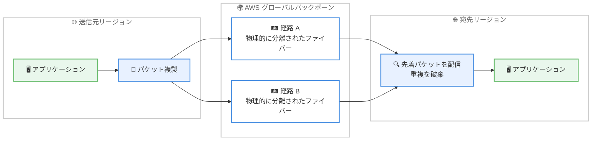

# Amazon VPC / AWS Transit Gateway / AWS Cloud WAN - クロスリージョントラフィック向け 99.999% 可用性 SLA (Multipath Resilience)

**リリース日**: 2026 年 11 月 17 日
**サービス**: Amazon VPC、AWS Transit Gateway、AWS Cloud WAN
**機能**: Multipath Resilience (クロスリージョントラフィック向け 99.999% 可用性 SLA)

📊 [このアップデートのインフォグラフィックを見る](https://takech9203.github.io/aws-news-summary/20261117-vpc-tgw-cloudwan-99999-sla.html)

## 概要

AWS は、Amazon VPC のクロスリージョンピアリング、AWS Transit Gateway のクロスリージョンピアリングアタッチメント、AWS Cloud WAN のクロスリージョントラフィックを対象に、99.999% の可用性サービスレベルアグリーメント (SLA) を提供する新機能「Multipath Resilience」を発表しました。決済処理、金融取引、テレフォニー、ライブメディアストリーミングなど、リージョン間でトラフィックを送信するミッションクリティカルなアプリケーションのレジリエンス向上を容易にします。

AWS バックボーンは物理的に分離されたファイバー経路でリージョン間を接続しており、ファイバー切断などで経路に障害が発生した場合、サブ秒で正常な経路へ自動的に再ルーティングされます。しかし、部分的な劣化のようにこの仕組みで迅速に解決できないまれなケースでは、接続の再確立に数分かかることがあります。Multipath Resilience を有効にすると、ネットワークが各パケットのコピーを物理的に分離された複数の経路で送信し、宛先リージョンに最初に到達したコピーを配信して重複を破棄します。1 つの経路でパケットがドロップしても、別の経路上にコピーが送信中であるため、ネットワークプロトコルの再ルーティングを待つことなくアプリケーションの接続が維持されます。

この仕組みにより、レジリエンス確保の作業がアプリケーションからネットワークへ移されます。アプリケーションは単一の接続を使い続けることができ、アプリケーションコードやオペレーティングシステムの変更、単一リージョン内に呼び出しを収めるためのデータ複製は不要です。

**アップデート前の課題**

数秒の中断も許容できないアプリケーションをリージョン間で運用する場合、以下のような課題がありました。

- 経路障害時の自動再ルーティングで解決できない部分的な劣化などでは、接続の再確立に数分かかる場合があった
- アプリケーションやオペレーティングシステムを改修し、単一の接続を複数の接続に分割するワークアラウンドが必要だった
- クロスリージョン呼び出しを避けるために、すべてのリージョンへデータを複製する構成が必要だった
- アプリケーションはトラフィックが通るネットワーク経路を制御できないため、これらのワークアラウンドは常に機能するとは限らなかった

**アップデート後の改善**

- クロスリージョントラフィックに対して 99.999% の可用性 SLA (金銭的補償付き) が提供されるようになった
- パケットのコピーが物理的に分離された複数経路で同時に送信されるため、単一経路の障害時も再ルーティングを待たずに接続が維持されるようになった
- アプリケーションコード、オペレーティングシステムの変更や、リージョンごとのデータ複製が不要になった
- VPC ピアリング接続、Transit Gateway ピアリングアタッチメント、Cloud WAN の設定で有効化するだけで利用でき、有効化時に既存トラフィックへの中断は発生しない

## アーキテクチャ図



Multipath Resilience を有効にすると、リージョン間ネットワークに入る各パケットが複製され、物理的に分離された複数のバックボーン経路で送信されます。宛先リージョンでは最初に到達したパケットが配信され、重複は破棄されます。

## サービスアップデートの詳細

### 主要機能

1. **パケット複製による経路冗長化**
   - 各パケットのコピーを、リアルタイムの容量状況に応じて選定された物理的に分離された AWS グローバルバックボーン経路で送信
   - 宛先リージョンに最初に到達したコピーを配信し、残りの重複パケットを破棄
   - 通常時はパケットが最低レイテンシーの経路を通るため、定常状態のレイテンシー増加がない設計で、単一経路配信と比較してジッターが低減する場合もある

2. **99.999% 可用性 SLA (金銭的補償付き)**
   - ネットワークパスごと、1 日 (UTC) ごとに 99.999% のアップタイムをコミット
   - あわせて 1 日あたり 99.9% 以上のパケット配信率もコミット
   - SLA 未達の場合、Multipath Resilience 利用料金に対するサービスクレジットを提供

3. **アプリケーション変更不要の有効化**
   - クロスリージョン VPC ピアリング接続、クロスリージョン Transit Gateway ピアリングアタッチメント、Cloud WAN のクロスリージョントラフィックで有効化可能
   - コンソール、CLI、API から有効化でき、有効化時に既存トラフィックの中断は発生しない
   - アプリケーションは単一の接続をそのまま使用でき、コードや OS の変更は不要

## 技術仕様

### SLA の測定方法

| 項目 | 詳細 |
|------|------|
| Daily Uptime コミットメント | ネットワークパスごとに 1 日 (UTC) あたり 99.999% |
| Daily Packet Delivery コミットメント | 1 日あたり 99.9% 以上のパケット配信 |
| Unavailable Second の定義 | 10% を超えるパケットがロスした秒 |
| 測定単位 | ネットワークパスごと、トラフィック方向ごとに個別に評価 |
| Qualifying Minutes | 1 分あたり 250,000 パケット以上を伝送し、かつ単一フロー (5-tuple) が 1 Gbps を超えない分のみが対象 |
| 対象範囲 | AWS バックボーン部分 (Protected Segment) のみ。リージョン内区間は対象外 |

### サービスクレジット

| コミットメント | 実績 | クレジット率 |
|----------------|------|--------------|
| Daily Uptime | 99.999% 未満かつ 99.99% 以上 | 10% |
| Daily Uptime | 99.99% 未満かつ 95.0% 以上 | 25% |
| Daily Uptime | 95.0% 未満 | 100% |
| Daily Packet Delivery | 99.9% 未満かつ 95.0% 以上 | 10% |
| Daily Packet Delivery | 95.0% 未満かつ 90.0% 以上 | 25% |
| Daily Packet Delivery | 90.0% 未満 | 100% |

同じ日に両方のコミットメントが未達となった場合は、大きい方のクレジットのみが適用されます。クレジットは当該パスの Multipath Resilience 料金 (データ転送料金は対象外) に適用されます。

### API 変更履歴

| 日付 | サービス | 変更内容 |
|------|----------|----------|
| 2026/11/17 | [ec2](https://awsapichanges.com/archive/changes/a370bc-ec2.html) | 1 new 18 updated api methods - クロスリージョン VPC ピアリング接続および Transit Gateway ピアリングアタッチメントへの Multipath Resilience サポート追加 |
| 2026/11/17 | [networkmanager](https://awsapichanges.com/archive/changes/a370bc-networkmanager.html) | 1 updated api methods - コアネットワーク変更セットのレビュー時に Multipath Resilience の変更値を取得可能に |

### API パラメータ

`CreateVpcPeeringConnection`、`AcceptVpcPeeringConnection`、`CreateTransitGatewayPeeringAttachment`、`AcceptTransitGatewayPeeringAttachment`、`ModifyTransitGatewayPeeringAttachment` などの API に、Multipath Resilience を制御するオプションが追加されています。

```json
{
  "Options": {
    "AllowMultipathResilience": true,
    "MultipathResilienceMode": "always-on"
  }
}
```

## 設定方法

### 前提条件

1. クロスリージョン VPC ピアリング接続、クロスリージョン Transit Gateway ピアリングアタッチメント、または Cloud WAN のクロスリージョントラフィックを使用していること
2. 対象リージョンが Multipath Resilience の提供リージョンであること
3. VPC ピアリング接続やピアリングアタッチメントを変更できる IAM 権限があること

### 手順

#### ステップ 1: Transit Gateway ピアリングアタッチメントで有効化

```python
import boto3

client = boto3.client("ec2")

response = client.modify_transit_gateway_peering_attachment(
    TransitGatewayAttachmentId="tgw-attach-0123456789abcdef0",
    Options={
        "AllowMultipathResilience": True,
        "MultipathResilienceMode": "always-on"
    }
)
```

既存のクロスリージョン Transit Gateway ピアリングアタッチメントに対して Multipath Resilience を有効化します。`AllowMultipathResilience` を `True` に設定し、`MultipathResilienceMode` に `always-on` を指定します。有効化は既存トラフィックを中断せずに実行されます。

#### ステップ 2: VPC ピアリング接続の作成時に有効化

```python
response = client.create_vpc_peering_connection(
    VpcId="vpc-0123456789abcdef0",
    PeerVpcId="vpc-0fedcba9876543210",
    PeerRegion="us-west-2",
    RequesterPeeringConnectionOptions={
        "AllowMultipathResilience": True,
        "MultipathResilienceMode": "always-on"
    }
)
```

クロスリージョン VPC ピアリング接続の作成時に、リクエスター側のオプションとして Multipath Resilience を有効化します。アクセプター側も `accept_vpc_peering_connection` で同様のオプションを指定できます。

#### ステップ 3: 有効化状態の確認

```python
response = client.describe_vpc_peering_connections(
    VpcPeeringConnectionIds=["pcx-0123456789abcdef0"]
)
```

`DescribeVpcPeeringConnections` や `DescribeTransitGatewayPeeringAttachments` で、対象リソースの Multipath Resilience 設定を確認します。Cloud WAN の場合は、コアネットワークの変更セットレビュー時に Multipath Resilience の変更値が表示されます。

## メリット

### ビジネス面

- **金銭的補償付きの 99.999% SLA**: クロスリージョン通信に対して明確な可用性コミットメントが得られ、規制産業やミッションクリティカルなワークロードの要件を満たしやすくなる
- **オンプレミスワークロードの移行促進**: ネットワーク可用性を理由にオンプレミスに残していた決済処理や金融取引などのワークロードを AWS へ移行しやすくなる
- **運用コストの削減**: マルチリージョン構成のためのデータ複製やアプリケーション改修といったワークアラウンドの開発・維持コストが不要になる

### 技術面

- **アプリケーション変更不要**: 単一接続のまま利用でき、アプリケーションコードや OS の変更なしでレジリエンスが向上する
- **再ルーティング待ちの排除**: パケットのコピーが常に複数経路で送信中のため、経路障害時もプロトコルの再収束を待たずに通信が継続する
- **レイテンシーへの影響なしの設計**: 通常時は最低レイテンシー経路のパケットが配信されるため定常状態のレイテンシーが増加せず、ジッターが低減する場合もある

## デメリット・制約事項

### 制限事項

- 提供リージョンは米国東部 (バージニア北部)、米国東部 (オハイオ)、米国西部 (北カリフォルニア)、米国西部 (オレゴン)、欧州 (アイルランド) の 5 リージョンに限定される (2026 年 11 月時点)
- SLA の対象はクロスリージョントラフィックのみで、単一リージョン内のトラフィックは対象外
- SLA は AWS バックボーン部分 (Protected Segment) のみを対象とし、リージョン内区間はカバーされない
- SLA の評価対象は Qualifying Minutes (1 分あたり 250,000 パケット以上、単一フロー 1 Gbps 以下) に限定される

### 考慮すべき点

- Multipath Resilience には追加料金が発生する (SLA クレジットは Multipath Resilience 料金に対して適用される)。詳細は Amazon VPC 料金ページで確認が必要
- サービスクレジットの請求には、所定の期限内 (インシデント発生後 2 請求サイクル以内) に AWS Support Center 経由での申請が必要
- ルートテーブル、セキュリティグループ、ACL の設定ミスなど、顧客起因の問題は SLA の対象外
- すべてのクロスリージョン通信に必要とは限らないため、数秒の中断も許容できないワークロードに絞って有効化を検討するのが望ましい

## ユースケース

### ユースケース 1: 決済処理システムのリージョン間連携

**シナリオ**: 決済フロントエンドを米国東部 (バージニア北部) に、トランザクションバックエンドを米国西部 (オレゴン) に配置しており、数秒の通信断でも決済失敗につながる。

**実装例**:
```
1. 両リージョン間の Transit Gateway ピアリングアタッチメントで Multipath Resilience を有効化
2. ModifyTransitGatewayPeeringAttachment で AllowMultipathResilience を true に設定
3. 既存のアプリケーションはそのまま単一接続で稼働を継続
```

**効果**: ファイバー切断や部分的な経路劣化が発生しても、複製パケットが別経路で配信されるため決済トランザクションが中断されない。アプリケーション改修やデータ複製が不要になる。

### ユースケース 2: ライブメディアストリーミングの配信網

**シナリオ**: ライブスポーツ中継の映像をリージョン間で伝送しており、わずかなパケットロスやジッターが映像品質の劣化に直結する。

**実装例**:
```
1. 伝送経路となるクロスリージョン VPC ピアリング接続で Multipath Resilience を有効化
2. CreateVpcPeeringConnection の RequesterPeeringConnectionOptions で有効化
3. 映像伝送アプリケーションは変更せずに運用
```

**効果**: 先着パケットの配信により単一経路配信と比較してジッターが低減する場合があり、経路障害時も映像が途切れない。99.999% SLA により放送品質の可用性要件を満たせる。

### ユースケース 3: AWS バックボーン上の企業 WAN

**シナリオ**: AWS Cloud WAN で複数リージョンにまたがる企業 WAN を構築しており、基幹システムのリージョン間通信に高い可用性保証が求められる。

**実装例**:
```
1. Cloud WAN のクロスリージョントラフィックで Multipath Resilience を有効化
2. コアネットワークの変更セットレビューで Multipath Resilience の設定変更内容を確認して適用
3. 対象セグメントのリージョン間通信が複数経路で保護される
```

**効果**: 金銭的補償付きの SLA がある企業 WAN を AWS バックボーン上で運用でき、専用線ベースの WAN からの移行判断がしやすくなる。

## 料金

Multipath Resilience の利用には追加料金が発生します。SLA のサービスクレジットは Multipath Resilience の利用料金 (データ転送料金は対象外) に対して適用されます。料金の詳細は [Amazon VPC 料金ページ](https://aws.amazon.com/vpc/pricing/) を参照してください。

## 利用可能リージョン

Multipath Resilience は以下のリージョンで一般提供されています。

- 米国東部 (バージニア北部)
- 米国東部 (オハイオ)
- 米国西部 (北カリフォルニア)
- 米国西部 (オレゴン)
- 欧州 (アイルランド)

## 関連サービス・機能

- **Amazon VPC ピアリング**: クロスリージョン VPC ピアリング接続で Multipath Resilience を有効化できる
- **AWS Transit Gateway**: クロスリージョンピアリングアタッチメントで Multipath Resilience を有効化できる
- **AWS Cloud WAN**: コアネットワークのクロスリージョントラフィックで Multipath Resilience を有効化でき、変更セットレビューで設定変更を確認できる
- **AWS Network Manager**: コアネットワーク変更セットの API が更新され、Multipath Resilience の変更値を取得できる

## 参考リンク

- 📊 [インフォグラフィック](https://takech9203.github.io/aws-news-summary/20261117-vpc-tgw-cloudwan-99999-sla.html)
- [公式発表 (What's New)](https://aws.amazon.com/about-aws/whats-new/2026/11/vpc-tgw-cloudwan-99999-sla/)
- [Multipath Resilience 機能ページ](https://aws.amazon.com/vpc/features/vpc-multipath-resilience/)
- [Multipath Resilience SLA](https://aws.amazon.com/vpc/features/vpc-multipath-resilience/sla)
- [Amazon VPC 料金ページ](https://aws.amazon.com/vpc/pricing/)

## まとめ

Multipath Resilience は、パケット複製と重複排除をネットワーク側で行うことで、クロスリージョントラフィックに 99.999% の金銭的補償付き SLA を実現する画期的なアップデートです。決済処理や金融取引、ライブメディアなど数秒の中断も許容できないワークロードをリージョン間で運用している場合、アプリケーション変更なしで有効化できるため、まず対象の VPC ピアリング接続や Transit Gateway ピアリングアタッチメントでの有効化と、料金と SLA 条件の確認を推奨します。
