# Amazon WorkSpaces - WorkSpaces Advisor プロアクティブトラブルシューティング (プレビュー)

**リリース日**: 2026 年 11 月 17 日
**サービス**: Amazon WorkSpaces
**機能**: WorkSpaces Advisor のプロアクティブトラブルシューティング (Public Preview)

📊 [このアップデートのインフォグラフィックを見る](https://takech9203.github.io/aws-news-summary/20261117-workspaces-advisor-proactive-troubleshooting-preview.html)

## 概要

Amazon WorkSpaces は、AI エージェント「WorkSpaces Advisor」のプロアクティブトラブルシューティング機能をパブリックプレビューとして発表しました。WorkSpaces Advisor は 2026 年 4 月に発表された、IT 管理者が WorkSpaces のパフォーマンス、接続性、プロビジョニングの問題を診断・修復できる AI エージェントです。今回のプレビューにより、管理者が調査を開始したりユーザーが問題を報告するのを待つことなく、Advisor が環境全体を継続的に監視し、問題の検出、根本原因の推定、修復アクションの推奨までを自動的に行えるようになりました。

本機能は 2 つの柱で構成されています。1 つ目は「フリート向けプロアクティブトラブルシューティング」で、複数の WorkSpaces に影響する問題を単一の課題として検出し、WorkSpaces コンソールに表示します。2 つ目は「ユーザー向けプロアクティブトラブルシューティング」(End User Advisor) で、WorkSpaces クライアント上でユーザー自身に問題の原因 (デバイス、ネットワーク、WorkSpace のいずれか) と対処方法を提示します。これにより、ヘルプデスクへのチケット数を削減し、エスカレーションされるチケットには診断情報が付与されるようになります。

対象ユーザーは、WorkSpaces Personal 環境を運用する IT 管理者と、その環境を利用するエンドユーザーです。プレビュー期間中は追加料金なしで利用できます。

**アップデート前の課題**

従来の WorkSpaces トラブルシューティングには以下の課題がありました。

- 管理者が問題を認識するのは、ユーザーからのチケットや問い合わせが発生した後であり、対応が後手に回っていた
- 同一の根本原因 (例: 証明書の期限切れ、特定サブネットの障害) に起因する問題でも、WorkSpace ごとに個別の調査が必要だった
- CloudWatch メトリクス、ログ、設定情報など複数のツールを横断して原因を調査する必要があり、時間がかかっていた
- ユーザーからの報告は「WorkSpace が遅い」といった症状ベースであり、原因がユーザーのデバイス、ネットワーク、WorkSpace のどこにあるかの切り分けから始める必要があった
- CloudWatch アラームのしきい値設定など、事前の監視設定が必要だった

**アップデート後の改善**

今回のアップデートにより以下が可能になりました。

- Advisor がフリート全体を自動監視し、調査の開始、ユーザーからの報告、アラームしきい値の設定なしで問題を検出できるようになった
- 同じ問題が複数の WorkSpaces に影響する場合、共有する構成 (ディレクトリ、サブネット、バンドル、コンピュートタイプなど) でグループ化し、単一の課題として根本原因と推奨修復アクションを提示するようになった
- CPU、メモリ、ディスク容量の枯渇を予測し、ユーザーに影響が出る前に対処できるようになった
- サインインに必要な証明書の期限切れが近いことを事前に通知するようになった
- エンドユーザーは WorkSpaces クライアント上で問題の原因 (デバイス、ネットワーク、WorkSpace) を確認でき、管理者が許可した修復アクション (WorkSpace の再起動など) を自分で実行できるようになった
- IT に連絡が必要な場合も、ユーザーは明確な診断情報を伝えられるため、管理者は症状ではなく診断から対応を開始できるようになった

## アーキテクチャ図

```mermaid
flowchart TD
    subgraph AWS["☁️ AWS"]
        subgraph WS["🖥️ WorkSpaces フリート"]
            direction LR
            W1["🖥️ WorkSpace A"]
            W2["🖥️ WorkSpace B"]
            W3["🖥️ WorkSpace C"]
            W1 ~~~ W2 ~~~ W3
        end
        Advisor["🤖 WorkSpaces Advisor<br/>AI エージェント"]
        Console["🔧 WorkSpaces コンソール<br/>検出された課題一覧"]
    end

    Admin(["👤 IT 管理者"])
    User(["👤 エンドユーザー"])
    Client["💻 WorkSpaces クライアント<br/>Windows 5.37 以降"]

    WS -. 継続的な監視 .-> Advisor
    Client -. セッション監視 .-> Advisor
    Advisor -->|課題の検出<br/>原因と推奨アクション| Console
    Advisor -->|原因の説明<br/>セルフサービス修復| Client
    Console --> Admin
    Client --> User
    User -->|承認済みアクションの実行| WS

    classDef cloud fill:none,stroke:#CCCCCC,stroke-width:2px,color:#666666
    classDef layer fill:none,stroke:#E1BEE7,stroke-width:2px,color:#666666
    classDef internal fill:#E8F1FF,stroke:#4A90E2,stroke-width:2px,color:#333333
    classDef process fill:#FFFFFF,stroke:#4A90E2,stroke-width:2px,color:#333333
    classDef user fill:#E3F2FD,stroke:#BBDEFB,stroke-width:2px,color:#1565C0

    class AWS cloud
    class WS layer
    class Advisor internal
    class Console,Client process
    class Admin,User user
```



WorkSpaces Advisor がフリート全体とユーザーセッションを継続的に監視し、管理者には WorkSpaces コンソールで、ユーザーには WorkSpaces クライアントで、問題の原因と推奨アクションを提示する構成です。

## サービスアップデートの詳細

### 主要機能

1. **フリート向けプロアクティブトラブルシューティング**
   - Advisor がフリートの通常状態 (ベースライン) を学習し、固定しきい値ではなく「普段との差異」として問題を検出
   - 影響を受けた WorkSpaces を共有構成 (ディレクトリ、サブネット、バンドル、コンピュートタイプなど) でグループ化し、単一の課題として報告
   - 各課題には影響を受ける WorkSpaces、判断根拠 (エビデンス)、推奨アクションが表示される
   - AWS のメンテナンスなど既知の想定されるイベントは課題として報告されない
   - 履歴の少ない新規ディレクトリでは参照ベースラインから開始し、十分な履歴が蓄積されると自身のベースラインに切り替わる

2. **検出される課題カテゴリ**
   - **構成を共有する WorkSpaces の異常**: 同一ディレクトリ・サブネットの WorkSpaces が同時に応答しなくなった場合などを検出
   - **リソース枯渇**: CPU、メモリ、ルートボリューム、ユーザーボリュームが危険水準に達した、または達すると予測される WorkSpaces を、想定時期とリソースを消費している上位プロセスとともに報告
   - **信頼済みデバイス証明書の期限切れ**: 信頼済みデバイスへのアクセスを制限する証明書の期限が近いことを通知
   - **証明書ベース認証の CA の問題**: 証明書ベース認証に使用する AWS Private CA の期限切れや利用不可を、影響を受けるディレクトリとともに報告

3. **ユーザー向けプロアクティブトラブルシューティング (End User Advisor)**
   - WorkSpaces クライアント上で、接続前・セッション中・切断後の各フェーズでセッションを監視
   - 問題検出時には「何が起きているか」「何をすべきか」「原因 (ユーザーのデバイス、ネットワーク、WorkSpace のいずれか)」を平易な言葉で表示
   - 接続前: 無効な登録コード、サインインの問題、WorkSpace のメンテナンス中、起動の遅延、ネットワーク遮断などを説明
   - セッション中: セッションが遅い・フリーズした場合に原因を切り分け、不要なアプリの終了、WorkSpace の再起動、コンピュートタイプの変更などを提案
   - 切断後: 無操作による切断、別デバイスからのセッション開始、ネットワーク切断などの理由と再接続方法を提示
   - IT の対応が必要な問題では、ユーザーに問題と推定原因を提示し、管理者への連絡時に診断情報を伝えられるようにする

4. **管理者によるコントロール**
   - End User Advisor はディレクトリ単位のセルフサービス権限として制御可能 (デフォルトで有効)
   - ユーザーが実行できる修復アクションは、管理者が有効化したセルフサービス権限 (再起動、コンピュートタイプ変更、ボリュームサイズ拡張など) の範囲内に限定される
   - 設定変更はユーザーの次回接続時に反映され、進行中のセッションには影響しない

## 技術仕様

### 機能別の提供状況

| 機能 | 表示場所 | 提供状況 |
|------|----------|----------|
| WorkSpace の調査 (Investigate) | WorkSpaces コンソール | 一般提供 (2026 年 4 月発表) |
| フリート向けプロアクティブトラブルシューティング | WorkSpaces コンソール | プレビュー |
| ユーザー向けプロアクティブトラブルシューティング | WorkSpaces クライアント | プレビュー |

### 前提条件と要件

| 項目 | 詳細 |
|------|------|
| 対象 WorkSpaces | WorkSpaces Personal のみ |
| 対応クライアント (ユーザー向け機能) | WorkSpaces Windows クライアント バージョン 5.37 以降 (新しいクライアント体験を有効化) |
| End User Advisor のデフォルト | 有効 (ディレクトリ単位で無効化可能) |
| フリート監視の事前設定 | 不要 (調査開始、アラームしきい値設定は不要) |
| 推奨結果の表示言語 | 英語、フランス語、ドイツ語、イタリア語、日本語、韓国語、ポルトガル語 (ブラジル)、スペイン語、中国語 (簡体字・繁体字) |

### API 変更履歴

| 日付 | サービス | 変更内容 |
|------|----------|----------|
| 2026/11/17 | [workspaces](https://awsapichanges.com/archive/changes/a370bc-workspaces.html) | 2 updated api methods - セルフサービス権限に `EnableEndUserAdvisor` と `NestedVirtualization` を追加。`ModifySelfservicePermissions` で設定し、`DescribeWorkspaceDirectories` で確認可能。End User Advisor はデフォルトで有効 |

### セルフサービス権限の設定例

```json
{
  "ResourceId": "d-1234567890",
  "SelfservicePermissions": {
    "RestartWorkspace": "ENABLED",
    "IncreaseVolumeSize": "DISABLED",
    "ChangeComputeType": "DISABLED",
    "SwitchRunningMode": "ENABLED",
    "RebuildWorkspace": "DISABLED",
    "EnableEndUserAdvisor": "ENABLED"
  }
}
```

## 設定方法

### 前提条件

1. WorkSpaces Personal 環境が利用可能なリージョンで稼働していること
2. ユーザー向け機能を利用する場合、WorkSpaces Windows クライアント バージョン 5.37 以降で新しいクライアント体験が有効になっていること
3. ユーザーにセルフサービスアクションを許可する場合、ディレクトリのセルフサービス権限が設定されていること

### 手順

#### ステップ1: フリートの検出済み課題を確認する

```text
1. Amazon WorkSpaces コンソールを開く
2. ナビゲーションペインで [WorkSpaces Advisor] を選択
3. 検出された課題の一覧を確認 (影響を受ける WorkSpaces、発生時刻、ステータス)
4. 課題を選択して詳細 (エビデンスと推奨アクション) を表示
5. 推奨アクションのリスクと影響を確認し、コンソールまたは自組織の変更プロセスで実行
```

フリート監視は自動で行われるため、有効化の操作は不要です。検出された課題は WorkSpaces コンソールで確認します。

#### ステップ2: End User Advisor の有効/無効をコンソールで設定する

```text
1. Amazon WorkSpaces コンソールを開く
2. ナビゲーションペインで [ディレクトリ] を選択
3. 対象のディレクトリを選択
4. [セルフサービス権限] セクションで [編集] を選択
5. [End User Advisor] を選択または解除
6. [保存] を選択
```

End User Advisor はデフォルトで有効です。ディレクトリ単位で設定し、設定はそのディレクトリに登録されたすべての WorkSpaces とユーザーに適用されます。

#### ステップ3: End User Advisor を CLI で設定する

```bash
# End User Advisor を無効化する
aws workspaces modify-selfservice-permissions \
    --resource-id d-1234567890 \
    --selfservice-permissions EnableEndUserAdvisor=DISABLED

# 設定を確認する
aws workspaces describe-workspace-directories \
    --directory-ids d-1234567890 \
    --query "Directories[0].SelfservicePermissions"
```

`modify-selfservice-permissions` コマンドで対象ディレクトリの End User Advisor を無効化し、`describe-workspace-directories` コマンドでセルフサービス権限の現在の設定を確認しています。再度有効化する場合は `EnableEndUserAdvisor=ENABLED` を指定します。

## メリット

### ビジネス面

- **ヘルプデスク負荷の削減**: ユーザーが自己解決できる問題はチケット化されず、エスカレーションされるチケットにも診断情報が付与されるため、サポートコストを削減できる
- **ダウンタイムの予防**: リソース枯渇の予測や証明書期限切れの事前通知により、小さな問題が障害や大量のチケットに発展する前に対処できる
- **運用チームの生産性向上**: 個別の問題を 1 件ずつ追いかける時間を減らし、ビジネス価値の高いプロジェクトに時間を振り向けられる
- **追加コストなし**: プレビュー期間中は追加料金なしで利用できる

### 技術面

- **根本原因への一括対応**: 同じ問題が多数の WorkSpaces に影響する場合も単一の課題として提示されるため、症状を WorkSpace ごとに追いかける必要がない
- **ベースライン学習による検出**: 固定しきい値ではなくフリート固有の通常状態との差異で検出するため、アラームしきい値の設計・調整が不要
- **原因の自動切り分け**: セッションの問題がユーザーのデバイス、ネットワーク、WorkSpace のどこにあるかを自動で切り分け、調査の起点を提供する
- **管理者によるガバナンス維持**: Advisor は推奨のみを行い、変更は管理者またはユーザーが承認済みアクションを選択した場合にのみ実行される

## デメリット・制約事項

### 制限事項

- プレビュー段階の機能であり、仕様は変更される可能性がある
- 対象は WorkSpaces Personal のみ (WorkSpaces Pools は対象外)
- 検出された課題は WorkSpaces コンソールにのみ表示され、プレビュー期間中は他のサービスへの通知 (SNS、EventBridge など) は行われない
- 検出しきい値はカスタマイズできない
- End User Advisor の設定はディレクトリ全体に適用され、ユーザー、WorkSpace、バンドル単位での有効/無効の切り替えや、実行するチェックの選択はできない
- ユーザーが推奨を確認したことを管理者に通知する仕組みはない

### 考慮すべき点

- ユーザー向け機能は WorkSpaces Windows クライアント バージョン 5.37 以降 (新しいクライアント体験) が必要なため、クライアントの更新計画が必要
- End User Advisor はデフォルトで有効のため、組織のポリシー上不要な場合はディレクトリ単位で明示的に無効化する必要がある
- ユーザーが実行できる修復アクションはセルフサービス権限に依存するため、どのアクションを許可するか事前に設計する必要がある
- GA 時に料金体系が変更される可能性があるため、プレビュー終了後の発表を確認する必要がある

## ユースケース

### ユースケース1: 構成起因の同時障害への先回り対応

**シナリオ**: 特定のサブネットに属する複数の WorkSpaces が同時に応答しなくなった。従来はユーザーからのチケットが複数届いてから、WorkSpace ごとに調査を開始していた。

**実装例**:
```text
1. WorkSpaces コンソールの [WorkSpaces Advisor] に、該当サブネットを
   共有する WorkSpaces 群が 1 件の課題として表示される
2. 課題の詳細で、影響範囲、発生時刻、エビデンス、推定原因を確認
3. 推奨アクションに従い、根本原因 (ネットワーク設定など) を 1 回の
   対応で修復
```

**効果**: 同一原因の問題を WorkSpace ごとに追いかける必要がなくなり、ユーザーからの報告を待たずに根本原因へ一括対応できる。

### ユースケース2: 証明書期限切れによるサインイン障害の予防

**シナリオ**: 証明書ベース認証に使用している AWS Private CA の証明書期限が近づいている。期限切れになると、該当ディレクトリのユーザー全員がサインインできなくなる。

**実装例**:
```text
1. Advisor が期限切れの近い CA 証明書と影響を受けるディレクトリを
   課題として検出
2. WorkSpaces コンソールで課題を確認し、推奨アクションに従って
   証明書を更新
3. 期限切れ前に対応が完了し、サインイン障害を回避
```

**効果**: アラームを事前に設定していなくても証明書の期限切れを検出でき、全社的なサインイン障害という重大インシデントを未然に防げる。

### ユースケース3: エンドユーザーによるセッション問題の自己解決

**シナリオ**: 在宅勤務中のユーザーのセッションが遅くなった。従来は「WorkSpace が遅い」というチケットが起票され、管理者がデバイス、ネットワーク、WorkSpace の切り分けから始めていた。

**実装例**:
```text
1. WorkSpaces クライアント (Windows 5.37 以降) 上で Advisor が
   セッションを監視し、原因を自動で切り分け
2. 原因がユーザーのネットワークの場合: ルーターに近づく、有線接続を
   使うといった対処を提示
3. 原因が WorkSpace のリソース不足の場合: リソースを消費している
   アプリを提示し、管理者が許可していれば WorkSpace の再起動を
   クライアントから実行
4. IT の対応が必要な場合: 問題と推定原因をユーザーに提示し、
   チケットに診断情報を含めて報告
```

**効果**: ヘルプデスクに届くチケット数が減り、届いたチケットも診断情報付きになるため、管理者は切り分け作業を省略して対応を開始できる。

## 料金

プレビュー期間中、プロアクティブトラブルシューティングは追加料金なしで利用できます。WorkSpaces Personal 自体の利用料金は通常どおり発生します。

## 利用可能リージョン

Amazon WorkSpaces Personal が利用可能な AWS 商用リージョンで、プレビューとして利用できます。ただし、AWS GovCloud (US) リージョン、中国リージョン、サウジアラビアリージョンは対象外です。

## 関連サービス・機能

- **Amazon WorkSpaces Personal**: 本機能の対象となる仮想デスクトップサービス。WorkSpaces Pools はプレビューの対象外
- **WorkSpaces Advisor (Investigate)**: 2026 年 4 月に発表された、管理者が個別の WorkSpace をコンソールから調査できる一般提供済みの機能。今回のプレビューはこれをフリート全体とエンドユーザーに拡張するもの
- **セルフサービス権限**: End User Advisor の有効/無効や、ユーザーが実行できる修復アクション (再起動、コンピュートタイプ変更、ボリュームサイズ拡張など) を制御する仕組み
- **AWS Private CA**: 証明書ベース認証に使用する CA。Advisor が証明書の期限切れや利用不可を検出する
- **Amazon CloudWatch**: 従来のトラブルシューティングで管理者が参照していたメトリクス・ログの基盤。Advisor はこうした情報の横断調査を自動化する

## 参考リンク

- 📊 [インフォグラフィック](https://takech9203.github.io/aws-news-summary/20261117-workspaces-advisor-proactive-troubleshooting-preview.html)
- [公式発表 (What's New)](https://aws.amazon.com/about-aws/whats-new/2026/11/workspaces-advisor-proactive-troubleshooting-preview)
- [ドキュメント: What is Amazon WorkSpaces Advisor?](https://docs.aws.amazon.com/workspaces/latest/adminguide/workspaces-advisor.html)
- [ドキュメント: Proactive troubleshooting for your WorkSpaces fleet (Preview)](https://docs.aws.amazon.com/workspaces/latest/adminguide/workspaces-advisor-fleet.html)
- [ドキュメント: Proactive troubleshooting for your WorkSpaces users (Preview)](https://docs.aws.amazon.com/workspaces/latest/adminguide/workspaces-advisor-users.html)
- [料金ページ](https://aws.amazon.com/workspaces-family/workspaces/pricing/)

## まとめ

WorkSpaces Advisor のプロアクティブトラブルシューティングにより、WorkSpaces 運用は「チケットに反応する」モデルから「問題を先回りして防ぐ」モデルへと進化します。追加設定もしきい値設計も不要で、プレビュー期間中は追加料金なしで利用できるため、WorkSpaces Personal を運用している環境ではまず WorkSpaces コンソールの Advisor 画面で検出された課題を確認することを推奨します。あわせて、エンドユーザー向け機能を活用するために WorkSpaces Windows クライアント 5.37 以降への更新と、ディレクトリのセルフサービス権限の設計を進めるとよいでしょう。
