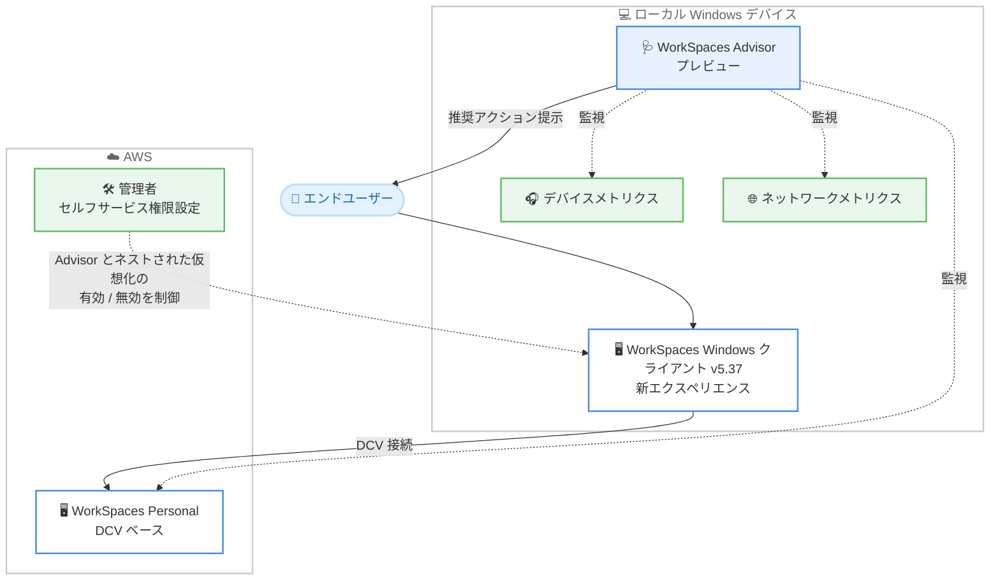

# Amazon WorkSpaces - 新しい Windows クライアントエクスペリエンス

**リリース日**: 2026 年 11 月 17 日
**サービス**: Amazon WorkSpaces
**機能**: Amazon WorkSpaces Personal 向け新 Windows クライアントエクスペリエンス (WorkSpaces Advisor パブリックプレビュー含む)

📊 [このアップデートのインフォグラフィックを見る](https://takech9203.github.io/aws-news-summary/20261117-workspaces-new-windows-client.html)

## 概要

Amazon WorkSpaces は、Amazon WorkSpaces Personal 向けに新しい Windows クライアントエクスペリエンスを提供開始しました。Windows クライアントバージョン 5.37 以降では、刷新されたインターフェイス、簡素化された接続フロー、見つけやすい設定画面を備えた新エクスペリエンスがデフォルトとなります。従来の (クラシック) エクスペリエンスとの切り替えも可能で、選択は次回起動時にも記憶されます。

今回のアップデートの目玉は、新機能「WorkSpaces Advisor」のプロアクティブトラブルシューティング (パブリックプレビュー) です。WorkSpaces Advisor は、ユーザーのデバイス、ネットワーク、WorkSpace 自体の主要メトリクスを監視し、登録・サインイン・接続全般に問題がある場合に、ユーザー自身で実行できる対処方法を提案します。これにより、エンドユーザーは管理者やサポートに問い合わせる前に、一般的な問題を自己解決できるようになります。

このほか、改善されたフルスクリーン体験、初回起動時のウェルカムツアー、管理者が許可した WorkSpace でのネストされた仮想化を有効化するセルフサービスオプションなども含まれています。VDI 環境を運用する IT 管理者と、日常的に WorkSpaces を利用するエンドユーザーの双方にとって、運用負荷の軽減と利便性向上につながるアップデートです。

**アップデート前の課題**

- 接続やサインインに問題が発生した場合、原因がデバイス側・ネットワーク側・WorkSpace 側のどこにあるかをエンドユーザー自身で切り分けることが難しく、管理者やサポートへの問い合わせが必要だった
- クライアントの設定項目やセッション中のツールが分散しており、必要な機能を見つけにくかった
- エラーメッセージの情報が限られており、ユーザーが取るべき対処方法がわかりにくかった
- ネストされた仮想化の有効化には管理者側での操作が必要だった

**アップデート後の改善**

- WorkSpaces Advisor (プレビュー) が接続前・接続中・切断後を通してセッションを監視し、問題検知時にアイコンの色とアラート表示で通知、実行可能な推奨アクションを提示するようになった
- 刷新された UI により、設定・セッションツール・デバイス管理 (カメラ、マイク、オーディオ、USB)・ファイル転送などに統合ツールバーからアクセスできるようになった
- 接続エラーや切断イベントに、発生した事象の説明と解決手順が表示されるようになった
- 管理者が許可した WorkSpace では、エンドユーザーがセルフサービスでネストされた仮想化を有効化できるようになった
- 初回起動時と初回セッションでウェルカムツアーが表示され、ヘルプメニューからいつでも再生できるようになった

## アーキテクチャ図



WorkSpaces Advisor (プレビュー) は、ローカルデバイス・ネットワーク・WorkSpace の 3 つの観点でメトリクスを監視し、登録・サインイン・接続に問題が発生した際にユーザーへ推奨アクションを提示します。管理者はセルフサービス権限で Advisor とネストされた仮想化の有効 / 無効を制御できます。

## サービスアップデートの詳細

### 主要機能

1. **WorkSpaces Advisor プロアクティブトラブルシューティング (パブリックプレビュー)**
   - 接続前・接続中・切断後を通して、デバイス・ネットワーク・WorkSpaces サービスの主要メトリクスを監視
   - 登録、サインイン、接続全般、セッション切断時に問題が検知されると、アイコンの色が変化しアラートインジケーターを表示
   - パネルを開くと、問題の詳細と実行可能な推奨アクションを確認可能
   - ネットワークチェックには、設定画面で構成したプロキシを使用
   - デフォルトで有効 (管理者は無効化可能)

2. **刷新されたインターフェイスと簡素化された接続フロー**
   - クリーンなレイアウトとモダンなデザインで、設定とツールを見つけやすく再設計
   - WorkSpace の登録・接続フローを簡素化し、頻繁にアクセスする WorkSpaces の管理オプションを追加
   - ライト / ダーク / システム追従のカラーテーマをサポート
   - 接続エラーと切断イベントに、事象の説明と解決手順を表示する改善されたエラーメッセージ

3. **新しい統合ツールバーとフルスクリーン体験の改善**
   - セッション中にキーボードショートカット、デバイス制御 (カメラ、マイク、オーディオ、USB)、ファイル転送、WorkSpaces Advisor へアクセスできる統合ツールバー
   - ウィンドウモードではタイトルバーに統合され、フルスクリーンモードでは画面上部にフローティング表示後に自動的に隠れる (ピン留めで常時表示も可能)
   - 前回使用したディスプレイでの起動、ウィンドウ状態・サイズ・位置の復元に対応

4. **ウェルカムツアーとセルフサービス機能**
   - 初回起動時と初回セッションでウェルカムツアーを表示し、操作方法をガイド (ヘルプメニューからいつでも再生可能)
   - 管理者が許可した WorkSpace では、ネストされた仮想化をセルフサービスで有効化可能
   - マイクとスピーカーの選択、相対マウスモード (CAD やゲームなどのグラフィックスアプリケーション向け)、mailto / ftp リンクのローカルデバイスへのリダイレクトなどの機能も追加

## 技術仕様

### クライアント要件と対応環境

| 項目 | 詳細 |
|------|------|
| 対象クライアント | Amazon WorkSpaces Windows クライアント バージョン 5.37 以降 |
| OS 要件 | Microsoft がサポートする Windows 11 |
| 対応プロトコル | 新エクスペリエンスは DCV ベースの WorkSpaces のみ対応 |
| PCoIP / WorkSpaces Pools | クラシックエクスペリエンスで自動的に開く (再サインイン不要) |
| デフォルト動作 | 新エクスペリエンスがデフォルト。[Return to classic] で切り替え可能で、選択は記憶される |
| 管理者制御 | Client Experience Policy で特定のエクスペリエンスを強制可能 |
| WorkSpaces Advisor | パブリックプレビュー。デフォルトで有効 |

### API 変更履歴

| 日付 | サービス | 変更内容 |
|------|----------|----------|
| 2026/11/17 | [workspaces](https://awsapichanges.com/archive/changes/a370bc-workspaces.html) | 2 updated api methods - `ModifySelfservicePermissions` に `NestedVirtualization` と `EnableEndUserAdvisor` のセルフサービス権限を追加。ディレクトリ単位でネストされた仮想化と End User Advisor の有効 / 無効を切り替え、`DescribeWorkspaceDirectories` で設定を確認可能。End User Advisor はデフォルトで有効 |

### セルフサービス権限の設定例

```bash
# ディレクトリのセルフサービス権限を変更
# WorkSpaces Advisor とネストされた仮想化の有効 / 無効を制御
aws workspaces modify-selfservice-permissions \
  --resource-id d-xxxxxxxxxx \
  --selfservice-permissions \
    "EnableEndUserAdvisor=ENABLED,NestedVirtualization=ENABLED"
```

## 設定方法

### 前提条件

1. DCV ベースの Amazon WorkSpaces Personal を利用していること
2. Windows 11 を実行するローカルデバイスであること
3. Amazon WorkSpaces Windows クライアント バージョン 5.37 以降をインストールしていること

### 手順

#### ステップ 1: 最新クライアントのインストール

```text
https://clients.amazonworkspaces.com/ からクライアントをダウンロードしてインストール
```

Amazon WorkSpaces Client Download ページから最新の Windows クライアントを取得します。「自分のみにインストール」と「デバイスの全ユーザーにインストール」の 2 つのオプションがあり、USB リダイレクトドライバーを使用する場合は全ユーザー向けインストールが必要です。

#### ステップ 2: 新エクスペリエンスでの接続

バージョン 5.37 以降では、クライアント起動時に新エクスペリエンスがデフォルトで開きます。初回起動時にはウェルカムツアーが表示され、主要な操作を確認できます。クラシックエクスペリエンスに戻す場合は、画面右上の [Return to classic] を選択します。

#### ステップ 3: WorkSpaces Advisor の利用

セッションの接続前・接続中・切断後に問題が検知されると、ツールバーの WorkSpaces Advisor (プレビュー) アイコンの色が変わり、アラートが表示されます。アイコンを選択してパネルを開き、問題の詳細と推奨される対処方法を確認して実行します。

#### ステップ 4: 管理者によるセルフサービス権限の制御 (オプション)

管理者は `ModifySelfservicePermissions` API または WorkSpaces コンソールから、ディレクトリ単位で End User Advisor とネストされた仮想化のセルフサービス権限を制御できます。End User Advisor はデフォルトで有効です。

## メリット

### ビジネス面

- **サポートコストの削減**: WorkSpaces Advisor がユーザー自身による問題解決を支援するため、ヘルプデスクへの問い合わせ件数と解決までの時間を削減できる
- **エンドユーザーの生産性向上**: 簡素化された接続フローとわかりやすいエラーメッセージにより、接続トラブルによる業務中断時間を短縮できる
- **追加コストなし**: 新クライアントエクスペリエンスは追加料金なしで利用できる

### 技術面

- **プロアクティブな問題検知**: デバイス・ネットワーク・WorkSpace の 3 層で主要メトリクスを監視し、問題の切り分けを自動化できる
- **段階的な移行が可能**: 新旧エクスペリエンスを切り替えられ、管理者は Client Experience Policy で利用するエクスペリエンスを制御できる
- **セルフサービスの拡充**: ネストされた仮想化の有効化や診断ログのオンデマンド送信 (AWS Support 向け参照コード付き) など、ユーザー側で完結する操作が増加した

## デメリット・制約事項

### 制限事項

- 新クライアントエクスペリエンスは DCV ベースの WorkSpaces のみ対応。PCoIP ベースの WorkSpaces と WorkSpaces Pools はクラシックエクスペリエンスで自動的に開く
- WorkSpaces Advisor はパブリックプレビューであり、仕様が変更される可能性がある
- クライアント要件として Microsoft がサポートする Windows 11 が必要
- USB リダイレクトドライバーはクライアント設定メニューからはダウンロードできず、全ユーザー向けインストール時にのみ導入可能

### 考慮すべき点

- 管理者が Client Experience Policy でエクスペリエンスを固定している場合、ユーザーは切り替えできない
- ネストされた仮想化のセルフサービスオプションは、管理者が許可した WorkSpace でのみ利用可能
- セッション切断後に短い満足度調査が表示されることがある
- エクスペリエンスの切り替えには数秒程度の時間がかかる場合がある

## ユースケース

### ユースケース 1: ヘルプデスク問い合わせの削減

**シナリオ**: 数千人規模で WorkSpaces を利用する企業で、接続不良やサインイン失敗に関するヘルプデスク問い合わせが多く、一次切り分けに時間がかかっている。

**実装例**:
```text
1. クライアントをバージョン 5.37 以降に更新 (新エクスペリエンスと Advisor はデフォルト有効)
2. エンドユーザー向けに WorkSpaces Advisor の利用方法を周知
3. 解決しない場合は、診断ログのオンデマンド送信で参照コードを取得し AWS Support へ連携
```

**効果**: ユーザーがデバイス・ネットワーク・WorkSpace のどこに問題があるかを自己確認し推奨アクションで解決できるため、ヘルプデスクの一次対応工数を削減できる。

### ユースケース 2: 開発者向け WorkSpace でのネストされた仮想化の有効化

**シナリオ**: 開発者がコンテナやローカル VM を利用するために、WorkSpace 上でネストされた仮想化を利用したいが、従来は管理者への申請と設定作業が必要だった。

**実装例**:
```bash
# 管理者: ディレクトリでネストされた仮想化のセルフサービスを許可
aws workspaces modify-selfservice-permissions \
  --resource-id d-xxxxxxxxxx \
  --selfservice-permissions "NestedVirtualization=ENABLED"

# 開発者: 新クライアントのセルフサービスメニューから有効化
```

**効果**: 管理者の個別対応なしで、開発者が必要なタイミングで自身の WorkSpace のネストされた仮想化を有効化でき、開発環境のセットアップが迅速化する。

### ユースケース 3: マルチディスプレイ環境での快適なリモートワーク

**シナリオ**: 在宅勤務のユーザーが外部ディスプレイを複数接続し、フルスクリーンで WorkSpace を利用している。従来はディスプレイ構成の変更時に設定し直す手間があった。

**実装例**:
```text
1. 新エクスペリエンスのツールバーからフルスクリーンモードを選択
2. フローティングツールバーをピン留め、またはドラッグで位置調整
3. 次回接続時は前回のディスプレイ・ウィンドウ状態が自動復元される
```

**効果**: ディスプレイやウィンドウの状態が記憶・復元されるため、ドッキングステーションの着脱が多い環境でも再設定の手間なく作業を再開できる。

## 料金

新しいクライアントエクスペリエンス (WorkSpaces Advisor パブリックプレビューを含む) は、追加料金なしで利用できます。Amazon WorkSpaces Personal 自体の料金は、従来どおりバンドルと課金モード (月額または時間単位) に応じて発生します。

## 利用可能リージョン

Amazon WorkSpaces Personal が利用可能なすべての AWS リージョンで、追加料金なしで利用できます (東京、大阪リージョンを含む)。

## 関連サービス・機能

- **Amazon DCV**: 新クライアントエクスペリエンスが対応するストリーミングプロトコル。高品質なリモートディスプレイ体験を提供
- **WorkSpaces Client Experience Policy**: 管理者がユーザーに提供するクライアントエクスペリエンス (新 / クラシック) を制御するポリシー
- **Amazon WorkSpaces Pools**: 非永続型のプール型仮想デスクトップ。現時点ではクラシックエクスペリエンスで動作
- **AWS Support**: 新しい診断ログのオンデマンド送信機能で発行される参照コードを使用した問い合わせが可能

## 参考リンク

- 📊 [インフォグラフィック](https://takech9203.github.io/aws-news-summary/20261117-workspaces-new-windows-client.html)
- [公式発表 (What's New)](https://aws.amazon.com/about-aws/whats-new/2026/11/workspaces-new-windows-client)
- [Amazon WorkSpaces Windows クライアントドキュメント](https://docs.aws.amazon.com/workspaces/latest/userguide/amazon-workspaces-windows-client.html)
- [Amazon WorkSpaces クライアントダウンロード](https://clients.amazonworkspaces.com/)
- [Amazon WorkSpaces 料金ページ](https://aws.amazon.com/workspaces/pricing/)

## まとめ

Amazon WorkSpaces Personal の Windows クライアントが刷新され、WorkSpaces Advisor (パブリックプレビュー) によるプロアクティブなトラブルシューティングが利用可能になりました。接続問題の自己解決を支援することでヘルプデスクの負荷軽減が期待できるため、WorkSpaces を運用する組織はクライアントのバージョン 5.37 以降への更新と、新エクスペリエンスのユーザーへの展開を検討することを推奨します。PCoIP ベースの WorkSpaces を利用中の場合はクラシックエクスペリエンスが引き続き使用される点に留意してください。
