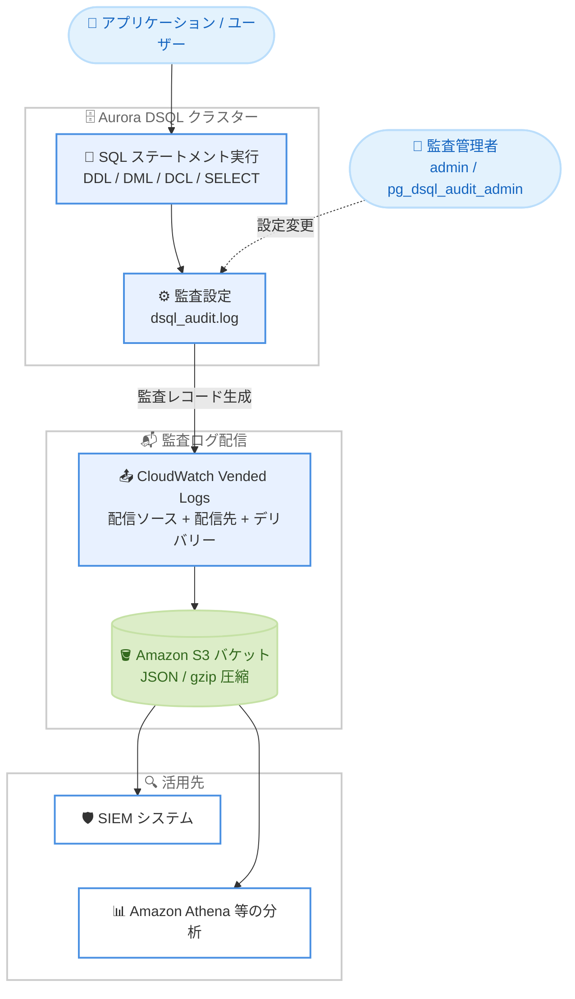

# Amazon Aurora DSQL - 監査ログ (Audit Logging) サポート

**リリース日**: 2026 年 11 月 18 日
**サービス**: Amazon Aurora DSQL
**機能**: 監査ログ (Audit Logging)

📊 [このアップデートのインフォグラフィックを見る](https://takech9203.github.io/aws-news-summary/20261118-amazon-aurora-dsql-audit-logging.html)

## 概要

Amazon Aurora DSQL が、クラスター上で実行された SQL ステートメントを記録するフルマネージドな監査ログ機能をサポートしました。DDL、DML、DCL、SELECT ステートメントについて、ステートメント本文、バインドパラメータ、実行者 (PostgreSQL ロールと AWS IAM アイデンティティの両方)、タイムスタンプ、テーブル名、トランザクション識別子などの詳細を記録できます。

監査レコードは Amazon CloudWatch Vended Logs を通じて、ユーザー所有の Amazon S3 バケットに構造化された JSON 形式 (gzip 圧縮、1 行 1 レコード) で配信されます。有効化は SQL の設定変更のみで完結し、拡張機能のロードやログ転送パイプラインの構築は不要です。金融機関をはじめとする規制対象の組織が、本番環境でのコンプライアンス要件を満たすために活用できる機能です。

**アップデート前の課題**

このアップデート以前は、Aurora DSQL のデータベース内部のアクティビティを記録する手段がありませんでした。

- AWS CloudTrail はクラスターへの API 呼び出しと接続試行のみを記録し、接続後に実行された SQL ステートメントは記録できなかった
- 誰がどのデータをいつ変更したかを証明する監査証跡を残せず、金融機関などの規制要件を満たすことが困難だった
- セキュリティインシデント発生時に、データベース内部で何が行われたかを再構築する手段がなかった

**アップデート後の改善**

今回のアップデートにより、データベース内部の監査証跡を標準機能として取得できるようになりました。

- DDL / DML / DCL / SELECT の各ステートメントを、実行者情報やバインドパラメータとともに記録できるようになった
- 監査レコードが構造化 JSON として S3 バケットに自動配信され、SIEM システムへの直接連携が可能になった
- SQL の設定 1 つで有効化でき、拡張機能のロードやログ転送パイプラインの構築が不要になった

## アーキテクチャ図



Aurora DSQL クラスター上で実行された SQL ステートメントが監査設定に基づいて記録され、CloudWatch Vended Logs 経由で S3 バケットに JSON 形式で配信されます。配信されたレコードは SIEM や分析ツールで活用できます。

## サービスアップデートの詳細

### 主要機能

1. **SQL ステートメントの包括的な記録**
   - DDL、DML (書き込み)、DCL (ロール・権限管理)、SELECT (読み取り)、関数呼び出しなどをクラスごとに選択して記録
   - ステートメント本文、バインドパラメータ値、影響行数、タイムスタンプ、テーブル名、トランザクション識別子を記録可能
   - 実行者として PostgreSQL ロールと AWS IAM アイデンティティの両方を記録

2. **CloudWatch Vended Logs による S3 への配信**
   - 配信ソース (クラスター)、配信先 (S3 バケット)、デリバリーを登録するだけで配信が開始
   - 監査レコードは gzip 圧縮ファイルとして S3 に配信され、1 行につき 1 つの JSON レコードを格納
   - `--record-fields` オプションで配信するフィールドを絞り込み可能

3. **ロール単位・クラスター全体の柔軟な監査設定**
   - `ALTER SYSTEM SET dsql_audit.log = 'ddl,role,write'` でクラスター全体のベースラインを設定
   - `sys.set_audit_config` 関数でロールごとに設定を上書き (モニタリング用ロールの除外なども可能)
   - 監査設定の変更自体は常に記録されるため、誰がいつ設定を変更したかも追跡可能

4. **マルチリージョンクラスター対応**
   - クラスターグループ内のすべてのクラスターが同じ監査設定を共有
   - ログ配信はリージョンごとに設定が必要で、未設定のリージョンがあると監査設定の変更はエラーになる

## 技術仕様

### 監査設定パラメータ

| 設定 | デフォルト | 説明 |
|------|-----------|------|
| `dsql_audit.log` | none | 監査対象のステートメントクラス。カンマ区切りで指定し、`all` や `none`、除外指定 (`all,-misc`) も可能 |
| `dsql_audit.log_parameter` | off | on にするとバインドパラメータの値を `parameters` フィールドに記録 |
| `dsql_audit.log_parameter_max_size` | 0 | 記録する可変長パラメータ値の最大サイズ (バイト)。コスト削減のため 4096 (4 KB) が推奨 |
| `dsql_audit.log_rows` | off | on にすると読み取り・変更された行数を `rows_affected` フィールドに記録 |
| `dsql_audit.log_statement` | on | ステートメント本文を `statement_text` フィールドに記録 |

### ステートメントクラス

| クラス | 対象ステートメント |
|--------|-------------------|
| read | SELECT、テーブルやクエリをソースとする COPY |
| write | INSERT、UPDATE、DELETE、テーブルを宛先とする COPY |
| function | 関数呼び出し |
| role | GRANT、REVOKE、CREATE/ALTER/DROP ROLE、AWS IAM GRANT/REVOKE などのロール・権限管理 |
| ddl | role クラスに含まれないすべての DDL ステートメント |
| misc | 他のクラスに含まれないステートメント (SET など)。misc_set を含む |
| misc_set | SET ステートメント |

### 権限

- 監査設定を変更できるのは、組み込みの `admin` ロールまたは `pg_dsql_audit_admin` のメンバーのみ
- ログ配信の設定には、CloudWatch Logs の配信関連 API (`PutDeliverySource`、`PutDeliveryDestination`、`CreateDelivery` など) を呼び出す IAM 権限が必要

## 設定方法

### 前提条件

1. Aurora DSQL クラスターが作成済みであること (マルチリージョン構成の場合は構成完了済みであること)
2. 監査レコードを受け取る Amazon S3 バケットが作成済みであること (監査ログ専用バケットを推奨)
3. IAM アイデンティティに CloudWatch Logs 配信設定に必要な権限があること
4. `admin` など監査設定を変更できるロールでクラスターに接続できること

### 手順

#### ステップ1: クラスターを配信ソースとして登録

```bash
aws logs put-delivery-source \
  --name my-cluster-audit-logs \
  --resource-arn arn:aws:dsql:us-east-1:111122223333:cluster/your-cluster-id \
  --log-type AUDIT_LOGS \
  --region us-east-1
```

Aurora DSQL クラスターを、`AUDIT_LOGS` ログタイプの CloudWatch Vended Logs 配信ソースとして登録します。

#### ステップ2: S3 バケットを配信先として登録

```bash
aws logs put-delivery-destination \
  --name my-audit-log-destination \
  --output-format json \
  --delivery-destination-configuration destinationResourceArn=arn:aws:s3:::amzn-s3-demo-destination-bucket \
  --region us-east-1
```

監査レコードの出力先となる S3 バケットを JSON 出力形式の配信先として登録します。出力される配信先 ARN は次のステップで使用します。

#### ステップ3: デリバリーを作成

```bash
aws logs create-delivery \
  --delivery-source-name my-cluster-audit-logs \
  --delivery-destination-arn arn:aws:logs:us-east-1:111122223333:delivery-destination:my-audit-log-destination \
  --region us-east-1
```

配信ソースと配信先を接続してデリバリーを作成します。バケットポリシーに CloudWatch Logs からの配信を許可するステートメントがない場合は、自動的に追加されます。

#### ステップ4: 監査設定を構成

```sql
-- クラスター全体のベースライン設定 (データや権限を変更するクラスを推奨)
ALTER SYSTEM SET dsql_audit.log = 'ddl,role,write';

-- 特定ロールの設定 (バインドパラメータと行数も記録)
SELECT sys.set_audit_config('app_user', 'dsql_audit.log', 'ddl,role,write');
SELECT sys.set_audit_config('app_user', 'dsql_audit.log_parameter', 'on');
SELECT sys.set_audit_config('app_user', 'dsql_audit.log_rows', 'on');
```

クラスターに `admin` または `pg_dsql_audit_admin` メンバーのロールで接続し、監査対象のステートメントクラスを設定します。設定変更は新しい接続に適用され、反映まで数分かかる場合があります。

#### ステップ5: 配信状態と監査レコードの確認

```sql
-- 配信設定の確認 (リージョンごとに has_delivery が t であること)
SELECT * FROM sys.audit_delivery_status();
```

```bash
# S3 バケット内の監査ログファイルを確認
aws s3 ls s3://amzn-s3-demo-destination-bucket/AWSLogs/111122223333/dsql/ --recursive
```

`sys.audit_delivery_status()` で配信ソースの登録状態を確認し、監査対象のステートメントを実行した後、S3 バケットにレコードが到着していることを確認します。到着まで数分かかる場合があります。

## メリット

### ビジネス面

- **コンプライアンス要件への対応**: 金融機関などの規制対象組織が求める「誰がどのデータをいつ変更したか」の監査証跡を標準機能で取得でき、監査人への説明責任を果たせる
- **インシデント対応力の向上**: セキュリティインシデント発生後に、データベース内部で実行された操作を正確に再構築できる
- **運用コストの削減**: ログ収集パイプラインの構築・保守が不要になり、監査基盤の運用負荷を軽減できる

### 技術面

- **フルマネージドかつ簡単な有効化**: SQL の設定 1 つで有効化でき、拡張機能のロードやエージェントの導入が不要
- **構造化 JSON による連携の容易さ**: S3 上の JSON レコードを SIEM や Amazon Athena などにそのまま取り込める
- **柔軟な粒度制御**: ステートメントクラス単位・ロール単位で監査対象を制御でき、モニタリング用ロールの除外などでログ量とコストを最適化できる
- **IAM と PostgreSQL ロールの両方を記録**: Aurora DSQL の IAM ベース認証と組み合わせて、実行者を一意に特定できる

## デメリット・制約事項

### 制限事項

- 監査設定の変更前に、ログ配信 (配信ソース・配信先・デリバリー) の設定が必要
- 実行前に失敗したステートメント (構文エラーなど) は監査レコードが生成されない
- `pg_catalog` スキーマのシステムカタログテーブルのみにアクセスするステートメントは監査対象外
- バックアップから復元したクラスターは監査設定を引き継ぐが、ログ配信は引き継がないため再設定が必要 (未設定の間は `AuditLogDeliveryNotConfigured` メトリクスで影響トランザクション数を確認可能)
- マルチリージョンクラスターでは、全リージョンでログ配信を設定しないと監査設定の変更がエラーになる

### 考慮すべき点

- `read` クラスを含むすべてのステートメントを監査すると監査レコード量が大幅に増加し、配信・ストレージコストが増大する。AWS は `ddl`、`role`、`write` のみの監査を推奨
- 監査設定の変更は新しい接続にのみ適用され、反映まで数分かかる場合があるため、最新設定を使うには再接続が必要
- バインドパラメータの記録 (`dsql_audit.log_parameter`) を有効にする場合、`dsql_audit.log_parameter_max_size` を 4096 に設定してコストを抑えることが推奨される
- DPU 料金、CloudWatch Logs 配信料金、S3 ストレージ料金の 3 種類のコストが発生するため、事前に見積もりが必要

## ユースケース

### ユースケース1: 金融機関のコンプライアンス監査

**シナリオ**: 金融機関が Aurora DSQL 上の勘定系データベースについて、データや権限の変更をすべて記録し、監査人に証跡を提示する必要がある。

**実装例**:
```sql
-- クラスター全体でデータ・権限変更を監査
ALTER SYSTEM SET dsql_audit.log = 'ddl,role,write';

-- アプリケーションロールは行数とパラメータも記録
SELECT sys.set_audit_config('app_user', 'dsql_audit.log_rows', 'on');
SELECT sys.set_audit_config('app_user', 'dsql_audit.log_parameter', 'on');
SELECT sys.set_audit_config('app_user', 'dsql_audit.log_parameter_max_size', '4096');
```

**効果**: すべてのデータ変更と権限変更が実行者 (IAM アイデンティティ含む) とともに S3 に保存され、監査人の要求に対して変更の説明責任を果たせる。

### ユースケース2: SIEM システムへのリアルタイム連携

**シナリオ**: セキュリティチームが、データベースへの不審な操作 (権限昇格、大量削除など) を SIEM で検知したい。

**実装例**:
```bash
# 実行者と操作内容に絞ったフィールドで配信を作成
aws logs create-delivery \
  --delivery-source-name my-cluster-audit-logs \
  --delivery-destination-arn arn:aws:logs:us-east-1:111122223333:delivery-destination:my-audit-log-destination \
  --record-fields resource_arn event_timestamp iam_arn session_user class command object_type object_name \
  --region us-east-1
```

**効果**: S3 に配信される JSON レコードを SIEM が直接取り込み、権限変更や DDL 操作をほぼリアルタイムで監視・アラートできる。配信フィールドの絞り込みによりログ量も最適化できる。

### ユースケース3: セキュリティインシデント後のフォレンジック調査

**シナリオ**: 不正アクセスの疑いが発生し、特定期間にデータベースで実行された操作を時系列で再構築する必要がある。

**実装例**:
```bash
# 対象期間の監査ログファイルを取得して展開
aws s3 ls s3://amzn-s3-demo-destination-bucket/AWSLogs/111122223333/dsql/us-east-1/2026/11/18/ --recursive
aws s3 cp s3://amzn-s3-demo-destination-bucket/AWSLogs/111122223333/dsql/us-east-1/2026/11/18/10/example-object-key.gz - | gunzip
```

**効果**: タイムスタンプ、トランザクション識別子、ステートメント本文、実行者情報から、インシデント時の操作を正確に再構築し、影響範囲を特定できる。

## 料金

監査ログの利用には以下の 3 種類の料金が発生します。

- **Aurora DSQL DPU 料金**: 監査レコードの生成に伴う DPU 消費 (請求上は Aurora DSQL に計上)
- **CloudWatch Logs 配信料金**: Vended Logs による S3 への配信 (請求上は CloudWatch に計上)
- **Amazon S3 ストレージ料金**: 監査レコードの保存 (請求上は S3 に計上)

コスト最適化のため、AWS はデータや権限を変更するクラス (`ddl`、`role`、`write`) のみの監査を推奨しています。詳細は [Aurora DSQL 料金ページ](https://aws.amazon.com/rds/aurora/dsql/pricing/)、[Amazon CloudWatch 料金ページ](https://aws.amazon.com/cloudwatch/pricing/)、[Amazon S3 料金ページ](https://aws.amazon.com/s3/pricing/) を参照してください。

## 利用可能リージョン

Amazon Aurora DSQL が利用可能なすべての AWS リージョンで利用できます。

## 関連サービス・機能

- **AWS CloudTrail**: Aurora DSQL の API 呼び出しと接続試行を記録。監査ログは接続後の SQL ステートメントを記録するため、両者は補完関係にある
- **Amazon CloudWatch Logs (Vended Logs)**: 監査レコードの S3 への配信基盤。配信ソース・配信先・デリバリーの管理に使用
- **Amazon S3**: 監査レコードの保存先。バケットポリシーやライフサイクルルールで保持期間とアクセス制御を管理
- **AWS IAM**: Aurora DSQL の認証基盤。監査レコードには IAM アイデンティティも記録されるため、実行者の一意な特定が可能

## 参考リンク

- 📊 [インフォグラフィック](https://takech9203.github.io/aws-news-summary/20261118-amazon-aurora-dsql-audit-logging.html)
- [公式発表 (What's New)](https://aws.amazon.com/about-aws/whats-new/2026/11/amazon-aurora-dsql-audit-logging/)
- [ドキュメント: Audit logging](https://docs.aws.amazon.com/aurora-dsql/latest/userguide/audit-logging.html)
- [ドキュメント: Getting started with audit logging](https://docs.aws.amazon.com/aurora-dsql/latest/userguide/audit-logging-setup.html)
- [ドキュメント: Configuring audit settings](https://docs.aws.amazon.com/aurora-dsql/latest/userguide/audit-logging-configure.html)
- [Amazon Aurora DSQL 製品ページ](https://aws.amazon.com/rds/aurora/dsql/)
- [料金ページ](https://aws.amazon.com/rds/aurora/dsql/pricing/)

## まとめ

Aurora DSQL に監査ログ機能が追加されたことで、CloudTrail では把握できなかったデータベース内部の SQL ステートメントを、実行者情報とともに S3 へ自動配信できるようになりました。金融機関などコンプライアンス要件の厳しい環境で Aurora DSQL を本番採用する際の大きな障壁が解消されます。まずは `ddl`、`role`、`write` クラスの監査から始め、ログ量とコストを確認しながら対象を調整することを推奨します。
