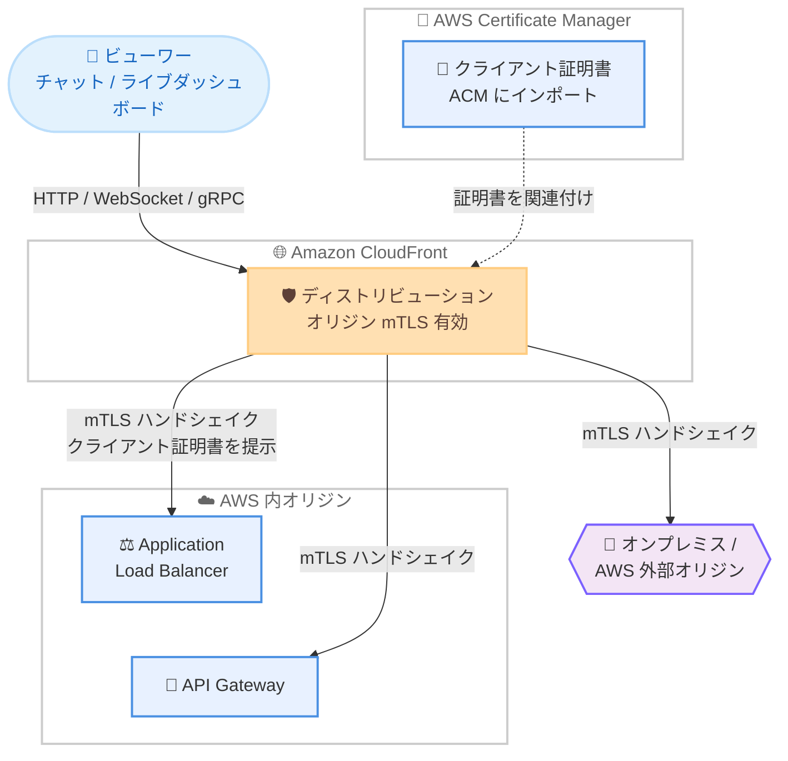

# Amazon CloudFront - オリジン Mutual TLS の WebSocket / gRPC サポート

**リリース日**: 2026 年 11 月 18 日
**サービス**: Amazon CloudFront
**機能**: Origin Mutual TLS (mTLS) の WebSocket および gRPC トラフィック対応

📊 [このアップデートのインフォグラフィックを見る](https://takech9203.github.io/aws-news-summary/20261118-amazon-cloudfront-origin-mtls-websockets-grpc.html)

## 概要

Amazon CloudFront が、オリジンへの WebSocket および gRPC トラフィックに対する Mutual TLS (mTLS) 認証のサポートを発表しました。これまで HTTP トラフィックで利用できたオリジン mTLS が、持続的な双方向通信やストリーミング通信を行うプロトコルにも拡張され、CloudFront からアプリケーションオリジンへの接続を TLS クライアント証明書で認証できるようになります。

オリジン mTLS では、CloudFront がクライアントとして TLS ハンドシェイク時にクライアント証明書をオリジンサーバーに提示し、オリジン側がその証明書をトラストストアと照合して検証します。これにより、許可された CloudFront ディストリビューションからのリクエストのみをオリジンが受け入れることができ、チャットプラットフォーム、共同編集ツール、ライブダッシュボードなど、WebSocket や gRPC を利用するアプリケーションを未認証のリクエストから保護できます。

対象となるオリジンは、Application Load Balancer や API Gateway などの AWS 内のアプリケーションオリジンに加え、オンプレミスのオリジンや AWS 外部でホストされているオリジンも含まれます。追加料金は不要で、従量課金制および Business / Premium の定額料金プランで利用できます。

**アップデート前の課題**

このアップデート以前は、WebSocket や gRPC のトラフィックに対して以下の課題がありました。

- WebSocket / gRPC のオリジンでは、CloudFront からのリクエストを識別するために共有シークレット (カスタムヘッダー) や IP 許可リストを使用する必要があった
- 共有シークレットのローテーションや IP リストの維持管理に運用負荷がかかり、証明書ベースの強力な認証が利用できなかった
- HTTP には mTLS を適用できても WebSocket / gRPC には適用できず、プロトコルごとに認証方式が分かれてしまっていた

**アップデート後の改善**

今回のアップデートにより、以下が可能になりました。

- WebSocket / gRPC 接続の確立時にも、TLS 証明書による CloudFront からのリクエスト認証が可能になった
- HTTP、WebSocket、gRPC のすべてのトラフィックで、1 つの TLS ベース認証方式に統一できるようになった
- 共有シークレットや IP 許可リストによる回避策が不要になり、運用負荷が軽減された

## アーキテクチャ図



CloudFront がオリジンへの接続時にクライアント証明書を提示し、オリジン側がトラストストアで検証する構成を示しています。WebSocket / gRPC を含むすべてのプロトコルで同一の証明書ベース認証を利用できます。

## サービスアップデートの詳細

### 主要機能

1. **WebSocket トラフィックのオリジン mTLS 対応**
   - WebSocket 接続のセットアップ時に、CloudFront がクライアント証明書を提示してオリジンに対する認証を実施
   - チャットプラットフォーム、共同編集ツール、ライブダッシュボードなどの持続的・双方向接続を未認証リクエストから保護
   - 共有シークレットや IP 許可リストによる識別が不要になる

2. **gRPC トラフィックのオリジン mTLS 対応**
   - gRPC のストリーミング通信においても証明書ベースの認証が可能
   - マイクロサービスや B2B API のバックエンドを、許可されたディストリビューション以外からのアクセスから保護

3. **プロトコル横断での認証方式の統一**
   - HTTP、WebSocket、gRPC のトラフィックを 1 つの TLS ベース認証に統一
   - AWS 内オリジン (Application Load Balancer、API Gateway など)、オンプレミスオリジン、AWS 外部のオリジンのいずれにも適用可能

## 技術仕様

### オリジン mTLS の動作

| 項目 | 詳細 |
|------|------|
| 認証方式 | Mutual TLS (双方向の証明書認証) |
| CloudFront の役割 | クライアントとして TLS ハンドシェイク時にクライアント証明書を提示 |
| オリジンの役割 | トラストストアによる証明書検証、有効期限確認、失効確認 (CRL / OCSP) |
| 証明書管理 | クライアント証明書を AWS Certificate Manager (ACM) にインポートして利用 |
| 対応プロトコル | HTTP、WebSocket、gRPC |
| 対応オリジン | Application Load Balancer、API Gateway などの AWS 内オリジン、オンプレミス、AWS 外部オリジン |

**注意**: CloudFront はクライアント証明書の提示のみを行い、証明書の有効性や失効状態の検証は行いません。検証ロジックとセキュリティポリシーの適用は、すべてオリジンサーバー側の責任となります。

## 設定方法

### 前提条件

1. CloudFront ディストリビューションが作成済みであること
2. オリジンサーバーが mTLS をサポートし、クライアント証明書の要求・検証が可能であること
3. CloudFront のクライアント証明書を発行した CA 証明書を、オリジンのトラストストアに登録できること

### 手順

#### ステップ 1: クライアント証明書を ACM にインポート

CloudFront がオリジンに提示するクライアント証明書を AWS Certificate Manager にインポートします。

```bash
aws acm import-certificate \
  --certificate fileb://client-cert.pem \
  --private-key fileb://client-key.pem \
  --certificate-chain fileb://chain.pem \
  --region us-east-1
```

このコマンドは、クライアント証明書、秘密鍵、証明書チェーンを ACM にインポートし、CloudFront から参照できる証明書 ARN を発行します。

#### ステップ 2: オリジンサーバーで mTLS を要求するよう設定

オリジン側 (ALB、API Gateway、オンプレミスのリバースプロキシなど) で、TLS ハンドシェイク時にクライアント証明書を要求し、CA 証明書をトラストストアに登録して検証するように構成します。証明書の有効期限確認や失効確認 (CRL / OCSP) のポリシーもオリジン側で定義します。

#### ステップ 3: CloudFront ディストリビューションでオリジン mTLS を有効化

CloudFront ディストリビューションのオリジン設定で、ステップ 1 でインポートしたクライアント証明書を関連付け、オリジン mTLS を有効にします。詳細な手順は [公式ドキュメント](https://docs.aws.amazon.com/AmazonCloudFront/latest/DeveloperGuide/origin-mtls-authentication.html) を参照してください。

設定後、WebSocket / gRPC を含むオリジンへの接続時に、CloudFront がクライアント証明書を提示するようになります。

## メリット

### ビジネス面

- **セキュリティ強化**: リアルタイムアプリケーションのオリジンを未認証アクセスから保護し、中間者攻撃や直接アクセスのリスクを低減できる
- **運用負荷の削減**: 共有シークレットのローテーションや IP 許可リストの維持管理が不要になり、運用コストを削減できる
- **追加費用なし**: オリジン mTLS は追加料金なしで利用でき、既存の料金プランの範囲内でセキュリティを強化できる

### 技術面

- **認証方式の統一**: HTTP、WebSocket、gRPC のすべてで同一の証明書ベース認証を利用でき、アーキテクチャがシンプルになる
- **ハイブリッド / マルチクラウド対応**: AWS 内オリジンだけでなく、オンプレミスや他クラウドのオリジンにも一貫した認証を適用できる
- **標準プロトコル準拠**: 独自実装のヘッダー検証ではなく、標準的な mTLS による強力な認証を利用できる

## デメリット・制約事項

### 制限事項

- CloudFront はクライアント証明書の提示のみを行い、証明書の検証 (有効期限、失効確認など) はオリジン側の責任となる
- オリジンサーバーが mTLS (クライアント証明書の要求・検証) をサポートしている必要がある
- クライアント証明書は ACM にインポートして管理する必要がある

### 考慮すべき点

- 証明書の有効期限管理とローテーションの運用プロセスを整備する必要がある
- オリジン側でトラストストアの管理、認証失敗時のハンドリング、接続イベントのログ・モニタリングを設計する必要がある
- 既に共有シークレットや IP 許可リストで保護している場合は、mTLS への移行手順 (並行稼働期間など) を計画することが望ましい

## ユースケース

### ユースケース 1: チャットプラットフォームの WebSocket オリジン保護

**シナリオ**: CloudFront 経由で WebSocket を配信するチャットサービスで、ALB 配下のバックエンドが CloudFront 以外からの直接接続を受け付けないようにしたい。

**実装例**:
```
1. チャット用クライアント証明書を ACM にインポート
2. ALB のリスナーで mTLS を有効化し、CA 証明書をトラストストアに登録
3. CloudFront のオリジン設定でクライアント証明書を関連付け
```

**効果**: WebSocket 接続の確立時に証明書認証が行われ、許可された CloudFront ディストリビューション以外からの接続を排除できる。

### ユースケース 2: gRPC マイクロサービスの B2B API 保護

**シナリオ**: SaaS プラットフォームが gRPC ベースの API を CloudFront 経由で公開しており、バックエンドへの直接アクセスを防ぎたい。

**実装例**:
```
1. API 用クライアント証明書を ACM にインポート
2. オリジンの gRPC サーバーでクライアント証明書の検証を有効化
3. CloudFront のオリジン設定でオリジン mTLS を有効化
```

**効果**: gRPC リクエストが許可された CloudFront ディストリビューション経由であることを証明書で検証でき、未認証アクセスや中間者攻撃を防止できる。

### ユースケース 3: ハイブリッド環境のライブダッシュボード

**シナリオ**: オンプレミスでホストするライブダッシュボードのオリジンに対し、IP 許可リストの管理をやめて証明書ベースの認証に統一したい。

**実装例**:
```
1. クライアント証明書を ACM にインポート
2. オンプレミスのリバースプロキシで mTLS を要求するよう設定
3. CloudFront のオリジン設定でオリジン mTLS を有効化し、IP 許可リストを段階的に廃止
```

**効果**: AWS 内外のオリジンで一貫した証明書ベース認証を実現し、IP リスト維持の運用負荷を解消できる。

## 料金

オリジン mTLS の利用に追加料金はかかりません。従量課金制 (pay-as-you-go) に加え、Business および Premium の定額料金プランでも利用できます。

詳細は [CloudFront 料金ページ](https://aws.amazon.com/cloudfront/pricing/) を参照してください。

## 利用可能リージョン

CloudFront はグローバルサービスとして提供されます。今回のアップデートにより、AWS リージョン内のアプリケーションオリジンへの WebSocket / gRPC トラフィックで mTLS がサポートされるほか、オンプレミスや AWS 外部でホストされるオリジンにも適用できます。

## 関連サービス・機能

- **AWS Certificate Manager (ACM)**: CloudFront がオリジンに提示するクライアント証明書のインポートと管理に使用
- **Application Load Balancer**: mTLS 対応の AWS 内オリジンとして、CloudFront からのクライアント証明書を検証可能
- **Amazon API Gateway**: mTLS 対応の AWS 内オリジンとして利用可能
- **CloudFront Functions**: オリジン mTLS と組み合わせて利用可能 (公式ドキュメント参照)
- **Viewer mTLS**: ビューワーと CloudFront の間の mTLS 認証。オリジン mTLS と組み合わせてエンドツーエンドの証明書認証を構成可能

## 参考リンク

- 📊 [インフォグラフィック](https://takech9203.github.io/aws-news-summary/20261118-amazon-cloudfront-origin-mtls-websockets-grpc.html)
- [公式発表 (What's New)](https://aws.amazon.com/about-aws/whats-new/2026/11/amazon-cloudfront-origin-mtls-websockets-grpc/)
- [ドキュメント: Origin mutual TLS with CloudFront](https://docs.aws.amazon.com/AmazonCloudFront/latest/DeveloperGuide/origin-mtls-authentication.html)
- [料金ページ](https://aws.amazon.com/cloudfront/pricing/)

## まとめ

CloudFront のオリジン mTLS が WebSocket と gRPC に拡張され、HTTP を含むすべてのトラフィックを 1 つの証明書ベース認証に統一できるようになりました。共有シークレットや IP 許可リストでオリジンを保護しているリアルタイムアプリケーションでは、追加料金なしで利用できる本機能への移行を検討することを推奨します。オリジン側の mTLS 対応と証明書管理の運用設計を確認したうえで導入してください。
