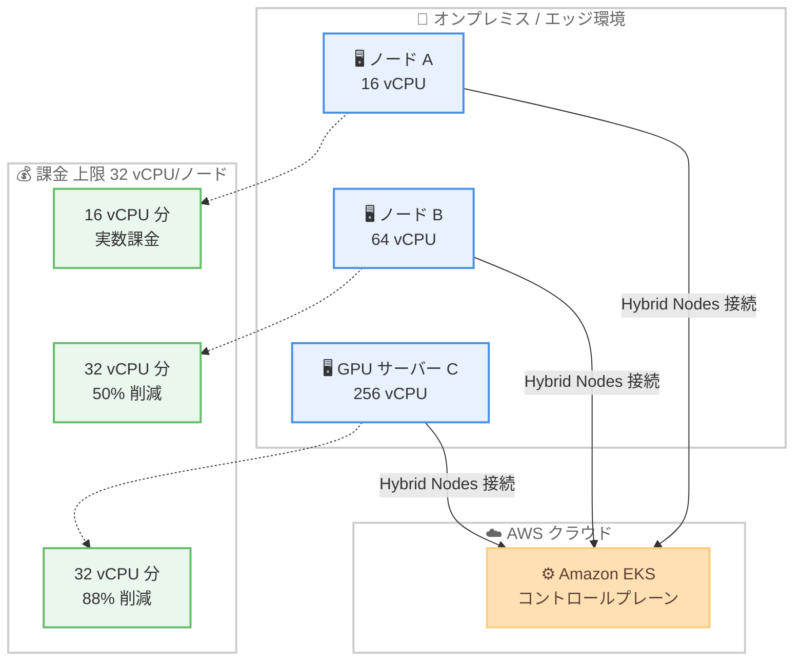

# Amazon EKS - Hybrid Nodes の大規模ホスト向け料金値下げ

**リリース日**: 2026 年 11 月 18 日
**サービス**: Amazon Elastic Kubernetes Service (Amazon EKS)
**機能**: EKS Hybrid Nodes の課金対象 vCPU 数を 1 ノードあたり最大 32 vCPU に制限する料金改定

📊 [このアップデートのインフォグラフィックを見る](https://takech9203.github.io/aws-news-summary/20261118-amazon-eks-hybrid-nodes-pricing-change.html)

## 概要

Amazon EKS Hybrid Nodes の料金が改定され、1 ノードあたりの課金対象 vCPU 数に 32 vCPU の上限 (キャップ) が設定されました。EKS Hybrid Nodes は、オンプレミスやエッジ環境のサーバーを EKS クラスターのノードとして接続できる機能で、これまではノードが Kubernetes に報告する vCPU 数に比例して料金が発生していました。

今回の改定により、32 vCPU を超える大規模ノードでは超過分の vCPU に課金されなくなります。第 1 料金ティアで比較すると、64 vCPU のノードは従来比 50% 、256 vCPU のノードは従来比 88% の値下げとなります。32 vCPU 以下のノードは従来どおり実際の vCPU 数に基づいて課金されます。

データレジデンシー、低レイテンシー、規制要件などの理由でオンプレミスに残す必要がある大規模ベアメタルサーバーや GPU サーバー上で、AI/ML のトレーニングや推論などのコンピューティング集約型ワークロードを実行するユーザーにとって、コスト面のメリットが大きいアップデートです。

**アップデート前の課題**

- 以前はノードの全 vCPU 数に比例して課金されたため、大規模なベアメタルサーバーや GPU サーバーをハイブリッドノードとして接続するとコストが高額になった
- ハイパースレッディング有効なベアメタルでは物理コアあたり 2 vCPU としてカウントされるため、大型ホストの課金対象 vCPU 数が増大しやすかった
- オンプレミスの GPU サーバーで AI/ML ワークロードを実行する際、GPU ではなく vCPU 数ベースの課金が大きな負担となるケースがあった

**アップデート後の改善**

- 1 ノードあたりの課金対象 vCPU 数が最大 32 vCPU に制限され、大規模ホストのコストが vCPU 数に比例して増加しなくなった
- 第 1 料金ティアで、64 vCPU ノードは 50%、256 vCPU ノードは 88% のコスト削減となった
- 従来の段階的な従量課金ティアも引き続き適用されるため、月間使用量が増えるほど実効単価がさらに下がる

## アーキテクチャ図



オンプレミスの各サーバーを EKS Hybrid Nodes として接続した場合の課金イメージです。32 vCPU を超えるノードはすべて 32 vCPU 分として課金されるため、大規模ホストほど削減率が大きくなります。

## サービスアップデートの詳細

### 主要機能

1. **1 ノードあたり 32 vCPU の課金上限**
   - ノードが Kubernetes に報告する vCPU 数が 32 を超えても、課金対象は 32 vCPU まで
   - 64 vCPU、256 vCPU のノードはいずれも 32 vCPU 分として課金される
   - 32 vCPU 以下のノードは従来どおり実際の vCPU 数で課金される

2. **既存の段階的料金ティアとの併用**
   - 月間の累積 vCPU 時間に応じた段階的な割引ティアは従来どおり適用される
   - 使用量が増えるほど実効単価が下がるため、大規模環境では二重のコスト削減効果がある

3. **新規ノードへの自動適用**
   - 新しく接続するハイブリッドノードには自動的に新料金が適用される
   - クラスターに接続済みの既存ノードに適用するには、ノードを一度削除して再接続する必要がある

## 技術仕様

### EKS Hybrid Nodes の料金ティア

| 月間使用量ティア | vCPU 時間あたりの料金 |
|------|------|
| 最初の 576,000 vCPU 時間 | 0.020 USD |
| 次の 576,000 vCPU 時間 | 0.014 USD |
| 次の 4,608,000 vCPU 時間 | 0.010 USD |
| 次の 5,760,000 vCPU 時間 | 0.008 USD |
| 11,520,000 vCPU 時間超 | 0.006 USD |

### 課金の仕組み

| 項目 | 詳細 |
|------|------|
| 課金対象 | Kubernetes に報告される vCPU 数 (1 ノードあたり最大 32 vCPU) |
| ハイパースレッディング | ベアメタルで有効な場合、物理コアあたり 2 vCPU としてカウント |
| 課金期間 | ノードがクラスターに参加してから削除されるまで |
| ティア集計 | 同一リージョン・同一アカウント内の月間 vCPU 時間を合算 (AWS Organizations の一括請求ではアカウント横断で合算) |
| EC2 利用時 | EC2 インスタンスをハイブリッドノードのインフラとして使用した場合も Hybrid Nodes 料金が発生 |

## 設定方法

### 前提条件

1. Amazon EKS クラスターが作成済みであること
2. オンプレミスまたはエッジ環境のサーバーが Hybrid Nodes の要件 (対応 OS、AWS へのネットワーク接続など) を満たしていること
3. 既存ノードに新料金を適用する場合は、ノードの削除・再接続によるワークロードへの影響を計画しておくこと

### 手順

#### ステップ1: 新規ノードの接続

```bash
# ハイブリッドノード上で nodeadm を使用してクラスターに接続
sudo nodeadm init -c file://nodeConfig.yaml
```

`nodeadm init` はノード設定ファイルに基づいてオンプレミスサーバーを EKS クラスターに参加させるコマンドです。新規に接続するノードには新料金が自動適用されます。

#### ステップ2: 既存ノードへの新料金適用 (削除と再接続)

```bash
# ノードを安全に退避してからクラスターから削除
kubectl drain <node-name> --ignore-daemonsets --delete-emptydir-data
kubectl delete node <node-name>

# ノード上でクリーンアップ後、再接続
sudo nodeadm uninstall
sudo nodeadm install <k8s-version> --credential-provider <provider>
sudo nodeadm init -c file://nodeConfig.yaml
```

`kubectl drain` で Pod を他ノードへ退避し、`kubectl delete node` でクラスターから削除します。その後 `nodeadm` でノードを再セットアップして再接続すると、新料金が適用されます。

#### ステップ3: 課金の確認

AWS Billing and Cost Management コンソールまたは Cost Explorer で、EKS Hybrid Nodes の vCPU 時間の課金が上限 32 vCPU で計算されていることを確認します。

## メリット

### ビジネス面

- **大規模ホストの大幅なコスト削減**: 第 1 ティアで 64 vCPU ノードは 50%、256 vCPU ノードは 88% の削減となり、オンプレミス大型サーバーの活用コストが大きく低下する
- **オンプレミス投資の有効活用**: 既存の大規模ベアメタルサーバーや GPU サーバーを、コストを気にせず EKS の管理下に統合できる
- **予測しやすいコスト構造**: ノードあたりの課金上限が明確になり、大型ホスト追加時のコスト見積もりが容易になる

### 技術面

- **AI/ML ワークロードとの親和性**: GPU サーバーは vCPU 数が多い傾向があるため、オンプレミス GPU での推論・トレーニングのコスト効率が向上する
- **運用の一元化**: オンプレミスの大規模ノードも EKS コントロールプレーンで一元管理でき、クラウドと同じツールチェーンを利用できる
- **段階的ティアとの相乗効果**: 使用量ベースのティア割引と組み合わせることで、スケールするほど実効単価が下がる

## デメリット・制約事項

### 制限事項

- 既存の接続済みノードには自動適用されず、ノードの削除と再接続が必要
- 32 vCPU 以下のノードには料金面の変化はない
- EC2 インスタンスをハイブリッドノードとして使用した場合も Hybrid Nodes 料金は発生する

### 考慮すべき点

- 既存ノードの再接続時はワークロードの退避 (drain) が必要なため、メンテナンスウィンドウの計画が必要
- ハイパースレッディング有効時は物理コアあたり 2 vCPU とカウントされるため、16 コア超のサーバーは上限 32 vCPU の恩恵を受ける
- vCPU 数は Kubernetes に報告される値に基づくため、課金確認時はノードの `capacity` を確認するとよい

## ユースケース

### ユースケース1: オンプレミス GPU サーバーでの AI/ML 推論

**シナリオ**: データレジデンシー要件により顧客データを国内データセンターから持ち出せない企業が、256 vCPU の GPU サーバーで推論ワークロードを実行する。

**実装例**:
```
GPU サーバー (256 vCPU) を EKS Hybrid Nodes として接続し、
NVIDIA device plugin を導入して GPU ワークロードをスケジューリング
```

**効果**: 従来 256 vCPU 分の課金が 32 vCPU 分となり、第 1 ティアで約 88% のコスト削減。EKS によるクラウドと一貫した運用も実現。

### ユースケース2: エッジ拠点の大型ベアメタルサーバー統合

**シナリオ**: 低レイテンシーが要求される工場やエッジ拠点の 64 vCPU ベアメタルサーバーを EKS で統合管理したい。

**実装例**:
```
各拠点のベアメタルサーバーを nodeadm で EKS クラスターに接続し、
ノードラベルで拠点別にワークロードを配置
```

**効果**: 第 1 ティアで 50% のコスト削減。拠点のサーバーをクラウド側の EKS コントロールプレーンから一元管理できる。

### ユースケース3: 既存ハイブリッドノードの料金最適化

**シナリオ**: すでに 32 vCPU 超のハイブリッドノードを複数運用しており、新料金を適用してコストを削減したい。

**実装例**:
```
メンテナンスウィンドウ中に kubectl drain でワークロードを退避し、
ノードを削除・再接続して新料金を適用
```

**効果**: 再接続のみで追加コストなしに新料金が適用され、以降の月額費用が削減される。

## 料金

EKS Hybrid Nodes は、ノードが Kubernetes に報告する vCPU 数に基づく vCPU 時間課金です。今回の改定で 1 ノードあたりの課金対象は最大 32 vCPU に制限されました。月間の累積 vCPU 時間に応じた段階的ティア (0.020 USD 〜 0.006 USD/vCPU 時間) は従来どおり適用されます。

### 料金例 (第 1 ティア 0.020 USD/vCPU 時間、730 時間/月で試算)

| ノード構成 | 改定前の月額 (概算) | 改定後の月額 (概算) | 削減率 |
|--------|------------------|------------------|--------|
| 16 vCPU ノード | 233.60 USD | 233.60 USD (変更なし) | 0% |
| 64 vCPU ノード | 934.40 USD | 467.20 USD | 50% |
| 256 vCPU ノード | 3,737.60 USD | 467.20 USD | 88% |

## 利用可能リージョン

Amazon EKS Hybrid Nodes が利用可能なすべての AWS リージョンで適用されます。

## 関連サービス・機能

- **Amazon EKS Hybrid Nodes**: オンプレミス・エッジのサーバーを EKS クラスターのノードとして接続する機能。今回の料金改定の対象
- **Amazon EKS Anywhere**: オンプレミスで Kubernetes クラスター全体を実行するオプション。Hybrid Nodes はコントロールプレーンをクラウド側に置く点が異なる
- **AWS Outposts**: AWS 管理のハードウェアをオンプレミスに設置するサービス。自社保有ハードウェアを活用したい場合は Hybrid Nodes が選択肢となる

## 参考リンク

- 📊 [インフォグラフィック](https://takech9203.github.io/aws-news-summary/20261118-amazon-eks-hybrid-nodes-pricing-change.html)
- [公式発表 (What's New)](https://aws.amazon.com/about-aws/whats-new/2026/11/amazon-eks-hybrid-nodes-pricing-change/)
- [ドキュメント (Amazon EKS Hybrid Nodes)](https://docs.aws.amazon.com/eks/latest/userguide/hybrid-nodes-overview.html)
- [料金ページ (Amazon EKS)](https://aws.amazon.com/eks/pricing/)

## まとめ

EKS Hybrid Nodes の課金対象 vCPU 数が 1 ノードあたり最大 32 vCPU に制限され、大規模なオンプレミスサーバーや GPU サーバーの利用コストが最大 88% 削減されました。32 vCPU 超のノードを運用中の場合は、メンテナンスウィンドウを計画してノードの削除・再接続を行い、新料金の適用を推奨します。
