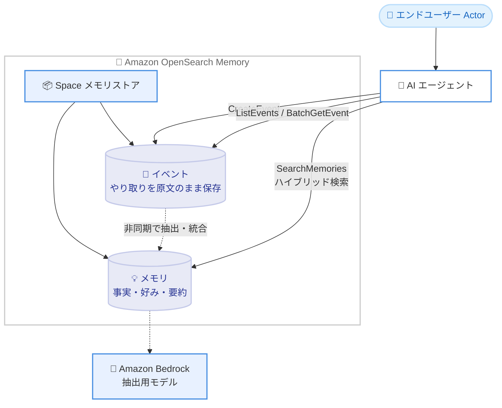

# Amazon OpenSearch Service - Amazon OpenSearch Memory の一般提供開始

**リリース日**: 2026 年 11 月 18 日
**サービス**: Amazon OpenSearch Service
**機能**: Amazon OpenSearch Memory (一般提供開始)

📊 [このアップデートのインフォグラフィックを見る](https://takech9203.github.io/aws-news-summary/20261118-amazon-opensearch-memory-generally-available.html)

## 概要

Amazon OpenSearch Memory が一般提供 (GA) となりました。OpenSearch Memory は、AI エージェントに永続的なメモリ (長期記憶) を追加するための Amazon OpenSearch Service の新しいサーバーレス機能です。エージェントとのやり取りを検索可能なイベントとして保存し、そこから構造化されたメモリを自動的に導出して、セッションをまたいで関連するコンテキストを取得できます。

これにより、エージェントは過去の意思決定、以前のやり取り、ユーザーの好みなどを、会話履歴全体をモデルに再送信することなく想起できるようになります。対象ユーザーは、チャットボットやエージェントアプリケーションを構築する開発者、特に複数セッションにわたるパーソナライズされた体験を提供したい組織です。

**アップデート前の課題**

このアップデート以前は、AI エージェントに長期記憶を持たせるために多くの独自実装が必要でした。

- 会話履歴全体を毎回プロンプトに含める必要があり、入力トークン数とコストが増大していた
- メモリの抽出、埋め込み、インデックス作成、統合、検索の各システムを個別に構築・運用する必要があった
- メモリ基盤のためのインフラストラクチャのプロビジョニングと容量管理が必要だった

**アップデート後の改善**

今回の一般提供開始により、以下が可能になりました。

- イベントを書き込むだけで、メモリの抽出から検索までのライフサイクル全体をマネージドに処理できるようになった
- クラスターのプロビジョニング、インスタンスタイプの選択、インデックスの作成が不要になり、抽出と検索の容量は自動的にスケールする
- キーワード検索、セマンティック検索、ハイブリッド検索により、必要なコンテキストだけを効率的に取得できるようになった

## アーキテクチャ図



エージェントは各ターンのやり取りをイベントとして Space に書き込み、サービスがバックグラウンドで Amazon Bedrock のモデルを使用してメモリを抽出・統合します。エージェントは応答生成前にハイブリッド検索で関連メモリを取得します。

## サービスアップデートの詳細

### 主要機能

1. **イベントの保存と即時検索**
   - エージェントとのやり取りを原文のまま (verbatim) イベントとして保存
   - 書き込み後すぐに読み取り可能で、数秒以内に検索可能になる
   - セッション ID によって単一の会話のイベントをグループ化できる

2. **メモリの自動導出と統合 (Consolidation)**
   - イベントから事実、好み、要約などの構造化されたメモリを非同期に導出
   - 新しい情報が到着すると、既存のメモリと比較して追加・更新・スキップを自動判断し、メモリを最新の状態に保つ
   - 抽出されたメモリには `sourceEventIds` が含まれ、元のイベントまで追跡可能

3. **柔軟な検索方式**
   - キーワード (レキシカル) 検索、セマンティック検索、ハイブリッド検索をサポート
   - `match` クエリと `neural` クエリを組み合わせたハイブリッド検索により、高い検索精度を実現

4. **セキュリティとアクセス制御**
   - メモリストアごとに AWS IAM によるアクセス制御が可能
   - アクター (エンドユーザー) とセッションによるスコープ設定で、データの分離を実現
   - IAM 条件キーでエージェントがアクセスできるアクターを制限可能
   - AWS KMS による暗号化 (カスタマーマネージドキーは作成時のみ指定可能)、CloudTrail ログ記録、CloudWatch メトリクスに対応

5. **サーバーレスで運用負荷ゼロ**
   - クラスターのプロビジョニング、インスタンスタイプの選択、インデックスの作成が不要
   - 抽出と検索の容量は自動的にスケールする

## 技術仕様

### 主要な概念

| 項目 | 詳細 |
|------|------|
| Space | メモリストアとなる AWS リソース。イベントとメモリを格納する |
| イベント | アプリケーションが原文のまま書き込むやり取りの記録。即時読み取り可能 |
| メモリ | イベントから非同期に導出される事実・好み・要約 |
| アクター | データの所有者となるエンドユーザー。すべてのリクエストと検索はアクター単位でスコープされる |
| セッション ID | 単一の会話のイベントをグループ化するオプションの ID |
| メモリ戦略 | Space に設定する抽出方式。`SEMANTIC` (事実・好み) や `SUMMARY` (セッション要約) など |
| イベント保持期間 | 1 日から 365 日で設定可能 |
| メモリ有効期限 | 設定可能。0 を指定すると無期限 |
| 抽出用モデル | Amazon Bedrock のモデルを選択して使用 |

### API変更履歴

| 日付 | サービス | 変更内容 |
|------|----------|----------|
| 2026/11/16 | [Amazon OpenSearch Memory](https://awsapichanges.com/archive/changes/f1785c-osm.html) | 20 new api methods - Amazon OpenSearch Memory の初回リリース。Space へのイベント保存、メモリの自動抽出、セマンティック・レキシカル・ハイブリッド検索をサポート |

主な API オペレーションには `CreateSpace`、`CreateEvent`、`CreateMemory` (CRM データのインポートなど直接書き込み用)、`SearchMemories`、`ListEvents`、`GetEvent`、`BatchGetEvent` (1 回の呼び出しで最大 10 件) が含まれます。

## 設定方法

### 前提条件

1. AWS アカウントと、OpenSearch Memory を操作できる IAM 権限
2. メモリ抽出に使用する Amazon Bedrock モデルへのアクセス
3. Python 3.10 以上および Boto3 1.44.4 以上 (Python SDK を使用する場合)

### 手順

#### ステップ1: Space の作成

```python
import boto3

client = boto3.client("opensearch-memory")

response = client.create_space(
    name="agent-memory-space",
    memoryStrategies=[
        {"type": "SEMANTIC"},
        {"type": "SUMMARY"},
    ],
    eventExpiryDuration={"days": 90},
    memoryExpiryDuration={"days": 365},
)
```

メモリストアとなる Space を作成します。セマンティック戦略と要約戦略を設定し、イベントの保持期間を 90 日、メモリの有効期限を 365 日に設定しています。必要に応じて KMS キーや抽出用モデルも指定できます。

#### ステップ2: イベントの書き込み

```python
client.create_event(
    spaceId=space_id,
    actorId="user-123",
    sessionId="session-456",
    payload={"role": "USER", "content": "来月の東京出張では窓側の席を希望します"},
)
```

会話の各ターンの後に、アクター ID とセッション ID を付けてイベントを書き込みます。サービスがバックグラウンドでメモリを抽出・統合します。

#### ステップ3: メモリの検索

```python
response = client.search_memories(
    spaceId=space_id,
    actorId="user-123",
    query="座席の好み",
)
```

エージェントの応答生成前に、アクター単位でスコープされたハイブリッド検索を実行し、関連するメモリを取得してプロンプトに含めます。

## メリット

### ビジネス面

- **トークンコストの大幅削減**: LongMemEval-S ベンチマークでは、全履歴送信 (約 167,000 トークン/質問) に対して約 13,500 トークン/質問と、約 12 分の 1 の入力トークンで 93.0% の精度 (全履歴は 95.2%) を達成
- **開発期間の短縮**: 抽出・インデックス・統合・検索の各システムを個別に構築する必要がなく、エージェントのコア機能開発に集中できる
- **パーソナライズされた体験**: セッションをまたいでユーザーの好みや過去の決定を記憶し、顧客体験を向上できる

### 技術面

- **フルマネージドなメモリライフサイクル**: 抽出、埋め込み、インデックス作成、統合、検索までを一貫してマネージドに処理
- **自動スケーリング**: サーバーレスで容量管理が不要
- **トレーサビリティ**: メモリに `sourceEventIds` が含まれ、導出元のイベントまで追跡可能
- **柔軟な統合方法**: AWS SDK、AWS MCP サーバー、フック、サポートされるフレームワーク統合からエージェントに接続可能

## デメリット・制約事項

### 制限事項

- 利用可能リージョンは現時点で 5 リージョンに限定される
- カスタマーマネージド KMS キーは Space 作成時のみ指定可能で、後から変更できない
- `BatchGetEvent` は 1 回の呼び出しで最大 10 件まで
- Python SDK の利用には Boto3 1.44.4 以上、Python 3.10 以上が必要

### 考慮すべき点

- メモリ抽出は非同期 (バックグラウンド) で実行されるため、新規ユーザーのメモリは即座には検索結果に現れない場合がある
- エージェントが書き込んだメモリは永続化されて将来のプロンプトに影響するため、`writtenBy` などのメタデータでタグ付けし、監査可能にすることが推奨されている
- 既存の独自メモリ実装からの移行では、データモデル (Space、イベント、メモリ、アクター) への対応付けを設計する必要がある

## ユースケース

### ユースケース1: カスタマーサポートエージェントのパーソナライズ

**シナリオ**: サポートチャットボットが、ユーザーの過去の問い合わせ内容や製品環境を記憶し、繰り返しの説明を不要にする。

**実装例**:
```python
# 各ターンの後にイベントを保存
client.create_event(
    spaceId=space_id,
    actorId=customer_id,
    sessionId=ticket_id,
    payload={"role": "USER", "content": user_message},
)

# 応答生成前に関連メモリを検索
memories = client.search_memories(
    spaceId=space_id,
    actorId=customer_id,
    query=user_message,
)
```

**効果**: 過去のセッションの文脈を踏まえた応答により、解決までの時間を短縮し、顧客満足度を向上できる。

### ユースケース2: 既存データのインポートによるコールドスタート回避

**シナリオ**: CRM に蓄積された顧客の好みや属性情報を初期メモリとして投入し、初回利用時からパーソナライズを提供する。

**実装例**:
```python
# CRM データをメモリとして直接書き込み
client.create_memory(
    spaceId=space_id,
    actorId=customer_id,
    content="プレミアムプランを契約中。通知はメールを希望",
)
```

**効果**: 会話履歴がないユーザーに対しても、初回から文脈を踏まえた応答が可能になる。

### ユースケース3: 長期プロジェクトを支援するコーディングエージェント

**シナリオ**: 開発支援エージェントが、プロジェクトの設計判断やコーディング規約を記憶し、セッションをまたいで一貫した提案を行う。

**実装例**:
```python
# セッション再開時に直近のイベントを取得
events = client.list_events(
    spaceId=space_id,
    actorId=developer_id,
    sessionId=project_session_id,
)
details = client.batch_get_event(
    spaceId=space_id,
    eventIds=[e["eventId"] for e in events["events"][:10]],
)
```

**効果**: 全履歴をプロンプトに含めることなく過去の決定事項を参照でき、トークンコストを抑えながら一貫性のある支援を実現できる。

## 料金

OpenSearch Memory の料金には、メモリの抽出と埋め込みのコストが含まれます。詳細は [Amazon OpenSearch Service の料金ページ](https://aws.amazon.com/opensearch-service/pricing/) を参照してください。

## 利用可能リージョン

以下のリージョンで利用可能です。

- 米国東部 (バージニア北部)
- 米国東部 (オハイオ)
- 米国西部 (オレゴン)
- 欧州 (フランクフルト)
- アジアパシフィック (東京)

## 関連サービス・機能

- **Amazon OpenSearch Serverless**: OpenSearch Memory の基盤となるサーバーレス検索基盤
- **Amazon Bedrock**: メモリ抽出に使用するモデルを提供。Bedrock AgentCore Memory と並ぶエージェント向けメモリの選択肢
- **AWS IAM / AWS KMS**: メモリストア単位のアクセス制御と保存データの暗号化
- **AWS CloudTrail / Amazon CloudWatch**: API 操作のログ記録とメトリクス監視

## 参考リンク

- 📊 [インフォグラフィック](https://takech9203.github.io/aws-news-summary/20261118-amazon-opensearch-memory-generally-available.html)
- [公式発表 (What's New)](https://aws.amazon.com/about-aws/whats-new/2026/11/amazon-opensearch-memory-generally-available/)
- [AWS Blog: Introducing Amazon OpenSearch Memory](https://aws.amazon.com/blogs/big-data/introducing-amazon-opensearch-memory-persistent-memory-for-ai-agents/)
- [ドキュメント](https://docs.aws.amazon.com/opensearch-service/latest/developerguide/memory.html)
- [料金ページ](https://aws.amazon.com/opensearch-service/pricing/)

## まとめ

Amazon OpenSearch Memory の一般提供開始により、AI エージェントへの長期記憶の追加が、独自のメモリ基盤を構築することなくサーバーレスで実現できるようになりました。ベンチマークでは全履歴送信比で約 12 分の 1 のトークン消費で高い精度を維持しており、コスト効率の高いエージェント構築に有効です。エージェントアプリケーションを運用中、または構築予定のチームは、東京リージョンでも利用可能なため、まずは Space を作成してイベント保存とメモリ検索の動作を検証することを推奨します。
