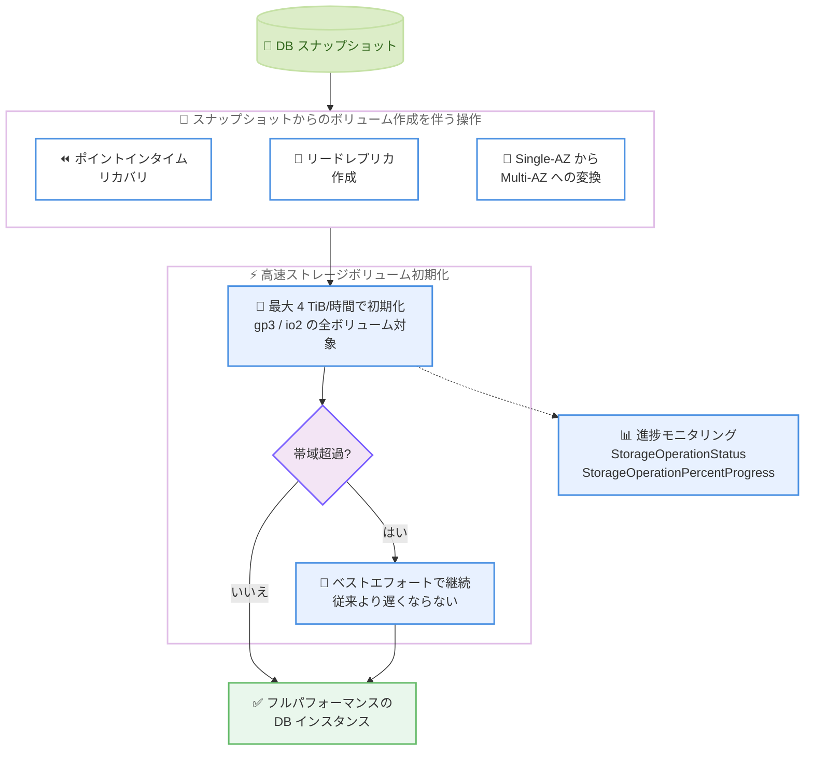

# Amazon RDS - 高速ストレージボリューム初期化のサポート

**リリース日**: 2026 年 11 月 18 日
**サービス**: Amazon RDS (Relational Database Service)
**機能**: Fast Storage Volume Initialization (高速ストレージボリューム初期化)

📊 [このアップデートのインフォグラフィックを見る](https://takech9203.github.io/aws-news-summary/20261118-amazon-rds-fast-storage-volume-initialization.html)

## 概要

Amazon RDS が、スナップショットからストレージボリュームを作成する操作において、高速なストレージボリューム初期化をサポートしました。ポイントインタイムリカバリ (PITR)、リードレプリカ作成、Single-AZ から Multi-AZ への変換といった操作の後、予測可能な時間内にフルパフォーマンスの DB インスタンスを利用できるようになります。

本機能では、各 DB インスタンスにアタッチされたすべての gp3 および io2 ストレージボリュームに対して、最大 4 TiB/時間の速度で初期化が実行されます。初期化中もインスタンスは利用可能な状態を維持し、追加料金なしでデフォルトで有効化されるため、ユーザー側の設定変更は不要です。

復元直後のデータベースで安定した I/O パフォーマンスを求める運用チームや、DR 訓練・検証環境の構築を頻繁に行うユーザーにとって、復旧時間の予測可能性が大きく向上するアップデートです。

**アップデート前の課題**

このアップデート以前は、スナップショットから作成されたボリュームの初期化に関して以下の課題がありました。

- 初期化の速度がワークロードやブロックアクセスパターンに依存し、完了時間を予測できなかった
- 初期化に専用の帯域が割り当てられておらず、未初期化ブロックへの初回アクセス時に I/O レイテンシが増大し、パフォーマンスが不安定だった
- PITR やリードレプリカ作成後、フルパフォーマンスに達するまでの時間が読めず、復旧計画 (RTO) の見積もりが困難だった

**アップデート後の改善**

今回のアップデートにより、以下が可能になりました。

- 各 DB インスタンスで最大 4 TiB/時間の専用初期化速度により、予測可能な時間でフルパフォーマンスの DB インスタンスを取得できるようになった
- `StorageOperationStatus` と `StorageOperationPercentProgress` フィールドにより、初期化の進捗をコンソール、API、CLI、SDK から追跡できるようになった
- デフォルトで有効化されており、追加設定や追加料金なしで利用できるようになった
- アカウント全体の同時初期化が利用可能な帯域を超えた場合でもベストエフォートにフォールバックするため、従来より遅くなることはない

## アーキテクチャ図



スナップショットからボリュームを作成する 3 つの操作において、最大 4 TiB/時間の専用帯域で初期化が実行され、進捗をフィールドで追跡しながら予測可能な時間でフルパフォーマンスに到達するフローを示しています。

## サービスアップデートの詳細

### 主要機能

1. **予測可能な高速初期化**
   - 各 DB インスタンスにアタッチされたすべての gp3 および io2 ストレージボリュームを、最大 4 TiB/時間で初期化
   - 初期化完了時間が予測可能になり、復旧計画や運用計画を立てやすくなる
   - 初期化中もインスタンスは利用可能な状態を維持

2. **対象となる操作**
   - ポイントインタイムリカバリ (PITR)
   - リードレプリカの作成
   - Single-AZ から Multi-AZ への変換
   - いずれもスナップショットからストレージボリュームを作成する操作

3. **進捗の可視化**
   - `StorageOperationStatus` フィールドで初期化の状態を確認可能
   - `StorageOperationPercentProgress` フィールドで進捗率を確認可能
   - RDS コンソール、`DescribeDBInstances` API、AWS CLI、SDK から参照できる

4. **安全なフォールバック動作**
   - アカウント全体での同時初期化が利用可能な帯域を超えた場合、残りのブロックはベストエフォートで初期化
   - 従来の動作より遅くなることはない設計

## 技術仕様

### 機能の仕様

| 項目 | 詳細 |
|------|------|
| 初期化速度 | インスタンスあたり最大 4 TiB/時間 |
| 対象ストレージタイプ | gp3、io2 |
| 対象操作 | PITR、リードレプリカ作成、Single-AZ から Multi-AZ への変換 |
| 対象エンジン | MariaDB、MySQL、PostgreSQL、Db2、Microsoft SQL Server、Oracle |
| 有効化方法 | デフォルトで有効 (設定不要) |
| 初期化中の可用性 | インスタンスは利用可能な状態を維持 |
| 進捗確認 | `StorageOperationStatus`、`StorageOperationPercentProgress` |
| 追加料金 | なし |

## 設定方法

### 前提条件

1. Amazon RDS for MariaDB、MySQL、PostgreSQL、Db2、Microsoft SQL Server、Oracle のいずれかを使用していること
2. ストレージタイプが gp3 または io2 であること
3. 本機能はデフォルトで有効のため、有効化のための追加設定は不要

### 手順

#### ステップ 1: 対象操作の実行

```bash
# 例: ポイントインタイムリカバリの実行
aws rds restore-db-instance-to-point-in-time \
    --source-db-instance-identifier mydbinstance \
    --target-db-instance-identifier mydbinstance-restored \
    --restore-time 2026-11-18T03:00:00Z
```

指定した時刻の状態に DB インスタンスを復元します。復元で作成されるストレージボリュームに対して、高速ストレージボリューム初期化が自動的に適用されます。

#### ステップ 2: 初期化の進捗確認

```bash
# DescribeDBInstances API で初期化の状態と進捗率を確認
aws rds describe-db-instances \
    --db-instance-identifier mydbinstance-restored \
    --query "DBInstances[0].[DBInstanceStatus,StorageOperationStatus,StorageOperationPercentProgress]"
```

`DescribeDBInstances` API の `StorageOperationStatus` フィールドと `StorageOperationPercentProgress` フィールドで、ストレージ初期化の状態と進捗率を確認します。RDS コンソールからも同じ情報を参照できます。

#### ステップ 3: 初期化完了後の運用

進捗が 100% に達すると、すべてのブロックが初期化され、DB インスタンスはフルパフォーマンスで動作します。初期化中もインスタンスは利用可能なため、進捗を確認しながら段階的にワークロードを移行する運用も可能です。

## メリット

### ビジネス面

- **RTO の予測可能性向上**: 復旧後にフルパフォーマンスへ到達するまでの時間が予測可能になり、災害復旧計画や SLA の見積もり精度が向上する
- **追加コストなし**: 追加料金なしで利用でき、デフォルトで有効なため導入コストもかからない
- **運用負荷の軽減**: ウォームアップ目的の手動プリウォーム処理 (全ブロックの先読みなど) が不要になり、運用手順を簡素化できる

### 技術面

- **安定した I/O パフォーマンス**: 未初期化ブロックへの初回アクセスによるレイテンシ増大を短時間で解消できる
- **進捗の可視化**: `StorageOperationStatus` と `StorageOperationPercentProgress` により、初期化状況をプログラムから監視し、自動化ワークフローに組み込める
- **後方互換性のある設計**: 帯域超過時はベストエフォートにフォールバックし、従来より遅くなることがない

## デメリット・制約事項

### 制限事項

- 対象ストレージタイプは gp3 と io2 であり、それ以外のストレージタイプは対象外
- 初期化速度の最大 4 TiB/時間はインスタンスあたりの上限であり、アカウント全体で同時に多数の初期化を実行すると帯域を共有し、一部はベストエフォートになる
- 対象はスナップショットからボリュームを作成する操作 (PITR、リードレプリカ作成、Single-AZ から Multi-AZ への変換) に限定される

### 考慮すべき点

- 初期化中もインスタンスは利用可能だが、初期化が完了するまでは未初期化ブロックへのアクセスでレイテンシが発生する可能性があるため、レイテンシに厳しいワークロードは進捗 100% を待ってから切り替えるのが安全
- 大規模な DR 訓練などで多数のインスタンスを同時に復元する場合は、帯域共有による初期化時間への影響を考慮して計画する

## ユースケース

### ユースケース 1: 障害復旧時のポイントインタイムリカバリ

**シナリオ**: 誤ったデータ更新が発生し、障害発生直前の状態に DB を復元して本番トラフィックを切り替えたい。切り替え後すぐに本番相当の I/O パフォーマンスが必要。

**実装例**:
```bash
aws rds restore-db-instance-to-point-in-time \
    --source-db-instance-identifier prod-db \
    --target-db-instance-identifier prod-db-recovered \
    --restore-time 2026-11-18T02:55:00Z

# 初期化進捗を監視し、100% になったら切り替え
aws rds describe-db-instances \
    --db-instance-identifier prod-db-recovered \
    --query "DBInstances[0].StorageOperationPercentProgress"
```

**効果**: 最大 4 TiB/時間の初期化により復旧完了時間を見積もれるため、切り替えタイミングを計画的に判断でき、復旧後のパフォーマンス劣化によるユーザー影響を回避できる。

### ユースケース 2: 読み取り負荷対策のリードレプリカ追加

**シナリオ**: キャンペーンなどで読み取りトラフィックの急増が見込まれるため、事前にリードレプリカを追加してトラフィックを分散したい。

**実装例**:
```bash
aws rds create-db-instance-read-replica \
    --db-instance-identifier prod-db-replica-2 \
    --source-db-instance-identifier prod-db

# StorageOperationStatus を監視し、初期化完了後に読み取りエンドポイントへ組み込み
```

**効果**: レプリカ作成後にフルパフォーマンスへ到達する時間が予測できるため、キャンペーン開始に間に合わせたスケールアウト計画を確実に実行できる。

### ユースケース 3: Single-AZ から Multi-AZ への可用性向上

**シナリオ**: 開発段階では Single-AZ で運用していた DB を、本番移行に合わせて Multi-AZ 構成へ変換し、高可用性を確保したい。

**実装例**:
```bash
aws rds modify-db-instance \
    --db-instance-identifier prod-db \
    --multi-az \
    --apply-immediately
```

**効果**: Multi-AZ 変換で新しく作成されるスタンバイ側のボリュームが高速に初期化されるため、変換作業全体の所要時間を予測しやすく、メンテナンスウィンドウの計画が容易になる。

## 料金

追加料金はありません。高速ストレージボリューム初期化はデフォルトで有効化され、対象エンジンのすべてのユーザーが無償で利用できます。通常の RDS インスタンス料金およびストレージ料金のみが適用されます。

## 利用可能リージョン

すべての AWS 商用リージョンおよび AWS GovCloud (US) リージョンで利用可能です。

対象エンジンは以下のとおりです。

- Amazon RDS for MariaDB
- Amazon RDS for MySQL
- Amazon RDS for PostgreSQL
- Amazon RDS for Db2
- Amazon RDS for Microsoft SQL Server
- Amazon RDS for Oracle

## 関連サービス・機能

- **Amazon EBS**: RDS のストレージ基盤。gp3 および io2 ボリュームが本機能の対象であり、EBS にも同様の高速スナップショット復元の概念が存在する
- **Amazon RDS Multi-AZ**: Single-AZ から Multi-AZ への変換時に、スタンバイ用ボリュームの初期化が高速化される
- **Amazon RDS リードレプリカ**: レプリカ作成時のボリューム初期化が高速化され、読み取りスケールアウトの計画性が向上する
- **AWS Backup / RDS 自動バックアップ**: PITR の基盤となるバックアップ機能であり、復元後の初期化が本機能の対象となる

## 参考リンク

- 📊 [インフォグラフィック](https://takech9203.github.io/aws-news-summary/20261118-amazon-rds-fast-storage-volume-initialization.html)
- [公式発表 (What's New)](https://aws.amazon.com/about-aws/whats-new/2026/11/amazon-rds-fast-storage-volume-initialization/)
- [ドキュメント (Amazon RDS DB instance storage)](https://docs.aws.amazon.com/AmazonRDS/latest/UserGuide/CHAP_Storage.html)
- [料金ページ (Amazon RDS)](https://aws.amazon.com/rds/pricing/)

## まとめ

Amazon RDS の高速ストレージボリューム初期化により、PITR、リードレプリカ作成、Multi-AZ 変換後のパフォーマンス立ち上がりが最大 4 TiB/時間で予測可能になりました。デフォルトで有効かつ追加料金なしのため、ユーザー側の対応は不要ですが、復旧手順やスケールアウト手順に `StorageOperationPercentProgress` による進捗確認を組み込むことで、切り替え判断をより確実に自動化できます。DR 計画の RTO 見積もりを本機能前提で見直すことを推奨します。
