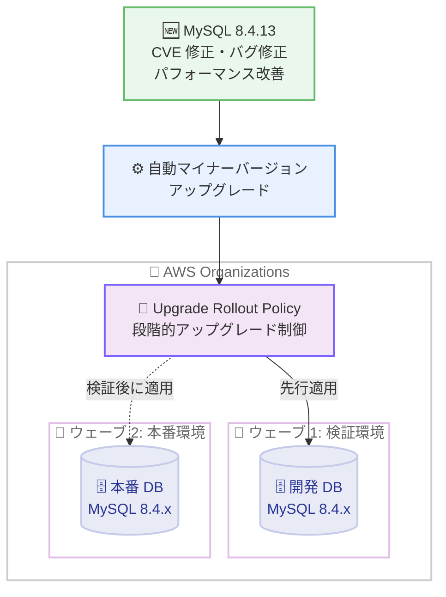

# Amazon RDS for MySQL - MySQL マイナーバージョン 8.4.13 のサポート

**リリース日**: 2026 年 11 月 18 日
**サービス**: Amazon RDS for MySQL
**機能**: MySQL マイナーバージョン 8.4.13 のサポート

📊 [このアップデートのインフォグラフィックを見る](https://takech9203.github.io/aws-news-summary/20261118-amazon-rds-mysql-8413-available.html)

## 概要

Amazon RDS for MySQL が、コミュニティ MySQL の最新マイナーバージョンである MySQL 8.4.13 をサポートしました。MySQL 8.4.13 は 2026 年 10 月 20 日にコミュニティからリリースされたバージョンで、以前のバージョンに存在した CVE (セキュリティ脆弱性) の修正に加え、バグ修正、パフォーマンス改善、コミュニティによる新機能が含まれています。

AWS は、これらの修正と改善を取り込むため、新しいマイナーバージョンへのアップグレードを推奨しています。アップグレードは自動マイナーバージョンアップグレードによるメンテナンスウィンドウでの適用、インプレースアップグレード、またはスナップショットからの復元によって実行できます。

大規模にデータベースを運用しているお客様向けには、自動マイナーバージョンアップグレードと AWS Organizations の Upgrade Rollout Policy を組み合わせることで、優先度の低い環境で先にアップグレードをテストし、その後ビジネスクリティカルな環境に段階的に展開するアプローチが推奨されています。

**アップデート前の課題**

このアップデート以前は、以下の課題がありました。

- RDS for MySQL では MySQL 8.4.13 を利用できず、同バージョンに含まれる CVE 修正やバグ修正を適用できなかった
- InnoDB、レプリケーション、オプティマイザなどに関する既知の不具合 (例: Group Replication のネットワーク分断復旧後の書き込みブロック、index_merge_union 無効時の不完全な結果セットなど) が未修正のままだった
- SHA-2 クライアント認証やレプリケーションプロトコルのパケット検証など、セキュリティ強化が取り込まれていなかった

**アップデート後の改善**

今回のアップデートにより、以下が可能になりました。

- RDS for MySQL で MySQL 8.4.13 を新規作成時またはアップグレードで選択できるようになった
- CVE 修正を含むセキュリティ強化 (クライアント認証パケット検証、mysqldump のメタデータ検証、バイナリ JSON 検証など) を適用できるようになった
- InnoDB、レプリケーション、オプティマイザ、SQL レイヤーの多数のバグ修正とパフォーマンス改善を利用できるようになった

## アーキテクチャ図



自動マイナーバージョンアップグレードと AWS Organizations の Upgrade Rollout Policy を組み合わせることで、検証環境で先にアップグレードをテストし、その後本番環境へ段階的に展開するフローを示しています。

## サービスアップデートの詳細

### 主要機能

1. **MySQL 8.4.13 の提供**
   - コミュニティ MySQL の最新マイナーバージョン (2026 年 10 月 20 日リリース) を RDS で利用可能
   - 以前のバージョンの CVE 修正、バグ修正、パフォーマンス改善を包含
   - RDS マネジメントコンソールまたは AWS CLI から新規作成・アップグレードが可能

2. **セキュリティ修正**
   - SHA-2 クライアント認証におけるサーバー提供 RSA 公開鍵の処理を修正
   - WebAuthn アサーションチャレンジパケットのクライアント側パースを修正
   - クライアント認証パケット、レプリケーションプロトコルパケット、バイナリ JSON の検証強化など多数のハードニング

3. **主なバグ修正 (コミュニティ版 8.4.13 由来)**
   - InnoDB: テーブルスペースの discard/import 後に古い Adaptive Hash Index エントリが誤った行を返す問題を修正
   - レプリケーション: Group Replication がネットワーク分断からの復旧後に書き込みをブロックし続ける問題を修正
   - オプティマイザ: index_merge_union 無効時に OR 条件の一部が欠落し不完全な結果を返す問題を修正
   - SQL: ALTER TABLE ... EXCHANGE PARTITION で CHECK 制約違反の行が移動できてしまう問題を修正

4. **機能追加 (コミュニティ版 8.4.13 由来)**
   - 4 要素のバージョン識別 MAJOR.MINOR.PATCH.UPDATE をサポート (VERSION_WITH_UPDATE 関数、version_with_update システム変数)
   - libevent、opentelemetry-cpp などの同梱ライブラリを更新

## 技術仕様

### バージョン情報

| 項目 | 詳細 |
|------|------|
| エンジン | MySQL Community Edition |
| 対象バージョン | 8.4.13 (8.4 LTS 系列のマイナーバージョン) |
| コミュニティリリース日 | 2026 年 10 月 20 日 |
| アップグレード方式 | 自動マイナーバージョンアップグレード、インプレースアップグレード、スナップショット復元 |
| 段階的展開 | AWS Organizations Upgrade Rollout Policy に対応 |

## 設定方法

### 前提条件

1. Amazon RDS for MySQL の DB インスタンスを運用している、または新規作成する権限があること
2. アップグレードの場合、メンテナンスウィンドウまたは即時適用の方針を決めておくこと
3. 本番環境への適用前に、検証環境でアプリケーションの互換性テストを実施すること

### 手順

#### ステップ 1: 利用可能なバージョンの確認

```bash
aws rds describe-db-engine-versions \
  --engine mysql \
  --engine-version 8.4.13 \
  --query 'DBEngineVersions[].{Engine:Engine,Version:EngineVersion}'
```

RDS で MySQL 8.4.13 が利用可能になっているかを確認しています。利用するリージョンで実行してください。

#### ステップ 2: 既存インスタンスのインプレースアップグレード

```bash
aws rds modify-db-instance \
  --db-instance-identifier my-mysql-instance \
  --engine-version 8.4.13 \
  --apply-immediately
```

既存の DB インスタンスを MySQL 8.4.13 にインプレースアップグレードしています。`--apply-immediately` を省略すると、次回のメンテナンスウィンドウで適用されます。

#### ステップ 3: 自動マイナーバージョンアップグレードの有効化

```bash
aws rds modify-db-instance \
  --db-instance-identifier my-mysql-instance \
  --auto-minor-version-upgrade \
  --no-apply-immediately
```

自動マイナーバージョンアップグレードを有効化し、今後の新しいマイナーバージョンがメンテナンスウィンドウ中に自動適用されるよう設定しています。大規模環境では AWS Organizations の Upgrade Rollout Policy と併用することで、環境の優先度に応じた段階的な展開が可能です。

## メリット

### ビジネス面

- **セキュリティリスクの低減**: 以前のバージョンに存在した CVE の修正が適用され、コンプライアンス要件への対応が容易になる
- **運用負荷の軽減**: 自動マイナーバージョンアップグレードと Upgrade Rollout Policy により、大規模環境でも計画的なアップグレードを自動化できる
- **サービス品質の向上**: コミュニティのバグ修正とパフォーマンス改善により、データベースの安定性が向上する

### 技術面

- **レプリケーションの安定性向上**: Group Replication のクォーラム喪失問題や XA トランザクションの GTID 順序の問題などが修正されている
- **クエリ結果の正確性向上**: index_merge_union 無効時の不完全な結果セットなど、オプティマイザの不具合が修正されている
- **バージョン管理の改善**: 4 要素バージョン識別により、適用されたアップデートを正確に追跡できる

## デメリット・制約事項

### 制限事項

- アップグレードはダウンタイムを伴う場合があるため、メンテナンスウィンドウの計画が必要
- アップグレード後のダウングレードはサポートされないため、事前のスナップショット取得が推奨される

### 考慮すべき点

- 本番環境への適用前に、検証環境でアプリケーションの互換性テストを実施することが推奨される
- 自動マイナーバージョンアップグレードを有効にしている場合、メンテナンスウィンドウ中に自動的に適用される点に留意する

## ユースケース

### ユースケース 1: セキュリティコンプライアンス対応

**シナリオ**: 金融系システムで、既知の CVE に対するパッチ適用が社内規程で義務付けられている。

**実装例**:
```bash
aws rds modify-db-instance \
  --db-instance-identifier finance-db \
  --engine-version 8.4.13 \
  --no-apply-immediately
```

**効果**: 次回メンテナンスウィンドウで CVE 修正を含む最新マイナーバージョンが適用され、コンプライアンス要件を満たせる。

### ユースケース 2: 大規模マルチアカウント環境での段階的アップグレード

**シナリオ**: AWS Organizations 配下の数百のアカウントで RDS for MySQL を運用しており、一斉アップグレードのリスクを避けたい。

**実装例**:
```text
1. 全インスタンスで自動マイナーバージョンアップグレードを有効化
2. Organizations で Upgrade Rollout Policy を設定
3. 開発・検証 OU を先行ウェーブ、本番 OU を後続ウェーブに指定
```

**効果**: 検証環境で問題がないことを確認してから本番環境に展開でき、アップグレード起因の障害リスクを最小化できる。

### ユースケース 3: Group Replication 利用環境の安定化

**シナリオ**: マルチ AZ 構成やレプリケーションを多用する環境で、ネットワーク分断からの復旧後に書き込みがブロックされる事象を経験している。

**実装例**:
```bash
aws rds modify-db-instance \
  --db-instance-identifier replicated-db \
  --engine-version 8.4.13 \
  --apply-immediately
```

**効果**: 8.4.13 に含まれるレプリケーション関連の修正により、ネットワーク分断復旧後の可用性が向上する。

## 料金

MySQL 8.4.13 の利用自体に追加料金は発生しません。通常の Amazon RDS for MySQL の料金 (インスタンス、ストレージ、I/O、データ転送) が適用されます。

## 利用可能リージョン

Amazon RDS for MySQL が利用可能なすべての AWS リージョンで利用できます。

## 関連サービス・機能

- **自動マイナーバージョンアップグレード**: メンテナンスウィンドウ中に新しいマイナーバージョンを自動適用する機能
- **AWS Organizations Upgrade Rollout Policy**: 組織全体でアップグレードを段階的に展開するためのポリシー
- **Amazon Aurora MySQL**: MySQL 互換のマネージドデータベース。高可用性要件が高い場合の選択肢
- **Amazon RDS Blue/Green Deployments**: 本番環境に影響を与えずにアップグレードを検証・切り替えする手法

## 参考リンク

- 📊 [インフォグラフィック](https://takech9203.github.io/aws-news-summary/20261118-amazon-rds-mysql-8413-available.html)
- [公式発表 (What's New)](https://aws.amazon.com/about-aws/whats-new/2026/11/amazon-rds-mysql-8413-available/)
- [Amazon RDS for MySQL 製品ページ](https://aws.amazon.com/rds/mysql/)
- [MySQL 8.4.13 リリースノート](https://dev.mysql.com/doc/relnotes/mysql/8.4/en/news-8-4-13.html)
- [MySQL DB インスタンスのアップグレード (ドキュメント)](https://docs.aws.amazon.com/AmazonRDS/latest/UserGuide/USER_UpgradeDBInstance.MySQL.html)
- [自動マイナーバージョンアップグレード (ドキュメント)](https://docs.aws.amazon.com/AmazonRDS/latest/UserGuide/USER_UpgradeDBInstance.Upgrading.html#USER_UpgradeDBInstance.Upgrading.AutoMinorVersionUpgrades)
- [Amazon RDS 料金ページ](https://aws.amazon.com/rds/mysql/pricing/)

## まとめ

Amazon RDS for MySQL で、CVE 修正と多数のバグ修正を含む MySQL 8.4.13 が利用可能になりました。セキュリティとレプリケーションの安定性の観点から、検証環境でのテストを経た上で早期のアップグレードを推奨します。大規模環境では、自動マイナーバージョンアップグレードと AWS Organizations の Upgrade Rollout Policy の併用により、安全な段階的展開が可能です。
