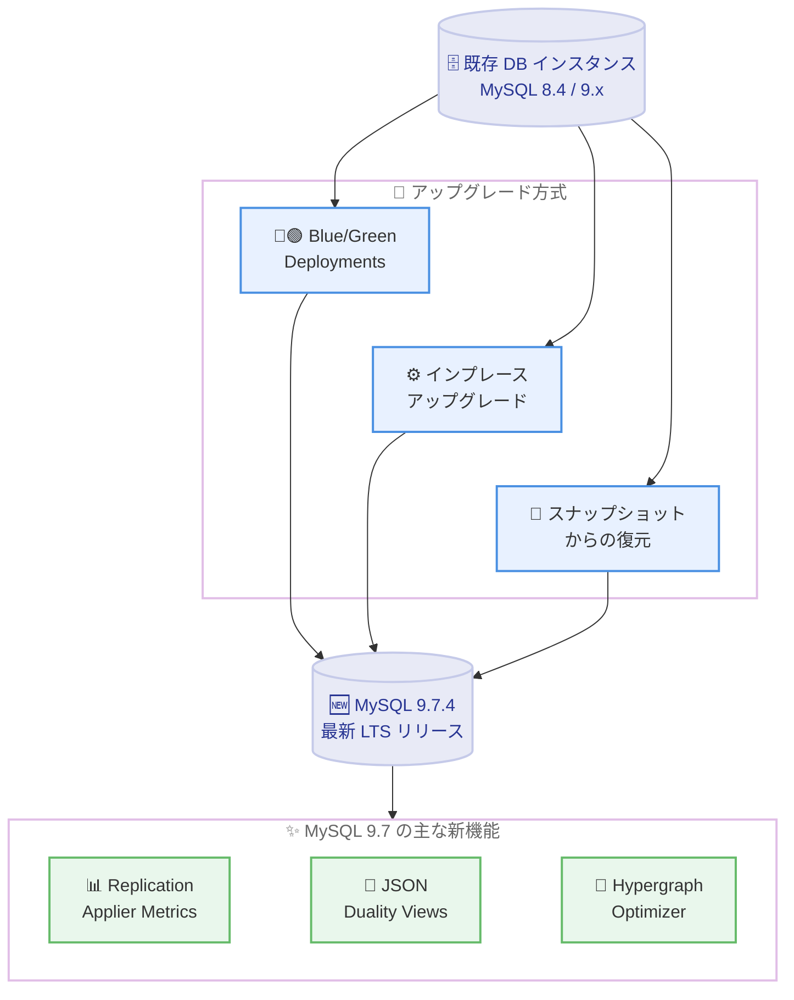

# Amazon RDS for MySQL - MySQL メジャーバージョン 9.7 のサポート

**リリース日**: 2026 年 11 月 18 日
**サービス**: Amazon RDS for MySQL
**機能**: MySQL メジャーバージョン 9.7 (コミュニティ版 9.7.4) のサポート

📊 [このアップデートのインフォグラフィックを見る](https://takech9203.github.io/aws-news-summary/20261118-amazon-rds-mysql-974-available.html)

## 概要

Amazon RDS for MySQL が、MySQL コミュニティの最新の長期サポート (LTS) リリースである MySQL メジャーバージョン 9.7 をサポートしました。RDS ではコミュニティ版 MySQL 9.7.4 として提供されます。

MySQL 9.7 には、レプリケーション遅延の診断を容易にする Replication Applier Metrics、リレーショナルテーブルを JSON ドキュメントとして読み書きできる JSON Duality Views、複雑なマルチジョインクエリの実行計画を改善できるオプトイン方式の Hypergraph Optimizer など、重要な新機能が含まれています。

既存のデータベースは、Amazon RDS Blue/Green Deployments、インプレースアップグレード、またはスナップショットからの復元によって MySQL 9.7 にアップグレードできます。新規作成・アップグレードは RDS マネジメントコンソールまたは AWS CLI から実行できます。

**アップデート前の課題**

このアップデート以前は、以下の課題がありました。

- RDS for MySQL では MySQL 9.7 系列を利用できず、コミュニティ最新 LTS リリースの新機能を活用できなかった
- レプリケーション遅延の調査に必要なチャネル別のアプライヤー統計が標準では得られず、遅延原因の診断に手間がかかった
- リレーショナルテーブルを JSON ドキュメントとして扱うには、アプリケーション側での変換処理や別途ドキュメントストアの併用が必要だった
- 複雑なマルチジョインクエリで最適な実行計画が得られない場合、クエリの書き換えやヒントの付与が必要だった

**アップデート後の改善**

今回のアップデートにより、以下が可能になりました。

- RDS for MySQL で MySQL 9.7 (9.7.4) を新規作成時またはアップグレードで選択できるようになった
- Performance Schema の新テーブルにより、チャネル別のアプライヤーバックログ、スループット、待機統計、各ワーカーの進捗を確認し、レプリケーション遅延を診断できるようになった
- JSON Duality Views により、リレーショナルテーブルに対して JSON ドキュメントとして読み取り・書き込みの両方を実行できるようになった
- オプトインの Hypergraph Optimizer により、複雑なマルチジョインクエリの実行計画を改善できるようになった

## アーキテクチャ図



既存の DB インスタンスから MySQL 9.7 へ移行する 3 つのアップグレード方式と、MySQL 9.7 で利用可能になる主要な新機能を示しています。

## サービスアップデートの詳細

### 主要機能

1. **MySQL 9.7 (LTS) の提供**
   - MySQL コミュニティの最新の長期サポートリリースを RDS for MySQL で利用可能
   - 提供されるコミュニティ版バージョンは MySQL 9.7.4
   - RDS マネジメントコンソールまたは AWS CLI から新規作成・アップグレードが可能

2. **Replication Applier Metrics**
   - Performance Schema に 2 つの新しいテーブルが追加
   - チャネル別のアプライヤーバックログ、スループット、待機統計をレポート
   - 各ワーカーが実行中のトランザクションの進捗も確認可能
   - レプリケーション遅延の原因診断を容易にする

3. **JSON Duality Views**
   - リレーショナルテーブルを JSON ドキュメントとしてアプリケーションから操作可能
   - 読み取りと書き込みの両方をサポート
   - リレーショナルモデルの一貫性を保ちながらドキュメント指向の開発スタイルを実現

4. **Hypergraph Optimizer**
   - オプトイン方式で有効化できる新しいオプティマイザ
   - 複雑なマルチジョインクエリの実行計画を改善できる

## 技術仕様

### バージョン情報

| 項目 | 詳細 |
|------|------|
| エンジン | MySQL Community Edition |
| 対象バージョン | 9.7 (メジャーバージョン)、コミュニティ版 9.7.4 として提供 |
| リリース種別 | 長期サポート (LTS) リリース |
| アップグレード方式 | Amazon RDS Blue/Green Deployments、インプレースアップグレード、スナップショット復元 |
| 操作方法 | RDS マネジメントコンソール、AWS CLI |

## 設定方法

### 前提条件

1. Amazon RDS for MySQL の DB インスタンスを運用している、または新規作成する権限があること
2. メジャーバージョンアップグレードのため、アプリケーションの互換性テストを計画していること
3. 本番環境では Blue/Green Deployments などダウンタイムと切り戻しリスクを最小化する方式を検討すること

### 手順

#### ステップ 1: 利用可能なバージョンの確認

```bash
aws rds describe-db-engine-versions \
  --engine mysql \
  --engine-version 9.7.4 \
  --query 'DBEngineVersions[].{Engine:Engine,Version:EngineVersion}'
```

利用するリージョンで RDS の MySQL 9.7.4 が利用可能になっているかを確認しています。

#### ステップ 2: Blue/Green Deployment の作成

```bash
aws rds create-blue-green-deployment \
  --blue-green-deployment-name mysql97-upgrade \
  --source arn:aws:rds:ap-northeast-1:123456789012:db:my-mysql-instance \
  --target-engine-version 9.7.4
```

本番環境 (Blue) のレプリカとして MySQL 9.7.4 のステージング環境 (Green) を作成しています。Green 環境でアプリケーションの互換性や性能を検証できます。

#### ステップ 3: 切り替えの実行

```bash
aws rds switchover-blue-green-deployment \
  --blue-green-deployment-identifier bgd-xxxxxxxxxxxxxxxx
```

検証が完了した Green 環境を本番に昇格させています。切り替えは通常 1 分以内に完了し、アップグレードに伴うダウンタイムを最小化できます。なお、インプレースアップグレードを行う場合は `aws rds modify-db-instance --engine-version 9.7.4` を使用します。

## メリット

### ビジネス面

- **最新 LTS の長期安定運用**: 長期サポートリリースであるため、頻繁なメジャーアップグレードを避けながら新機能を活用できる
- **開発生産性の向上**: JSON Duality Views により、ドキュメント指向のアプリケーション開発とリレーショナルデータ管理を両立できる
- **運用品質の向上**: レプリケーション遅延の診断が容易になり、障害対応やチューニングの時間を短縮できる

### 技術面

- **レプリケーション可観測性の強化**: Performance Schema の新テーブルで、チャネル別のバックログ、スループット、待機統計、ワーカー進捗を把握できる
- **クエリ性能の改善余地**: Hypergraph Optimizer により、複雑なマルチジョインクエリの実行計画が改善される可能性がある
- **柔軟なデータアクセス**: 同一データに対して SQL と JSON ドキュメントの両方のアクセスパターンを利用できる

## デメリット・制約事項

### 制限事項

- メジャーバージョンアップグレードのため、アプリケーションやドライバの互換性確認が必須
- Hypergraph Optimizer はオプトイン方式であり、既定では有効にならない。また、すべてのクエリで性能が向上するとは限らないため検証が必要
- アップグレード後のダウングレードはサポートされないため、事前のスナップショット取得が推奨される

### 考慮すべき点

- 本番環境への適用前に、Blue/Green Deployments を活用して検証環境で互換性と性能を確認することが推奨される
- JSON Duality Views や新オプティマイザの採用は、アプリケーション設計やクエリ特性に応じて段階的に進めるべき

## ユースケース

### ユースケース 1: レプリケーション遅延の原因診断

**シナリオ**: リードレプリカの遅延が断続的に発生しており、どのチャネル・ワーカーがボトルネックかを特定したい。

**実装例**:
```sql
-- Performance Schema に追加された 2 つのアプライヤーメトリクステーブルを参照する
-- 概念例: 実際のテーブル名は MySQL 9.7 のリファレンスマニュアルで確認してください
SELECT * FROM performance_schema.replication_applier_metrics;
```

**効果**: チャネル別のバックログ、スループット、待機統計と各ワーカーの進捗を確認でき、遅延原因の切り分けが迅速になる。

### ユースケース 2: リレーショナルデータの JSON ドキュメント化

**シナリオ**: モバイルアプリのバックエンドで JSON API を提供しており、正規化されたテーブルを JSON ドキュメントとして直接読み書きしたい。

**実装例**:
```text
1. 注文テーブルと注文明細テーブルを対象に JSON Duality View を定義
2. アプリケーションからはビューを 1 つの JSON ドキュメントとして読み書き
3. 書き込みは基盤となるリレーショナルテーブルに反映される
※ 具体的な DDL 構文は MySQL 9.7 のリファレンスマニュアルを参照してください
```

**効果**: アプリケーションは JSON ドキュメントとして読み書きしつつ、データは正規化されたテーブルで一貫性を維持できる。

### ユースケース 3: 複雑な分析クエリの実行計画改善

**シナリオ**: 多数のテーブルを結合するレポートクエリの実行時間が長く、オプティマイザの実行計画を改善したい。

**実装例**:
```sql
-- セッション単位で Hypergraph Optimizer を有効化して実行計画を検証する
-- 概念例: 正確な有効化方法は MySQL 9.7 のリファレンスマニュアルで確認してください
SET SESSION optimizer_switch = 'hypergraph_optimizer=on';
EXPLAIN FORMAT=TREE SELECT ...;
```

**効果**: 複雑なマルチジョインクエリでより良い実行計画が選択され、クエリの書き換えなしに性能改善が期待できる。

## 料金

MySQL 9.7 の利用自体に追加料金は発生しません。通常の Amazon RDS for MySQL の料金 (インスタンス、ストレージ、I/O、データ転送) が適用されます。詳細は Amazon RDS for MySQL の料金ページを参照してください。

## 利用可能リージョン

Amazon RDS for MySQL が利用可能なすべての AWS リージョンで利用できます。

## 関連サービス・機能

- **Amazon RDS Blue/Green Deployments**: 本番環境に影響を与えずにメジャーバージョンアップグレードを検証・切り替えする手法
- **Amazon Aurora MySQL**: MySQL 互換のマネージドデータベース。高可用性要件が高い場合の選択肢
- **Amazon RDS Performance Insights**: データベース負荷の可視化。新しいアプライヤーメトリクスと併用した性能分析に有効

## 参考リンク

- 📊 [インフォグラフィック](https://takech9203.github.io/aws-news-summary/20261118-amazon-rds-mysql-974-available.html)
- [公式発表 (What's New)](https://aws.amazon.com/about-aws/whats-new/2026/11/amazon-rds-mysql-974-available/)
- [Amazon RDS for MySQL 製品ページ](https://aws.amazon.com/rds/mysql/)
- [MySQL 9.7.4 リリースノート](https://dev.mysql.com/doc/relnotes/mysql/9.7/en/news-9-7-4.html)
- [RDS for MySQL バージョン管理 (ドキュメント)](https://docs.aws.amazon.com/AmazonRDS/latest/UserGuide/MySQL.Concepts.VersionMgmt.html)
- [MySQL DB インスタンスのアップグレード (ドキュメント)](https://docs.aws.amazon.com/AmazonRDS/latest/UserGuide/USER_UpgradeDBInstance.MySQL.html)
- [Amazon RDS Blue/Green Deployments (ドキュメント)](https://docs.aws.amazon.com/AmazonRDS/latest/UserGuide/blue-green-deployments.html)
- [Amazon RDS for MySQL 料金ページ](https://aws.amazon.com/rds/mysql/pricing/)

## まとめ

Amazon RDS for MySQL で、最新の長期サポートリリースである MySQL 9.7 (9.7.4) が利用可能になりました。Replication Applier Metrics によるレプリケーション可観測性の強化、JSON Duality Views、Hypergraph Optimizer など、運用と開発の両面で価値のある新機能が含まれています。メジャーバージョンアップグレードとなるため、Blue/Green Deployments を活用した十分な互換性検証を経た上での移行を推奨します。
