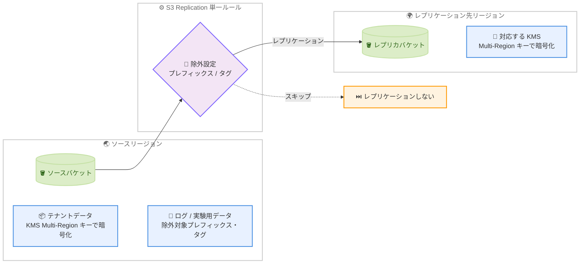

# Amazon S3 - レプリケーションの除外設定と Multi-Region キー解決

**リリース日**: 2026 年 11 月 18 日
**サービス**: Amazon S3
**機能**: S3 Replication の除外設定 (Exclusions) と Multi-Region キー解決 (Multi-Region Key Resolution)

📊 [このアップデートのインフォグラフィックを見る](https://takech9203.github.io/aws-news-summary/20261118-amazon-s3-replication-exclusions-multi-region-key-resolution.html)

## 概要

Amazon S3 Replication に 2 つの新機能が追加されました。1 つ目は「除外設定 (Exclusions)」で、バケット全体をレプリケーションしながら、特定のプレフィックスや特定のタグが付いたオブジェクト (ログや実験用データなど) をスキップできます。2 つ目は「Multi-Region キー解決 (Multi-Region Key Resolution)」で、レプリケーション先リージョンにおいて、ソースオブジェクトに対応する AWS Key Management Service (AWS KMS) の Multi-Region キーで各レプリカを暗号化します。

これらの機能は、特に多数のテナントを収容するマルチテナントバケットや共有バケットを運用するユーザーに有効です。従来は多数のレプリケーションルールを組み合わせて実現していた構成を、単一のルールに集約できます。たとえば、数百のテナントがそれぞれ固有の Multi-Region キーを持つバケットでも、単一のルールでレプリケーションでき、後から追加されるテナントにも自動的に適用されます。

両機能はオプションであり、すべての AWS リージョンで追加料金なしで利用できます。AWS SDK、AWS CLI、S3 API、または S3 コンソールから設定可能です。

**アップデート前の課題**

- バケット全体をレプリケーションする場合、不要なデータ (ログや一時データなど) も含めてすべてレプリケーションされ、ストレージコストや転送コストが増加していた
- 特定のデータのみをレプリケーションするには、対象のプレフィックスやタグごとに複数のレプリケーションルールを作成・管理する必要があった
- テナントごとに異なる KMS キーで暗号化するマルチテナントバケットでは、キーごとにルールを分ける必要があり、テナント追加のたびにルールの追加・更新が必要だった

**アップデート後の改善**

- 除外設定により、バケット全体をレプリケーションしつつ、特定のプレフィックスやタグ付きオブジェクトをスキップできるようになった
- Multi-Region キー解決により、レプリケーション先リージョンでソースオブジェクトに対応する KMS Multi-Region キーを自動的に使用してレプリカを暗号化できるようになった
- 多数のレプリケーションルールを単一のルールに集約でき、後から追加されるテナントにも自動的に対応できるようになった

## アーキテクチャ図



単一のレプリケーションルールで、除外対象 (特定プレフィックスやタグ付きオブジェクト) をスキップしながらバケット全体をレプリケーションし、レプリケーション先では対応する KMS Multi-Region キーでレプリカを暗号化する流れを示しています。

## サービスアップデートの詳細

### 主要機能

1. **除外設定 (Exclusions)**
   - バケット全体をレプリケーション対象としながら、特定のプレフィックス配下のオブジェクトをレプリケーションから除外できる
   - 特定のタグが付与されたオブジェクトを除外することも可能
   - ログや実験用データなど、レプリケーション不要なデータをスキップすることで、ストレージコストと転送コストを削減できる

2. **Multi-Region キー解決 (Multi-Region Key Resolution)**
   - AWS KMS Multi-Region キーで暗号化されたオブジェクトをレプリケーションする際、レプリケーション先リージョンに存在する対応するレプリカキーで自動的に暗号化する
   - ソースオブジェクトの暗号化要件に準拠した状態でレプリカを維持できる
   - テナントごとに固有の Multi-Region キーを使用するマルチテナントバケットでも、単一のルールでレプリケーションできる

3. **ルールの集約と自動追従**
   - 従来は多数のレプリケーションルールが必要だった構成を、単一のルールに集約できる
   - 数百のテナントを収容するバケットでも、後から追加されるテナントを含めて単一ルールで対応できる

## 技術仕様

### 機能の位置づけ

| 項目 | 詳細 |
|------|------|
| 対象機能 | Amazon S3 Replication (CRR / SRR) |
| 除外設定 | プレフィックス単位またはオブジェクトタグ単位でレプリケーション対象から除外 |
| Multi-Region キー解決 | レプリケーション先リージョンの対応する KMS Multi-Region キーでレプリカを暗号化 |
| 利用方法 | AWS SDK、AWS CLI、S3 API、S3 コンソール |
| 適用 | 両機能ともオプション (既存のレプリケーション動作は変更なし) |
| 追加料金 | なし |

### API 変更履歴

本アップデートに対応する API 変更は、レポート作成時点 (2026 年 11 月 19 日) で awsapichanges.com に未掲載です。レプリケーション設定は `PutBucketReplication` API で管理されるため、詳細な設定要素は [S3 User Guide](https://docs.aws.amazon.com/AmazonS3/latest/userguide/replication.html) の最新情報を確認してください。

## 設定方法

### 前提条件

1. ソースバケットとレプリケーション先バケットの両方でバージョニングが有効であること
2. S3 がオブジェクトをレプリケーションするための IAM ロール (KMS キーを使用する場合は対象キーへの復号・暗号化権限を含む) が設定されていること
3. Multi-Region キー解決を使用する場合、レプリケーション先リージョンに対応する KMS Multi-Region レプリカキーが作成されていること

### 手順

#### ステップ 1: レプリケーションルールの作成

S3 コンソールでソースバケットの [管理] タブから [レプリケーションルール] を作成します。ルールのスコープとしてバケット全体を指定します。

#### ステップ 2: 除外設定の追加

ルール設定で、レプリケーションから除外するプレフィックス (例: `logs/`) や、除外対象のオブジェクトタグ (例: `environment=experimental`) を指定します。指定したプレフィックス配下のオブジェクトやタグ付きオブジェクトは、レプリケーション対象から自動的にスキップされます。

#### ステップ 3: Multi-Region キー解決の有効化

ルールの暗号化設定で Multi-Region キー解決を有効にします。これにより、KMS Multi-Region キーで暗号化されたソースオブジェクトは、レプリケーション先リージョンの対応するレプリカキーで暗号化されます。

```bash
# 設定後、レプリケーション設定を確認する
aws s3api get-bucket-replication --bucket my-source-bucket
```

このコマンドは、ソースバケットに設定されたレプリケーション設定 (ルール、除外設定、暗号化設定を含む) を取得して表示します。

## メリット

### ビジネス面

- **コスト削減**: ログや実験用データなど不要なデータのレプリケーションをスキップすることで、レプリカのストレージコストとリージョン間転送コストを削減できる
- **運用負荷の軽減**: 多数のレプリケーションルールを単一ルールに集約でき、ルールの作成・更新・監査にかかる運用負荷を軽減できる
- **コンプライアンス維持**: レプリカがソースオブジェクトの暗号化要件に準拠した状態を自動的に維持でき、監査対応が容易になる

### 技術面

- **シンプルな構成**: 「全体をレプリケーションし、一部を除外する」という直感的な設計が可能になり、プレフィックスごとの包含ルールを多数管理する必要がなくなる
- **自動スケール**: 新しいテナントやプレフィックスが追加されても、単一ルールが自動的に適用されるため、設定変更が不要
- **暗号化の一貫性**: Multi-Region キーの対応関係を S3 が自動的に解決するため、リージョンごとのキー指定ミスを防止できる

## デメリット・制約事項

### 制限事項

- Multi-Region キー解決は AWS KMS の Multi-Region キーを使用している場合に有効な機能であり、通常の単一リージョンキーには適用されない
- レプリケーション先リージョンに対応する Multi-Region レプリカキーが事前に作成されている必要がある
- 除外されたオブジェクトはレプリケーションされないため、障害復旧 (DR) 要件の対象データを誤って除外しないよう設計時の確認が必要

### 考慮すべき点

- 既存のレプリケーションルールを集約する場合、除外条件が既存の包含条件と等価になるかを事前に検証することを推奨
- 除外設定によりレプリケーションされないデータについて、別途バックアップが必要かどうかを検討する
- 詳細な設定要素や制限値は公式ドキュメントの最新情報を確認する

## ユースケース

### ユースケース 1: マルチテナント SaaS バケットのリージョン間レプリケーション

**シナリオ**: 数百のテナントをプレフィックスで分離し、テナントごとに固有の KMS Multi-Region キーで暗号化しているバケットを、DR 目的で別リージョンにレプリケーションしたい。

**実装例**:
```
1. 各テナントの Multi-Region キーのレプリカキーを DR リージョンに作成
2. バケット全体を対象とする単一のレプリケーションルールを作成
3. Multi-Region キー解決を有効化
```

**効果**: テナントごとのルール作成が不要になり、新規テナント追加時もルール変更なしで自動的にレプリケーションされる。各レプリカはテナント固有のキーで暗号化された状態を維持できる。

### ユースケース 2: ログ・一時データを除外したコスト効率の高い DR 構成

**シナリオ**: アプリケーションデータとアクセスログが同一バケットに保存されており、DR リージョンにはアプリケーションデータのみをレプリケーションしたい。

**実装例**:
```
1. バケット全体を対象とするレプリケーションルールを作成
2. 除外設定に logs/ プレフィックスを指定
3. 実験用データには experimental タグを付与し、タグ除外を設定
```

**効果**: 重要データのみをレプリケーションすることで、DR リージョンのストレージコストとリージョン間データ転送コストを削減できる。

### ユースケース 3: 本番環境から分析環境への選択的データ共有

**シナリオ**: 本番バケットのデータを分析用アカウントのバケットに SRR で共有するが、個人情報を含む特定プレフィックスは共有対象から除外したい。

**実装例**:
```
1. 本番バケットから分析バケットへのクロスアカウント SRR ルールを作成
2. 除外設定に個人情報を含むプレフィックス (例: pii/) を指定
```

**効果**: 共有してはいけないデータをレプリケーション段階で確実に除外でき、データガバナンス要件を満たしながら分析環境へのデータ提供を自動化できる。

## 料金

除外設定と Multi-Region キー解決の両機能は、追加料金なしで利用できます。S3 Replication 自体の標準料金 (レプリカのストレージ料金、レプリケーションに伴う PUT リクエスト料金、CRR の場合のリージョン間データ転送料金、S3 RTC を使用する場合の RTC 料金) は従来どおり適用されます。

| 料金項目 | 内容 |
|--------|------------------|
| 除外設定 / Multi-Region キー解決 | 追加料金なし |
| レプリカのストレージ | レプリケーション先の storage class に応じた標準料金 |
| リージョン間データ転送 (CRR) | 標準のデータ転送料金 |
| KMS リクエスト | レプリカ暗号化に伴う KMS API リクエスト料金 |

なお、除外設定によりレプリケーション対象データが減ることで、これらの既存コストの削減が期待できます。詳細は [S3 料金ページ](https://aws.amazon.com/s3/pricing/) を参照してください。

## 利用可能リージョン

すべての AWS リージョンで利用可能です。

## 関連サービス・機能

- **AWS KMS Multi-Region キー**: 複数リージョンで同一のキーマテリアルを共有するキー。Multi-Region キー解決機能の前提となる
- **S3 Replication Time Control (S3 RTC)**: 15 分以内のレプリケーションを SLA で保証する機能。本アップデートの機能と組み合わせて利用可能
- **S3 Batch Replication**: 既存オブジェクトをオンデマンドでレプリケーションする機能。ルール設定前の既存データの同期に使用
- **S3 Multi-Region Access Point**: リージョン間フェイルオーバーを実現する機能。双方向レプリケーションと組み合わせた高可用性構成に使用

## 参考リンク

- 📊 [インフォグラフィック](https://takech9203.github.io/aws-news-summary/20261118-amazon-s3-replication-exclusions-multi-region-key-resolution.html)
- [公式発表 (What's New)](https://aws.amazon.com/about-aws/whats-new/2026/11/amazon-s3-replication-exclusions-multi-region-key-resolution/)
- [S3 Replication 製品ページ](https://aws.amazon.com/s3/features/replication/)
- [ドキュメント: Replicating objects within and across Regions](https://docs.aws.amazon.com/AmazonS3/latest/userguide/replication.html)
- [料金ページ](https://aws.amazon.com/s3/pricing/)

## まとめ

S3 Replication の除外設定と Multi-Region キー解決により、マルチテナントバケットや共有バケットのレプリケーション設計が大幅に簡素化されます。多数のルールで運用している既存環境では、単一ルールへの集約によるコスト削減と運用負荷軽減の効果が大きいため、現在のレプリケーション構成を見直すことを推奨します。
