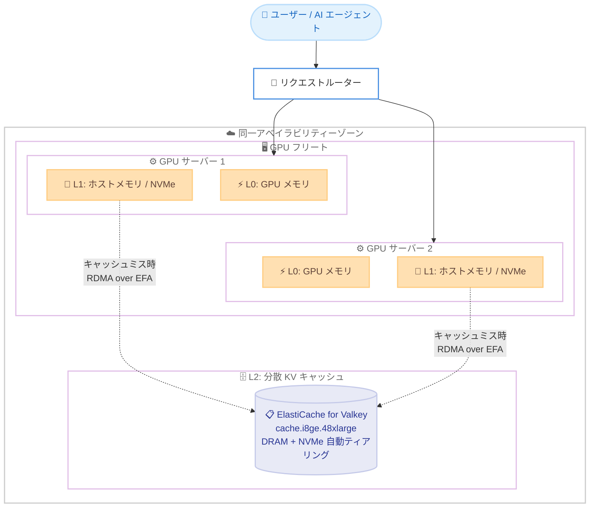

# Amazon ElastiCache - セルフホスト LLM 推論向け分散 KV キャッシング

**リリース日**: 2026 年 11 月 18 日
**サービス**: Amazon ElastiCache (ElastiCache for Valkey)
**機能**: 分散 KV キャッシング (Distributed KV Caching) for セルフホスト LLM 推論

📊 [このアップデートのインフォグラフィックを見る](https://takech9203.github.io/aws-news-summary/20261118-announcing-distributed-kv-caching-for-self-hosted-llms-with-amazon-elasticache.html)

## 概要

Amazon ElastiCache for Valkey が、セルフホスト LLM 推論向けのフルマネージド分散 KV キャッシングの一般提供を開始しました。この新機能により、セルフホスト LLM の推論コストを最大 40% 削減し、最初のトークンが生成されるまでの時間 (TTFT: Time to First Token) を最大 80% 短縮できます。

LLM をセルフホストしている組織では、各 GPU サーバー上の小さく孤立したローカルキャッシュが、AI エージェントやチャットアプリケーションが繰り返し送信する長大なコンテキストを保持・共有できないため、冗長な GPU 計算 (プリフィルの再計算) にコストを費やしていました。分散 KV キャッシングは、GPU ローカルキャッシュを共有ティア (L2 キャッシュ) で拡張し、フリート内のどのサーバーからでも KV ステートを数日間にわたって再利用できるようにします。セッションをまたぐ再訪問、ルーティングの変化、サーバー障害が発生しても KV ステートが維持されます。

vLLM、SGLang、TensorRT-LLM といった既存の推論エンジンに、オープンソースの LMCache コネクタを通じて設定変更のみで接続でき、アプリケーションコードの変更は不要です。対象ユーザーは、オープンウェイトモデルやファインチューニング済みモデルを自社 GPU 基盤で運用する推論プロバイダー、AI コーディングアシスタント、カスタマーサポートエージェント、ドキュメント QA パイプラインの運用者などです。

**アップデート前の課題**

- GPU メモリ上の L0 キャッシュ (HBM3e で最大約 288 GB) はモデル重みと全リクエストで共有され、長い会話の KV ステートはすぐに追い出されていた
- ホストメモリとローカル NVMe を使う L1 キャッシュ (LMCache などによるオフロード) は単一サーバー専用であり、別のサーバーにルーティングされたリクエストはキャッシュを利用できなかった
- 数時間〜数日後に戻ってくるユーザーのセッションはローカルキャッシュから消失しており、システムプロンプトやツール定義を含むプロンプト全体のプリフィルを再計算する必要があった (コーディングエージェントのトレースでは、プロンプトトークンの 95% 以上が処理済みプレフィックスの再送)
- GPU サーバーの障害やスケールインでローカルキャッシュが完全に失われ、復旧後もレイテンシが悪化していた

**アップデート後の改善**

- フリート内の全 GPU が共有する L2 キャッシュティアにより、どのサーバーに着信しても過去のコンテキストの KV ステートを数ミリ秒で取得可能になった
- 推論コスト (100 万トークンあたりのコスト) を最大 40% 削減、TTFT を最大 80% 短縮 (モデルやワークロードによっては最大 93% 短縮)
- RDMA over EFA により OS のネットワークスタックや TCP/IP をバイパスし、ノードあたり最大 220 Gbps のスループットで GPU ホストメモリと直接データ転送が可能になった
- サーバー障害時も残存サーバーが共有キャッシュから KV ステートを読み出せるため、性能劣化が緩和され、復旧も高速化された

## アーキテクチャ図



推論エンジンはリクエストごとに L0 (GPU メモリ)、L1 (ホストメモリ / NVMe) の順にローカルキャッシュを確認し、ミスした場合のみ L2 (ElastiCache for Valkey) から RDMA over EFA 経由で KV ステートを読み出します。新しく計算した KV ステートは LMCache コネクタが L2 ティアに書き込み、フリート内の任意の GPU が再利用できます。

## サービスアップデートの詳細

### 主要機能

1. **共有 L2 KV キャッシュティア**
   - GPU ローカルの L0 / L1 キャッシュを補完する、フリート全体で共有される L2 ティアを提供
   - KV ステートがサーバー境界・セッション・障害をまたいで数日間維持される
   - ペタバイト級までスケール可能なストレージを提供し、同一 AZ 内のすべての GPU が同じ L2 キャッシュを読み取り可能

2. **RDMA over EFA による高速データ転送**
   - Elastic Fabric Adapter (EFA) 上の RDMA により、ElastiCache ノードのメモリと GPU ホストのメモリ間で直接データを転送
   - OS ネットワークスタック、TCP/IP、中間コピーをバイパスし、ノードあたり最大 220 Gbps のスループットを実現
   - DRAM 上のブロックへのキャッシュ応答はサブミリ秒 (8 MB オブジェクトの Get で P50 477 µs、1 GB の取得で約 42 ms)

3. **DRAM と NVMe の自動データティアリング**
   - 新たに導入された Valkey のラージオブジェクトサポートを使用し、KV ブロックを DRAM と NVMe に格納
   - 最もホットな KV ブロックは DRAM から読み書きし、コールドなブロックはノードローカルの NVMe に自動的にティアリング
   - ユーザーは ElastiCache for Valkey のエンドポイントとやり取りするだけでよく、ティアリングは透過的に動作

4. **LMCache コネクタによる主要推論エンジン対応**
   - vLLM、SGLang、TensorRT-LLM をオープンソースの LMCache コネクタ経由で接続可能
   - 設定変更のみで導入でき、アプリケーションコードの変更は不要
   - オープンウェイト、ファインチューニング済み、カスタムモデルに対応し、フル・スパース・ハイブリッドなどのアテンション設計をサポート

5. **KVTrace による事前効果見積もり**
   - オープンソースの KVTrace ツールにより、デプロイ前に自分のトラフィックでコスト削減と TTFT 改善を無料で見積もり可能
   - vLLM / SGLang が発行するキャッシュイベントを利用し、分散 KV キャッシュが解消できたはずの再計算をレポート
   - ハッシュ化されたプロンプトデータのみを使用するためプライバシーを保護し、推論エンジンや GPU クラスターの変更は不要

## 技術仕様

### 分散 KV キャッシングの構成要素

| 項目 | 詳細 |
|------|------|
| キャッシュエンジン | ElastiCache for Valkey |
| ノードタイプ | cache.i8ge.48xlarge |
| 配置要件 | GPU フリートと同一アベイラビリティーゾーン |
| 接続方式 | RDMA over Elastic Fabric Adapter (EFA) |
| ノードあたりスループット | 最大 220 Gbps (2026 年 11 月 18 日時点) |
| ストレージ | DRAM + ノードローカル NVMe の自動ティアリング、ペタバイト級までスケール可能 |
| 対応推論エンジン | vLLM、SGLang、TensorRT-LLM (LMCache コネクタ経由) |
| 対応モデル | オープンウェイト / ファインチューニング済み / カスタムモデル、フル・スパース・ハイブリッドアテンション |

### キャッシュ応答時間 (cache.i8ge.48xlarge)

| オブジェクト | 操作 | レイテンシ P50 | レイテンシ P99 |
|------|------|------|------|
| 8 MB オブジェクト 1 個 | Get | 477 µs | 950 µs |
| 8 MB オブジェクト 1 個 | Set | 881 µs | 1,010 µs |
| 1 GB (8 MB x 128、1 ノード) | Get | 41.7 ms | 42.1 ms |
| 1 GB (8 MB x 128、1 ノード) | Set | 44.6 ms | 49.4 ms |

### ベンチマーク結果 (AWS 公表値)

| ワークロード | 結果 |
|------|------|
| 共有ドキュメント QA | サーバーあたり 2 倍の RPS を処理し、100 万出力トークンあたりのコストを 40% 削減 (ElastiCache ノード費用控除後) |
| コーディングエージェント | 同一負荷で最大 1.98 倍のスループット、サーバーあたりピークトークンスループット 23% 向上 |
| AI アシスタント | 同一負荷で最大 1.61 倍のスループット (P90 TTFT 30 秒の SLO 内) |
| TTFT 削減 | 8 モデルのテストで 55%〜93% の削減。フルアテンションモデルは 10K トークン程度のプロンプトでも 80% 以上の削減 |
| サーバー障害時 | 残存サーバーが P90 TTFT を 43% 低く維持しつつ 1.48 倍のリクエストを完了。復旧後 60 秒以内に元の性能に回復 |

## 設定方法

### 前提条件

1. GPU フリート (例: P6 サーバー) と同一アベイラビリティーゾーンに ElastiCache for Valkey クラスターを作成できること
2. vLLM、SGLang、TensorRT-LLM のいずれかの推論エンジンを使用していること
3. LMCache コネクタを構成できること

### 手順

#### ステップ 1: KVTrace で効果を事前見積もり (推奨)

```bash
# KVTrace を GitHub から取得 (PyPI にはない)
git clone https://github.com/aws-samples/amazon-elasticache-samples.git
cd amazon-elasticache-samples/kvtrace
pip install .

# vLLM の KV キャッシュイベントを有効化
vllm serve <model> --enable-prefix-caching \
  --kv-events-config '{"enable_kv_cache_events": true, "publisher": "zmq", "endpoint": "tcp://127.0.0.1:5557", "replay_endpoint": "tcp://127.0.0.1:5558", "topic": "kv-events"}'

# 各 GPU サーバーでトラフィックを記録
kvtrace record --endpoint-mode bind --endpoint tcp://127.0.0.1:5557 \
  --replay-endpoint tcp://127.0.0.1:5558 \
  --model <model-label> --metrics-url http://127.0.0.1:8000/metrics --out traces/

# キャッシュサイズをシミュレートしてレポートを作成
kvtrace simulate traces/ --model-config config.json --tp 8 -o sim.json
kvtrace report sim.json -o report.html \
  --gpu-cost-per-hour <GPU 時間単価> --gpus-per-replica 8
```

KVTrace をインストールし、vLLM が発行するキャッシュイベントを記録して、分散 KV キャッシュ導入時の期待キャッシュヒット率・コスト削減・TTFT 改善と推奨クラスターサイズをオフラインでシミュレートします。本番クラスターの変更は不要で、ハッシュ化されたデータのみを扱います。

#### ステップ 2: ElastiCache for Valkey クラスターの作成

```bash
# GPU フリートと同一 AZ に cache.i8ge.48xlarge ノードでクラスターを作成
aws elasticache create-replication-group \
  --replication-group-id llm-kv-cache \
  --replication-group-description "Distributed KV cache for LLM inference" \
  --engine valkey \
  --cache-node-type cache.i8ge.48xlarge \
  --preferred-cache-cluster-azs <GPU フリートと同じ AZ>
```

AWS CLI を使用して、GPU フリートと同一のアベイラビリティーゾーンに cache.i8ge.48xlarge ノードの ElastiCache for Valkey クラスターを作成します。同一 AZ への配置は RDMA over EFA による低レイテンシ通信の要件です。

#### ステップ 3: 推論エンジンへのエンドポイント追加

LMCache の Valkey コネクタ設定に、作成した ElastiCache for Valkey クラスターのエンドポイントを追加します。vLLM、SGLang、TensorRT-LLM のいずれも設定変更のみで接続でき、アプリケーションコードの変更は不要です。詳細な設定方法は [ElastiCache ドキュメント](https://docs.aws.amazon.com/AmazonElastiCache/latest/dg/distributed-kv-caching.html)を参照してください。

## メリット

### ビジネス面

- **推論コストの大幅削減**: GPU がプリフィルを再計算する代わりにキャッシュから KV ステートを取得することで、100 万トークンあたりのコストを最大 40% 削減 (ElastiCache ノードの費用を考慮した後の数値)
- **ユーザー体験の向上**: TTFT を最大 80% 短縮し、応答開始が早く、ストリーミングが滑らかになる。Multiverse Computing 社の事例では、同じ GPU で 50% 多いリクエストを処理し、ピーク時の TTFT 中央値を 95% 削減
- **GPU 投資の最大活用**: ルーティング最適化への依存を減らし、フリート全体の GPU を有効活用できるため、トラフィックスパイク時の増設判断を緩和できる

### 技術面

- **コード変更不要の導入**: LMCache コネクタによる設定変更のみで vLLM / SGLang / TensorRT-LLM に統合可能
- **障害・スケーリング耐性**: GPU ホスト障害やスケールインでローカルキャッシュが失われても、共有ティアから KV ステートを読み出して性能を維持。復帰したサーバーもキャッシュからハイドレートして 60 秒以内に初期性能に回復 (テスト環境での結果)
- **事前検証が可能**: KVTrace により、インフラをデプロイする前に自社トラフィックでの効果とクラスターサイズを無料で見積もり可能
- **フルマネージド**: DRAM / NVMe ティアリングやスケーリングは ElastiCache が管理し、ユーザーはエンドポイントを利用するだけでよい

## デメリット・制約事項

### 制限事項

- ノードタイプは cache.i8ge.48xlarge に限定され、GPU フリートと同一アベイラビリティーゾーンへの配置が必要
- 提供リージョンは米国、欧州、アジアパシフィックの 13 リージョン (発表時点。具体的なリージョン名はドキュメントで確認が必要)
- GPU ノードとの接続に RDMA over EFA を使用するため、EFA に対応した GPU インスタンス構成が前提となる
- キャッシュは容量確保のために古い KV ステートを追い出すため、保持期間は無期限ではない (数日単位)

### 考慮すべき点

- KV ステートが GPU メモリに収まる小規模デプロイ、再利用のない単発 LLM 呼び出し (分類、翻訳、モデレーションなど)、短いプロンプトから長い出力を生成するワークロードでは効果が小さい
- モデルごとに「カットオーバーポイント」(キャッシュ取得が再計算より速くなるプロンプト長) が存在する。テストした全モデルで 10K トークン未満 (スパースモデルで 512 トークン未満、ハイブリッドモデルで 1,000〜7,600 トークン) だが、レイテンシ重視の場合は自ワークロードでの測定とカットオーバー超のプロンプトのみのキャッシュが推奨される
- cache.i8ge.48xlarge は大型ノードのため、ノード費用を上回るコスト削減が得られるか KVTrace で事前に確認することが重要
- ベンチマーク値 (最大 40% コスト削減、最大 80% TTFT 短縮) はワークロード特性とキャッシュヒット率に依存する

## ユースケース

### ユースケース 1: AI コーディングアシスタント

**シナリオ**: 開発者が同じコードベースに対して何十ターンも対話を続ける AI コーディングアシスタントを、複数の GPU サーバーでセルフホストしている。プロンプトは 100K トークンを超え、95% 以上が過去に処理済みのプレフィックスの再送である。

**実装例**:
```
1. KVTrace で Claude Code 相当のトレースを記録し、効果を見積もり
2. GPU フリートと同一 AZ に cache.i8ge.48xlarge クラスターを作成
3. vLLM の LMCache 設定に Valkey エンドポイントを追加
```

**効果**: AWS のテストでは、コーディングエージェントワークロードで同一負荷時に最大 1.98 倍のスループットを達成。長いプロンプトほどプリフィル再計算の削減効果が大きい。

### ユースケース 2: 数時間〜数日の会話履歴を持つサポートエージェント

**シナリオ**: カスタマーサポート AI が長時間の会話履歴を保持しており、ユーザーが数時間後や翌日に戻ってくる。従来はローカルキャッシュから KV ステートが消失し、履歴全体のプリフィルを再計算していた。

**実装例**:
```
分散 KV キャッシュを L2 ティアとして追加し、
KV ステートを数日間保持。どの GPU サーバーに
ルーティングされても過去の文脈を再利用。
```

**効果**: 再訪ユーザーへの応答で TTFT が大幅に短縮され (テストでは最大 80%)、GPU は新規リクエストの処理に集中できる。

### ユースケース 3: 共有ドキュメントに対する大規模 QA

**シナリオ**: 多数のユーザーが同じ契約書やマニュアルに対して質問するドキュメント QA サービス。共有システムプロンプトと共通ドキュメントのプリフィルが全サーバーで重複計算されている。

**実装例**:
```
共通ドキュメントの KV ステートを L2 ティアで共有し、
全 GPU サーバーがプリフィル済みの状態を再利用。
```

**効果**: AWS のテストでは、サーバーあたりの処理リクエスト数が 2 倍になり、インタラクティビティ SLO (P90 TTFT 5 秒未満) を維持しながら 100 万出力トークンあたりのコストを 40% 削減。

## 料金

ElastiCache for Valkey のノード料金体系に基づき、cache.i8ge.48xlarge ノードの稼働時間に応じて課金されます。分散 KV キャッシング機能自体の追加料金は発表されていません。KVTrace ツールは無料で利用できます。具体的な単価は [Amazon ElastiCache 料金ページ](https://aws.amazon.com/elasticache/pricing/)を参照してください。

AWS の公表値である「コスト最大 40% 削減」は、ElastiCache ノードの費用を支払った後のネットの削減率です。

## 利用可能リージョン

米国、欧州、アジアパシフィックの 13 の AWS リージョンで利用可能です (2026 年 11 月 18 日時点)。具体的なリージョンは [ElastiCache ドキュメント](https://docs.aws.amazon.com/AmazonElastiCache/latest/dg/distributed-kv-caching.html)で確認してください。

## 関連サービス・機能

- **Amazon ElastiCache for Valkey**: 本機能の基盤となるフルマネージドインメモリキャッシュサービス。新しいラージオブジェクトサポートで KV ブロックを格納
- **Elastic Fabric Adapter (EFA)**: GPU ノードとキャッシュノード間の RDMA 通信を実現するネットワークインターフェイス
- **LMCache**: vLLM / SGLang / TensorRT-LLM と ElastiCache を接続するオープンソースの KV キャッシュオフロードコネクタ
- **Amazon EC2 P6 インスタンス**: ベンチマークで使用された GPU サーバー。8 GPU 構成で vLLM を実行
- **Amazon SageMaker AI / Amazon Bedrock**: セルフホストではなくマネージドな推論を選ぶ場合の代替手段

## 参考リンク

- 📊 [インフォグラフィック](https://takech9203.github.io/aws-news-summary/20261118-announcing-distributed-kv-caching-for-self-hosted-llms-with-amazon-elasticache.html)
- [公式発表 (What's New)](https://aws.amazon.com/about-aws/whats-new/2026/11/announcing-distributed-kv-caching-for-self-hosted-llms-with-amazon-elasticache/)
- [AWS Blog: Announcing distributed KV caching for self-hosted LLMs with Amazon ElastiCache](https://aws.amazon.com/blogs/database/announcing-distributed-kv-caching-for-self-hosted-llms-with-amazon-elasticache/)
- [ドキュメント: Distributed KV caching](https://docs.aws.amazon.com/AmazonElastiCache/latest/dg/distributed-kv-caching.html)
- [KVTrace ツール (GitHub)](https://github.com/aws-samples/amazon-elasticache-samples/tree/main/kvtrace)
- [Elastic Fabric Adapter](https://aws.amazon.com/hpc/efa/)
- [料金ページ](https://aws.amazon.com/elasticache/pricing/)

## まとめ

Amazon ElastiCache for Valkey の分散 KV キャッシングは、セルフホスト LLM 推論の最大のボトルネックであるプリフィル再計算を、フリート共有の L2 キャッシュティアで解消する画期的なアップデートです。コード変更なしの設定のみで vLLM / SGLang / TensorRT-LLM に導入でき、コスト最大 40% 削減と TTFT 最大 80% 短縮が期待できます。長いコンテキストを扱う AI エージェントやドキュメント QA をセルフホストしている場合は、まず無料の KVTrace ツールで自社トラフィックでの効果を見積もることを推奨します。
