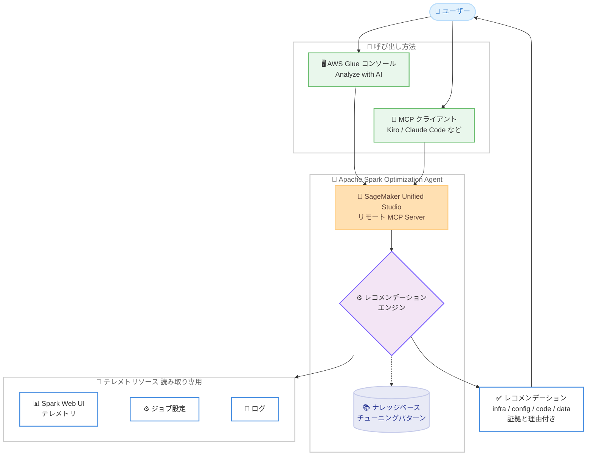

# AWS Glue - Apache Spark Optimization Agent for AWS Glue ETL

**リリース日**: 2026 年 11 月 18 日
**サービス**: AWS Glue
**機能**: Apache Spark Optimization Agent for AWS Glue ETL

📊 [このアップデートのインフォグラフィックを見る](https://takech9203.github.io/aws-news-summary/20261118-apache-spark-aws-glue-etl.html)

## 概要

AWS Glue ETL に Apache Spark Optimization Agent が導入されました。このエージェントは、完了した Spark ジョブ実行の設定、ログ、Spark テレメトリを分析し、数分以内にコストとパフォーマンスの最適化レコメンデーションを提供します。ユーザーはコスト最適化またはパフォーマンス最適化のいずれかの目標を選択するだけで、具体的な設定変更の提案を、その根拠となるテレメトリの証拠と理由付きで受け取ることができます。

エージェントは AWS Glue コンソールの完了したジョブ実行から直接利用できるほか、Amazon SageMaker Unified Studio MCP Server を介して独自のツールからも呼び出せます。レコメンデーションは決定論的なレコメンデーションエンジンによって計算され、並列度の不足、結合キーのスキュー、スピルを引き起こすメモリ圧迫、アイドル状態のエグゼキューター、実際の使用量に対する過剰なキャパシティプロビジョニングなど、コストと実行時間を左右する要因を特定します。

このアップデートは、Spark ジョブのチューニングに多くの時間を費やしているデータエンジニアや、Glue ジョブのコスト削減を検討しているチームにとって、専門知識がなくても根拠に基づいた最適化を実現できる重要な機能です。追加料金なしで利用できます。

**アップデート前の課題**

このアップデート以前は、Spark ジョブの最適化に専門知識と手作業が必要でした。

- Spark History Server のタイムライン、シャッフルメトリクス、エグゼキューターのサイジング、タスク分布などを専門家が手動で分析する必要があった
- データスキュー、メモリ圧迫、小さいファイルの大量発生といったボトルネックの特定には、Spark 内部に関する深い知識が必要だった
- ジョブが期限内に完了している場合、過剰プロビジョニングによるコストの無駄が見過ごされがちだった
- 以前は正常だったジョブが劣化した際、何が変わったのかを突き止める比較分析に時間がかかった

**アップデート後の改善**

今回のアップデートにより、以下が可能になりました。

- 完了したジョブ実行に対して、数分でコストまたはパフォーマンスの最適化レコメンデーションを取得できるようになった
- 各レコメンデーションにテレメトリの証拠と理由が添付され、根拠に基づいた判断が可能になった
- 正常だった実行をベースラインとして指定し、劣化した実行との差分分析ができるようになった
- MCP 対応クライアントから `analyze_spark_workload` ツールを使い、自然言語で分析を依頼できるようになった

## アーキテクチャ図



ユーザーがコンソールまたは MCP クライアントから分析を依頼すると、エージェントが完了したジョブのテレメトリを読み取り専用で収集し、決定論的なレコメンデーションエンジンが証拠付きの最適化提案を返します。

## サービスアップデートの詳細

### 主要機能

1. **目標ベースの最適化レコメンデーション**
   - コスト最適化またはパフォーマンス最適化のいずれかの目標を選択して分析を実行
   - コストとパフォーマンスが競合する場合、選択した指標を最適化しつつ、もう一方の劣化を定義された制限内に抑える
   - 大規模または高コストなジョブにはより厳しいしきい値が適用される

2. **決定論的レコメンデーションエンジンによる根本原因分析**
   - ジョブの設定、ログ、Spark テレメトリを総合的に分析
   - 並列度の不足、結合キーのスキュー、スピルを引き起こすメモリ圧迫、アイドル状態のエグゼキューター、過剰プロビジョニングなどを検出
   - ルールベースの調査、意図ベースの決定論的モデル、AWS 上の膨大な Spark ジョブのチューニングパターンから構築されたナレッジベースを組み合わせる

3. **ベースライン比較分析**
   - 以前は正常だったジョブが劣化した場合、現在の実行と正常だった実行を指定して比較
   - 設定、メトリクス、ステージの挙動の差分から変化の原因を特定

4. **ベストプラクティスチェック**
   - 新しい AWS Glue バージョンへの移行や AWS Graviton プロセッサの採用などのプラットフォームレベルの改善も提案
   - AWS Glue のパフォーマンスチューニングガイダンスに照らしたチェックを実施

5. **カテゴリ付きレコメンデーション**
   - 各レコメンデーションは変更対象の領域でラベル付けされる: infrastructure (インフラ)、Spark configuration (設定)、code (コード)、data layout (データレイアウト)
   - 変更対象のプロパティ、現在値と提案値、根拠となるテレメトリの証拠が表示される

6. **MCP 経由の呼び出し**
   - Amazon SageMaker Unified Studio のリモート MCP Server が提供する `analyze_spark_workload` ツールを使用
   - Kiro、Claude Code などの MCP 対応クライアントから自然言語で分析を依頼可能

## 技術仕様

### 分析の仕組み

| 項目 | 詳細 |
|------|------|
| 分析対象 | 完了した AWS Glue ジョブ実行 |
| 対応バージョン | AWS Glue 4.0 以降 |
| テレメトリソース | AWS Glue Apache Spark Web UI のテレメトリ、ジョブ設定、ログ |
| アクセス方式 | 既存の AWS API 経由の読み取り専用アクセス (TLS) |
| 分析モード | 単一ジョブ実行分析、ベースライン比較分析 |
| 変更の適用 | エージェントは変更を適用しない (ユーザーが判断して適用) |
| 認証・監査 | AWS IAM で認証、AWS CloudTrail に記録 |
| データの取り扱い | 顧客データはモデルのトレーニングやナレッジベースの構築に使用されない |

### レコメンデーションのカテゴリ

| カテゴリ | 対象 | 適用時の注意 |
|----------|------|--------------|
| infra | ワーカータイプ、ワーカー数などのコンピューティングリソース | 次回実行で検証可能 |
| config | `spark.sql.shuffle.partitions`、`spark.executor.memory`、AQE オプションなどの Spark 設定 | コード変更なしで次回実行時に検証可能 |
| code | ジョブコードの改善 | コードレビューとテストが必要 |
| data | 別キーでの再パーティション、小さいファイルの圧縮などの物理データレイアウト | ジョブの挙動が変わるため本番適用前に十分なレビューとテストが必要 |

## 設定方法

### 前提条件

1. AWS Glue 4.0 以降で実行された完了済みのジョブ実行があること
2. 分析対象のジョブ実行のテレメトリやログにアクセスできる IAM 権限があること (詳細はドキュメントを参照)
3. MCP 経由で利用する場合は、MCP 対応クライアントと Amazon SageMaker Unified Studio MCP Server への接続設定

### 手順

#### ステップ 1: コンソールから分析を開始する

1. AWS Glue コンソールで [ETL jobs] から対象のジョブを選択
2. [Runs] タブで成功した実行を選択
3. [Analyze with AI] を選択

完了したジョブ実行を指定して AI 分析を開始します。

#### ステップ 2: 最適化の目標を選択する

1. Performance (パフォーマンス) または Cost (コスト) を選択
2. 必要に応じてベースラインとなる正常だった実行を指定
3. 分析を実行し、完了後にレコメンデーションを確認

目標を指定することで、エージェントは選択した指標を優先しつつ、もう一方の劣化を制限内に抑えた提案を生成します。

#### ステップ 3: MCP クライアントから利用する場合

```text
# MCP クライアントでのプロンプト例
My job is slow. How do I make this job faster?   # パフォーマンス目標
My bill is too high.                              # コスト目標
Why is my job running slowly today?               # ベースライン比較
```

Amazon SageMaker Unified Studio のリモート MCP Server が提供する `analyze_spark_workload` ツールを呼び出します。「faster」「cheaper」などの自然言語の表現から目標が設定されます。ジョブ実行 ID (比較の場合はベースライン実行 ID も) を含めて依頼します。

#### ステップ 4: レコメンデーションを確認して適用する

分析結果には、変更対象のプロパティ、現在値と提案値、根拠となるテレメトリの証拠が表示されます。エージェントは変更を自動適用しないため、内容を確認した上でユーザー自身がジョブ設定やコードに反映し、次回実行で効果を検証します。

## メリット

### ビジネス面

- **コスト削減の機会を可視化**: 期限内に完了しているため見過ごされがちなジョブについても、確保したエグゼキューター数と実際に使用されたエグゼキューター数を比較して過剰プロビジョニングを検出できる
- **追加料金なし**: エージェントの利用自体に追加費用は発生せず、導入のハードルが低い
- **専門家への依存を低減**: Spark チューニングの専門知識がないチームでも、証拠に基づいた最適化判断が可能になる

### 技術面

- **証拠に基づくレコメンデーション**: 各提案にテレメトリの証拠と理由が付属し、推測ではなくデータに基づいた改善ができる
- **読み取り専用で安全**: エージェントはジョブのコードや設定を変更せず、適用の判断は常にユーザー側にある
- **ベースライン比較による劣化分析**: 正常時との差分から、パフォーマンス劣化の原因を効率的に特定できる
- **IAM と CloudTrail による統制**: アクセスは IAM で認証され、CloudTrail に記録されるため、ガバナンス要件に対応できる

## デメリット・制約事項

### 制限事項

- AWS Glue 4.0 以降のジョブのみ対応
- 完了したジョブ実行のみが分析対象 (実行中のジョブはリアルタイムに分析できない)
- AWS GovCloud (US) および中国リージョンでは利用不可

### 考慮すべき点

- エージェントは変更を自動適用しないため、レコメンデーションの反映と効果検証はユーザーの作業として残る
- data カテゴリのレコメンデーション (再パーティションや小さいファイルの圧縮など) はジョブの挙動を変えるため、本番適用前に通常の変更管理プロセスでのレビューとテストが必要
- コストとパフォーマンスはトレードオフになる場合があり、選択した目標によって提案内容が変わることを理解した上で利用する

## ユースケース

### ユースケース 1: SLA 遅延が発生した夜間パイプラインの改善

**シナリオ**: 毎朝 8 時のダッシュボード更新に間に合わせる必要がある夜間の注文データパイプラインが、データ量の増加に伴い徐々に遅くなり、SLA に間に合わなくなってきた。

**実装例**:
```text
1. AWS Glue コンソールで対象ジョブの最新の実行を選択
2. [Analyze with AI] から Performance を選択して分析
3. ボトルネックとなっているステージと推奨設定を確認して適用
```

**効果**: 単純にワーカーを追加するのではなく、ボトルネックのステージに対する具体的な設定変更が提案されるため、コストを抑えながら実行時間を短縮できる。

### ユースケース 2: 見過ごされていた過剰プロビジョニングの是正

**シナリオ**: ジョブは期限内に完了しているため誰もレビューしておらず、Glue ジョブのコストが必要以上に高くなっている可能性がある。

**実装例**:
```text
1. 対象ジョブの成功した実行に対して Cost 目標で分析を実行
2. 確保されたエグゼキューターとステージで実際に使用されたエグゼキューターの比較結果を確認
3. 提案されたワーカータイプ・ワーカー数に変更して次回実行で検証
```

**効果**: 実行時間の劣化を定義された制限内に抑えながら、過剰なキャパシティを適正化してコストを削減できる。

### ユースケース 3: 突然遅くなったジョブの原因特定

**シナリオ**: 以前は安定して動いていたジョブが、ある日から急に遅くなった。設定、データ、環境のどこに原因があるのかわからない。

**実装例**:
```text
1. 劣化した実行と、正常だった過去の実行をベースラインとして指定
2. MCP クライアントから「Why is my job running slowly today?」と依頼
3. 設定・メトリクス・ステージ挙動の差分レポートを確認
```

**効果**: 正常時との差分が自動で抽出されるため、データスキューの発生や設定変更など、劣化の原因を短時間で特定できる。

## 料金

Apache Spark Optimization Agent は追加料金なしで利用できます。AWS Glue ジョブの実行自体には通常の AWS Glue の料金が適用されます。

## 利用可能リージョン

AWS Glue が利用可能なすべての AWS リージョンで利用できます。ただし、AWS GovCloud (US) および中国リージョンは除きます。

## 関連サービス・機能

- **Amazon EMR Serverless**: 同じ Apache Spark Optimization Agent が Amazon EMR Serverless の Spark ジョブにも提供されており、EMR Studio の [Analyze with AI] から利用できる
- **Amazon SageMaker Unified Studio**: リモート MCP Server を通じて `analyze_spark_workload` ツールを提供し、外部ツールからのエージェント呼び出しを可能にする
- **AWS CloudTrail**: エージェントへのアクセスが記録され、監査証跡として利用できる
- **AWS Graviton**: エージェントのベストプラクティスチェックにより、Graviton ベースのワーカーへの移行が提案される場合がある

## 参考リンク

- 📊 [インフォグラフィック](https://takech9203.github.io/aws-news-summary/20261118-apache-spark-aws-glue-etl.html)
- [公式発表 (What's New)](https://aws.amazon.com/about-aws/whats-new/2026/11/apache-spark-aws-glue-etl/)
- [AWS Blog: Introducing the Apache Spark optimization agent for Amazon EMR Serverless and AWS Glue ETL](https://aws.amazon.com/blogs/big-data/introducing-the-apache-spark-optimization-agent-for-amazon-emr-serverless-and-aws-glue-etl/)
- [ドキュメント: Apache Spark Optimization Agent for Amazon EMR and AWS Glue](https://docs.aws.amazon.com/emr/latest/ReleaseGuide/spark-optimization-agent.html)
- [料金ページ: AWS Glue の料金](https://aws.amazon.com/glue/pricing/)

## まとめ

Apache Spark Optimization Agent により、これまで専門家の手作業に頼っていた Spark ジョブのチューニングが、数分で得られる証拠付きのレコメンデーションに置き換わります。追加料金なしで利用でき、エージェントは読み取り専用で変更を強制しないため、まずは主要な Glue ジョブや長時間実行されているジョブに対して Cost / Performance の両目標で分析を試し、提案内容と削減効果を確認することを推奨します。
