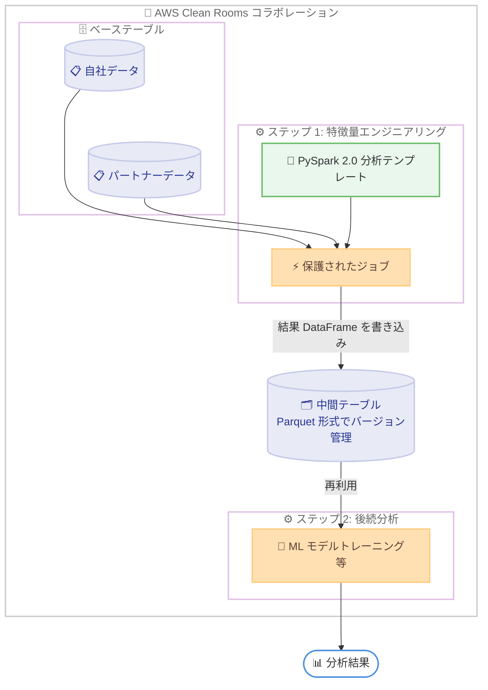

# AWS Clean Rooms - PySpark ジョブ結果の中間テーブルへの書き込みサポート

**リリース日**: 2026 年 11 月 18 日
**サービス**: AWS Clean Rooms
**機能**: PySpark ジョブ結果の中間テーブル (Intermediate Table) への書き込み

📊 [このアップデートのインフォグラフィックを見る](https://takech9203.github.io/aws-news-summary/20261118-aws-clean-rooms-pyspark-intermediate-table.html)

## 概要

AWS Clean Rooms が、PySpark ジョブの実行結果を中間テーブル (Intermediate Table) に書き込み、後続の分析で再利用する機能をサポートしました。中間テーブルはコラボレーション内で分析結果をキャッシュするテーブルで、これまでの SQL クエリに加えて、PySpark 2.0 分析テンプレートによるデータ投入が可能になりました。

AWS Clean Rooms は、企業とそのパートナーが互いの生データを開示・コピーすることなく、組み合わせたデータセットを共同で分析できるサービスです。今回のアップデートにより、複数ステップにわたる複雑な分析ワークフローをパートナーと実行する際の柔軟性が向上します。たとえば計測ベンダーが PySpark で特徴量エンジニアリングを実行し、その出力を機械学習モデルのトレーニングに利用して高価値顧客を特定するといった、オーディエンスターゲティングやキャンペーン入札最適化のためのパイプラインを Clean Rooms 内で構築できます。

**アップデート前の課題**

- PySpark ジョブの結果をコラボレーション内で再利用できず、多段の分析ワークフローでは同じ処理を毎回実行し直す必要があった
- 特徴量エンジニアリングとモデルトレーニングのような複数ステップの処理を、単一のジョブにまとめるか、コラボレーションの外部で組み立てる必要があった
- 中間結果の受け渡しに外部ストレージを使う場合、Clean Rooms のプライバシー保護の枠外でデータを扱うリスクがあった

**アップデート後の改善**

- PySpark ジョブの結果を中間テーブルとしてコラボレーション内に保存し、後続の分析から参照できるようになった
- 特徴量エンジニアリング → モデルトレーニングのような多段パイプラインを、Clean Rooms のプライバシー保護の枠内で完結できるようになった
- 中間テーブルは再投入 (リフレッシュ) のたびに新しいバージョンが作成され、ベーステーブル更新時のデータ更新も安全に行えるようになった

## アーキテクチャ図



PySpark 分析テンプレートによる保護されたジョブの結果を中間テーブルに書き込み、後続の分析で再利用する流れを示しています。中間テーブルへの投入のたびに新しいバージョンが作成されます。

## サービスアップデートの詳細

### 主要機能

1. **PySpark ジョブ結果の中間テーブルへの書き込み**
   - PySpark 2.0 (`PYSPARK_2_0`) 分析テンプレートを使用して中間テーブルにデータを投入できる
   - 投入処理は保護されたジョブ (Protected Job) として実行され、処理時間は数分から数時間
   - スクリプトは結果としてちょうど 1 つの DataFrame を返す必要がある

2. **バージョン管理による安全なリフレッシュ**
   - 投入 (Populate) 操作のたびに中間テーブルの新しいバージョンが作成される
   - リフレッシュ中も以前のバージョンが利用可能で、リフレッシュが失敗しても既存データには影響しない
   - テーブルのステータスは `POPULATE_STARTED` から `POPULATE_SUCCESS` または `POPULATE_FAILED` に遷移する

3. **保持期間とライフサイクル管理**
   - 中間テーブルには保持期間 (デフォルト 30 日) を設定でき、アクティブなバージョンに適用される
   - バージョンの期限が切れると、保存されたデータは AWS Clean Rooms から削除される
   - 期限切れ後に再び使用するには、テーブルを再投入する必要がある

4. **コンピューティング設定の柔軟性**
   - 投入ジョブのワーカータイプ (デフォルト: CR.1X) とワーカー数 (2 - 128、デフォルト: 16) を指定可能
   - カスタムの Spark プロパティによるランタイム設定も可能
   - 複数のクエリコンピューティング支払者がいる場合、投入操作のコスト負担者を選択できる

## 技術仕様

### PySpark 分析テンプレートによる投入の要件

| 項目 | 詳細 |
|------|------|
| 分析テンプレート | PySpark 2.0 (`PYSPARK_2_0`) のみ対応 |
| 結果の形式 | スクリプトはちょうど 1 つの結果 DataFrame を返す必要がある |
| 出力フォーマット | Parquet のみ (CSV は非対応) |
| 列数 | 最小 1 列、最大 100 列 |
| 列名 | 投入時に小文字へ変換される。変換後に重複する列名があると投入は失敗する |
| 実行形態 | 保護されたジョブとして実行 (数分から数時間) |
| 保持期間 | デフォルト 30 日。期限切れ後はデータが削除され、再投入が必要 |
| テーブル名 | コラボレーション内の全テーブルで一意。最大 100 文字、SQL 予約語は不可 |
| 暗号化 | カスタム KMS キーによる暗号化をオプションで指定可能 |

### 考慮事項

- **アクセスバジェット**: 中間テーブルの投入は、参照されるすべてのベーステーブル (推移的な依存関係を含む) のアクセスバジェットを消費する
- **クォータ**: 中間テーブルを投入する SQL および PySpark 分析は、アカウントのクォータにカウントされる

## 設定方法

### 前提条件

1. AWS Clean Rooms コラボレーションが作成済みであること
2. PySpark 2.0 (`PYSPARK_2_0`) 分析テンプレートが用意されていること
3. 分析テンプレートのスクリプトがちょうど 1 つの結果 DataFrame を返すこと

### 手順

#### ステップ 1: 中間テーブルの作成

1. AWS Clean Rooms コンソールで対象のコラボレーションを開き、[Tables] タブを選択する
2. [Add] ドロップダウンから [Create intermediate table] を選択する
3. テーブル名 (最大 100 文字)、説明 (任意)、保持期間 (デフォルト 30 日) を入力する

コラボレーション内に中間テーブルの定義を作成します。この時点ではテーブルは `CREATED` ステータスで、実データは含まれません。

#### ステップ 2: データセットの定義

1. [Dataset] で [Analysis template] を選択する
2. 一覧から PySpark 2.0 分析テンプレートを選択する (エントリポイントファイル、SHA-256 ハッシュ、ロール ARN、ライブラリが表示される)
3. 必要に応じて [Encryption] でカスタム KMS キーの ARN を指定する

中間テーブルに投入するデータの生成方法として、PySpark 分析テンプレートを関連付けます。SQL クエリで定義することも可能です。

#### ステップ 3: 中間テーブルの投入

1. 作成時に [Populate the intermediate table after creation] を選択するか、作成後にテーブルの詳細ページで [Populate] を選択する
2. クエリコンピューティング支払者、ワーカータイプ (デフォルト: CR.1X)、ワーカー数 (2 - 128、デフォルト: 16)、Spark プロパティ (任意) を設定する
3. [Populate] を選択して投入を開始する

投入は保護されたジョブとして実行されます。進捗は中間テーブル詳細ページの [Analysis] タブで、保護されたジョブ ID、ステータス、ワーカータイプ、ワーカー数を確認できます。

## メリット

### ビジネス面

- **多段分析ワークフローの実現**: 特徴量エンジニアリングからモデルトレーニングまで、複数ステップのパイプラインをパートナーとのコラボレーション内で完結できる
- **プライバシー保護の維持**: 中間結果を外部に持ち出すことなく、Clean Rooms のデータ保護の枠内で再利用できる
- **広告・マーケティング分析の高度化**: 高価値顧客の特定、オーディエンスターゲティング、キャンペーン入札最適化などのユースケースを支援する

### 技術面

- **計算コストの削減**: 高コストな前処理の結果をキャッシュし、後続の分析で再実行せずに参照できる
- **安全なデータ更新**: バージョン管理により、リフレッシュ失敗時も既存データに影響がない
- **柔軟なリソース設定**: ワーカータイプ・ワーカー数・Spark プロパティを投入ジョブごとに調整できる

## デメリット・制約事項

### 制限事項

- PySpark による投入は PySpark 2.0 (`PYSPARK_2_0`) 分析テンプレートのみ対応
- 出力は Parquet のみで、CSV は非対応
- 出力列数は最大 100 列。列名は小文字に変換され、変換後に重複すると投入が失敗する
- 中間テーブルのデータは保持期間 (デフォルト 30 日) を過ぎると削除され、再投入が必要

### 考慮すべき点

- 投入操作は参照するすべてのベーステーブル (推移的依存を含む) のアクセスバジェットを消費するため、予算設計に注意が必要
- 投入は保護されたジョブとして実行され、数分から数時間かかる場合があるため、パイプラインのスケジュール設計を考慮する
- 投入分析はアカウントのクォータにカウントされる

## ユースケース

### ユースケース 1: 特徴量エンジニアリングと ML トレーニングの分離

**シナリオ**: 計測ベンダーが広告主とのコラボレーションで、PySpark による特徴量エンジニアリングの結果を使って高価値顧客を特定する ML モデルをトレーニングしたい。

**実装例**:
```text
1. PySpark 2.0 分析テンプレートで特徴量生成スクリプトを登録
2. 中間テーブルを作成し、テンプレートを指定して投入
3. 後続の分析で中間テーブルを参照して ML モデルをトレーニング
```

**効果**: 特徴量生成を毎回再実行せずにモデルトレーニングを反復でき、計算コストと実行時間を削減できる。

### ユースケース 2: ベーステーブル更新に合わせた定期リフレッシュ

**シナリオ**: パートナーのベーステーブルが日次で更新されるため、前処理済みデータも定期的に最新化したい。

**実装例**:
```text
1. 中間テーブルに前処理用の PySpark 分析テンプレートを関連付け
2. ベーステーブル更新後に Populate 操作を実行して新バージョンを作成
3. リフレッシュ中は既存バージョンで分析を継続
```

**効果**: リフレッシュ失敗時も既存データに影響せず、安全に中間データを最新化できる。

### ユースケース 3: 複雑な多段パイプラインの段階的構築

**シナリオ**: データクレンジング、結合、集計など複数の処理ステップからなる分析を、ステップごとに検証しながら構築したい。

**実装例**:
```text
1. 各処理ステップを個別の PySpark 分析テンプレートとして定義
2. ステップごとに中間テーブルへ結果を書き込み
3. 各中間テーブルの内容を次ステップの入力として参照
```

**効果**: 巨大な単一ジョブを分割でき、ステップ単位でのデバッグ・再実行が容易になる。

## 料金

中間テーブルの投入操作は保護されたクエリまたは保護されたジョブとして実行され、AWS Clean Rooms の標準的なコンピューティング料金 (CRPU 時間ベース) が適用されます。ワーカータイプとワーカー数により消費する CRPU が変動します。コラボレーションに複数のクエリコンピューティング支払者がいる場合は、投入操作ごとに支払者を選択できます。詳細は [AWS Clean Rooms 料金ページ](https://aws.amazon.com/clean-rooms/pricing/) を参照してください。

## 利用可能リージョン

AWS Clean Rooms が利用可能なリージョンで使用できます。最新のリージョン情報は [AWS リージョン別サービス表](https://docs.aws.amazon.com/general/latest/gr/clean-rooms.html#clean-rooms_region) を参照してください。

## 関連サービス・機能

- **AWS Clean Rooms 分析テンプレート**: PySpark 2.0 分析テンプレートが中間テーブルへの投入手段として利用される
- **AWS Clean Rooms ML**: 中間テーブルで前処理したデータを活用した ML ワークフローとの組み合わせが可能
- **AWS KMS**: 中間テーブルの暗号化にカスタム KMS キーを指定可能

## 参考リンク

- 📊 [インフォグラフィック](https://takech9203.github.io/aws-news-summary/20261118-aws-clean-rooms-pyspark-intermediate-table.html)
- [公式発表 (What's New)](https://aws.amazon.com/about-aws/whats-new/2026/11/aws-clean-rooms-pyspark-intermediate-table)
- [ドキュメント: 中間テーブルの作成](https://docs.aws.amazon.com/clean-rooms/latest/userguide/create-intermediate-table.html)
- [ドキュメント: 中間テーブルの投入](https://docs.aws.amazon.com/clean-rooms/latest/userguide/populate-intermediate-table.html)
- [AWS Clean Rooms 製品ページ](https://aws.amazon.com/clean-rooms/)
- [料金ページ](https://aws.amazon.com/clean-rooms/pricing/)

## まとめ

AWS Clean Rooms の中間テーブルが PySpark ジョブの結果書き込みに対応し、特徴量エンジニアリングから ML トレーニングまでの多段分析ワークフローをプライバシー保護の枠内で構築できるようになりました。パートナーとのデータコラボレーションで複雑な PySpark 処理を利用している場合は、中間テーブルによる結果の再利用でコスト削減とパイプラインの簡素化を検討することを推奨します。
