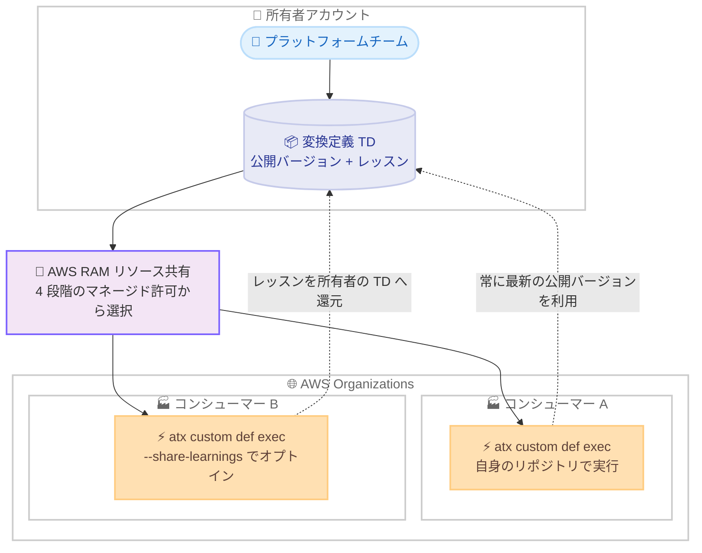

# AWS Transform - 変換定義のクロスアカウント共有

**リリース日**: 2026 年 11 月 18 日
**サービス**: AWS Transform custom
**機能**: 変換定義 (Transformation Definition) のクロスアカウント共有

📊 [このアップデートのインフォグラフィックを見る](https://takech9203.github.io/aws-news-summary/20261118-aws-custom-cross-account-td.html)

## 概要

AWS Transform custom が、変換定義 (TD) とそれに関連するレッスン (継続学習で蓄積された知見) を、AWS Resource Access Manager (AWS RAM) を通じて AWS アカウント間で共有できるようになりました。共有先は個別の AWS アカウント、AWS Organizations の組織単位 (OU)、または組織全体を指定できます。AWS Transform custom は、API やフレームワークのアップグレード、移行、言語変換など、テクノロジースタック全体の変換を実行する機能です。

TD は静的なコピーではなく「ライブリソース」として共有されます。コンシューマー (共有先アカウント) は常に所有者が公開した最新バージョンを自動的に実行し、所有者は TD の管理権限を保持し続けます。所有者は 4 段階のマネージド許可から共有レベルを選択でき、デフォルトの実行のみから、レッスンの利用、レッスンの還元、TD のダウンロードまで段階的に制御できます。

この機能は、標準化された変換を多数のアカウントに展開するプラットフォームエンジニアリングチームや AWS パートナーに特に有用です。中央のチームが TD を一度構築すれば、組織全体で共有して利用できます。

**アップデート前の課題**

- 変換定義は作成したアカウント内でのみ利用可能で、他のアカウントで同じ変換を実行するには TD を個別に複製・公開する必要があった
- 複製した TD はバージョン管理が分散し、改善内容 (レッスン) も各アカウントに分散して蓄積されていた
- 組織全体で標準化された変換を展開・維持する仕組みがなかった

**アップデート後の改善**

- AWS RAM を通じて TD をアカウント、OU、組織全体に共有できるようになり、TD は 1 つの ID、1 つのバージョン履歴、1 つのレッスンセットで一元管理できるようになった
- 所有者が新バージョンを公開すると、既存の共有を通じてコンシューマーへ自動的に反映されるようになった
- コンシューマーが実行から得たレッスンを所有者の TD へ還元でき、組織全体で変換品質を継続的に改善できるようになった

## アーキテクチャ図



所有者アカウントが公開した TD を AWS RAM 経由でライブリソースとして共有し、各コンシューマーアカウントは自身の環境・認証情報で TD を実行します。許可レベルに応じて、レッスンの利用や所有者へのレッスン還元も可能です。

## サービスアップデートの詳細

### 主要機能

1. **ライブリソースとしての TD 共有**
   - TD は AWS RAM のリソースタイプ `transform-custom:Package` として共有される
   - コンシューマーは常に所有者の最新公開バージョンを実行する (`--tv` で特定バージョンの指定も可能)
   - 所有者のみが TD の公開、変更、削除、共有、許可変更、共有の取り消しを実行できる
   - コンシューマーは TD の変更、削除、公開、再共有はできない

2. **4 段階のマネージド許可**
   - **Execute** (デフォルト): TD の実行のみ。レッスンは利用も作成もされない
   - **ExecuteWithLearnings**: 実行に加え、所有者の現在のレッスンを利用できる
   - **ExecuteWithLearningsAndContribution**: 上記に加え、`--share-learnings` でオプトインした実行のレッスンを所有者の TD に還元できる
   - **ExecuteWithLearningsAndPackageDownload**: 実行とレッスン利用に加え、`atx custom def get` による TD のダウンロードが可能 (`transform-custom:GetTransformationPackageUrl` を含む)

3. **柔軟な共有先の指定**
   - 組織全体 (組織 ARN)、OU (OU ARN)、個別アカウント (12 桁アカウント ID) を指定可能
   - AWS RAM で AWS Organizations との共有を有効化している場合、組織内の共有は招待不要で即時有効
   - 組織外のアカウントへの共有は招待制で、12 時間以内の承諾が必要
   - アカウントが組織や OU を離れると、TD へのアクセスは自動的に失われる

4. **レッスンの還元 (オプトイン方式)**
   - レッスンの還元は共有の許可とコンシューマーのオプトインの両方が揃った場合のみ行われる
   - オプトインは実行ごとに `--share-learnings` フラグで明示する必要があり、組織内でも自動化されない
   - コンシューマーのリポジトリや実行トランスクリプトは所有者に共有されない
   - 還元されたレッスンは通常のレッスンと同様に、重複、競合、安全でないコンテンツ、機密データのチェックを経て取り込まれる

5. **CloudTrail による監査**
   - 共有の作成・更新・削除は所有者アカウントの CloudTrail に記録される
   - 所有者の TD やレッスンを読み書きする呼び出し (レッスン参照、TD ダウンロード、レッスン還元) は、コンシューマーと所有者の両方のアカウントに記録される
   - 拒否された呼び出しも `AccessDenied` エラーコードとともに記録される

## 技術仕様

### 共有先と承諾の要否

| 共有先 | 指定方法 | コンシューマーの承諾 |
|------|------|------|
| 組織全体 | 組織 ARN | 不要 (組織内の現在および将来のアカウントに即時適用) |
| 組織内の OU | OU ARN | 不要 (OU と子 OU のアカウントに即時適用) |
| 組織内のアカウント | 12 桁アカウント ID | AWS RAM の組織共有が有効なら不要 |
| 組織外のアカウント | 12 桁アカウント ID | 必要 (招待の有効期限は 12 時間) |

### マネージド許可とレッスンの動作

| 実行時の許可 | 実行で利用するレッスン | 実行で作成されるレッスン |
|------|------|------|
| Execute | なし | なし |
| ExecuteWithLearnings / ExecuteWithLearningsAndPackageDownload | 所有者の現在のレッスン | なし |
| ExecuteWithLearningsAndContribution (オプトインなし) | 所有者の現在のレッスン | なし |
| ExecuteWithLearningsAndContribution (`--share-learnings` 指定) | 所有者の現在のレッスン | 所有者の TD に追加 |

## 設定方法

### 前提条件

1. **所有者アカウント**: 共有する TD を自身のアカウントで公開済みであること (ドラフトや AWS マネージド変換、共有された TD は共有不可)
2. **CLI バージョン**: AWS Transform CLI バージョン 3.23.0 以降が必要 (`atx update` で更新)
3. **組織共有**: 組織や OU と共有する場合、管理アカウントで AWS RAM の AWS Organizations との共有を有効化しておくこと
4. **IAM 権限**: 所有者は AWS RAM の共有作成・管理権限、コンシューマーは招待の確認・承諾権限と共有 TD の ARN に対する `transform-custom:ExecuteTransformation` が必要

### 手順

#### ステップ 1: AWS RAM で組織共有を有効化 (組織・OU と共有する場合)

```bash
aws ram enable-sharing-with-aws-organization
```

組織の管理アカウントで一度だけ実行し、AWS RAM で AWS Organizations との共有を有効化します。AWS Organizations コンソールで AWS RAM の信頼されたアクセスを有効化するだけでは不十分な点に注意してください。

#### ステップ 2: 所有者が TD を共有

```bash
# CLI を最新バージョンに更新
atx update

# 共有を作成 (オプションの詳細は --help で確認)
atx custom def share create --help
```

`atx custom def share create` コマンドで共有を作成します。共有は TD が公開されたリージョンで行い、CLI は `AWS_REGION` または AWS プロファイルのリージョンを使用します。CLI が管理できるのは 4 つの AWS マネージド許可のみで、カスタマーマネージド許可を使う場合は AWS RAM を直接操作します。

#### ステップ 3: コンシューマーが共有された TD を実行

```bash
atx custom def exec \
  -n arn:aws:transform-custom:us-east-1:111122223333:package/java17-upgrade \
  -p ./my-repo
```

共有された TD の ARN を指定して、自身のリポジトリに対して変換を実行します。実行はコンシューマーの環境・認証情報で行われ、所有者はコンシューマーのリポジトリや実行トランスクリプトにアクセスできません。

#### ステップ 4: レッスンを所有者へ還元 (オプトイン)

```bash
atx custom def exec \
  -n arn:aws:transform-custom:us-east-1:111122223333:package/java17-upgrade \
  -p ./my-repo --share-learnings
```

`--share-learnings` フラグを付けた実行のみ、レッスンが所有者の TD に還元されます。このフラグは実行ごとに指定が必要で、`--do-not-learn` (`-d`) とは併用できません。

## メリット

### ビジネス面

- **標準化された変換の組織展開**: 中央チームが TD を一度構築すれば組織全体で利用でき、各チームの重複作業を削減できる
- **AWS パートナーの効率化**: パートナーが構築した変換を複数の顧客アカウントへ展開する際の運用負荷を軽減できる
- **継続的な品質向上**: 各アカウントの実行から得られたレッスンを所有者の TD に集約し、組織全体の変換精度を継続的に高められる

### 技術面

- **一元管理**: 1 つの TD、1 つのバージョン履歴、1 つのレッスンセットで管理でき、コピーの乱立を防げる
- **自動バージョン配信**: 新バージョンの公開が既存の共有を通じて自動的にコンシューマーへ反映される
- **段階的なアクセス制御**: 4 段階のマネージド許可により、実行のみからダウンロード可能まで共有レベルを細かく制御できる
- **監査性**: 共有操作、レッスンの参照・還元、TD のダウンロードが CloudTrail に記録され、所有者側でも追跡できる

## デメリット・制約事項

### 制限事項

- 共有はリージョナルであり、クロスリージョン共有はサポートされない (コンシューマーは TD が公開されたリージョンで実行する必要がある)
- 共有できるのは公開済みの TD のみで、ドラフトや AWS マネージド変換は共有できない
- コンシューマーは TD の再共有や、承諾済み共有からの離脱ができない (取り消しは所有者が行う)
- IAM ロールやユーザー単位での共有はサポートされず、アカウント単位のみ
- 共有された TD は AWS Transform CLI でのみ利用可能で、現時点では AWS Transform の Web アプリケーションでは利用できない
- 組織外アカウントへの招待は 12 時間で期限切れになる
- TD を削除しても AWS RAM のリソース共有は自動削除されない
- 共有された TD は所有者側の TD 数・サイズのクォータにカウントされ、実行は実行したアカウントの月間クォータにカウントされる

### 考慮すべき点

- **共有 TD の実行はサードパーティコードの実行と同等**: 所有者の指示、参照、スクリプトがコンシューマーの環境・権限で実行されるため、信頼できる所有者からの共有のみ受け入れるべき。`ExecuteWithLearningsAndPackageDownload` 以外の許可では実行前に TD の内容を確認できない
- **最小権限での実行**: 共有された TD の実行では `--trust-all-tools` (`-t`) を使わず、信頼設定ファイルで必要なツールのみ許可し、最小権限の認証情報を使用することが推奨される
- **レッスン還元の匿名性**: 還元されたレッスンにはどのアカウントが提供したかの記録が残らない。提供元を知るには所有者側の CloudTrail で `ContributeKnowledgeItems` イベントを確認する
- **SCP による制御**: 組織外の TD へのレッスン還元を禁止したい場合は、`transform-custom:ContributeKnowledgeItems` を条件付きで拒否する SCP を利用できる
- **機密情報の扱い**: 共有する TD にはシークレットや認証情報などの機密情報を含めないこと

## ユースケース

### ユースケース 1: プラットフォームエンジニアリングチームによる標準変換の全社展開

**シナリオ**: 数百のアカウントを持つ企業で、プラットフォームチームが Java 17 へのアップグレード変換を標準化し、全開発チームに展開したい。

**実装例**:
```bash
# プラットフォームチーム: TD を公開し、組織全体に Execute 許可で共有
atx custom def share create  # 組織 ARN と Execute 許可を指定

# 各開発チーム: 承諾不要で即座に実行可能
atx custom def exec -n arn:aws:transform-custom:ap-northeast-1:111122223333:package/java17-upgrade -p ./app-repo
```

**効果**: TD の複製が不要になり、プラットフォームチームが新バージョンを公開するだけで全チームに最新の変換が行き渡る。

### ユースケース 2: AWS パートナーによる顧客アカウントへの変換提供

**シナリオ**: AWS パートナーが独自に開発したフレームワーク移行の変換を、複数の顧客アカウントに提供したい。

**実装例**:
```bash
# パートナー: 顧客アカウント ID を指定して共有 (組織外のため顧客が 12 時間以内に承諾)
# 顧客: 招待を承諾後、自身の環境で実行
atx custom def exec -n arn:aws:transform-custom:us-east-1:444455556666:package/framework-migration -p ./customer-repo
```

**効果**: 顧客のコードは顧客のアカウント内に留まったまま、パートナーの変換ノウハウを活用できる。料金は実行した顧客側に課金される。

### ユースケース 3: 組織横断でのレッスン集約による変換品質の向上

**シナリオ**: 中央チームが管理する TD に対し、各チームの実行で得られた知見を集約して変換の精度を高めたい。

**実装例**:
```bash
# 所有者: ExecuteWithLearningsAndContribution 許可で共有
# コンシューマー: レッスン還元にオプトインして実行
atx custom def exec -n arn:aws:transform-custom:ap-northeast-1:111122223333:package/api-upgrade \
  -p ./team-repo --share-learnings

# 所有者: 集まったレッスンを管理
atx custom def learnings
```

**効果**: 各チームのコードパターンや修正から抽出されたレッスンが所有者の TD に蓄積され、すべてのアカウントの以降の実行に活用される。

## 料金

共有された TD の実行は、エージェント分 (agent minutes) として、実行を開始したコンシューマーアカウントに課金されます。所有者には課金されません。一括請求 (Consolidated Billing) の場合、使用量はコンシューマーのリンクアカウントの下に表示されます。詳細は [AWS Transform の料金ページ](https://aws.amazon.com/transform/pricing/) を参照してください。

## 利用可能リージョン

AWS Transform CLI および AWS RAM を通じて、以下のリージョンで利用可能です。

- 米国東部 (バージニア北部)
- 欧州 (フランクフルト)
- 欧州 (ロンドン)
- アジアパシフィック (ムンバイ)
- アジアパシフィック (ソウル)
- アジアパシフィック (シドニー)
- アジアパシフィック (東京)
- カナダ (中部)

## 関連サービス・機能

- **AWS Resource Access Manager (AWS RAM)**: TD の共有基盤。リソース共有の作成、マネージド許可の適用、組織共有の有効化を担う
- **AWS Organizations**: 組織全体や OU 単位での共有に使用。アカウントが組織を離れるとアクセスも失われる
- **AWS CloudTrail**: 共有操作、レッスンの参照・還元、TD ダウンロードの監査ログを所有者・コンシューマー双方に記録
- **AWS Transform の継続学習 (Continual Learning)**: 実行から抽出したレッスンを TD に蓄積する仕組み。共有 TD ではレッスンは常に所有者の TD に帰属する

## 参考リンク

- 📊 [インフォグラフィック](https://takech9203.github.io/aws-news-summary/20261118-aws-custom-cross-account-td.html)
- [公式発表 (What's New)](https://aws.amazon.com/about-aws/whats-new/2026/11/aws-custom-cross-account-td/)
- [ドキュメント: Sharing transformation definitions across AWS accounts](https://docs.aws.amazon.com/transform/latest/userguide/custom-sharing.html)
- [ドキュメント: Prerequisites for sharing](https://docs.aws.amazon.com/transform/latest/userguide/custom-sharing-prerequisites.html)
- [ドキュメント: Lessons and shared transformation definitions](https://docs.aws.amazon.com/transform/latest/userguide/custom-sharing-lessons.html)
- [料金ページ](https://aws.amazon.com/transform/pricing/)

## まとめ

AWS Transform custom の変換定義が AWS RAM を通じてクロスアカウント共有に対応し、組織全体で標準化された変換をライブリソースとして一元管理・展開できるようになりました。プラットフォームエンジニアリングチームや AWS パートナーは、TD を一度構築すれば多数のアカウントへ展開でき、レッスンの還元により変換品質を継続的に改善できます。導入にあたっては、共有はリージョナルである点、共有 TD の実行はサードパーティコードの実行と同等のリスクがある点を理解し、適切なマネージド許可の選択と最小権限での運用を推奨します。
