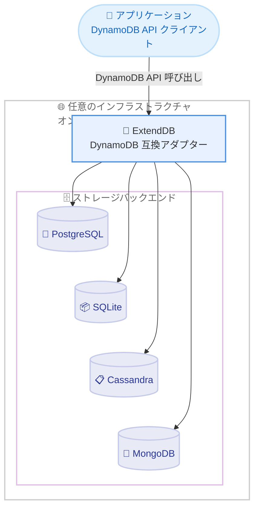

# AWS ExtendDB - ExtendDB 1.0 リリース

**リリース日**: 2026 年 11 月 18 日
**サービス**: AWS ExtendDB (オープンソース)
**機能**: Amazon DynamoDB 互換アダプター ExtendDB 1.0

📊 [このアップデートのインフォグラフィックを見る](https://takech9203.github.io/aws-news-summary/20261118-aws-extenddb-1-0.html)

## 概要

AWS は、Amazon DynamoDB 互換のオープンソースアダプターである ExtendDB 1.0 を発表しました。本リリースは、プロダクション利用を想定した初のリリースです。ExtendDB は DynamoDB API と完全な互換性を持つため、アプリケーションコードを変更することなく、DynamoDB スタイルのワークロードをオンプレミス、プライベートクラウド、パブリッククラウド、エッジ環境など、任意のインフラストラクチャ上で実行できます。

ストレージバックエンドとして PostgreSQL、SQLite、Cassandra、MongoDB の 4 種類をサポートしており、既存のデータベース資産や運用要件に合わせて選択できます。また、ローカル開発や CI 向けには、extenddb-dev コンテナイメージと `@extenddb/dev` npm パッケージが提供されており、外部データベースのセットアップなしで SQLite を利用した DynamoDB 互換エンドポイントを起動できます。

ExtendDB は AWS がメンテナンスし、Apache 2.0 ライセンスで公開され、GitHub 上でオープンに開発されています。

**アップデート前の課題**

- DynamoDB API を利用するアプリケーションは、AWS クラウド上の DynamoDB に依存しており、オンプレミスやエッジ環境で同じコードを実行することが困難だった
- ローカル開発や CI 環境で DynamoDB 相当の動作を再現するには、追加のセットアップやエミュレーターの管理が必要だった
- 規制やデータ主権の要件により AWS 外でのデータ保持が求められる場合、DynamoDB 向けに書かれたアプリケーションを移植するためのコード変更が必要だった

**アップデート後の改善**

- DynamoDB API と完全互換のため、アプリケーションコードを変更せずに任意のインフラストラクチャ上で DynamoDB スタイルのワークロードを実行できるようになった
- PostgreSQL、SQLite、Cassandra、MongoDB の 4 種類のストレージバックエンドから、要件に応じて選択できるようになった
- extenddb-dev コンテナイメージと npm パッケージにより、外部データベース不要で SQLite ベースのローカル開発・CI 環境を即座に構築できるようになった

## アーキテクチャ図



アプリケーションは既存の DynamoDB API 呼び出しをそのまま ExtendDB アダプターに向けるだけで、4 種類のストレージバックエンドのいずれかを利用した DynamoDB 互換の動作を任意の環境で実現できます。

## サービスアップデートの詳細

### 主要機能

1. **DynamoDB API との完全互換**
   - DynamoDB API と完全互換のアダプターとして動作する
   - アプリケーションコードの変更なしで、DynamoDB 向けに開発されたワークロードをそのまま実行できる
   - オンプレミス、プライベートクラウド、パブリッククラウド、エッジ環境など、任意のインフラストラクチャにデプロイ可能

2. **4 種類のストレージバックエンド**
   - PostgreSQL、SQLite、Cassandra、MongoDB をストレージバックエンドとしてサポート
   - 既存のデータベース運用スキルやインフラ資産を活用して DynamoDB 互換レイヤーを構築できる

3. **ローカル開発・CI 向けツール**
   - extenddb-dev コンテナイメージと `@extenddb/dev` npm パッケージを提供
   - SQLite をバックエンドとした DynamoDB 互換エンドポイントを起動でき、外部データベースのセットアップが不要

4. **オープンソースガバナンス**
   - AWS がメンテナンスを担当
   - Apache 2.0 ライセンスで公開
   - GitHub 上でオープンに開発

## 技術仕様

### 提供形態

| 項目 | 詳細 |
|------|------|
| ライセンス | Apache 2.0 |
| 互換 API | Amazon DynamoDB API |
| ストレージバックエンド | PostgreSQL、SQLite、Cassandra、MongoDB |
| 開発向けコンテナイメージ | extenddb-dev (Docker Hub) |
| 開発向け npm パッケージ | `@extenddb/dev` |
| ソースコード | GitHub (ExtendDB/extenddb) |

## 設定方法

### 前提条件

1. コンテナランタイム (Docker など) または Node.js 環境
2. プロダクション利用の場合は、バックエンドとして使用する PostgreSQL、Cassandra、MongoDB などのデータベース
3. DynamoDB API を利用する既存または新規のアプリケーション

### 手順

#### ステップ 1: 開発用エンドポイントの起動

```bash
# extenddb-dev コンテナイメージを起動する例
docker run -p 8000:8000 extenddb/extenddb-dev
```

extenddb-dev コンテナを起動し、SQLite をバックエンドとした DynamoDB 互換エンドポイントをローカルで提供します。外部データベースのセットアップは不要です。

#### ステップ 2: アプリケーションのエンドポイント切り替え

```bash
# AWS CLI から ExtendDB エンドポイントに接続する例
aws dynamodb list-tables --endpoint-url http://localhost:8000
```

DynamoDB クライアントのエンドポイント URL を ExtendDB に向けることで、アプリケーションコードを変更せずに DynamoDB 互換の動作を確認できます。

#### ステップ 3: プロダクションバックエンドの選択

プロダクション環境では、PostgreSQL、Cassandra、MongoDB などの要件に適したバックエンドを選択して ExtendDB を構成します。詳細な構成方法はプロジェクトページおよび GitHub リポジトリのドキュメントを参照してください。

## メリット

### ビジネス面

- **ベンダーロックインの緩和**: DynamoDB 向けに開発したアプリケーション資産を、AWS 外の環境でも活用できる
- **データ主権・規制対応**: オンプレミスやプライベートクラウドでのデータ保持が求められる環境でも、DynamoDB スタイルのワークロードを実行できる
- **ライセンスコスト不要**: Apache 2.0 ライセンスのオープンソースソフトウェアとして無償で利用できる

### 技術面

- **コード変更不要**: DynamoDB API と完全互換のため、既存アプリケーションをそのまま移行・併用できる
- **バックエンドの選択肢**: PostgreSQL、SQLite、Cassandra、MongoDB から運用要件に合わせて選択できる
- **開発体験の向上**: extenddb-dev により、外部データベースなしでローカル開発・CI 環境を即座に構築できる

## デメリット・制約事項

### 制限事項

- マネージドサービスではないため、インフラストラクチャの構築、運用、スケーリング、バックアップはユーザー自身で行う必要がある
- DynamoDB のマネージド機能 (自動スケーリング、グローバルテーブル、ポイントインタイムリカバリなど) がどこまで利用できるかは、公式ドキュメントでの確認が必要

### 考慮すべき点

- 選択するストレージバックエンドによって、性能特性や運用方法が異なる
- プロダクション利用にあたっては、バックエンドデータベース自体の高可用性設計が別途必要になる
- フルマネージドな DynamoDB と自己管理の ExtendDB のどちらが適切か、運用コストを含めて比較検討することが推奨される

## ユースケース

### ユースケース 1: ローカル開発・CI 環境での DynamoDB 互換テスト

**シナリオ**: DynamoDB を利用するアプリケーションの開発チームが、AWS への接続なしでユニットテストや統合テストを実行したい。

**実装例**:
```bash
# CI パイプラインで extenddb-dev を起動し、テストを実行
docker run -d -p 8000:8000 extenddb/extenddb-dev
npm test
```

**効果**: 外部データベースのセットアップや AWS アカウントへの接続なしで、SQLite ベースの DynamoDB 互換エンドポイントを使った高速なテストが可能になります。

### ユースケース 2: オンプレミス環境での DynamoDB ワークロード実行

**シナリオ**: 規制要件によりデータをオンプレミスに保持する必要がある企業が、DynamoDB 向けに開発した既存アプリケーションを社内データセンターで稼働させたい。

**実装例**:
```
オンプレミスの PostgreSQL をバックエンドとして ExtendDB を構成し、
アプリケーションのエンドポイント URL を ExtendDB に変更する。
```

**効果**: アプリケーションコードを変更することなく、データ主権要件を満たしながら DynamoDB スタイルのワークロードを実行できます。

### ユースケース 3: エッジ環境でのデータ処理

**シナリオ**: ネットワーク接続が限定されるエッジ拠点で、クラウドと同じ DynamoDB API を使ったアプリケーションを動作させたい。

**実装例**:
```
エッジデバイス上で SQLite バックエンドの ExtendDB を稼働させ、
クラウドとエッジで同一のアプリケーションコードを使用する。
```

**効果**: クラウドとエッジで共通のコードベースを維持しながら、エッジ環境でもローカルにデータを処理できます。

## 料金

ExtendDB は Apache 2.0 ライセンスのオープンソースソフトウェアであり、ソフトウェア自体の利用は無償です。AWS からの料金は発生しません。ただし、ExtendDB を稼働させるインフラストラクチャおよびバックエンドデータベースの運用コストはユーザー負担となります。

## 利用可能リージョン

ExtendDB はセルフホスト型のオープンソースソフトウェアであるため、特定の AWS リージョンに依存しません。オンプレミス、プライベートクラウド、パブリッククラウド、エッジ環境など、任意のインフラストラクチャで利用できます。

## 関連サービス・機能

- **Amazon DynamoDB**: ExtendDB が互換性を提供するフルマネージド NoSQL データベースサービス。クラウドでのフルマネージド運用には引き続き DynamoDB が適する
- **DynamoDB Local**: 従来から提供されているローカル開発向けの DynamoDB エミュレーター。ExtendDB はプロダクション利用と複数バックエンドへの対応という点で異なる
- **PostgreSQL / SQLite / Cassandra / MongoDB**: ExtendDB がサポートするストレージバックエンド

## 参考リンク

- 📊 [インフォグラフィック](https://takech9203.github.io/aws-news-summary/20261118-aws-extenddb-1-0.html)
- [公式発表 (What's New)](https://aws.amazon.com/about-aws/whats-new/2026/11/aws-extenddb-1-0/)
- [ExtendDB プロジェクトページ](https://extenddb.org)
- [GitHub リポジトリ](https://github.com/ExtendDB/extenddb)
- [extenddb-dev コンテナイメージ (Docker Hub)](https://hub.docker.com/r/extenddb/extenddb-dev)
- [@extenddb/dev npm パッケージ](https://www.npmjs.com/package/@extenddb/dev)

## まとめ

ExtendDB 1.0 は、DynamoDB API 互換のワークロードを任意のインフラストラクチャで実行可能にする、AWS メンテナンスのオープンソースアダプターです。データ主権要件への対応やローカル開発・CI 環境の効率化に有効であり、DynamoDB を利用する開発チームは extenddb-dev によるローカル検証から試すことを推奨します。
