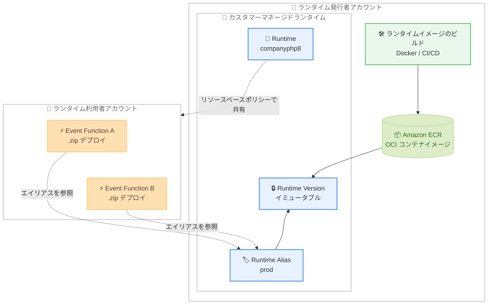

# AWS Lambda - カスタマーマネージドランタイム

**リリース日**: 2026 年 11 月 18 日
**サービス**: AWS Lambda
**機能**: Customer-managed runtimes (カスタマーマネージドランタイム)

📊 [このアップデートのインフォグラフィックを見る](https://takech9203.github.io/aws-news-summary/20261118-aws-lambda-customer-managed-runtimes.html)

## 概要

AWS Lambda がカスタマーマネージドランタイム (customer-managed runtimes) のサポートを発表しました。ランタイムを関数から完全に独立したスタンドアロンリソースとして作成・管理できるようになり、プラットフォームチームがランタイムの内容、更新、アクセス制御、ライフサイクルを一元管理できます。ランタイムは OCI コンテナイメージとして Amazon ECR にパッケージ化し、既存の Docker や CI/CD ツールと組み合わせて利用できます。

組織では、すべての関数に承認済みコンポーネント (社内 SDK、証明書、セキュリティ・監視ツールなど) を組み込む必要があるケースが多くあります。従来は Lambda Layers やコンテナイメージで配布していたため、共有コンポーネントを変更するたびに影響を受けるすべての関数を再デプロイする必要がありました。カスタマーマネージドランタイムでは、ランタイム発行者が一度更新すれば、Lambda が実行環境をリサイクルするタイミングで各関数が自動的に更新を取り込むため、関数ごとの再デプロイや大規模なロールアウト調整が不要になります。

本機能は Lambda Event Functions を対象とし、プラットフォームチーム、SaaS/PaaS プロバイダー、サードパーティのランタイム発行者、変更管理ポリシーに基づくランタイムパッチ管理が必要な組織に適しています。なお、従来の「カスタムランタイム」(デプロイパッケージやレイヤーにランタイムを含める方式) は「bring your own language (BYOL)」に名称変更されました。

**アップデート前の課題**

- 共有コンポーネント (SDK、証明書、監視ツールなど) を Lambda Layers やコンテナイメージで配布すると、変更のたびにすべての関数の再デプロイが必要だった
- コンテナイメージ利用時は、ランタイムのセキュリティパッチ適用にもイメージの再ビルドと再デプロイが必要だった
- Lambda マネージドランタイムでは、ランタイムの内容・更新時期・非推奨化を AWS が管理するため、組織の変更管理ポリシーに合わせた制御ができなかった
- Lambda がサポートしない言語 (PHP など) を使う場合、関数開発者自身がランタイムの管理責任を負う必要があった

**アップデート後の改善**

- ランタイムをスタンドアロンリソースとして一元管理し、ランタイム管理と関数デプロイを完全に分離できるようになった
- ランタイム発行者が更新を一度公開すれば、関数は再デプロイなしで次回コールドスタート時に自動的に新バージョンへ移行できるようになった
- リソースベースポリシーにより、特定アカウント、AWS Organizations の組織/OU、またはパブリックにランタイムを共有できるようになった
- 変更管理ポリシーに合わせた段階的なロールアウト、一元的なヘルスメトリクス監視、迅速なロールバックが可能になった
- 関数開発者は従来どおり .zip ファイルでデプロイでき、Lambda マネージドランタイムと同じ開発体験を維持できる

## アーキテクチャ図



ランタイム発行者が ECR 上のコンテナイメージからランタイムバージョンを作成し、エイリアスを更新すると、エイリアスを参照する関数は次回コールドスタート時に自動的に新しいランタイムバージョンへ移行します。

## サービスアップデートの詳細

### 主要機能

1. **ランタイム管理と関数管理の分離**
   - ランタイムを関数から独立したスタンドアロンリソースとして作成・管理
   - 「ランタイム発行者」と「ランタイム利用者」という 2 つの役割を明確に分離 (同一チームが両方を担うことも、アカウントをまたぐことも可能)
   - 発行者はランタイムの内容、更新、アクセス制御、ライフサイクルを管理し、利用者はアプリケーション開発に専念できる

2. **3 階層のリソースモデル**
   - **Runtime**: ランタイム全体を表す最上位リソース。名前、ARN、説明、ライセンス情報を保持し、リソースベースポリシーでアクセスを制御
   - **Runtime Version**: ランタイムの内容 (実行環境のファイルシステム) を表すイミュータブルなリソース。Amazon ECR 上のコンテナイメージを指す
   - **Runtime Alias**: ランタイムバージョンへの名前付きポインタ。関数はエイリアス経由でランタイムを利用する

3. **自動的な更新ロールアウト**
   - 発行者がエイリアスを新しいバージョンに向けると、デフォルトで関数は次回コールドスタート時に自動的に新バージョンへ移行
   - 環境ごとの段階的ロールアウト、ヘルスメトリクスの監視、ロールバックが可能
   - 利用者は Function update モードや Manual モードで更新タイミングを制御可能 (既存のランタイム管理コントロールを利用)

4. **クロスアカウント共有**
   - リソースベースポリシーで特定の AWS アカウント、AWS Organizations の組織または OU、あるいはパブリックに共有可能
   - 組織全体で承認済みコンポーネントを標準化できる

5. **既存ツールとの互換性**
   - ランタイムイメージは OCI コンテナイメージとして ECR に格納し、既存の Docker および CI/CD ツールで構築可能
   - Lambda ランタイムベースイメージから構築することも、スクラッチから構築することも可能
   - AWS CLI、AWS SDK、CloudFormation、AWS CDK で管理可能

## 技術仕様

### デプロイモデルの比較

| 項目 | Lambda マネージドランタイム | カスタマーマネージドランタイム | コンテナイメージ | BYOL |
|------|------|------|------|------|
| 対応言語 | Lambda サポート言語のみ | 任意の言語 | 任意の言語 | 任意の言語 |
| ランタイム制御 | AWS | ランタイム発行者 | 関数開発者 | 関数開発者 |
| 関数デプロイ形式 | .zip ファイル | .zip ファイル | コンテナイメージ | .zip ファイルまたはレイヤー |
| 更新メカニズム | Lambda が自動適用 | 発行者がエイリアスを更新し、関数は次回コールドスタートで取り込み | イメージ再ビルドと関数の再デプロイ | レイヤー更新と各関数の再デプロイ |
| OS パッチ責任 | AWS | ランタイム発行者 | 関数開発者 | OS 部分は AWS、言語ランタイムは開発者 |
| 更新スケール | Lambda 制御の段階的ロールアウト | エイリアス単位のターゲットロールアウト | 関数単位 | 関数単位 |

### リソースの構成要素

| 項目 | 詳細 |
|------|------|
| ランタイム ARN 形式 | `arn:aws:lambda:{region}:{account-id}:runtime/{runtime-name}` |
| ランタイム名 | 2〜128 文字。小文字、数字、`_`、`.`、`-` のみ。作成後の変更不可 |
| イメージ形式 | OCI コンテナイメージ (Amazon ECR に格納) |
| ランタイムバージョン | イミュータブル。更新時は新バージョンを作成しエイリアスを切り替え |
| 必須コンポーネント | ランタイムインターフェースクライアント (RIC)。Lambda サービスと関数ハンドラーの橋渡し役 |
| リソースの管理 API | Lambda Core API (`aws lambda-core`)。関数・タグ・ポリシーは Lambda API (`aws lambda`) |
| リージョン性 | リージョナルリソース。利用するリージョンごとに作成が必要 |

### API 変更履歴

| 日付 | サービス | 変更内容 |
|------|----------|----------|
| 2026/11/13 | [AWS Lambda Core](https://awsapichanges.com/archive/changes/b4312b-lambda.html) | 16 new api methods - カスタマーマネージドランタイム管理 API の追加 |
| 2026/11/13 | [AWS Lambda](https://awsapichanges.com/archive/changes/b4312b-lambda.html) | 13 updated api methods - CreateFunction および UpdateFunctionConfiguration でのカスタマーマネージドランタイム指定のサポート |

## 設定方法

### 前提条件

1. ランタイムイメージを格納する Amazon ECR リポジトリ
2. ランタイム、ランタイムバージョン、ランタイムエイリアスを管理する IAM 権限
3. ランタイムインターフェースクライアント (RIC) を含むランタイムイメージ (Lambda ベースイメージまたはスクラッチから構築)

### 手順

#### ステップ 1: ランタイムイメージをビルドして ECR にプッシュ

```bash
docker build -t companyphp8:v1 .
docker tag companyphp8:v1 123456789012.dkr.ecr.us-east-1.amazonaws.com/companyphp8:v1
docker push 123456789012.dkr.ecr.us-east-1.amazonaws.com/companyphp8:v1
```

Lambda ランタイムベースイメージまたはスクラッチからランタイムイメージをビルドし、Amazon ECR リポジトリにプッシュします。イメージには RIC を含める必要があります。

#### ステップ 2: ランタイムを作成

```bash
aws lambda-core create-runtime \
  --name companyphp8 \
  --description "PHP 8 runtime with company-approved extensions" \
  --license-info "PHP License v3.01." \
  --tags Team=platform,Project=runtimes
```

Lambda Core API でランタイム (最上位リソース) を作成します。名前、説明、ライセンス情報、タグを指定でき、出力に含まれる ARN をアクセス制御や関数設定で使用します。

#### ステップ 3: ランタイムバージョンとエイリアスを作成

```bash
# ランタイムの確認
aws lambda-core get-runtime --runtime-name companyphp8

# アカウント内のランタイム一覧
aws lambda-core list-runtimes
```

ECR 上のイメージからランタイムバージョンを作成し、そのバージョンを指すランタイムエイリアス (例: `prod`) を作成します。ランタイムは作成直後にはバージョンもエイリアスも持たないため、関数から利用するにはこのステップが必須です。

#### ステップ 4: 関数でランタイムエイリアスを参照

関数の設定で、`python3.14` のような Lambda マネージドランタイム識別子の代わりにカスタマーマネージドランタイムのエイリアスを指定します。関数コードは従来どおり .zip ファイルでデプロイします。クロスアカウントで共有する場合は、ランタイムにリソースベースポリシーを設定します。

## メリット

### ビジネス面

- **ガバナンスの強化**: プラットフォームチームが組織全体のランタイム内容と更新を一元管理し、承認済みコンポーネントを標準化できる
- **コンプライアンス対応**: 変更管理ポリシーに合わせた更新のスケジューリングや段階的ロールアウトが可能。公開されている EOL スケジュールを超えてランタイムを延長利用することも可能
- **運用コスト削減**: 共有コンポーネント更新時の関数ごとの再デプロイ作業や大規模なロールアウト調整が不要になる

### 技術面

- **再デプロイ不要の更新**: 発行者がエイリアスを更新するだけで、関数は次回コールドスタート時に自動的に新しいランタイムバージョンを取り込む
- **開発体験の維持**: 関数開発者は .zip デプロイと自動ランタイム更新という Lambda マネージドランタイムと同じ体験を維持できる
- **既存ツールとの互換性**: OCI コンテナイメージベースのため、既存の Docker、CI/CD パイプライン、CloudFormation、CDK がそのまま利用できる
- **任意の言語のサポート**: PHP など Lambda がマネージドランタイムを提供しない言語でも、組織やサードパーティがランタイムを公開できる

## デメリット・制約事項

### 制限事項

- Lambda Event Functions 専用。Lambda Web Functions では利用不可
- Lambda SnapStart および Lambda@Edge は利用不可
- ランタイムリソースを AWS KMS カスタマーマネージドキーで暗号化できない (関数側の KMS キーやコード署名のサポートには影響なし)
- ランタイムイメージにコード署名を使用できない
- AWS SAM ではランタイムの公開・更新ができない (関数定義では利用可能)
- ランタイムはリージョナルリソースのため、利用するリージョンごとに作成が必要

### 考慮すべき点

- **発行者への信頼が必須**: 発行者はランタイム更新を通じて、関数の実行環境に任意のコードをプッシュでき、そのコードは関数の実行ロールの権限で動作する。信頼できる発行者のランタイムのみ利用すること。サードパーティ製ランタイムや重要なアプリケーションでは、イメージを自アカウントの ECR にコピーして独自ランタイムを作成する方法も検討する
- **パッチ適用責任の移転**: Lambda マネージドランタイムと異なり、OS ライブラリや言語ランタイムを含むすべてのコンポーネントのセキュリティパッチは発行者の責任となる
- **後方互換性の維持**: 発行者は既存の関数と後方互換性のある更新を維持する責任がある
- **削除時の影響**: 発行者がエイリアスやバージョンを削除すると、依存する関数は `Inactive` 状態になり、コールドスタートが必要な呼び出しは失敗する
- **イメージの保持**: ランタイムバージョンが存在する間、発行者は対応するコンテナイメージを ECR に保持し続ける必要がある
- 一部の機能 (Lambda Managed Instances、レスポンスストリーミングなど) はランタイム側の実装が必要なため、発行者のドキュメントで対応状況を確認する

## ユースケース

### ユースケース 1: エンタープライズプラットフォームチームによる標準ランタイムの配布

**シナリオ**: 大企業のプラットフォームチームが、セキュリティエージェント、監視ツール、社内 SDK を組み込んだ標準ランタイムを全社のアプリケーションチームに提供する。

**実装例**:
```
1. 承認済みコンポーネントを含むランタイムイメージをビルドし ECR にプッシュ
2. ランタイムを作成し、AWS Organizations の組織単位でリソースベースポリシーを設定
3. 各アプリケーションチームは関数設定でランタイムエイリアスを参照
4. ツール更新時はプラットフォームチームが新バージョンを作成しエイリアスを更新
```

**効果**: 数百〜数千の関数に対して、再デプロイなしで一斉にセキュリティツールを更新できる。

### ユースケース 2: Lambda 未対応言語のランタイム提供

**シナリオ**: 組織またはサードパーティが、Lambda のマネージドランタイムが提供されていない PHP 8 のランタイムを公開し、複数チームが利用する。

**実装例**:
```
aws lambda-core create-runtime \
  --name companyphp8 \
  --description "PHP 8 runtime with company-approved extensions"
# バージョンとエイリアスを作成後、各関数はエイリアスを参照して .zip でデプロイ
```

**効果**: 従来の BYOL (旧カスタムランタイム) と異なり、PHP ランタイムの更新を一元管理でき、各関数の再デプロイが不要になる。

### ユースケース 3: 変更管理ポリシーに基づくランタイムパッチ制御

**シナリオ**: 金融機関などの規制業種で、ランタイム更新を組織の変更管理プロセスに沿ってステージング環境から本番環境へ段階的に適用する。

**実装例**:
```
1. ステージング用エイリアス staging を新バージョンへ更新し検証
2. ヘルスメトリクスを監視して問題がないことを確認
3. 本番用エイリアス prod を更新し、問題発生時はエイリアスを旧バージョンへ戻す
```

**効果**: 環境ごとのエイリアス運用により、コンプライアンス要件を満たす制御されたロールアウトと迅速なロールバックを実現できる。

## 料金

カスタマーマネージドランタイム自体に追加料金はありません。

- カスタマーマネージドランタイムを使用する関数の料金は、Lambda マネージドランタイムを使用する関数と同じ標準 Lambda 料金
- ランタイムバージョンごとの料金は発生しない
- 発行者はランタイムバージョンが存在する間、対応するコンテナイメージを Amazon ECR に保持する必要があり、標準の Amazon ECR ストレージ料金が適用される

## 利用可能リージョン

すべての AWS 商用リージョンで一般提供 (GA)。

## 関連サービス・機能

- **Amazon ECR**: ランタイムバージョンのコンテナイメージの格納先。既存の Docker ツールチェーンと連携
- **AWS Organizations**: リソースベースポリシーによる組織/OU 単位でのランタイム共有に利用
- **Lambda Layers / コンテナイメージ / BYOL**: 従来の実行環境カスタマイズ手法。カスタマーマネージドランタイムはこれらの課題 (関数ごとの再デプロイ) を解消する位置付け
- **AWS CloudFormation / AWS CDK**: ランタイムリソースの IaC 管理に対応 (AWS SAM はランタイムの公開・更新に非対応)

## 参考リンク

- 📊 [インフォグラフィック](https://takech9203.github.io/aws-news-summary/20261118-aws-lambda-customer-managed-runtimes.html)
- [公式発表 (What's New)](https://aws.amazon.com/about-aws/whats-new/2026/11/aws-lambda-customer-managed-runtimes/)
- [AWS Blog: Control your AWS Lambda runtimes with customer-managed runtimes](https://aws.amazon.com/blogs/compute/control-your-aws-lambda-runtimes-with-customer-managed-runtimes/)
- [ドキュメント: Customer-managed runtimes](https://docs.aws.amazon.com/lambda/latest/dg/runtimes-customer-managed.html)
- [ドキュメント: Creating a runtime](https://docs.aws.amazon.com/lambda/latest/dg/cmr-create.html)
- [料金ページ: AWS Lambda](https://aws.amazon.com/lambda/pricing/)

## まとめ

カスタマーマネージドランタイムは、ランタイム管理を関数デプロイから完全に分離し、プラットフォームチームによる一元的なランタイムガバナンスを実現する重要なアップデートです。Lambda Layers やコンテナイメージで共有コンポーネントを配布している組織は、関数ごとの再デプロイが不要になる本機能への移行を検討する価値があります。まずは開発環境でランタイムの作成からエイリアス経由の関数設定までのワークフローを検証し、組織の変更管理プロセスに合わせたロールアウト戦略を設計することを推奨します。
