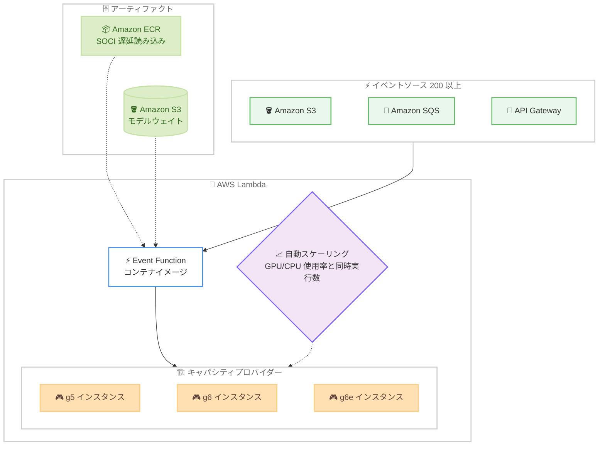

# AWS Lambda - Lambda Managed Instances での GPU インスタンスサポート

**リリース日**: 2026 年 11 月 18 日
**サービス**: AWS Lambda
**機能**: Lambda Managed Instances における GPU インスタンス (EC2 G シリーズ) のサポート

📊 [このアップデートのインフォグラフィックを見る](https://takech9203.github.io/aws-news-summary/20261118-aws-lambda-gpu-managed-instances.html)

## 概要

AWS Lambda が、Lambda Managed Instances 上の Event Functions で GPU インスタンス (EC2 G シリーズ) をサポートしました。これにより、AI 推論、メディア処理、3D レンダリング、科学技術計算、金融シミュレーションといった GPU アクセラレーションが必要なワークロードを、GPU ドライバーやフレームワーク、スケーリングインフラの管理なしにサーバーレスモデルで実行できます。

GPU 対応の Event Functions は、他の Event Functions と同様に 200 以上の AWS イベントソースと統合でき、GPU 使用率・CPU 使用率・同時実行数に基づいて自動的にスケールします。vLLM、SGLang、PyTorch があらかじめ構成された GPU ベースイメージが提供されるため、LLM 推論サーバーを最小限の設定でデプロイできます。

**アップデート前の課題**

これまで GPU ワークロードをイベント駆動で実行するには、以下のような運用負担がありました。

- Lambda は GPU をサポートしておらず、GPU 推論には Amazon EC2、Amazon ECS/EKS、Amazon SageMaker AI などでインフラを自前で構築・運用する必要があった
- GPU ドライバー、CUDA、推論フレームワークのセットアップとバージョン管理をユーザー自身が行う必要があった
- イベントソースとの統合やオートスケーリングのロジックを個別に実装する必要があった
- GPU キャパシティ不足時のフォールバック戦略を自前で設計する必要があった

**アップデート後の改善**

- Event Functions として GPU ワークロードを実行でき、GPU 使用率・CPU 使用率・同時実行数に基づく自動スケーリングが利用可能になった
- vLLM、SGLang、PyTorch を事前構成した GPU ベースイメージにより、モデル ID を指定するだけで推論サーバーをデプロイできるようになった
- 複数世代の G シリーズインスタンスタイプを指定でき、Lambda が利用可能な最新世代を優先選択し、キャパシティ不足時は旧世代へ自動フォールバックするようになった
- Seekable OCI (SOCI) による遅延読み込みと Amazon S3 からのアーティファクトストリーミングにより、大きなコンテナイメージでも起動が高速化された

## アーキテクチャ図



Event Function はキャパシティプロバイダーで指定した複数世代の G シリーズ GPU インスタンス上で実行され、GPU/CPU 使用率と同時実行数に基づいて自動スケールします。コンテナイメージは SOCI 遅延読み込み、モデルウェイトは S3 ストリーミングにより高速に起動します。

## サービスアップデートの詳細

### 主要機能

1. **GPU インスタンス EC2 G シリーズのサポート**
   - キャパシティプロバイダーの `AllowedInstanceTypes` に g5、g6、g6e など複数世代を指定可能
   - Lambda は利用可能な最新世代を優先的に選択し、キャパシティ不足時は旧世代へ自動フォールバック
   - `AcceleratorConfig.AcceleratorMemorySize` で必要な GPU メモリ (3〜48 GB) を指定すると、要件を満たす最小の GPU に配置される

2. **実行環境ごとの複数同時実行**
   - 1 つの実行環境で最大 48 の同時リクエストを処理可能 (`PerExecutionEnvironmentMaxConcurrency`、デフォルト 4)
   - vLLM が同一 GPU 上で複数リクエストをバッチ処理し、単一のモデルコピーを共有することで GPU 使用率を最大化
   - GPU 使用率、CPU 使用率、同時実行数に基づく自動スケーリング

3. **事前構成済み GPU ベースイメージ**
   - vLLM、SGLang、PyTorch を含むベースイメージを提供 (例: `public.ecr.aws/lambda/deep-learning-containers/vllm:cuda-v1`)
   - vLLM イメージでは推論コードの実装が不要で、環境変数 `MODEL_ID` に Hugging Face リポジトリや S3 ロケーションを指定するだけでデプロイ可能
   - OpenAI 互換の API ペイロード (chat completions / text completions) に対応

4. **高速起動の仕組み**
   - Seekable OCI (SOCI) 遅延読み込みにより、最大 32 GB のコンテナイメージでも必要な部分から起動
   - モデルウェイトを同一リージョンの S3 に配置し `VLLM_LOAD_FORMAT=runai_streamer` を設定することでウェイトをメモリへ直接ストリーミング
   - バージョン発行時に実行環境のプロビジョニング、ウェイトのダウンロード、エンジンのウォームアップが行われるため、最初の呼び出しがコールドスタートを待たない

## 技術仕様

### GPU 対応 Event Functions の主な仕様

| 項目 | 詳細 |
|------|------|
| 対応インスタンス | EC2 G シリーズ (g5、g6、g6e など) |
| パッケージ形式 | コンテナイメージのみ (最大 32 GB、1 ファイルあたり 10 GB) |
| メモリ | 2,048〜32,768 MB |
| アクセラレーターメモリ | 3〜48 GB (`AcceleratorMemorySize`) |
| エフェメラルストレージ | 最大 32 GB (NVMe) |
| 実行環境あたりの同時実行数 | 最大 48 (デフォルト 4) |
| キャパシティプロバイダーあたりの vCPU | 最大 15,000 |
| タイムアウト | 非同期呼び出しおよびイベントソースマッピングで最大 90 分 |
| イベントソース | 200 以上の AWS イベントソースと統合可能 |

### API 変更履歴

| 日付 | サービス | 変更内容 |
|------|----------|----------|
| 2026/11/16 | [AWS Lambda](https://awsapichanges.com/archive/changes/f1785c-lambda.html) | 13 updated api methods - `CreateFunction` と `UpdateFunctionConfiguration` に GPU インスタンスサポートを追加。新しい `AcceleratorConfig` パラメータでアクセラレーターメモリを設定可能 |
| 2026/11/16 | [AWS Lambda Core](https://awsapichanges.com/archive/changes/f1785c-lambda.html) | 5 updated api methods - GPU インスタンスを持つキャパシティプロバイダー上での Event Functions 実行をサポート |

### 設定例: キャパシティプロバイダー定義

```json
{
  "CapacityProviderName": "gpu-capacity-provider",
  "VpcConfig": {
    "SubnetIds": ["subnet-xxxxxxxx"],
    "SecurityGroupIds": ["sg-xxxxxxxx"]
  },
  "PermissionsConfig": {
    "CapacityProviderOperatorRoleArn": "arn:aws:iam::123456789012:role/LambdaCapacityProviderRole"
  },
  "InstanceRequirements": {
    "AllowedInstanceTypes": ["g5.2xlarge", "g6.2xlarge", "g6e.2xlarge"]
  },
  "CapacityProviderScalingConfig": {
    "ScalingMode": "Auto",
    "MaxVCpuCount": 96
  }
}
```

## 設定方法

### 前提条件

1. EC2 のサービスクォータ「Running On-Demand G and VT instances」の引き上げ (新規アカウントは 0 の場合がある)
2. コンテナイメージを格納する Amazon ECR リポジトリ
3. キャパシティプロバイダー用の VPC (サブネット、セキュリティグループ) と IAM ロール

### 手順

#### ステップ 1: キャパシティプロバイダーの作成

```bash
aws lambda create-capacity-provider \
  --cli-input-json file://capacity-provider.json
```

GPU インスタンスを実行するキャパシティプロバイダーを作成します。`AllowedInstanceTypes` に複数世代の G シリーズを指定すると、Lambda が利用可能なものを自動選択し、キャパシティ不足時のフォールバックが有効になります。

#### ステップ 2: コンテナイメージのビルドとプッシュ

```bash
docker build -t lmi-gpu-inference .
docker tag lmi-gpu-inference:latest \
  123456789012.dkr.ecr.us-east-1.amazonaws.com/lmi-gpu-inference:latest
docker push 123456789012.dkr.ecr.us-east-1.amazonaws.com/lmi-gpu-inference:latest
```

vLLM ベースイメージ (`public.ecr.aws/lambda/deep-learning-containers/vllm:cuda-v1`) をベースにしたコンテナイメージをビルドし、ECR にプッシュします。vLLM イメージを使う場合、推論コードの実装は不要です。

#### ステップ 3: 関数の作成

```bash
aws lambda create-function \
  --function-name lmi-gpu-inference \
  --package-type Image \
  --code ImageUri=123456789012.dkr.ecr.us-east-1.amazonaws.com/lmi-gpu-inference:latest \
  --role arn:aws:iam::123456789012:role/LambdaExecutionRole \
  --memory-size 16384 \
  --timeout 900 \
  --accelerator-config AcceleratorMemorySize=16 \
  --capacity-provider-config '{
    "LambdaManagedInstancesCapacityProviderConfig": {
      "CapacityProviderArn": "arn:aws:lambda:us-east-1:123456789012:capacity-provider:gpu-capacity-provider",
      "ExecutionEnvironmentMemoryGiBPerVCpu": 4,
      "PerExecutionEnvironmentMaxConcurrency": 4
    }
  }' \
  --environment 'Variables={MODEL_ID=s3://my-bucket/models/my-model/}'
```

`AcceleratorConfig` で必要な GPU メモリ (この例では 16 GB) を指定して関数を作成します。`MODEL_ID` にはモデルウェイトの場所 (Hugging Face リポジトリまたは S3) を指定します。

#### ステップ 4: バージョンの発行と呼び出し

```bash
aws lambda publish-version --function-name lmi-gpu-inference
```

GPU 対応の Event Functions は発行済みバージョンから実行します。バージョン発行時に実行環境のプロビジョニング、モデルウェイトのダウンロード、エンジンのウォームアップが行われるため、最初の呼び出しがコールドスタートの影響を受けません。呼び出しは OpenAI 互換のペイロード (`messages` または `prompt`) で行えます。

## メリット

### ビジネス面

- **インフラ運用コストの削減**: GPU クラスターの構築・運用、ドライバー管理が不要になり、運用チームの負担を削減
- **GPU コストの最適化**: 複数の同時呼び出しが単一 GPU とモデルコピーを共有し、Lambda が関数をインスタンスへ集約して GPU 使用率を最大化
- **市場投入までの時間短縮**: 事前構成済みベースイメージとイベントソース統合により、AI 推論機能を短期間でサービスに組み込み可能

### 技術面

- **自動スケーリング**: GPU 使用率、CPU 使用率、同時実行数に基づくスケーリングを Lambda が管理
- **キャパシティの耐障害性**: 複数世代のインスタンスタイプ指定により、特定世代の GPU キャパシティ不足時も自動フォールバックで継続稼働
- **高速起動**: SOCI 遅延読み込みと S3 ウェイトストリーミング、発行時ウォームアップにより大規模モデルでも起動を高速化
- **イミュータブルなバージョン**: モデルの切り替えは `MODEL_ID` の変更と新バージョン発行のみで完了し、イメージの再ビルドが不要。バージョン単位でモデルを並行稼働可能

## デメリット・制約事項

### 制限事項

- パッケージ形式はコンテナイメージのみ (ZIP デプロイは不可)
- GPU 対応の Event Functions は発行済みバージョンからの実行が必要
- アクセラレーターメモリは 3〜48 GB の範囲 (単一 GPU 相当) で、超大規模モデルのマルチ GPU 構成には対応しない
- 利用には Lambda Managed Instances と EC2 G シリーズの両方が利用可能なリージョンである必要がある

### 考慮すべき点

- EC2 クォータ「Running On-Demand G and VT instances」の事前引き上げが必要 (新規アカウントは 0 の場合がある)
- 課金は EC2 インスタンスベースであり、従来の Lambda のリクエスト単位課金とはコストモデルが異なるため、アイドル時間を含めたコスト試算が必要
- 検証後に課金を停止するには、関数を削除した後にキャパシティプロバイダーを削除して GPU インスタンスをシャットダウンする必要がある
- `AcceleratorMemorySize` は最小要件の指定であり、配置先によっては指定より大きい GPU が割り当てられる場合がある

## ユースケース

### ユースケース 1: イベント駆動の LLM 推論 API

**シナリオ**: 自社アプリケーションにオープンウェイト LLM による推論 API を組み込みたいが、GPU インフラの運用チームを持たない。

**実装例**:
```bash
# vLLM ベースイメージを使用し、MODEL_ID に S3 のモデルウェイトを指定
# VLLM_LOAD_FORMAT=runai_streamer でウェイトをストリーミング読み込み
aws lambda invoke \
  --function-name lmi-gpu-inference:1 \
  --payload '{"messages":[{"role":"user","content":"こんにちは"}]}' \
  response.json
```

**効果**: OpenAI 互換 API として LLM 推論を提供でき、GPU ドライバーやスケーリングの管理が不要。複数リクエストのバッチ処理により GPU あたりのスループットを最大化できる。

### ユースケース 2: S3 イベント起点のメディア処理

**シナリオ**: S3 にアップロードされた動画や画像に対して、GPU を使ったトランスコードや画像解析を自動実行したい。

**実装例**:
```bash
# S3 イベント通知を Event Function に接続
aws s3api put-bucket-notification-configuration \
  --bucket my-media-bucket \
  --notification-configuration '{
    "LambdaFunctionConfigurations": [{
      "LambdaFunctionArn": "arn:aws:lambda:us-east-1:123456789012:function:gpu-media-processor:1",
      "Events": ["s3:ObjectCreated:*"]
    }]
  }'
```

**効果**: アップロードをトリガーに GPU 処理が自動実行され、負荷に応じてスケール。最大 90 分のタイムアウトにより長時間のトランスコードにも対応できる。

### ユースケース 3: バッチの科学技術計算・金融シミュレーション

**シナリオ**: 日次で実行する金融リスクシミュレーションやレンダリングジョブを、ジョブ量に応じた GPU キャパシティで実行したい。

**実装例**:
```bash
# EventBridge スケジューラから Event Function を定期起動
aws scheduler create-schedule \
  --name daily-risk-simulation \
  --schedule-expression "cron(0 1 * * ? *)" \
  --target '{"Arn":"arn:aws:lambda:us-east-1:123456789012:function:risk-sim:1","RoleArn":"arn:aws:iam::123456789012:role/SchedulerRole"}' \
  --flexible-time-window '{"Mode":"OFF"}'
```

**効果**: ジョブ実行時のみ GPU インスタンスがスケールし、複数世代フォールバックによりキャパシティ不足時も安定して実行できる。

## 料金

GPU 対応の Event Functions は Lambda Managed Instances の料金モデルに従います。

| 課金要素 | 内容 |
|----------|------|
| EC2 インスタンス料金 | 使用する G シリーズインスタンスのオンデマンド料金 (Savings Plans およびリザーブドインスタンスの割引が適用可能) |
| Lambda 管理料金 | インスタンス料金に対して 9.75% |
| リクエスト料金 | 100 万リクエストあたり 0.20 USD |

詳細は [AWS Lambda 料金ページ](https://aws.amazon.com/lambda/pricing/) を参照してください。

## 利用可能リージョン

Lambda Managed Instances と EC2 G シリーズインスタンスの両方が利用可能な、すべての AWS 商用リージョンで利用できます。設定は AWS マネジメントコンソール、AWS CLI、SDK、AWS CloudFormation、AWS CDK、AWS SAM のほか、Agent Toolkit for AWS の Lambda Managed Instances スキルを通じて Kiro、Claude Code、Codex などのコーディングアシスタントからも可能です。

## 関連サービス・機能

- **AWS Lambda Managed Instances**: 本機能の基盤。Lambda のプログラミングモデルを維持しつつ EC2 インスタンス上で関数を実行する仕組み
- **Amazon EC2 G シリーズインスタンス**: 実行基盤となる NVIDIA GPU 搭載インスタンスファミリー (g5、g6、g6e など)
- **Amazon ECR**: GPU 関数のコンテナイメージを格納。SOCI 遅延読み込みと組み合わせて起動を高速化
- **Amazon S3**: モデルウェイトの配置先。ストリーミング読み込みにより大規模モデルの起動を高速化
- **Amazon SageMaker AI**: フルマネージドな ML 推論エンドポイントを提供する代替手段。常時稼働のエンドポイントや大規模なマルチ GPU 構成が必要な場合はこちらを検討

## 参考リンク

- 📊 [インフォグラフィック](https://takech9203.github.io/aws-news-summary/20261118-aws-lambda-gpu-managed-instances.html)
- [公式発表 (What's New)](https://aws.amazon.com/about-aws/whats-new/2026/11/aws-lambda-gpu-managed-instances/)
- [AWS Blog: AWS Lambda now supports GPU instances for Event Functions on Lambda Managed Instances](https://aws.amazon.com/blogs/aws/aws-lambda-now-supports-gpu-instances-for-event-functions-on-lambda-managed-instances/)
- [ドキュメント: GPU support for Lambda Managed Instances](https://docs.aws.amazon.com/lambda/latest/dg/lambda-managed-instances-gpu.html)
- [ドキュメント: Seekable OCI lazy loading](https://docs.aws.amazon.com/lambda/latest/dg/lambda-managed-instances-seekable-oci.html)
- [Lambda Managed Instances](https://aws.amazon.com/lambda/lambda-managed-instances/)
- [EC2 高速コンピューティングインスタンス](https://aws.amazon.com/ec2/instance-types/accelerated-computing/)
- [料金ページ](https://aws.amazon.com/lambda/pricing/)

## まとめ

AWS Lambda の GPU サポートにより、AI 推論をはじめとする GPU ワークロードをイベント駆動かつサーバーレスの運用モデルで実行できるようになりました。vLLM などの事前構成済みベースイメージと OpenAI 互換 API により、LLM 推論サーバーの構築は大幅に簡素化されます。GPU 推論基盤を自前運用しているチームや、これから LLM 推論をアプリケーションへ組み込むチームは、EC2 クォータの引き上げを行ったうえで小規模な PoC から評価を始めることを推奨します。
