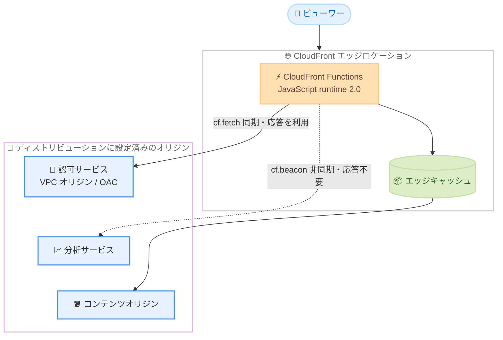

# Amazon CloudFront - CloudFront Functions のネットワークコール対応

**リリース日**: 2026 年 11 月 18 日
**サービス**: Amazon CloudFront
**機能**: CloudFront Functions network calls (cf.fetch / cf.beacon)

📊 [このアップデートのインフォグラフィックを見る](https://takech9203.github.io/aws-news-summary/20261118-cloudfront-functions-network-calls.html)

## 概要

Amazon CloudFront Functions が、リクエスト処理中にネットワークコールを実行できるようになりました。CloudFront Functions はエッジロケーションで軽量な JavaScript を実行する機能ですが、これまではコード内から外部サービスへアクセスする手段がなく、外部データに基づく判断が必要な場合は Lambda@Edge やオリジン側での処理が必要でした。

今回のアップデートで、新しいヘルパーメソッド `cf.fetch()` と `cf.beacon()` が追加されました。`cf.fetch()` は API エンドポイントを呼び出してレスポンスを基にリクエスト処理を分岐でき、`cf.beacon()` はビューワーを待たせることなくバックグラウンドで分析イベントを送信できます。AI エージェントの権限や利用バジェットを API や MCP サーバーに到達する前にチェックする、不正検知サービスにシグナルを送って疑わしいトラフィックをブロックするといった、最新のユースケースに対応します。

ネットワークコールの宛先は同じディストリビューションに設定済みのオリジンであり、オリジンアクセスコントロール (OAC) による SigV4 署名、VPC オリジン、コネクション再利用、カスタムオリジンヘッダー、オリジン mTLS といった既存のオリジン設定をそのまま活用できる点が特徴です。

**アップデート前の課題**

このアップデート以前には、以下の課題がありました。

- CloudFront Functions から外部サービスを呼び出せず、動的なデータに基づく判断 (トークン失効チェック、認可判定など) ができなかった
- 外部データが必要なロジックは Lambda@Edge に移行する必要があり、コストとレイテンシーが増加した
- あるいはロジックをオリジン側へ戻す必要があり、エッジでの早期ブロックやオフロードのメリットを得られなかった
- エッジからの分析イベント送信には別の仕組みが必要だった

**アップデート後の改善**

今回のアップデートにより、以下が可能になりました。

- `cf.fetch()` でビューワーリクエスト / ビューワーレスポンス関数から API を呼び出し、レスポンスに基づいてリクエストを処理できるようになった
- `cf.beacon()` でキャッシュ配信時も含め、ビューワーを待たせずにバックグラウンドで分析イベントを送信できるようになった
- OAC、VPC オリジン、カスタムオリジンヘッダー、オリジン mTLS などディストリビューションのオリジン設定を関数コード側で再実装せずに利用できるようになった
- 認可チェックや不正検知などの軽量なネットワーク連携を、Lambda@Edge を使わずエッジで完結できるようになった

## アーキテクチャ図



CloudFront Functions が `cf.fetch()` で認可サービスを同期呼び出しして結果に基づきリクエストを処理し、`cf.beacon()` で分析サービスへ非同期にイベントを送信する構成です。宛先はいずれも同じディストリビューションに設定済みのオリジンである必要があります。

## サービスアップデートの詳細

### 主要機能

1. **cf.fetch() メソッド**
   - オリジンへリクエストを送信し、レスポンスを読み取る同期型のネットワークコール
   - Promise を返すため、`async` 関数内で `await` と組み合わせて使用する
   - `path` (必須) と `options` (必須) を指定し、`options.originId` で同一ディストリビューション上のオリジン ID を指定する
   - `method` は GET / HEAD / POST / PUT / PATCH / DELETE / OPTIONS に対応 (大文字のみ、省略時は GET)
   - レスポンスボディを読むには `includeBody: true` の指定が必要。`text()`、`json()`、`bytes()`、`arrayBuffer()` でボディを取得できる (読み取りは 1 回のみ)
   - エラーは `TypeError`、`TimeoutError`、`InternalError`、`SyntaxError` として通知されるため、`try` / `catch` でフェイルオープン / フェイルクローズを設計する

2. **cf.beacon() メソッド**
   - レスポンスを待たずにオリジンへリクエストを送信するベストエフォートの非同期送信
   - 分析イベントや監査レコードなど、ビューワーを待たせたくない用途に使用する
   - 即座に `undefined` を返し、関数の実行は継続される
   - `logDeliveryErrors: true` を指定すると、関数終了後の配信失敗を CloudWatch Logs で確認できる (2xx / 3xx 以外のステータスはログに記録)

3. **既存オリジン設定の活用**
   - OAC 設定済みオリジンへのコールは CloudFront が SigV4 で署名するため、関数コードに認証情報を埋め込む必要がない
   - VPC オリジンによりプライベートサブネット内のサービスを呼び出せるため、宛先にパブリックエンドポイントが不要
   - CloudFront がオリジンへのウォームコネクションを保持しているため、TCP / TLS セットアップを回避できる
   - オリジンに設定したカスタムオリジンヘッダー (共有シークレットなど) がコールにも付与される
   - オリジン mTLS が設定されている場合、CloudFront がクライアント証明書を提示するため関数側で証明書を扱わない

4. **CloudFront KeyValueStore との使い分け**
   - リクエスト間でデータが変化し最新の回答が必要な場合 (トークン失効、セグメント判定) や、データセットが大きい場合はネットワークコールが適する
   - 静的または更新頻度の低いデータ (リダイレクトマップ、機能フラグ) や、1 リクエストで複数回の参照が必要な場合は KeyValueStore が適する (ネットワークコールは 1 回 / 呼び出しだが、KeyValueStore は繰り返し読み取り可能)
   - 両方の併用も可能 (KeyValueStore で実験設定を読み、ネットワークコールでバリアントを割り当てるなど)

## 技術仕様

### ネットワークコールのクォータ

| 項目 | 詳細 |
|------|------|
| 関数呼び出しあたりのネットワークコール数 | 1 回 (cf.fetch と cf.beacon の合計) |
| タイムアウト | 1 秒 (リクエスト送信から最終バイト受信まで。オリジンのレスポンスタイムアウト設定は適用されない) |
| リクエストボディの最大サイズ | 10 KB |
| レスポンスボディの最大サイズ | 10 KB |
| リクエストヘッダー名の最大長 | 256 バイト |
| リクエストヘッダー値の最大長 | 1,783 バイト |
| 全ヘッダーの最大合計サイズ | 10 KB (リクエスト / レスポンスとも) |
| パスとクエリ文字列の最大長 | 8 KB |

これらのクォータは引き上げ不可です。

### 利用要件

| 項目 | 詳細 |
|------|------|
| ランタイム | JavaScript runtime 2.0 (`import cf from "cloudfront";` が必要) |
| イベントタイプ | ビューワーリクエストおよびビューワーレスポンス関数 |
| 宛先 | 同一ディストリビューションに設定済みのオリジン (ホスト名の URL 指定は不可、パスとオリジン ID を指定) |
| 料金プラン | 無料プランのディストリビューションでは利用不可 |

### リクエスト構築の仕様

- CloudFront はネットワークコールを一から構築するため、ビューワーのヘッダー、Cookie、クエリ文字列は自動では転送されない (`X-Forwarded-For`、`Via`、`CDN-Loop` のみ自動付与)。必要な情報は `headers` または `body` で明示的に渡す
- `Accept-Encoding`、`Content-Length`、`TE`、`Transfer-Encoding` ヘッダーの指定は不可 (`TypeError` が発生)
- OAC を使わないカスタムオリジンでは `host` ヘッダーの上書きが可能 (S3 オリジンや OAC 付きオリジンでは不可)
- `x-amz-content-sha256` ヘッダーは CloudFront が自動付与する。ただし Lambda 関数 URL への body 付き POST / PUT では、関数側で body の SHA-256 ダイジェストを設定する必要がある

## 設定方法

### 前提条件

1. CloudFront ディストリビューションと、呼び出し先となるオリジンが同一ディストリビューションに設定済みであること
2. CloudFront Functions の JavaScript runtime 2.0 を使用すること
3. ディストリビューションが無料プラン以外であること (フラットレートプランの場合は Pro プラン以上で追加料金なし)

### 手順

#### ステップ 1: ネットワークコールを行う関数を作成する

```bash
aws cloudfront create-function \
  --name auth-check-function \
  --function-config '{"Comment":"Authorization check with cf.fetch","Runtime":"cloudfront-js-2.0"}' \
  --function-code fileb://function.js
```

JavaScript runtime 2.0 を指定して CloudFront 関数を作成します。`function.js` には `import cf from 'cloudfront';` で始まるコードを記述します。

#### ステップ 2: 関数コードで cf.fetch() を使用する

```javascript
import cf from 'cloudfront';

async function handler(event) {
    const request = event.request;
    const auth = request.headers['authorization'];

    if (!auth) {
        return { statusCode: 401, statusDescription: 'Unauthorized' };
    }

    try {
        const response = await cf.fetch('/v1/authorize', {
            originId: 'auth-service',
            method: 'POST',
            headers: { 'content-type': 'application/json' },
            body: JSON.stringify({ token: auth.value, uri: request.uri }),
            includeBody: true,
        });

        if (!response.ok) {
            return { statusCode: 403, statusDescription: 'Forbidden' };
        }

        const result = await response.json();
        request.headers['x-user-id'] = { value: result.userId };
        return request;
    } catch (e) {
        console.log('Authorization check failed: ' + e.name + ': ' + e.message);
        return { statusCode: 503, statusDescription: 'Service Unavailable' };
    }
}
```

ビューワーのトークンを認可サービスに送信し、承認された場合のみリクエストを通過させるフェイルクローズ型の実装例です。`originId` には同一ディストリビューション上のオリジン ID を指定します。

#### ステップ 3: 関数を公開してディストリビューションに関連付ける

```bash
# 関数を公開
aws cloudfront publish-function \
  --name auth-check-function \
  --if-match <ETag>

# ディストリビューションのキャッシュビヘイビアに viewer-request として関連付け
# (コンソールまたは update-distribution で FunctionAssociations を設定)
```

関数を LIVE ステージに公開し、キャッシュビヘイビアのビューワーリクエストイベントに関連付けます。なお、`TestFunction` API やコンソールのテストタブではネットワークコールは実行されず `TypeError` が発生するため、`try` / `catch` で囲んでテスト可能にしておきます。

## メリット

### ビジネス面

- **アーキテクチャの簡素化とコスト最適化**: 軽量な認可チェックや分析送信のためだけに Lambda@Edge を使う必要がなくなり、エッジ処理のコストと運用負荷を削減できる
- **セキュリティ強化**: 疑わしいトラフィックを不正検知サービスと連携してエッジでブロック / チャレンジでき、オリジンへの不要な到達を防止できる
- **AI ワークロードへの対応**: AI エージェントの権限や利用バジェットを API や MCP サーバーに到達する前に検証でき、AI トラフィックのガバナンスを実現できる

### 技術面

- **既存オリジン設定の再利用**: OAC による SigV4 署名、VPC オリジン、mTLS、カスタムヘッダーを関数コードで再実装せずに利用でき、認証情報をコードに埋め込まずに済む
- **低レイテンシー**: CloudFront がオリジンへのウォームコネクションを保持しているため、TCP / TLS セットアップのオーバーヘッドを回避できる
- **ビューワー体験の維持**: `cf.beacon()` はキャッシュ配信時でもビューワーを待たせずにイベントを送信でき、パフォーマンスに影響しない

## デメリット・制約事項

### 制限事項

- 1 回の関数呼び出しにつきネットワークコールは 1 回のみ (`Promise.all()` による複数コールも不可)
- タイムアウトは 1 秒固定で、リクエスト / レスポンスボディはそれぞれ最大 10 KB
- 宛先は同一ディストリビューションに設定済みのオリジンに限定され、任意の URL は指定できない
- 無料プランのディストリビューションでは利用不可
- `TestFunction` API やコンソールのテストタブではネットワークコールを実行できない
- Connection Functions および継続的デプロイ (continuous deployment) を使用するディストリビューションでは利用不可
- AWS WAF はネットワークコールを検査しない (Web ACL が評価するのはビューワーリクエストのみ)
- ネットワークコールのレスポンスはキャッシュされず、到達するたびに毎回実行される

### 考慮すべき点

- `cf.fetch()` のエラーを catch しない場合、関数が失敗してビューワーに HTTP 503 が返るため、フェイルオープン / フェイルクローズの方針を明確にして `try` / `catch` を必ず実装する
- 遠方のオリジンへの TLS 失敗やプライベート IP のオリジンは、1 秒制限により `TimeoutError` として現れる場合がある。プライベートネットワーク内のサービスには VPC オリジンを使用する
- `cf.beacon()` はベストエフォートであり、確実な配信が必要な用途には使用しない。失敗の確認には `logDeliveryErrors: true` が必要
- ビューワーリクエストの情報は自動転送されないため、オリジンが必要とする情報は `headers` / `body` で明示的に渡す設計が必要
- 高頻度の参照で内容が静的なデータは、ネットワークコールではなく CloudFront KeyValueStore の利用を検討する

## ユースケース

### ユースケース 1: AI エージェントトラフィックの認可とバジェット制御

**シナリオ**: API や MCP サーバーの手前で、AI エージェントの権限と利用バジェットを検証し、超過したエージェントのリクエストをエッジでブロックしたい。

**実装例**:
```javascript
const response = await cf.fetch('/v1/agent-authorize', {
    originId: 'agent-control-plane',
    method: 'POST',
    headers: { 'content-type': 'application/json' },
    body: JSON.stringify({ agentId: agentId, uri: request.uri }),
    includeBody: true,
});
if (!response.ok) {
    return { statusCode: 429, statusDescription: 'Budget Exceeded' };
}
```

**効果**: 認可されないリクエストがオリジンに到達する前にブロックされ、API / MCP サーバーの負荷とコストを削減できる。

### ユースケース 2: 不正検知サービスと連携したトラフィック制御

**シナリオ**: ボットや不正アクセスの疑いがあるトラフィックについて、社内の不正検知サービスにシグナルを送り、判定結果に応じてブロックまたはチャレンジを返したい。

**実装例**:
```javascript
const response = await cf.fetch('/v1/fraud-check', {
    originId: 'fraud-service',
    method: 'POST',
    headers: { 'content-type': 'application/json' },
    body: JSON.stringify({ ip: event.viewer.ip, uri: request.uri }),
    includeBody: true,
});
const verdict = await response.json();
if (verdict.action === 'block') {
    return { statusCode: 403, statusDescription: 'Forbidden' };
}
```

**効果**: リアルタイムの判定に基づく動的なアクセス制御をエッジで実現し、オリジンを不正トラフィックから保護できる。

### ユースケース 3: キャッシュヒットを含む全リクエストの分析イベント収集

**シナリオ**: キャッシュから配信されるコンテンツも含め、全ビューワーリクエストの分析イベントを、配信パフォーマンスに影響を与えずに収集したい。

**実装例**:
```javascript
import cf from 'cloudfront';

function handler(event) {
    const request = event.request;
    cf.beacon('/events', {
        originId: 'analytics-service',
        method: 'POST',
        headers: { 'content-type': 'application/json' },
        body: JSON.stringify({ uri: request.uri, viewerIp: event.viewer.ip }),
        logDeliveryErrors: true,
    });
    return request;
}
```

**効果**: ビューワーのレスポンスタイムに影響を与えず、キャッシュヒット時も含めた分析データをリアルタイムに収集できる。

## 料金

ネットワークコールは 100 万コールあたり 0.10 USD で、通常の CloudFront Functions 呼び出し料金に追加で課金されます。CloudFront フラットレートプランの Pro プラン以上では、追加料金なしで利用できます。なお、無料プランのディストリビューションではネットワークコールを利用できません。

### 料金例

| 使用量 | 月額料金 (概算、ネットワークコール分) |
|--------|------------------|
| 1,000 万コール / 月 | 1 USD + Functions 呼び出し料金 |
| 1 億コール / 月 | 10 USD + Functions 呼び出し料金 |
| Pro プラン以上のフラットレートプラン | 追加料金なし |

## 利用可能リージョン

すべての CloudFront エッジロケーションで利用可能です。

## 関連サービス・機能

- **Lambda@Edge**: より長い実行時間 (最大 30 秒) や複数のネットワークコールが必要な複雑な処理に適する。軽量な単一コールであれば CloudFront Functions への移行でコスト削減が可能
- **Amazon CloudFront KeyValueStore**: 静的 / 低頻度更新のデータをエッジで低レイテンシーに参照する機能。ネットワークコールと併用可能
- **CloudFront VPC オリジン**: プライベートサブネット内のサービスをパブリックエンドポイントなしでネットワークコールの宛先にできる
- **オリジンアクセスコントロール (OAC)**: ネットワークコールを SigV4 で自動署名し、プライベート S3 バケットや Lambda 関数 URL を認証情報なしで呼び出せる

## 参考リンク

- 📊 [インフォグラフィック](https://takech9203.github.io/aws-news-summary/20261118-cloudfront-functions-network-calls.html)
- [公式発表 (What's New)](https://aws.amazon.com/about-aws/whats-new/2026/11/cloudfront-functions-network-calls/)
- [ドキュメント: Helper methods for network calls](https://docs.aws.amazon.com/AmazonCloudFront/latest/DeveloperGuide/helper-functions-network-calls.html)
- [ドキュメント: Quotas on CloudFront Functions network calls](https://docs.aws.amazon.com/AmazonCloudFront/latest/DeveloperGuide/cloudfront-limits.html#limits-functions-network-calls)
- [料金ページ](https://aws.amazon.com/cloudfront/pricing/)

## まとめ

CloudFront Functions がネットワークコールに対応したことで、これまで Lambda@Edge やオリジン側に頼らざるを得なかった動的な認可チェック、不正検知連携、分析イベント送信をエッジの軽量関数だけで完結できるようになりました。1 コール / 呼び出し、1 秒タイムアウト、10 KB ボディという制約を踏まえ、まずは認可チェックやビーコン送信などの軽量ユースケースから `cf.fetch()` / `cf.beacon()` の適用を検討することを推奨します。
