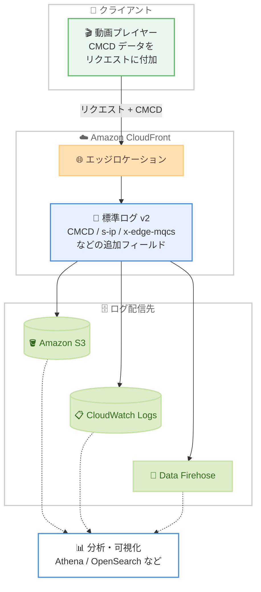

# Amazon CloudFront - 標準ログの CMCD および追加ログフィールド対応

**リリース日**: 2026 年 11 月 18 日
**サービス**: Amazon CloudFront
**機能**: 標準ログ (v2) における CMCD フィールドおよび追加アクセスログフィールドのサポート

📊 [このアップデートのインフォグラフィックを見る](https://takech9203.github.io/aws-news-summary/20261118-cloudfront-standard-logging-cmcd-fields.html)

## 概要

Amazon CloudFront の標準ログ (標準ロギング v2) が、これまでリアルタイムログでのみ利用可能だったアクセスログフィールドをサポートしました。追加されたフィールドには、リクエストを処理した CloudFront サーバーの IP アドレス、プライマリディストリビューションとステージングディストリビューションのトラフィックを区別する識別子、メディア品質信頼スコア (MQCS)、そして Common Media Client Data (CMCD) フィールドが含まれます。

CMCD は、動画プレイヤーがリクエストに付加するクライアント側の再生情報 (ビットレート、バッファ長、再生セッション ID など) の業界標準仕様 (CTA-5004) です。今回のアップデートにより、これらの情報をリアルタイムログ用のデータストリームを別途構築することなく、標準ログとして Amazon S3、Amazon CloudWatch Logs、Amazon Data Firehose に直接配信できるようになりました。

動画ストリーミングを提供するお客様にとって、視聴者側の再生品質の問題と CloudFront の配信データを相関分析できるため、トラブルシューティングの迅速化に役立ちます。

**アップデート前の課題**

- CMCD フィールドやサーバー IP などの詳細フィールドはリアルタイムログでのみ取得可能で、Kinesis Data Streams を用いたデータストリームの構築・運用が必要だった
- リアルタイムログ基盤 (Kinesis Data Streams、コンシューマー処理) の構築・運用コストが発生していた
- 標準ログだけでは、視聴者側の再生状態 (バッファ状況、ビットレートなど) と CloudFront の配信状況を突き合わせた分析が困難だった

**アップデート後の改善**

- リアルタイムログ用のデータストリームを構築せずに、CMCD を含む詳細フィールドを標準ログで取得できるようになった
- 取得したログは Amazon S3、CloudWatch Logs、Data Firehose のいずれにも配信可能で、既存の分析基盤をそのまま活用できる
- 視聴者側の再生メトリクスと CloudFront の配信データを 1 つのログで相関分析でき、ストリーミングの問題解決が迅速になった

## アーキテクチャ図



動画プレイヤーが付加した CMCD データを含むリクエストを CloudFront が受信し、標準ログ v2 として追加フィールドとともに S3、CloudWatch Logs、Data Firehose に配信するフローです。リアルタイムログ用のストリーム構築は不要になります。

## サービスアップデートの詳細

### 主要機能

1. **CMCD フィールドのサポート**
   - CTA-5004 仕様に基づく Common Media Client Data のフィールドを標準ログで取得可能
   - `cmcd-encoded-bitrate` (エンコードビットレート)、`cmcd-buffer-length` (バッファ長)、`cmcd-session-id` (再生セッション ID) など 18 種類のフィールドに対応
   - `cmcd-buffer-starvation` によりバッファ枯渇 (リバッファリング) の発生を検知可能

2. **CloudFront サーバー IP アドレス**
   - `s-ip` フィールドでリクエストを処理した CloudFront サーバーの IP アドレスを記録
   - IPv4 / IPv6 の両形式に対応

3. **継続的デプロイのトラフィック識別**
   - `primary-distribution-id` および `primary-distribution-dns-name` フィールドにより、継続的デプロイ利用時にプライマリディストリビューションとステージングディストリビューションのトラフィックを区別可能

4. **メディア品質信頼スコア (MQCS)**
   - `x-edge-mqcs` フィールドで、CloudFront が MediaPackage v2 から CMSD レスポンスヘッダーとして受け取った Media Quality Confidence Score (0 - 100) を記録
   - メディア品質対応レジリエンシー (MQAR) が有効なオリジングループに一致するリクエストで利用可能

5. **リアルタイムログ不要の詳細ロギング**
   - 上記フィールドを含むログを、追加のデータストリームを構築せずに Amazon S3、CloudWatch Logs、Data Firehose へ直接配信可能

## 技術仕様

### 主な CMCD ログフィールド

| フィールド | 説明 |
|------|------|
| `cmcd-encoded-bitrate` | リクエストされたオーディオ / ビデオオブジェクトのエンコードビットレート |
| `cmcd-buffer-length` | リクエストされたメディアオブジェクトのバッファ長 |
| `cmcd-buffer-starvation` | 前回リクエストから今回リクエストの間にバッファ枯渇が発生したかどうか |
| `cmcd-content-id` | 現在のコンテンツを識別する一意の文字列 |
| `cmcd-measured-throughput` | クライアントが測定したクライアント - サーバー間スループット |
| `cmcd-playback-rate` | 再生速度 (1 = 等速、2 = 倍速、0 = 停止中) |
| `cmcd-session-id` | 再生セッションを識別する GUID |
| `cmcd-streaming-format` | 現在のリクエストのストリーミングフォーマット |
| `cmcd-top-bitrate` | クライアントが再生可能な最高ビットレートのレンディション |
| `cmcd-version` | CMCD 仕様のバージョン |

### その他の追加フィールド

| フィールド | 説明 |
|------|------|
| `s-ip` | リクエストを処理した CloudFront サーバーの IP アドレス |
| `primary-distribution-id` | 継続的デプロイ有効時にプライマリディストリビューションを識別する ID |
| `primary-distribution-dns-name` | プライマリディストリビューションのドメイン名 |
| `x-edge-mqcs` | MediaPackage v2 から取得した Media Quality Confidence Score (0 - 100) |

### ログ配信先と出力形式

| 項目 | 詳細 |
|------|------|
| 配信先 | Amazon S3、Amazon CloudWatch Logs、Amazon Data Firehose |
| 出力形式 | JSON、Plain、w3c、Raw、Parquet (S3 のみ) |
| S3 向けオプション | パーティショニング、Hive 互換ファイル名、オプトインリージョンへの配信 |
| 設定方法 | CloudFront コンソールまたは CloudWatch Logs API (PutDeliverySource / PutDeliveryDestination / CreateDelivery) |

## 設定方法

### 前提条件

1. CloudFront ディストリビューションが作成済みであること
2. ログ配信先 (S3 バケット、CloudWatch Logs ロググループ、または Firehose ストリーム) が作成済みであること
3. 配信先サービスに対するログ配信の権限が設定されていること

### 手順

#### ステップ 1: 配信ソースの作成

```bash
aws logs put-delivery-source \
  --name cf-delivery \
  --resource-arn arn:aws:cloudfront::123456789012:distribution/d111111abcdef8 \
  --log-type ACCESS_LOGS
```

CloudFront ディストリビューションを配信ソースとして登録します。CloudWatch Logs API は米国東部 (バージニア北部) リージョン (us-east-1) で呼び出す必要があります。

#### ステップ 2: 配信先の作成

```bash
aws logs put-delivery-destination \
  --name S3-destination \
  --delivery-destination-configuration destinationResourceArn=arn:aws:s3:::amzn-s3-demo-bucket
```

ログの配信先 (この例では S3 バケット) を登録します。CloudWatch Logs ロググループや Firehose ストリームの ARN も指定可能です。

#### ステップ 3: 配信の作成と CMCD フィールドの選択

```bash
aws logs create-delivery \
  --delivery-source-name cf-delivery \
  --delivery-destination-arn arn:aws:logs:us-east-1:123456789012:delivery-destination:S3-destination \
  --record-fields '["date","time","x-edge-location","sc-status","cs-uri-stem","s-ip","x-edge-mqcs","cmcd-encoded-bitrate","cmcd-buffer-length","cmcd-buffer-starvation","cmcd-session-id"]'
```

配信ソースと配信先を関連付け、`recordFields` で取得したいログフィールドを選択します。CMCD フィールドや `s-ip` などの新しいフィールドをここで指定します。CloudFront コンソールの [Logging] タブからも同様にフィールド選択が可能です。

## メリット

### ビジネス面

- **運用コストの削減**: リアルタイムログ用の Kinesis Data Streams の構築・運用が不要になり、インフラコストと運用負荷を削減できる
- **視聴体験の改善**: 視聴者側の再生品質データを容易に取得できるため、品質問題の早期発見と改善サイクルの高速化につながる
- **トラブルシューティングの迅速化**: 視聴者からの問い合わせに対し、再生セッション ID でログを特定して配信状況と突き合わせた原因調査が可能

### 技術面

- **クライアントとサーバーの相関分析**: CMCD によりプレイヤー側のバッファ状態・ビットレートと CloudFront 側の配信結果を同一ログで分析できる
- **柔軟な配信先**: S3 (Athena での分析)、CloudWatch Logs (Logs Insights でのクエリ)、Firehose (OpenSearch などへのストリーミング) を用途に応じて選択できる
- **フィールド選択と Parquet 対応**: 必要なフィールドのみを選択でき、S3 向けには Parquet 形式での出力も可能なため、分析基盤に最適化したログ設計ができる

## デメリット・制約事項

### 制限事項

- CMCD フィールドが記録されるのは、動画プレイヤーが CMCD データをリクエストに付加している場合のみ (プレイヤー側の CMCD 対応が必要)
- `x-edge-mqcs` は MQAR が有効なオリジングループ (MediaPackage v2) に一致するリクエストでのみ記録される
- `primary-distribution-id` / `primary-distribution-dns-name` は継続的デプロイが有効な場合に意味を持つ
- 出力形式は配信先の作成時にのみ設定可能で、後から変更するには配信を削除して再作成する必要がある
- ディストリビューションごとに作成できる配信ソースは 1 つのみ

### 考慮すべき点

- 標準ログは CloudWatch の Vended Logs として配信されるため、配信先に応じた配信・保存コストが発生する
- Parquet 形式への変換を有効にすると CloudWatch の変換料金が発生する
- ログ設定の変更が反映されるまで最大 12 時間かかる
- 標準ログはリアルタイムログと異なり準リアルタイムの配信であるため、秒単位の即時性が必要な監視にはリアルタイムログが引き続き適している

## ユースケース

### ユースケース 1: 動画ストリーミングの再生品質トラブルシューティング

**シナリオ**: ライブ配信サービスで一部の視聴者から「再生が頻繁に止まる」という問い合わせがあり、クライアント側の問題か CDN 側の問題かを切り分けたい。

**実装例**:
```sql
-- Athena で CMCD フィールドを含む標準ログを分析
SELECT "cmcd-session-id",
       "cmcd-buffer-starvation",
       "cmcd-measured-throughput",
       "x-edge-location",
       "time-to-first-byte",
       "x-edge-result-type"
FROM cloudfront_standard_logs_v2
WHERE "cmcd-buffer-starvation" = 'true'
  AND date = DATE '2026-11-18'
ORDER BY time;
```

**効果**: バッファ枯渇が発生したセッションを特定し、エッジロケーションや配信レイテンシーと突き合わせることで、問題の原因がクライアントのネットワークか CloudFront の配信かを迅速に切り分けられる。

### ユースケース 2: 継続的デプロイにおけるステージングトラフィックの分析

**シナリオ**: CloudFront の継続的デプロイ機能でステージングディストリビューションに一部トラフィックを流しており、本番とステージングのパフォーマンスを比較したい。

**実装例**:
```sql
-- プライマリとステージングのパフォーマンス比較
SELECT "primary-distribution-id",
       COUNT(*) AS requests,
       AVG(CAST("time-to-first-byte" AS DOUBLE)) AS avg_ttfb,
       SUM(CASE WHEN "sc-status" >= '500' THEN 1 ELSE 0 END) AS errors
FROM cloudfront_standard_logs_v2
GROUP BY "primary-distribution-id";
```

**効果**: 設定変更をステージングで検証する際、エラー率やレイテンシーをトラフィック種別ごとに比較でき、安全なロールアウト判断ができる。

### ユースケース 3: MQCS を活用したメディア配信品質の継続監視

**シナリオ**: MediaPackage v2 と CloudFront の MQAR を利用したライブ配信で、オリジンから返されるメディア品質スコアを長期的にモニタリングしたい。

**実装例**:
```bash
# CloudWatch Logs Insights で MQCS の低いリクエストを抽出
aws logs start-query \
  --log-group-name /aws/cloudfront/access-logs \
  --start-time 1763424000 --end-time 1763510400 \
  --query-string 'fields `x-edge-mqcs`, `x-edge-location`, `cs-uri-stem` | filter `x-edge-mqcs` < 50 | sort `x-edge-mqcs` asc'
```

**効果**: 品質スコアの低いメディアセグメントを継続的に把握し、オリジン側の品質劣化やフェイルオーバー (`sr-reason` = MediaQuality) の傾向を可視化できる。

## 料金

CloudFront の標準ログの有効化自体に追加料金はかかりません。ただし、ログは CloudWatch Vended Logs として配信されるため、選択した配信先に応じて配信・取り込み・保存・アクセスの料金が発生します。

- **Amazon S3**: ログ配信自体は追加料金なし。S3 の保存およびアクセスに対する料金が発生。Parquet 変換を有効にした場合は CloudWatch の変換料金が発生
- **CloudWatch Logs**: Vended Logs の取り込み・保存料金が発生
- **Data Firehose**: Vended Logs の配信料金および Firehose の料金が発生

詳細は [Amazon CloudWatch 料金ページ](https://aws.amazon.com/cloudwatch/pricing/) の Vended Logs セクションを参照してください。

## 利用可能リージョン

すべての CloudFront エッジロケーションで利用可能です。ログ配信先として、オプトインリージョンの S3 バケットも指定できます。なお、CloudWatch API で標準ログを設定する場合は us-east-1 リージョンを指定する必要があります。

## 関連サービス・機能

- **Amazon CloudWatch Logs**: 標準ログ v2 の配信基盤 (Vended Logs) であり、配信先としても利用可能
- **Amazon Data Firehose**: ログを OpenSearch や外部分析ツールへストリーミング配信する際に利用
- **Amazon S3 / Amazon Athena**: ログの長期保存と SQL ベースの分析に利用。Parquet 形式や Hive 互換パーティショニングで効率的な分析が可能
- **AWS Elemental MediaPackage v2**: MQCS (`x-edge-mqcs`) の情報源となるオリジンサービス。MQAR と組み合わせて高可用なメディア配信を実現
- **CloudFront リアルタイムログ**: 秒単位の即時性が必要な場合に引き続き利用可能。今回のアップデートでフィールドの多くが標準ログでも取得可能になった

## 参考リンク

- 📊 [インフォグラフィック](https://takech9203.github.io/aws-news-summary/20261118-cloudfront-standard-logging-cmcd-fields.html)
- [公式発表 (What's New)](https://aws.amazon.com/about-aws/whats-new/2026/11/cloudfront-standard-logging-cmcd-fields)
- [ドキュメント: Configure standard logging (v2)](https://docs.aws.amazon.com/AmazonCloudFront/latest/DeveloperGuide/standard-logging.html)
- [ドキュメント: Standard logging reference](https://docs.aws.amazon.com/AmazonCloudFront/latest/DeveloperGuide/standard-logs-reference.html)
- [CTA-5004: Common Media Client Data 仕様](https://www.cta.tech/standards/wave-common-media-client-data/)
- [料金ページ (Amazon CloudWatch)](https://aws.amazon.com/cloudwatch/pricing/)

## まとめ

CloudFront 標準ログが CMCD、サーバー IP、MQCS などの詳細フィールドに対応したことで、これまでリアルタイムログ基盤の構築が必要だった高度な配信分析が、標準ログだけで実現できるようになりました。動画ストリーミングを提供しているお客様は、プレイヤーの CMCD 対応状況を確認した上で、標準ログ v2 のフィールド選択にこれらの新フィールドを追加し、再生品質と配信品質の相関分析を始めることを推奨します。
