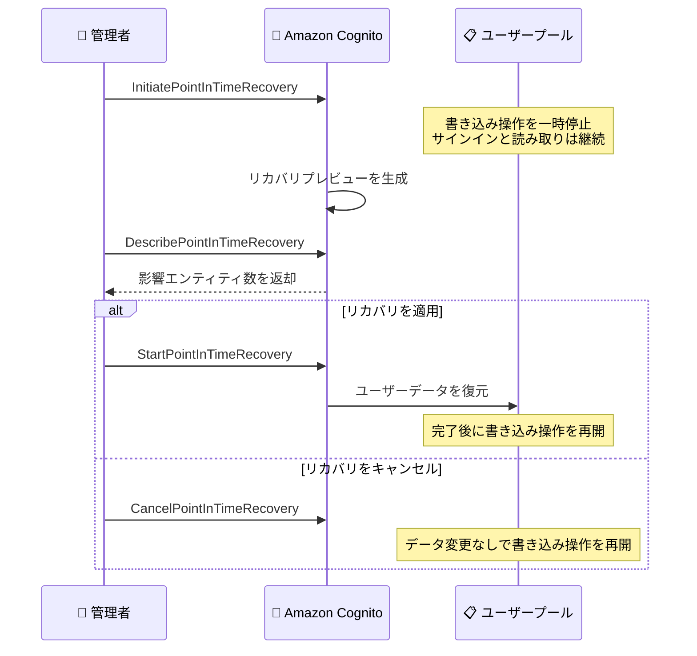

# Amazon Cognito - ポイントインタイムリカバリ (PITR) のサポート

**リリース日**: 2026 年 11 月 18 日
**サービス**: Amazon Cognito
**機能**: ユーザープールのポイントインタイムリカバリ (Point-in-Time Recovery)

📊 [このアップデートのインフォグラフィックを見る](https://takech9203.github.io/aws-news-summary/20261118-cognito-point-in-time-recovery.html)

## 概要

Amazon Cognito がポイントインタイムリカバリ (PITR) をサポートしました。ユーザープール内のユーザーデータを過去の特定時点の状態に復元できる機能です。管理スクリプトの誤実行、アプリケーションのバグ、アカウント内の不正なアクティビティなどによってユーザーやその属性、サインイン認証情報が誤って削除・変更された場合に、その直前の時点までロールバックできます。

リカバリは 2 段階のプロセスで実行されます。まず復元先の時点 (リカバリポイント) を指定してリカバリを開始すると、Cognito は書き込み操作を一時停止し、ユーザー、グループ、多要素認証 (MFA) 設定、パスキーがそれぞれいくつ作成・更新・削除されるかを示すリカバリプレビューを生成します。管理者はプレビューを確認したうえで、リカバリを適用するかキャンセルするかを選択できます。復元されたユーザーは識別子、パスワード、MFA 設定、パスキーを保持するため、認証情報のリセットは不要です。

PITR は Essentials および Plus 機能プランのユーザープールで追加料金なしで自動的に有効化されます。AWS Management Console、Cognito API、AWS CLI、AWS SDK から管理できます。

**アップデート前の課題**

- 誤削除や誤変更に備えるには、独自のエクスポート・リストアプロセスを構築・維持する必要があった
- 独自の方法で復元したユーザーには新しい識別子が割り当てられ、既存の ID との整合性が崩れていた
- 復元後のユーザーはパスワードのリセットが必要で、ユーザー体験が損なわれていた

**アップデート後の改善**

- マネージドな機能として、ユーザーデータを過去の時点の状態にそのまま復元できるようになった
- 復元されたユーザーは識別子、パスワード、MFA 設定、パスキーを保持し、既存の認証情報でそのままサインインできる
- 復元の実行前にプレビューで影響範囲 (作成・更新・削除されるエンティティ数) を確認し、適用またはキャンセルを選択できる

## アーキテクチャ図



リカバリの開始からプレビュー確認、適用またはキャンセルまでの流れを示しています。プレビュー生成から復元完了 (またはキャンセル) までの間、ユーザープールへの書き込み操作は一時停止されます。

## サービスアップデートの詳細

### 主要機能

1. **特定時点へのユーザーデータ復元**
   - リカバリポイントを指定して、ユーザープール内のユーザーデータをその時点の状態に復元
   - リカバリポイント以降に削除されたユーザーは再作成、作成されたユーザーは削除、変更されたユーザーはリカバリポイント時点の状態に戻る
   - 復元は同一ユーザープール内で実行され、ユーザープールの ID、ARN、設定は維持される

2. **リカバリプレビューによる事前確認**
   - 適用前に、ユーザー、グループ、ユーザー MFA、パスキーの各エンティティについて作成・更新・削除される件数を確認可能
   - プレビューを確認したうえで、リカバリの適用 (Start) またはキャンセル (Cancel) を選択
   - リカバリ開始後 24 時間以内に適用またはキャンセルしない場合、プレビューは失効し、データ変更なしで書き込み操作が再開される

3. **認証情報を保持した復元**
   - 復元されたユーザーは識別子、パスワード、MFA 設定 (認証アプリの TOTP を含む)、パスキーを保持
   - ユーザーは既存の認証情報でそのままサインインでき、パスワードリセットは不要
   - リカバリポイント以降にユーザー自身が変更したパスワードは巻き戻されない (現在のパスワードが維持される)

4. **CloudTrail による監査**
   - PITR の各 API 操作は CloudTrail の管理イベントとして記録される
   - リカバリ適用時には、作成・更新・削除されたユーザー、グループ、グループメンバーシップごとに `CognitoPointInTimeRecovery` サービスイベントが記録され、変更内容を監査可能

### 復元対象と対象外

**復元されるデータ**

- ユーザープロファイル (標準属性とカスタム属性)
- グループとグループメンバーシップ
- 再作成されるユーザーのパスワード
- ユーザーの MFA 設定 (認証アプリの TOTP を含む)
- パスキー

**復元されないもの (現在の状態が維持される)**

- ユーザープール設定 (属性スキーマ、パスワード・MFA ポリシー、Lambda トリガー、メッセージテンプレート、脅威保護設定、マルチリージョンレプリケーション設定)
- アプリクライアントとクライアントシークレット
- ID プロバイダーとリソースサーバー
- ドメイン、マネージドログインのブランディング、クラシックホスト UI のカスタマイズ
- 暗号化設定 (カスタマーマネージドキーを含む)
- ログ配信設定と AWS WAF Web ACL の関連付け
- 記憶されたデバイスとユーザー認証イベント履歴
- ユーザーセッション、発行済み・失効済みトークン、ワンタイムコード
- ユーザーインポートジョブ

## 技術仕様

### 機能プランとリカバリウィンドウ

| 機能プラン | 最大リカバリウィンドウ |
|------|------|
| Lite | 利用不可 |
| Essentials | 1 日 |
| Plus | 14 日 |

リカバリウィンドウは、ユーザープールが PITR を含む機能プランの利用を開始した時点から始まります。たとえば Plus プランで 14 日前まで復元できるのは、過去 14 日間継続して Plus プランを利用していた場合のみです。プランを変更するとリカバリウィンドウはリセットされる点に注意が必要です。

### 主な制約

| 項目 | 詳細 |
|------|------|
| リカバリポイント | 15 分以上前、かつユーザープール作成時刻以降 |
| プレビューの有効期限 | リカバリ開始から 24 時間 |
| 同時実行 | 1 ユーザープールあたりアクティブなリカバリは 1 件 |
| 完了回数 | 24 時間あたり 1 ユーザープールにつき 1 回 |
| 開始回数 | 24 時間あたり 1 ユーザープールにつき 3 回まで (キャンセル・失効を含む) |
| 30 日間の開始回数 | 1 ユーザープールにつき 10 回まで |
| アカウント単位 | アクティブなリカバリは全ユーザープール合計で 5 件まで |
| AWS Organizations 単位 | アクティブなリカバリは全アカウント合計で 10 件まで |

### API 操作

| API 操作 | 説明 |
|------|------|
| `InitiatePointInTimeRecovery` | 書き込み操作を一時停止し、指定したリカバリポイントのプレビューを生成 |
| `DescribePointInTimeRecovery` | リカバリのステータスとプレビューを取得 |
| `StartPointInTimeRecovery` | プレビュー確認後にリカバリを適用 |
| `CancelPointInTimeRecovery` | リカバリを破棄し、書き込み操作を再開 |
| `ListPointInTimeRecoveries` | ユーザープールの現在および過去のリカバリを一覧表示 |

### IAM ポリシー例

`InitiatePointInTimeRecovery` を実行できるプリンシパルは最大 24 時間書き込み操作を停止でき、`StartPointInTimeRecovery` を実行できるプリンシパルはユーザーデータを巻き戻せるため、これらの権限は信頼できる管理者にのみ付与します。

```json
{
    "Version": "2012-10-17",
    "Statement": [
        {
            "Sid": "ViewPointInTimeRecoveries",
            "Effect": "Allow",
            "Action": [
                "cognito-idp:DescribePointInTimeRecovery",
                "cognito-idp:ListPointInTimeRecoveries"
            ],
            "Resource": "arn:aws:cognito-idp:us-east-1:111122223333:userpool/*"
        },
        {
            "Sid": "ManagePointInTimeRecoveries",
            "Effect": "Allow",
            "Action": [
                "cognito-idp:InitiatePointInTimeRecovery",
                "cognito-idp:StartPointInTimeRecovery",
                "cognito-idp:CancelPointInTimeRecovery"
            ],
            "Resource": "arn:aws:cognito-idp:us-east-1:111122223333:userpool/us-east-1_EXAMPLE"
        }
    ]
}
```

## 設定方法

### 前提条件

1. ユーザープールが Essentials または Plus 機能プランであること (PITR は自動的に有効化される)
2. 実行する IAM プリンシパルに PITR 関連の `cognito-idp` 権限があること
3. カスタマーマネージド KMS キーで暗号化している場合、リカバリ期間中もキーが有効で Cognito からアクセス可能であること
4. ユーザーインポートジョブが実行中でないこと

### 手順

#### ステップ 1: リカバリを開始する

```bash
aws cognito-idp initiate-point-in-time-recovery \
    --user-pool-id us-east-1_EXAMPLE \
    --restore-timestamp 2026-11-17T12:00:00Z
```

指定したリカバリポイント (この例では 2026 年 11 月 17 日 12:00 UTC) へのリカバリを開始します。この時点でユーザープールへの書き込み操作が一時停止され、レスポンスにリカバリ ID (`RestoreId`) が返されます。

#### ステップ 2: プレビューを確認する

```bash
aws cognito-idp describe-point-in-time-recovery \
    --user-pool-id us-east-1_EXAMPLE \
    --restore-id a1b2c3d4-5678-90ab-cdef-111111111111
```

リカバリのステータスを確認します。ステータスが `PREVIEW_GENERATED` になると、レスポンスの `RestorePreview` にユーザー、グループ、ユーザー MFA、パスキーごとの作成・更新・削除件数が表示されます。

#### ステップ 3: リカバリを適用またはキャンセルする

```bash
# 適用する場合
aws cognito-idp start-point-in-time-recovery \
    --user-pool-id us-east-1_EXAMPLE \
    --restore-id a1b2c3d4-5678-90ab-cdef-111111111111

# キャンセルする場合
aws cognito-idp cancel-point-in-time-recovery \
    --user-pool-id us-east-1_EXAMPLE \
    --restore-id a1b2c3d4-5678-90ab-cdef-111111111111
```

プレビューの内容を確認したうえで、リカバリを適用するかキャンセルするかを選択します。適用後は `describe-point-in-time-recovery` でステータスが `RESTORE_COMPLETED` になるまで監視します。キャンセルした場合はデータ変更なしで書き込み操作が再開されます。

## メリット

### ビジネス面

- **ディザスタリカバリ体制の強化**: 誤操作や不正アクティビティによるユーザーデータの損失から、追加コストなしで迅速に復旧できる
- **ユーザー体験の維持**: 復元後もユーザーは既存のパスワード、MFA、パスキーでサインインでき、パスワードリセットの案内やサポート対応が不要
- **運用コストの削減**: 独自のエクスポート・リストアの仕組みを構築・維持する必要がなくなる

### 技術面

- **識別子の保持**: 復元されたユーザーは元の識別子を保持するため、外部システムとの ID 連携や参照整合性が崩れない
- **プレビューによる安全な運用**: 適用前に影響範囲を定量的に確認でき、意図しない復元を防止できる
- **監査性**: CloudTrail の管理イベントとサービスイベントにより、リカバリ操作と変更されたエンティティを追跡できる

## デメリット・制約事項

### 制限事項

- Lite 機能プランでは利用できない (Essentials は 1 日、Plus は 14 日のリカバリウィンドウ)
- リカバリ中は書き込み操作が停止する (サインアップ、ユーザー作成・削除、属性更新、パスワード変更などが拒否される)
- 新しいユーザープール、別リージョン、別アカウントへの復元はできない (同一ユーザープール内のインプレース復元のみ)
- ユーザープール設定、アプリクライアント、ID プロバイダー、セッションやトークンなどは復元対象外
- 機能プランを変更するとリカバリウィンドウがリセットされる
- 一部の古いユーザープールや、サポートされない文字・形式のユーザーデータを含むユーザープールでは利用できない場合がある
- マルチリージョンレプリケーション構成では、プライマリリージョンでのみ、かつレプリケーション変更が進行中でない場合にのみ開始できる

### 考慮すべき点

- 書き込み停止期間中は `NEW_PASSWORD_REQUIRED`、`MFA_SETUP`、`SOFTWARE_TOKEN_MFA` チャレンジを伴うサインインが失敗するため、アプリケーション側でメンテナンスメッセージの表示などの準備が推奨される
- リカバリポイント以降にユーザー自身が変更したパスワードは巻き戻されないため、必要に応じて `AdminResetUserPassword` でリセットを強制する
- PITR は災害復旧用の機能であり、個別ユーザーの削除や変更の取り消しには `AdminDeleteUser` や `AdminUpdateUserAttributes` を使用する
- `InitiatePointInTimeRecovery` と `StartPointInTimeRecovery` の権限は最小限の管理者に限定する

## ユースケース

### ユースケース 1: 管理スクリプトの誤実行からの復旧

**シナリオ**: クリーンアップ用の管理スクリプトのバグにより、アクティブなユーザーを含む多数のユーザーが誤って削除された。

**実装例**:
```bash
# スクリプト実行直前の時点を指定してリカバリを開始
aws cognito-idp initiate-point-in-time-recovery \
    --user-pool-id us-east-1_EXAMPLE \
    --restore-timestamp 2026-11-18T08:55:00Z
```

**効果**: 削除されたユーザーが元の識別子、パスワード、MFA 設定、パスキーとともに再作成され、ユーザーは何も操作することなく従来どおりサインインできる。

### ユースケース 2: 不正アクティビティによるデータ改ざんへの対応

**シナリオ**: アカウント内の不正なアクティビティにより、多数のユーザー属性やグループメンバーシップが改ざんされた疑いがある。

**実装例**:
```bash
# プレビューで影響範囲を確認してから適用を判断
aws cognito-idp describe-point-in-time-recovery \
    --user-pool-id us-east-1_EXAMPLE \
    --restore-id a1b2c3d4-5678-90ab-cdef-111111111111
```

**効果**: 改ざん前の時点にユーザーデータを戻しつつ、CloudTrail の `CognitoPointInTimeRecovery` サービスイベントで復元によって変更されたエンティティを監査できる。

### ユースケース 3: アプリケーションバグによる属性破損の巻き戻し

**シナリオ**: アプリケーションの不具合により、デプロイ後にユーザーのカスタム属性が誤った値で上書きされ続けていた。

**実装例**:
```bash
# デプロイ直前の時点へ復元し、完了を監視
aws cognito-idp start-point-in-time-recovery \
    --user-pool-id us-east-1_EXAMPLE \
    --restore-id a1b2c3d4-5678-90ab-cdef-111111111111
```

**効果**: 破損した属性値をデプロイ前の状態に一括で戻せる。ユーザープール設定やアプリクライアントは影響を受けないため、修正済みアプリケーションをそのまま運用継続できる。

## 料金

PITR は Essentials および Plus 機能プランのユーザープールで追加料金なしで自動的に有効化されます。機能プラン自体の料金は月間アクティブユーザー (MAU) に基づく Amazon Cognito の料金体系に従います。詳細は [Amazon Cognito の料金ページ](https://aws.amazon.com/cognito/pricing/) を参照してください。

## 利用可能リージョン

Amazon Cognito が利用可能なすべての AWS リージョンで利用できます。詳細は [AWS リージョン別サービス一覧](https://aws.amazon.com/about-aws/global-infrastructure/regional-product-services/) を参照してください。

## 関連サービス・機能

- **Amazon Cognito 機能プラン (Essentials / Plus)**: PITR の利用可否とリカバリウィンドウの長さを決定する
- **AWS CloudTrail**: PITR の API 操作とリカバリによるエンティティ変更を記録し、監査を可能にする
- **AWS KMS**: カスタマーマネージドキーで暗号化されたユーザープールでは、リカバリ中もキーへのアクセスが必要
- **Amazon DynamoDB / Amazon RDS の PITR**: 他の AWS サービスにも同様のポイントインタイムリカバリ機能があり、システム全体の復旧戦略を統一的に設計できる

## 参考リンク

- 📊 [インフォグラフィック](https://takech9203.github.io/aws-news-summary/20261118-cognito-point-in-time-recovery.html)
- [公式発表 (What's New)](https://aws.amazon.com/about-aws/whats-new/2026/11/cognito-point-in-time-recovery/)
- [ドキュメント: Point-in-time recovery for user pools](https://docs.aws.amazon.com/cognito/latest/developerguide/user-pool-point-in-time-recovery.html)
- [Amazon Cognito 製品ページ](https://aws.amazon.com/cognito/)
- [料金ページ](https://aws.amazon.com/cognito/pricing/)

## まとめ

Amazon Cognito の PITR により、これまで独自に構築する必要があったユーザーデータのバックアップ・リストアが、追加料金なしのマネージド機能として利用できるようになりました。識別子や認証情報を保持したまま復元できる点が大きな特長です。Essentials または Plus プランを利用中のユーザーは、リカバリウィンドウの仕様と書き込み停止の影響を把握したうえで、災害復旧手順に PITR を組み込むことを推奨します。
