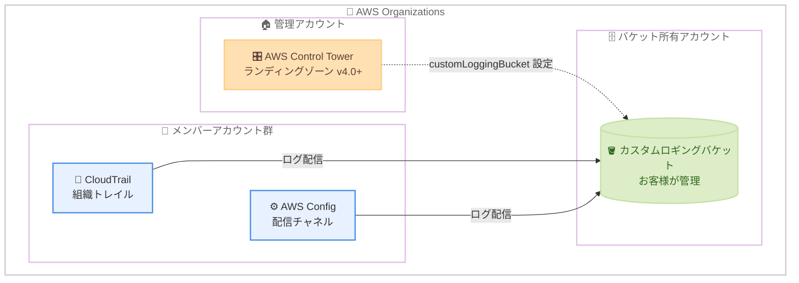

# AWS Control Tower - 既存 Amazon S3 バケットへのログ配信サポート

**リリース日**: 2026 年 11 月 18 日
**サービス**: AWS Control Tower
**機能**: 既存 Amazon S3 バケット (カスタムロギングバケット) へのログ配信

📊 [このアップデートのインフォグラフィックを見る](https://takech9203.github.io/aws-news-summary/20261118-control-tower-existing-s3-log-bucket.html)

## 概要

AWS Control Tower が、ランディングゾーンにおける AWS CloudTrail および AWS Config のログ保存先として、既存の Amazon S3 バケット (カスタムロギングバケット) を指定できるようになりました。これまで Control Tower は、サービス自身が作成・管理する S3 バケットの使用を必須としていましたが、今回のアップデートにより、お客様が自前で管理するバケットを集約ログの保存先として利用できます。

この機能により、バケットポリシー、ライフサイクルルール、ロギングインフラストラクチャを完全に自社の管理下に置くことができ、既存のログ集約基盤やデータレイクへの統合が容易になります。セルフマネージドバケットと Control Tower マネージドバケットはいつでも切り替え可能で、カスタムバケットはランディングゾーンの更新、リセット、デコミッション時にも保持されます。

既にログ集約用の S3 バケットを運用している企業や、独自のガバナンス要件 (暗号化、保持期間、アクセス制御など) を持つ組織にとって、Control Tower 導入の障壁を下げる重要なアップデートです。

**アップデート前の課題**

このアップデート以前は、ログ配信先のバケットに関して以下の制約がありました。

- Control Tower が自動作成する `aws-controltower-` プレフィックスのバケットの使用が必須で、既存のログ集約バケットを利用できなかった
- バケットポリシーやライフサイクルルールの変更が Control Tower の管理と競合し、ドリフトの原因になることがあった
- 既存のログ分析基盤やデータレイクと統合するには、バケット間のレプリケーションや追加のデータ移動が必要だった

**アップデート後の改善**

今回のアップデートにより、以下が可能になりました。

- 組織内アカウントが所有する既存 S3 バケットを CloudTrail / AWS Config のログ配信先として指定可能になった
- バケットポリシー、ライフサイクルルール、暗号化設定などを完全に自社管理できるようになった
- セルフマネージドバケットと Control Tower マネージドバケットをいつでも切り替え可能になった
- カスタムバケットはランディングゾーンの更新、リセット、デコミッション時にも保持されるようになった

## アーキテクチャ図



Control Tower のランディングゾーン設定でカスタムロギングバケットを指定すると、組織全体の CloudTrail と AWS Config のログが、お客様が所有・管理する既存の S3 バケットに直接配信されます。

## サービスアップデートの詳細

### 主要機能

1. **カスタムロギングバケットの指定**
   - CloudTrail 統合 (組織トレイル) と AWS Config 統合 (Config 配信) のそれぞれでカスタムバケットを指定可能
   - 両方の統合で同一バケットを共用することも、片方のみカスタムバケットにすることも可能
   - カスタムバケットを使用する統合では、Control Tower はロギングバケットおよびアクセスロギングバケットを作成しない

2. **コンソールと API の両方で設定可能**
   - コンソール: ランディングゾーン設定の [Amazon S3 bucket preferences for logs] で [Use custom logging bucket] を選択し、バケット ARN とアカウント ID を入力
   - API: `CreateLandingZone` / `UpdateLandingZone` の `configurations` に `customLoggingBucket` オブジェクト (`bucketArn` と `bucketAccountId`) を追加
   - 初期セットアップ時、既存ランディングゾーンの更新時のどちらでも設定可能

3. **柔軟な切り替えとライフサイクル保護**
   - セルフマネージドバケットと Control Tower マネージドバケットをいつでも切り替え可能
   - カスタムバケットはランディングゾーンの更新、リセット、デコミッション時にも保持される
   - AWS Config のバケット切り替え後は、対象アカウントの有効化済みベースラインの更新 (Re-Register OU または `ResetEnabledBaseline`) が必要

## 技術仕様

### カスタムロギングバケットの要件

| 項目 | 詳細 |
|------|------|
| ランディングゾーンバージョン | 4.0 以降 |
| バケットのリージョン | ランディングゾーンのホームリージョンに存在すること |
| バケットの所有者 | 組織内の AWS アカウント (管理アカウントを除く) |
| バケット ARN | 標準形式 `arn:aws:s3:::bucket-name` のみ (アクセスポイント ARN は非サポート) |
| バケット名 | `aws-controltower-` で始まる名前は使用不可 (Control Tower 予約) |
| バケットポリシー | CloudTrail / AWS Config のログ配信を許可するポリシーの事前設定が必要 |

### API 設定例

`UpdateLandingZone` のマニフェストで、`centralizedLogging` (CloudTrail) や `config` (AWS Config) の統合に `customLoggingBucket` を指定します。

```json
{
  "centralizedLogging": {
    "configurations": {
      "customLoggingBucket": {
        "bucketArn": "arn:aws:s3:::my-org-log-bucket",
        "bucketAccountId": "111122223333"
      }
    }
  }
}
```

**制約**: 同一の統合に対して `customLoggingBucket` と `loggingBucket` / `accessLoggingBucket` を同時に指定することはできません (後者は Control Tower マネージドバケット専用の設定です)。

### 必要なバケットポリシー (CloudTrail と AWS Config の共用バケットの例)

組織 ID はログ配信の S3 キープレフィックスおよび `aws:SourceOrgID` の値として使用されます。

```json
{
  "Version": "2012-10-17",
  "Statement": [
    {
      "Sid": "AllowSSLRequestsOnly",
      "Effect": "Deny",
      "Principal": "*",
      "Action": "s3:*",
      "Resource": [
        "arn:aws:s3:::my-org-log-bucket",
        "arn:aws:s3:::my-org-log-bucket/*"
      ],
      "Condition": { "Bool": { "aws:SecureTransport": "false" } }
    },
    {
      "Sid": "AllowBucketPermissionsCheck",
      "Effect": "Allow",
      "Principal": {
        "Service": ["cloudtrail.amazonaws.com", "config.amazonaws.com"]
      },
      "Action": "s3:GetBucketAcl",
      "Resource": "arn:aws:s3:::my-org-log-bucket"
    },
    {
      "Sid": "AllowBucketExistenceCheck",
      "Effect": "Allow",
      "Principal": {
        "Service": [
          "controltower.amazonaws.com",
          "cloudtrail.amazonaws.com",
          "config.amazonaws.com"
        ]
      },
      "Action": "s3:ListBucket",
      "Resource": "arn:aws:s3:::my-org-log-bucket"
    },
    {
      "Sid": "AllowCloudTrailDelivery",
      "Effect": "Allow",
      "Principal": { "Service": "cloudtrail.amazonaws.com" },
      "Action": "s3:PutObject",
      "Resource": "arn:aws:s3:::my-org-log-bucket/o-exampleorgid/AWSLogs/*/*",
      "Condition": { "StringEquals": { "aws:SourceOrgID": "o-exampleorgid" } }
    },
    {
      "Sid": "AllowConfigDelivery",
      "Effect": "Allow",
      "Principal": { "Service": "config.amazonaws.com" },
      "Action": "s3:PutObject",
      "Resource": "arn:aws:s3:::my-org-log-bucket/o-exampleorgid/AWSLogs/*/*",
      "Condition": { "StringEquals": { "aws:SourceOrgID": "o-exampleorgid" } }
    }
  ]
}
```

## 設定方法

### 前提条件

1. ランディングゾーンがバージョン 4.0 以降であること (旧バージョンの場合は先にランディングゾーンを更新)
2. ホームリージョンに、組織内アカウント (管理アカウント以外) が所有する S3 バケットが存在すること
3. 上記の必要なバケットポリシーをバケットに事前設定していること

### 手順

#### ステップ 1: バケットポリシーの設定

```bash
aws s3api put-bucket-policy \
  --bucket my-org-log-bucket \
  --policy file://custom-logging-bucket-policy.json
```

ログ配信に必要な権限 (CloudTrail / AWS Config からの `s3:PutObject` など) を既存バケットに付与します。組織 ID とバケット名は自組織の値に置き換えます。

#### ステップ 2: ランディングゾーン設定の更新 (コンソール)

1. AWS Control Tower コンソールで [Landing zone settings] を開き、[Modify settings] を選択
2. [AWS Config for detective controls] または [AWS CloudTrail centralized logging] セクションを選択
3. [Amazon S3 bucket preferences for logs] を展開し、[Use custom logging bucket] を選択してバケット ARN とバケット所有アカウント ID を入力
4. 両方の統合でカスタムバケットを使用する場合は、もう一方の統合でも同じ操作を繰り返す
5. 変更内容を確認して [Update landing zone] を選択

#### ステップ 3: ベースラインの更新 (AWS Config のバケット切り替え時)

```bash
# ドリフト状態の確認
aws controltower list-enabled-baselines \
  --filter sourceDriftStatuses=DRIFTED --include-children

# OU 単位でベースラインをリセット
aws controltower reset-enabled-baseline \
  --enabled-baseline-identifier <enabled-baseline-arn>
```

AWS Config のバケットを切り替えた場合、旧バケットを使用しているアカウントはソースドリフトとして報告されます。`ListEnabledBaselines` でドリフト状態を確認し、`ResetEnabledBaseline` (またはコンソールの Re-Register OU / Reset AWS Config baseline) で新しいバケットへの配信に切り替えます。CloudTrail のバケット切り替えのみの場合、ソースドリフトは発生しません。

## メリット

### ビジネス面

- **既存投資の活用**: 既に運用しているログ集約バケットやデータレイクをそのまま利用でき、移行コストや二重管理を削減できる
- **ガバナンス要件への適合**: 保持期間、暗号化、アクセス制御などの社内ポリシーをバケットに直接適用でき、コンプライアンス対応が容易になる
- **Control Tower 導入障壁の低減**: 独自のロギング基盤を持つ組織でも、既存構成を崩さずに Control Tower を採用しやすくなる

### 技術面

- **完全な構成管理**: バケットポリシー、ライフサイクルルール、ロギングインフラストラクチャをお客様側で完全にコントロールできる
- **ライフサイクル保護**: カスタムバケットはランディングゾーンの更新、リセット、デコミッション時にも保持され、ログの継続性が確保される
- **柔軟な切り替え**: セルフマネージドバケットと Control Tower マネージドバケットをいつでも相互に切り替え可能

## デメリット・制約事項

### 制限事項

- ランディングゾーンバージョン 4.0 以降が必要
- バケットはホームリージョンに存在し、組織内のアカウント (管理アカウントを除く) が所有している必要がある
- アクセスポイント ARN は非サポート (標準バケット ARN のみ)
- `aws-controltower-` で始まるバケット名は使用不可
- 同一統合で `customLoggingBucket` と `loggingBucket` / `accessLoggingBucket` の併用は不可

### 考慮すべき点

- カスタムバケットは Control Tower のコントロール (ガードレール) の保護対象外となるため、S3 ブロックパブリックアクセス、バージョニング、暗号化などの保護はお客様の責任で実施する必要がある
- バケットポリシーからログ配信権限を削除すると CloudTrail / AWS Config のログ配信が中断されるため、ポリシー変更やバケット削除を防ぐ SCP (`s3:DeleteBucket`、`s3:PutBucketPolicy` の拒否など) の適用が推奨される
- AWS Config のバケット切り替え後は、影響を受けるアカウントのベースライン更新が必要 (更新までは旧バケットへ配信が継続)
- バケット所有アカウントが組織を離脱しないよう、`organizations:LeaveOrganization` を拒否する SCP の適用も推奨される

## ユースケース

### ユースケース 1: 既存のログ集約基盤への統合

**シナリオ**: セキュリティチームが既に Log Archive 用の S3 バケットを中心としたログ分析パイプライン (Amazon Athena、Amazon OpenSearch Service など) を運用しており、Control Tower のログも同じ基盤に集約したい。

**実装例**:
```
1. 既存のログ集約バケットに必要なバケットポリシーを追加
2. UpdateLandingZone で centralizedLogging と config の両統合に
   customLoggingBucket を指定
3. 既存の Athena テーブル定義にログプレフィックス
   {org-id}/AWSLogs/ を追加
```

**効果**: バケット間レプリケーションや ETL が不要になり、単一バケットで組織全体のログを分析できる。

### ユースケース 2: 厳格なコンプライアンス要件への対応

**シナリオ**: 金融機関が、監査ログに対して独自の KMS キーによる暗号化、オブジェクトロック相当の保護、10 年間の保持ポリシーなどの厳格な要件を持っている。

**実装例**:
```
1. 要件を満たす構成 (暗号化、バージョニング、ライフサイクル) の
   バケットを Log Archive アカウントに作成
2. バケット削除とポリシー変更を拒否する SCP を適用
3. ランディングゾーン設定でカスタムロギングバケットとして指定
```

**効果**: Control Tower マネージドバケットでは実現が難しかった独自要件を満たしつつ、Control Tower のガバナンス機能を利用できる。

### ユースケース 3: Control Tower 既存環境のログ保存先移行

**シナリオ**: Control Tower マネージドバケットを使用中の組織が、全社ログ基盤の刷新に伴い、自社管理バケットへ段階的に移行したい。

**実装例**:
```
1. 新バケットを準備しバケットポリシーを設定
2. まず CloudTrail 統合のみカスタムバケットへ切り替え
   (ソースドリフトは発生しない)
3. 次に AWS Config 統合を切り替え、ListEnabledBaselines で
   ドリフトを確認しながら OU ごとに ResetEnabledBaseline を実行
```

**効果**: ドリフトの影響範囲を確認しながら段階的に移行でき、必要に応じてマネージドバケットへ戻すことも可能。

## 料金

AWS Control Tower 自体の追加料金はありません。カスタムロギングバケットに保存されるログに対する Amazon S3 のストレージ料金およびリクエスト料金、ならびに AWS CloudTrail、AWS Config の利用料金が通常どおり発生します。

## 利用可能リージョン

AWS Control Tower が利用可能なすべての AWS 商用リージョン、AWS GovCloud (US) リージョン、および AWS European Sovereign Cloud で利用可能です。

## 関連サービス・機能

- **AWS CloudTrail**: Control Tower の組織トレイルによる API アクティビティログの配信先としてカスタムバケットを利用可能
- **AWS Config**: 設定スナップショットと設定履歴の配信先としてカスタムバケットを利用可能
- **AWS Organizations**: バケット所有アカウントは組織内に存在する必要があり、`aws:SourceOrgID` 条件でログ配信元を組織に限定
- **サービスコントロールポリシー (SCP)**: カスタムバケットの削除やポリシー変更、所有アカウントの組織離脱を防止する保護策として推奨

## 参考リンク

- 📊 [インフォグラフィック](https://takech9203.github.io/aws-news-summary/20261118-control-tower-existing-s3-log-bucket.html)
- [公式発表 (What's New)](https://aws.amazon.com/about-aws/whats-new/2026/11/control-tower-existing-s3-log-bucket/)
- [ドキュメント: Bring your own Amazon S3 bucket for log delivery](https://docs.aws.amazon.com/controltower/latest/userguide/custom-logging-bucket.html)
- [API リファレンス: UpdateLandingZone](https://docs.aws.amazon.com/controltower/latest/APIReference/API_UpdateLandingZone.html)
- [料金ページ](https://aws.amazon.com/controltower/pricing/)

## まとめ

AWS Control Tower のログ配信先として既存の S3 バケットを利用できるようになり、独自のロギング基盤やコンプライアンス要件を持つ組織でも Control Tower を採用しやすくなりました。ランディングゾーン 4.0 以降を利用中でログ保存先の統合や独自管理を検討している場合は、必要なバケットポリシーと保護用 SCP を準備したうえで、ランディングゾーン設定からのカスタムロギングバケットへの切り替えを検討することを推奨します。
