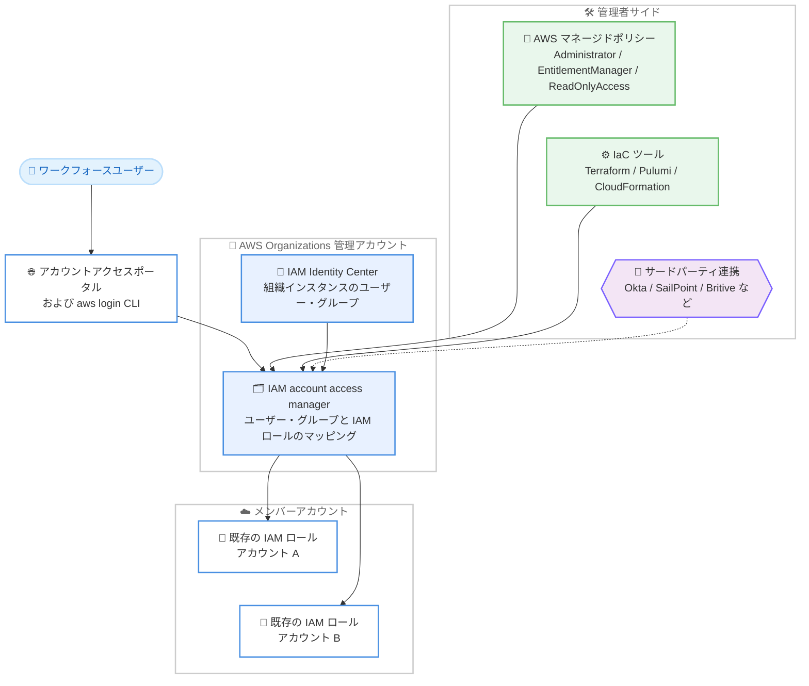

# AWS IAM - account access manager の導入・運用が容易に

**リリース日**: 2026 年 11 月 18 日
**サービス**: AWS Identity and Access Management (IAM)
**機能**: IAM account access manager のデプロイ・利用簡素化 (マネージドポリシー、IaC 対応、サードパーティ連携)

📊 [このアップデートのインフォグラフィックを見る](https://takech9203.github.io/aws-news-summary/20261118-iam-account-access-manager-easier.html)

## 概要

AWS IAM account access manager の導入と運用がさらに容易になりました。IAM account access manager は、IAM Identity Center の組織インスタンスに同期されたユーザーやグループに対して、各 AWS アカウントの既存の IAM ロールを割り当ててアカウントアクセスを管理できる機能です。今回のアップデートでは、(1) AWS マネージドポリシーによる有効化・管理、(2) Infrastructure as Code (IaC) 構成への組み込み、(3) サードパーティのアイデンティティ管理・エンタイトルメント管理ソリューションとのロール割り当て統合、という 3 つの改善が発表されました。

新たに 3 種類の AWS マネージドポリシーが提供され、管理者、エンタイトルメント管理者、監査担当者といった役割ごとに必要な権限を簡単に付与できるようになりました。また、Terraform、Pulumi、AWS CloudFormation といった IaC ツールで account access manager を管理できるため、既存の自動化パイプラインに組み込んだ大規模な展開が可能です。

さらに、Okta、Ping Identity、Cisco Duo、Apono、BeyondTrust、Britive、Sonrai Security、C1.ai、Lumos、SailPoint といったパートナーソリューションとの統合により、既存のアイデンティティガバナンス製品から AWS アカウントへのロール割り当てを直接管理できます。

**アップデート前の課題**

- account access manager を有効化・管理するには、IAM Identity Center、AWS Organizations、AWS KMS、IAM など複数サービスにまたがる権限を含む IAM ポリシーを手動で組み立てる必要があった
- 役割 (管理者、エンタイトルメント管理者、監査担当者) ごとの最小権限ポリシーを自作・保守する運用負荷があった
- サードパーティのアイデンティティ管理・エンタイトルメント管理ツールとのネイティブなロール割り当て統合が限定的だった

**アップデート後の改善**

- 3 種類の AWS マネージドポリシーを利用するだけで、有効化・管理・監査に必要な権限を付与できるようになった
- Terraform、Pulumi、AWS CloudFormation で account access manager を IaC として管理し、自動化・大規模展開に組み込めるようになった
- Okta、SailPoint などのパートナーソリューションから AWS アカウントへのロール割り当てを直接統合管理できるようになった

## アーキテクチャ図



管理者はマネージドポリシーまたは IaC ツールで account access manager を有効化・管理し、IAM Identity Center のユーザー・グループを各アカウントの既存 IAM ロールにマッピングします。ユーザーはアカウントアクセスポータルや `aws login` コマンド経由で割り当てられたアカウントにアクセスします。

## サービスアップデートの詳細

### 主要機能

1. **AWS マネージドポリシーによる有効化・管理**
   - 新たに 3 種類の AWS マネージドポリシーが提供され、役割ごとの権限付与が容易になった
   - 従来必要だった IAM Identity Center、Organizations、KMS、IAM にまたがるポリシーの手動作成が不要になった
   - 最小権限の原則に沿った権限分離 (管理者 / エンタイトルメント管理者 / 読み取り専用) を標準で実現できる

2. **Infrastructure as Code (IaC) 対応**
   - Terraform、Pulumi、AWS CloudFormation で account access manager の構成を管理できる
   - 既存の IaC パイプラインに組み込むことで、有効化からロール割り当てまでをコードとして再現可能な形で展開できる
   - 大規模なマルチアカウント環境での一貫したデプロイが可能になる

3. **サードパーティソリューションとのロール割り当て統合**
   - Okta、Ping Identity、Cisco Duo、Apono、BeyondTrust、Britive、Sonrai Security、C1.ai、Lumos、SailPoint と統合できる
   - 既存のアイデンティティガバナンス・エンタイトルメント管理ワークフローから AWS アカウントへのロール割り当てを直接管理できる
   - Just-in-Time アクセスやアクセスレビューなど、パートナー製品の機能と組み合わせた運用が可能になる

### account access manager の基本機能 (おさらい)

公式ドキュメントによると、account access manager は以下の特徴を持ちます。

- IAM Identity Center の組織インスタンスのユーザー・グループに対し、各アカウントの**既存の IAM ロール**を割り当ててアクセスを付与する
- IAM Identity Center の許可セット (permission sets) と併用することも、単独で使用することも可能
- IAM ロールのタグ・セッションタグによる属性ベースアクセス制御 (ABAC)、信頼ポリシーによるロール引き受け制限、ロールパスによる論理的なグループ化など、IAM ロールの柔軟性をそのまま活用できる
- ユーザーは専用のアカウントアクセスポータルから割り当てられたアカウントにアクセスでき、ブラウザでのサインイン後に `aws login` コマンドで AWS CLI の認証情報を取得できる
- IAM API とは独立した `account-access` という専用の API 名前空間を持つ

## 技術仕様

### 新しい AWS マネージドポリシー

| マネージドポリシー | 対象者 | 権限内容 |
|------|------|------|
| AWSAccountAccessManagerAdministrator | 組織の管理者 | 組織の管理アカウントでの account access manager の有効化・管理、ユーザー・グループと IAM ロールのマッピングを含むフル管理権限 |
| AWSAccountAccessManagerEntitlementManager | エンタイトルメント管理者 | サービス設定を変更することなく、ユーザーへのアクセス割り当て・削除を行う権限 |
| AWSAccountAccessManagerReadOnlyAccess | 監査担当者・コンプライアンスレビュアー | 設定と割り当て状況を確認できる読み取り専用権限 |

### アクセス管理方式の比較 (公式ドキュメントより)

| 項目 | IAM ロール + account access manager | IAM Identity Center 許可セット | IAM ロール + IAM フェデレーション |
|------|------|------|------|
| 適した用途 | アカウントごとに異なるカスタム IAM ロール | 読み取り専用・管理者など統一的なベースラインの人的アクセス | ワークロード向け |
| スコープ | 複数アカウント (AWS Organizations) | 複数アカウント (AWS Organizations) | アカウント単位 |
| IAM ロールのプロビジョニング | IaC または IAM コンソールで手動 | 自動プロビジョニング | IaC または手動 |
| ロールとアイデンティティのマッピング | account access manager | IAM Identity Center | 外部 IdP |
| エンドユーザー体験 | アカウントアクセスポータル URL からアクセス | AWS アクセスポータルからアクセス | IdP ポータルのアカウント別 SAML アプリからアクセス |

## 設定方法

### 前提条件

1. AWS Organizations の組織が構成されており、管理アカウントにアクセスできること
2. IAM Identity Center の組織インスタンスが有効化されており、ユーザー・グループが同期または作成されていること
3. アクセスを割り当てる対象の IAM ロールが各メンバーアカウントに存在すること

### 手順

#### ステップ 1: 管理者へのマネージドポリシーのアタッチ

```bash
aws iam attach-role-policy \
  --role-name AccountAccessAdminRole \
  --policy-arn arn:aws:iam::aws:policy/AWSAccountAccessManagerAdministrator
```

account access manager の有効化・管理を担当する管理者のロールに、新しいマネージドポリシー `AWSAccountAccessManagerAdministrator` をアタッチします。従来のように複数サービスにまたがるカスタムポリシーを作成する必要はありません。

#### ステップ 2: account access manager の有効化とロール割り当て

組織の管理アカウントで account access manager を有効化し、IAM Identity Center のユーザー・グループと各アカウントの IAM ロールをマッピングします。コンソールのほか、`account-access` API 名前空間を使用した AWS CLI / SDK、または Terraform、Pulumi、CloudFormation などの IaC ツールで構成できます。

#### ステップ 3: エンタイトルメント管理者・監査担当者への権限付与

```bash
# エンタイトルメント管理者 (アクセスの割り当て・削除のみ)
aws iam attach-role-policy \
  --role-name EntitlementManagerRole \
  --policy-arn arn:aws:iam::aws:policy/AWSAccountAccessManagerEntitlementManager

# 監査担当者 (読み取り専用)
aws iam attach-role-policy \
  --role-name AuditorRole \
  --policy-arn arn:aws:iam::aws:policy/AWSAccountAccessManagerReadOnlyAccess
```

日常的なアクセス割り当てを行う担当者と、設定を確認する監査担当者に、それぞれ最小権限のマネージドポリシーを付与します。これにより職務分掌を標準ポリシーだけで実現できます。

## メリット

### ビジネス面

- **導入までの時間短縮**: マネージドポリシーにより権限設計の手間が大幅に削減され、account access manager の導入を迅速に開始できる
- **ガバナンスの強化**: 管理者・エンタイトルメント管理者・監査担当者の職務分掌を AWS 標準のポリシーで実現でき、コンプライアンス対応が容易になる
- **既存投資の活用**: Okta や SailPoint などの既存のアイデンティティガバナンス製品をそのまま活用し、AWS アカウントアクセスを統合管理できる

### 技術面

- **IaC による再現性**: Terraform、Pulumi、CloudFormation で構成をコード化でき、マルチアカウント環境への一貫した展開と変更管理が可能になる
- **ポリシー保守の負荷軽減**: 複数サービスにまたがるカスタムポリシーの作成・保守が不要になり、権限の過不足によるリスクを低減できる
- **既存 IAM ロールの柔軟性維持**: ABAC 用のセッションタグ、信頼ポリシーの条件、ロールパスなど、IAM ロールの機能をそのまま利用できる

## デメリット・制約事項

### 制限事項

- account access manager の利用には IAM Identity Center の組織インスタンスが前提となる (AWS Organizations 環境が必要)
- 割り当て対象の IAM ロールは自動プロビジョニングされないため、IaC またはコンソールで事前に各アカウントへ作成する必要がある
- サードパーティ統合の具体的な機能範囲は各パートナーソリューションの実装に依存する

### 考慮すべき点

- 既に IAM Identity Center の許可セットで統一的なアクセス管理を行っている場合、account access manager との使い分け (カスタムロールは account access manager、ベースラインは許可セット) を設計する必要がある
- 既存のカスタムポリシーで account access manager を運用している場合は、新しいマネージドポリシーへの移行を検討するとポリシー保守が簡素化される

## ユースケース

### ユースケース 1: マルチアカウント環境への IaC による一括展開

**シナリオ**: 数百のメンバーアカウントを持つ企業が、アカウントごとに異なるカスタム IAM ロールへのアクセス管理を標準化したい。

**実装例**:
```
1. 各アカウントのカスタム IAM ロールを Terraform で定義・展開
2. account access manager の有効化とユーザー・グループへのロール割り当てを
   同じ Terraform 構成に組み込み
3. CI/CD パイプラインで変更をレビュー・適用
```

**効果**: アクセス管理の構成がコードとして管理され、レビュー可能かつ再現可能な形でマルチアカウント全体に展開できる。

### ユースケース 2: 職務分掌に基づく運用体制の構築

**シナリオ**: セキュリティチームがサービス設定を管理し、各事業部の担当者が日常のアクセス割り当てを行い、監査部門が定期レビューを実施する体制を作りたい。

**実装例**:
```
- セキュリティチーム: AWSAccountAccessManagerAdministrator
- 事業部の担当者: AWSAccountAccessManagerEntitlementManager
- 監査部門: AWSAccountAccessManagerReadOnlyAccess
```

**効果**: カスタムポリシーを作成することなく、最小権限の原則に沿った職務分掌をマネージドポリシーのみで実現できる。

### ユースケース 3: 既存アイデンティティガバナンス製品との統合

**シナリオ**: SailPoint や Okta でエンタイトルメント管理を一元化している企業が、AWS アカウントへのロール割り当ても同じワークフローで管理したい。

**実装例**:
```
1. パートナーソリューション側で account access manager との統合を設定
2. アクセス申請・承認ワークフローをパートナー製品側で運用
3. 承認されたロール割り当てが account access manager に反映される
```

**効果**: AWS アカウントアクセスの申請・承認・レビューを既存のガバナンスプロセスに統合し、管理の分断を解消できる。

## 料金

account access manager は追加料金なしで利用できます。

## 利用可能リージョン

デフォルトで有効なすべての AWS 商用リージョンで利用可能です。

## 関連サービス・機能

- **AWS IAM Identity Center**: account access manager はその組織インスタンスのユーザー・グループを利用する。許可セットとの併用も可能
- **AWS Organizations**: 組織の管理アカウントで account access manager を有効化・管理する
- **AWS IAM**: 割り当て対象となる既存の IAM ロール (タグ、信頼ポリシー、パスなど) を提供する
- **AWS CloudFormation / Terraform / Pulumi**: account access manager の構成を IaC として管理できる

## 参考リンク

- 📊 [インフォグラフィック](https://takech9203.github.io/aws-news-summary/20261118-iam-account-access-manager-easier.html)
- [公式発表 (What's New)](https://aws.amazon.com/about-aws/whats-new/2026/11/iam-account-access-manager-easier/)
- [ドキュメント: Account access manager (IAM ユーザーガイド)](https://docs.aws.amazon.com/IAM/latest/UserGuide/account-access-manager.html)
- [AWS Blog: Optimize AWS administration with IAM paths](https://aws.amazon.com/blogs/security/optimize-aws-administration-with-iam-paths/) (ロールパス活用の関連記事)

## まとめ

今回のアップデートにより、IAM account access manager はマネージドポリシー、IaC 対応、サードパーティ統合の 3 点で導入・運用のハードルが大きく下がりました。既存の IAM ロールを活用したきめ細かいアカウントアクセス管理を検討している組織は、まず新しいマネージドポリシーを使った小規模な有効化から始め、Terraform や CloudFormation による構成管理へ段階的に拡大することを推奨します。
