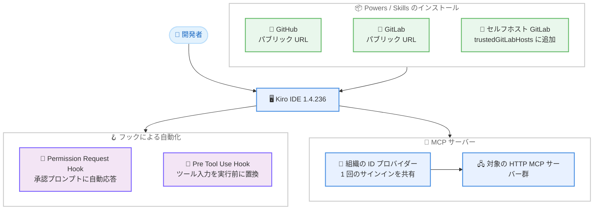

# Kiro - GitLab からのインストール、Permission Request Hook、MCP の組織サインイン (IDE 1.4.236)

**リリース日**: 2026 年 11 月 18 日
**サービス**: Kiro
**機能**: GitLab からの Powers / Skills インストール、Permission Request Hook、MCP サーバーの組織サインイン

📊 [このアップデートのインフォグラフィックを見る](https://takech9203.github.io/aws-news-summary/20261118-kiro-changelog-2026-11-18.html)

## 概要

Kiro IDE 1.4.236 がリリースされ、3 つの主要機能が追加されました。1 つ目は、GitHub と同様に GitLab のパブリック URL を貼り付けるだけで、カスタム Power や Skill をインストールできる機能です。セルフホスト型の GitLab インスタンスにも、`kiroAgent.powers.trustedGitLabHosts` 設定にホストを追加することで対応できます。

2 つ目は、Permission Request Hook です。Kiro がツール呼び出しの承認を求める直前にコマンドを実行し、スクリプトが定型的な承認プロンプトに自動応答できるようになりました。誰も画面を見ていないセッションでも、承認待ちでエージェントが停止することを防げます。あわせて、Pre Tool Use Hook はツール呼び出しの入力を実行前に書き換えられるようになり、承認プロンプトには最終的な引数が表示されます。

3 つ目は、MCP サーバーの組織サインインです。対象となる HTTP MCP サーバーは、サーバーごとに個別にサインインする代わりに、組織の ID プロバイダーを通じた 1 回のサインインを共有できます。このほか、チャットをサイドバーとエディタ領域の間で移動できる機能や、Memories ビューから Memory 設定を選択できる改善も含まれています。

**アップデート前の課題**

- 以前は Power や Skill のインストール元として GitHub の URL しか利用できず、GitLab でホストされたリポジトリからは直接インストールできなかった
- 以前はツール呼び出しの承認プロンプトに人間が応答する必要があり、無人で実行するセッションでは定型的な承認待ちでエージェントが停止していた
- 以前は HTTP MCP サーバーごとに個別のサインインが必要で、多数の社内 MCP サーバーを利用する場合に認証操作が繰り返し発生していた

**アップデート後の改善**

- 今回のアップデートにより、GitLab のパブリック URL の貼り付けでカスタム Power のインストールや Skill のインポートが可能になり、セルフホスト型 GitLab にも設定追加で対応できるようになった
- 今回のアップデートにより、Permission Request Hook のスクリプトが定型的な承認プロンプトに自動応答でき、無人セッションの継続実行が可能になった
- 今回のアップデートにより、Pre Tool Use Hook がツール呼び出しの入力を実行前に置き換えられるようになり、承認プロンプトに最終的な引数が表示されるため、実際に実行される内容を確認したうえで承認できるようになった
- 今回のアップデートにより、対象の HTTP MCP サーバー群に対して組織の ID プロバイダー経由の 1 回のサインインを共有できるようになった

## アーキテクチャ図



Kiro IDE 1.4.236 に追加された 3 つの機能領域を示しています。GitLab を含むインストール元の拡大、フックによる承認とツール入力の自動化、組織の ID プロバイダーを介した MCP サーバーへの一括サインインで構成されます。

## サービスアップデートの詳細

### 主要機能

1. **GitLab からの Powers / Skills インストール**
   - GitHub と同じ操作で、GitLab のパブリック URL を貼り付けてカスタム Power のインストールや Skill のインポートができる
   - セルフホスト型の GitLab インスタンスを利用する場合は、事前に `kiroAgent.powers.trustedGitLabHosts` 設定にそのホストを追加する
   - 社内の資産を GitLab で管理している組織でも、Power / Skill の配布と再利用がしやすくなる

2. **Permission Request Hook によるスクリプト応答**
   - Hook エディタで Permission Request Hook を作成すると、Kiro がツール呼び出しの承認を求める直前にコマンドが実行される
   - スクリプトが定型的なプロンプトに応答できるため、誰も監視していないセッションでも処理を継続できる
   - Pre Tool Use Hook は、ツール呼び出しの入力を実行前に置き換えられるようになった
   - 承認プロンプトには最終的な引数が表示されるため、置換後の実際の実行内容を確認したうえで承認できる

3. **MCP サーバーへの組織サインイン**
   - 対象となる HTTP MCP サーバーは、サーバーごとの個別サインインの代わりに、組織の ID プロバイダーを通じた 1 回のサインインを共有できる
   - 管理者から提供された ID プロバイダー情報をユーザーの MCP 設定に追加し、MCP Servers ビューの「Organization sign-in」行で [Sign in] を選択する
   - 同日リリースの Kiro CLI 3.5.0 でも、V3 セッション向けに同様の組織サインインが提供されている

4. **その他の改善**
   - チャットをサイドバーとエディタ領域の間で移動できるようになった
   - Memories ビューから Memory 設定を選択できるようになった

## 技術仕様

### 各機能の設定箇所

| 機能 | 設定・操作箇所 | 備考 |
|------|----------------|------|
| GitLab からのインストール | パブリック URL の貼り付け | GitHub と同じ操作 |
| セルフホスト GitLab 対応 | `kiroAgent.powers.trustedGitLabHosts` 設定 | ホストの事前追加が必要 |
| Permission Request Hook | Hook エディタ | 承認プロンプトの直前にコマンドを実行 |
| Pre Tool Use Hook の入力置換 | Hook エディタ | 承認プロンプトには最終的な引数を表示 |
| MCP 組織サインイン | ユーザーの MCP 設定 + MCP Servers ビュー | 管理者から提供される ID プロバイダー情報が必要 |

## 設定方法

### 前提条件

1. Kiro IDE 1.4.236 以降にアップデートしていること
2. セルフホスト GitLab を利用する場合は、対象ホストを信頼済みとして設定できること
3. MCP 組織サインインを利用する場合は、管理者から組織の ID プロバイダー情報の提供を受けていること

### 手順

#### ステップ 1: GitLab から Power / Skill をインストールする

インストール画面に GitLab のパブリック URL を貼り付けます。セルフホスト型 GitLab の場合は、先に設定へ以下のようにホストを追加します。

```json
{
  "kiroAgent.powers.trustedGitLabHosts": ["gitlab.example.com"]
}
```

信頼するセルフホスト GitLab のホスト名を設定に追加することで、そのインスタンスの URL からのインストールが可能になります。詳細は [Powers のインストール](https://kiro.dev/docs/powers/installation/) および [Skills のインポート](https://kiro.dev/docs/skills/#importing-skills) を参照してください。

#### ステップ 2: Permission Request Hook を作成する

Hook エディタで Permission Request Hook を作成し、承認プロンプトの直前に実行するコマンドを指定します。スクリプトの応答により、定型的なツール呼び出しの承認を自動化できます。詳細は [Hooks タイプ: Permission Request](https://kiro.dev/docs/hooks/types/#permission-request) を参照してください。

#### ステップ 3: MCP の組織サインインを設定する

管理者から提供された ID プロバイダー情報をユーザーの MCP 設定に追加します。その後、MCP Servers ビューの「Organization sign-in」行で [Sign in] を選択すると、対象のサーバー群に対して 1 回のサインインが共有されます。詳細は [MCP 設定: 組織サインイン](https://kiro.dev/docs/mcp/configuration/#organization-sign-in) を参照してください。

## メリット

### ビジネス面

- **GitLab 利用組織への対応**: 社内資産を GitLab で管理する組織でも Power / Skill を直接配布でき、導入の障壁が下がる
- **無人運用の実現**: 承認プロンプトへのスクリプト応答により、夜間バッチや CI 連携など監視者のいないセッションでもエージェントを継続稼働できる
- **認証運用の簡素化**: 組織の ID プロバイダーによる一括サインインで、多数の社内 MCP サーバー利用時の認証の手間とサポート負荷を削減できる

### 技術面

- **インストール元の統一的な扱い**: GitHub と GitLab を同じ操作で扱え、セルフホスト環境も設定追加のみで利用できる
- **フックの表現力向上**: Pre Tool Use Hook による入力の置換と、最終引数が表示される承認プロンプトの組み合わせで、ツール呼び出しの制御と透明性を両立できる
- **MCP 認証の一元化**: サーバーごとのブラウザサインインフローが不要になり、ID プロバイダーを起点とした一貫した認証が可能になる

## デメリット・制約事項

### 制限事項

- GitLab からのインストールはパブリック URL が対象であり、セルフホスト型インスタンスは `kiroAgent.powers.trustedGitLabHosts` への事前登録が必要
- MCP の組織サインインは対象となる (eligible) HTTP MCP サーバーに限られる
- 組織サインインの利用には、管理者から提供される ID プロバイダー情報が必要

### 考慮すべき点

- Permission Request Hook で承認を自動化する場合、意図しないツール呼び出しまで許可しないよう、スクリプトの応答条件を慎重に設計する必要がある
- Pre Tool Use Hook による入力の置換を利用する場合、承認プロンプトに表示される最終的な引数を確認する運用を徹底することが望ましい
- 信頼する GitLab ホストの追加は、インストール元として許可する範囲を広げる操作であるため、組織のセキュリティポリシーに沿って管理する必要がある

## ユースケース

### ユースケース 1: GitLab で管理する社内 Power の配布

**シナリオ**: 開発標準やコーディング規約を Power としてセルフホスト GitLab で管理している組織が、各開発者の Kiro IDE に配布したい。

**実装例**:
```text
1. kiroAgent.powers.trustedGitLabHosts に社内 GitLab のホストを追加
2. 開発者に Power リポジトリの URL を共有
3. 各開発者が URL を貼り付けて Power をインストール
```

**効果**: GitHub への移行やミラーリングを行わずに、既存の GitLab 資産をそのまま Kiro の Power / Skill として配布できる。

### ユースケース 2: 無人セッションでの承認自動化

**シナリオ**: 長時間実行するリファクタリングタスクを夜間に走らせたいが、定型的なツール呼び出しの承認プロンプトで処理が停止してしまう。

**実装例**:
```text
1. Hook エディタで Permission Request Hook を作成
2. 許可してよいツール呼び出しの条件をスクリプトに実装
3. 条件に一致する承認プロンプトにはスクリプトが自動応答
4. 条件外のプロンプトは従来どおり人間の確認に委ねる
```

**効果**: 監視者のいないセッションでも定型的な承認で停止せず、タスクを最後まで実行できる。

### ユースケース 3: 社内 MCP サーバー群への一括サインイン

**シナリオ**: 社内のナレッジ検索、チケット管理、監視ツールなど複数の HTTP MCP サーバーを利用しており、サーバーごとのサインインが負担になっている。

**実装例**:
```text
1. 管理者が組織の ID プロバイダー情報を開発者に配布
2. 開発者がユーザーの MCP 設定に ID プロバイダーを追加
3. MCP Servers ビューの Organization sign-in 行で [Sign in] を選択
4. 対象のサーバー群が 1 回のサインインを共有
```

**効果**: サーバーごとのブラウザ認証フローが不要になり、複数の社内 MCP サーバーをすぐに利用開始できる。

## 利用可能リージョン

Kiro はグローバルに利用可能です。

## 関連サービス・機能

- **Kiro Powers / Skills**: 今回 GitLab がインストール元として追加された拡張機構
- **Kiro Hooks**: Permission Request Hook が新タイプとして追加され、Pre Tool Use Hook が入力置換に対応
- **MCP (Model Context Protocol)**: 組織サインインの対象となる HTTP MCP サーバーの接続プロトコル
- **Kiro CLI 3.5.0**: 同日リリースされ、V3 セッション向けに MCP の組織サインインとカスタムログインポータルを提供

## 参考リンク

- 📊 [インフォグラフィック](https://takech9203.github.io/aws-news-summary/20261118-kiro-changelog-2026-11-18.html)
- [Kiro Changelog: IDE 1.4.236](https://kiro.dev/changelog/ide/1-4-236/)
- [ドキュメント: Powers のインストール](https://kiro.dev/docs/powers/installation/)
- [ドキュメント: Skills のインポート](https://kiro.dev/docs/skills/#importing-skills)
- [ドキュメント: Hooks タイプ Permission Request](https://kiro.dev/docs/hooks/types/#permission-request)
- [ドキュメント: MCP 設定の組織サインイン](https://kiro.dev/docs/mcp/configuration/#organization-sign-in)
- [Kiro Changelog: CLI 3.5.0](https://kiro.dev/changelog/cli/3-5/)

## まとめ

Kiro IDE 1.4.236 では、GitLab からの Power / Skill インストール、承認プロンプトに自動応答する Permission Request Hook、組織の ID プロバイダーによる MCP サーバーへの一括サインインが追加されました。GitLab を利用する組織や、無人セッションでのエージェント運用、多数の社内 MCP サーバーを扱う環境において実用性の高いアップデートです。まずは IDE を 1.4.236 以降へ更新し、自組織のワークフローに合わせてフックと MCP 設定を見直すことを推奨します。
