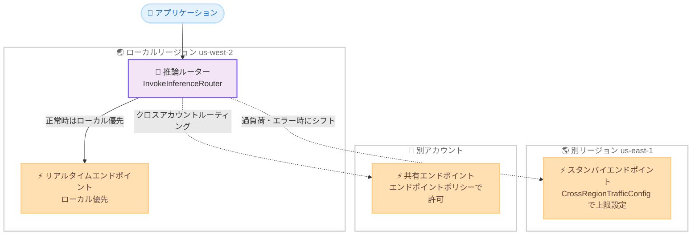

# Amazon SageMaker AI - クロスリージョン推論ルーティング

**リリース日**: 2026 年 11 月 18 日
**サービス**: Amazon SageMaker AI
**機能**: クロスリージョン推論ルーティング (Cross-Region Inference Routing)

📊 [このアップデートのインフォグラフィックを見る](https://takech9203.github.io/aws-news-summary/20261118-sagemaker-cross-region-routing.html)

## 概要

Amazon SageMaker AI がクロスリージョン推論ルーティングをサポートしました。推論ルーター (Inference Router) という新しいリージョナルリソースを作成し、複数のリージョンやアカウントにデプロイした既存のリアルタイムエンドポイント、非同期エンドポイント、推論コンポーネントを登録すると、アプリケーションは単一の API を呼び出すだけで、正常かつキャパシティに余裕がある宛先にリクエストが自動的にルーティングされます。

このアップデートは、GPU などのアクセラレーテッドインスタンスが単一リージョンでキャパシティ上限に達した場合でも、推論アプリケーションの可用性を維持することを目的としています。ルーターは自身のリージョンのエンドポイントを優先し、エラーやスロットリングが増加すると他リージョンの正常な宛先へ段階的にトラフィックを移動し、ローカルエンドポイントが回復すると段階的に戻します。既存のエンドポイント、モデル、コンテナへの変更は不要です。

**アップデート前の課題**

このアップデート以前は、複数リージョンでの推論の可用性確保をユーザー自身で実装する必要がありました。

- 単一リージョンでアクセラレーテッドインスタンスがキャパシティ不足になると、推論リクエストがスロットリングされ、アプリケーションの可用性が低下していた
- 複数リージョンにモデルをデプロイしても、リージョン選択、ヘルスチェック、リトライロジックを独自に構築・運用する必要があった
- 別アカウントが保有するエンドポイントのキャパシティを安全に共有する標準的な仕組みがなかった

**アップデート後の改善**

- 推論ルーターを作成して既存エンドポイントを登録するだけで、単一の API によるマルチリージョン・マルチアカウントのルーティングが利用可能になった
- エラーやスロットリングの増加に応じたトラフィックの自動シフトと、回復後の自動復帰が実現され、独自のフェイルオーバー実装が不要になった
- エンドポイントポリシーと `CrossRegionTrafficConfig` により、エンドポイント所有者がアクセス許可とローカルキャパシティの確保を制御できるようになった

## アーキテクチャ図



アプリケーションは推論ルーターの単一 API を呼び出すだけで、ルーターがローカルリージョンのエンドポイントを優先しつつ、過負荷やエラー発生時には別リージョン・別アカウントの正常なエンドポイントへトラフィックを自動的に振り分けます。

## サービスアップデートの詳細

### 主要機能

1. **推論ルーターによる単一 API での複数宛先ルーティング**
   - ルーターに 1 つ以上のルーティングターゲット (モデル単位) を追加し、各ターゲットに宛先 (エンドポイントまたは推論コンポーネント) を登録する
   - 宛先は同一パーティション内の任意のリージョン、同一アカウントまたは別アカウントのリソースを指定可能
   - リアルタイム推論は `InvokeInferenceRouter`、非同期推論は `InvokeInferenceRouterAsync` で呼び出す
   - 既存のエンドポイント、モデル、コンテナ、オートスケーリング設定への変更は不要

2. **ヘルスベースの自動トラフィックシフト**
   - 宛先のヘルスは 5xx エラー、スロットリング、タイムアウトの発生状況から測定される (ルーター経由以外のリクエストも含む)
   - ローカル宛先のヘルスが低下すると、低下度合いに応じてトラフィックの一部を他リージョンの正常な宛先へ段階的に移動し、回復すると段階的に戻す
   - モデルが実行されなかった失敗 (スロットリングなど) は別の宛先で 1 回リトライされる
   - 成功している遅いレスポンスや 4xx エラーではトラフィックは移動しない

3. **エンドポイント所有者による制御**
   - エンドポイントポリシーにより、どのクロスアカウントルーターがエンドポイントにアクセスできるかを制御できる
   - エンドポイント設定の `CrossRegionTrafficConfig` により、他リージョンのルーターからのリクエストレートに上限を設定し、ローカルリージョン向けのキャパシティを確保できる
   - 上限は `InService` インスタンス数に応じて自動的に増減する

4. **可観測性**
   - 各リアルタイムレスポンスのヘッダーで、どの宛先がリクエストを処理したか (`X-Amzn-SageMaker-Invoked-Routed-Resource-Arn`) と選択理由 (`X-Amzn-SageMaker-Invoked-Routing-Reason`) を確認できる
   - ルーティング理由は `local-preferred`、`capacity-available`、`failover`、`only-healthy` の 4 種類
   - ルーターは CloudWatch メトリクスを発行し、トラフィック分布や宛先のステータス (`destination.status`) を追跡できる

## 技術仕様

### 推論ルーターの仕様

| 項目 | 詳細 |
|------|------|
| リソースタイプ | リージョナルリソース (`AWS::SageMaker::InferenceRouter`、`AWS::SageMaker::EndpointPolicy`) |
| 対応エンドポイント | リアルタイムエンドポイント、非同期エンドポイント、推論コンポーネント |
| 呼び出し用ランタイム | SageMaker AI Inference Router Runtime (`inferencerouter-runtime.sagemaker.{region}.amazonaws.com`) |
| ルーティングターゲット数 | ルーターあたり最大 20 |
| 宛先数 | ルーティングターゲットあたり最大 10 |
| ルーター数 | アカウント・リージョンあたり 5 (引き上げ申請可能) |
| リアルタイムペイロード | 最大 6 MB |
| モデル応答時間 | リアルタイムはリクエストあたり最大 60 秒 (超える場合は非同期を使用) |
| デフォルト呼び出しレート | `InvokeInferenceRouter`: 10,000 リクエスト/秒、`InvokeInferenceRouterAsync`: 100 リクエスト/秒 |
| 管理ツール | AWS CLI、AWS SDK、AWS CloudFormation (コンソールは非対応) |

### API 変更履歴

| 日付 | サービス | 変更内容 |
|------|----------|----------|
| 2026/11/16 | [Amazon SageMaker Service](https://awsapichanges.com/archive/changes/f1785c-api.sagemaker.html) | 8 new 11 updated api methods - クロスリージョン推論ルーティング、KV Aware ルーティングなどの追加 |
| 2026/11/16 | [Amazon SageMaker Inference Router Runtime](https://awsapichanges.com/archive/changes/f1785c-inferencerouter-runtime.sagemaker.html) | 2 new api methods - `InvokeInferenceRouter` と `InvokeInferenceRouterAsync` の追加 |

### クロスリージョントラフィック上限の設定例

```bash
aws sagemaker create-endpoint-config \
    --endpoint-config-name my-endpoint-config \
    --production-variants file://production-variants.json \
    --cross-region-traffic-config MaxInvocationsPerSecondPerInstance=50,MaxCrossRegionPercentPerEndpoint=25
```

`MaxInvocationsPerSecondPerInstance` は 1 インスタンスが処理できる秒間呼び出し数、`MaxCrossRegionPercentPerEndpoint` はそのうち他リージョンのルーターが使用できる割合です。上記の例では、2 インスタンス稼働時に他リージョンからのリクエストを秒間 25 リクエストに制限します。上限を超えたリクエストは `ThrottlingException` となり、ルーターが別の宛先で 1 回リトライします。

## 設定方法

### 前提条件

1. 同一モデルを複数リージョン (または複数アカウント) の SageMaker AI エンドポイントにデプロイ済みであること
2. ルーティングターゲット内のすべての宛先が、同じモデル・同じリクエスト/レスポンス形式であること
3. ルーターの作成・呼び出しに必要な IAM 権限が付与されていること

### 手順

#### ステップ 1: 推論ルーターの作成

```bash
aws sagemaker create-inference-router \
    --inference-router-name my-router \
    --routing-targets file://routing-targets.json
```

ローカルリージョンに推論ルーターを作成し、ルーティングターゲット (モデルごとの宛先リスト) を登録します。宛先には同一パーティション内の任意のリージョン・アカウントのエンドポイントや推論コンポーネントを指定できます。

#### ステップ 2: ルーター経由での推論リクエスト

```bash
aws sagemaker-inference-router-runtime invoke-inference-router \
    --inference-router-name my-router \
    --routing-target-name my-model \
    --content-type application/json \
    --body fileb://input.json \
    output.json
```

アプリケーションはエンドポイントの代わりにルーターを呼び出します。ルーターがルーティングターゲットの宛先の中から、正常でキャパシティのある宛先を選択してリクエストを転送します。管理は `sagemaker` クライアント、呼び出しは `sagemaker-inference-router-runtime` という別のランタイムサービスを使用する点に注意してください。

#### ステップ 3: ルーティング結果の確認とモニタリング

レスポンスヘッダーの `X-Amzn-SageMaker-Invoked-Routed-Resource-Arn` でどの宛先が処理したか、`X-Amzn-SageMaker-Invoked-Routing-Reason` でルーティング理由を確認します。CloudWatch のルーターメトリクスでトラフィック分布と宛先のヘルス (`destination.status`) を継続的にモニタリングします。

## メリット

### ビジネス面

- **可用性の向上**: 単一リージョンのキャパシティ不足や障害時にも、他リージョンのエンドポイントで推論を継続でき、サービス停止のリスクを低減できる
- **追加料金なし**: クロスリージョン推論ルーティング自体は無料で、既存のエンドポイント料金のみで利用できる
- **キャパシティ共有**: 別アカウントが共有するエンドポイントのキャパシティを活用でき、組織全体での GPU リソースの有効活用が可能になる

### 技術面

- **実装の簡素化**: 独自のリージョン選択、ヘルスチェック、リトライロジックの構築・運用が不要になる
- **既存リソースへの無変更**: エンドポイント、モデル、コンテナ、オートスケーリング設定を変更せずに導入できる
- **きめ細かな制御**: エンドポイントポリシーと `CrossRegionTrafficConfig` により、アクセス許可とローカルキャパシティ確保をエンドポイント所有者側で制御できる

## デメリット・制約事項

### 制限事項

- ルーター自体は単一リージョンで稼働するため、ルーターのリージョンが障害を起こすと、他リージョンの宛先が正常でも呼び出しは失敗する
- レスポンスストリーミングは利用できない
- `TargetVariant`、`TargetModel`、`InferenceComponentName`、ステートフルセッション (`SessionId`) は利用できない
- ルーティングの重み付けやヘルスしきい値のカスタマイズ、ローカルリージョン以外の優先設定はできない
- ランタイムエンドポイントは HTTP/1.1 のみ対応 (AWS SDK・CLI 利用時は影響なし)
- リアルタイムのモデル応答時間は 60 秒固定で、アカウント単位のタイムアウト引き上げは適用されない

### 考慮すべき点

- 個々のリクエストを特定リージョンに制限することはできないため、データレジデンシー要件がある場合は許可されたリージョンの宛先のみを登録する必要がある
- ルーターはキャパシティを追加しないため、スタンバイ側のエンドポイントには移動してくるトラフィックを処理できるキャパシティとオートスケーリング設定が必要
- 成功している遅いレスポンスではトラフィックは移動しないため、スロットリングが始まる前にスケールアウトするようオートスケーリングを設定すべき
- 宛先のモード (リアルタイム/非同期) はルーター作成・更新時のみチェックされるため、エンドポイントのモード変更時はルーティングターゲットの見直しが必要

## ユースケース

### ユースケース 1: GPU キャパシティ不足時のオーバーフロー処理

**シナリオ**: us-west-2 の LLM 推論エンドポイントがトラフィックスパイク時に GPU インスタンスを追加できず、スロットリングが発生している。

**実装例**:
```
1. us-east-1 に同一モデルのスタンバイエンドポイントをデプロイ (最低 1 インスタンス + オートスケーリング)
2. us-west-2 に推論ルーターを作成し、両エンドポイントを宛先として登録
3. アプリケーションの呼び出し先をルーターに変更
```

**効果**: ローカルエンドポイントがスロットリングを返し始めると、超過分のトラフィックが us-east-1 へ自動的に移動し、ユーザーへのエラー応答を回避できる。

### ユースケース 2: 別アカウントとの推論キャパシティ共有

**シナリオ**: 組織内の複数アカウントで同一の基盤モデルを運用しており、アカウント間で GPU キャパシティを融通したい。

**実装例**:
```
1. 共有する側のアカウントでエンドポイントポリシーを設定し、許可するルーターを指定
2. 共有するエンドポイントに CrossRegionTrafficConfig を設定し、自リージョン向けキャパシティを確保
3. 利用する側のアカウントでルーターに共有エンドポイントを宛先として追加
```

**効果**: エンドポイント所有者がアクセス制御と上限を維持したまま、組織全体で GPU リソースを有効活用できる。

### ユースケース 3: 長時間推論の非同期フェイルオーバー

**シナリオ**: 処理に数分かかる非同期推論ジョブを、リージョン障害やキャパシティ不足時にも確実に処理したい。

**実装例**:
```
1. 複数リージョンに非同期エンドポイントをデプロイ (スタンバイはゼロインスタンスまでスケールイン可能)
2. InvokeInferenceRouterAsync でルーター経由のジョブ投入に切り替え
3. MaxTimeInBacklogSeconds をスタンバイのスケールアウト時間より長く設定
```

**効果**: バックログ滞留時間が上限を超えるとジョブが別の宛先へ移動し、コストを抑えつつ非同期処理の完了を担保できる。

## 料金

クロスリージョン推論ルーティング自体に追加料金はありません。リクエストを処理するエンドポイントおよび推論コンポーネントに対して、標準の Amazon SageMaker AI 料金が発生します (ルーター経由か直接呼び出しかを問わない)。宛先が別アカウントの場合、そのエンドポイントの料金は所有アカウントに課金されます。ルーターが発行する CloudWatch メトリクスとそのクエリには、標準の CloudWatch 料金が適用されます。

## 利用可能リージョン

- **リアルタイム推論ルーティング**: 32 の商用 AWS リージョン
- **非同期推論ルーティング**: 25 の AWS リージョン (アジアパシフィック (ニュージーランド、ジャカルタ、ハイデラバード、メルボルン)、欧州 (ミラノ)、イスラエル (テルアビブ)、カナダ西部 (カルガリー) では利用不可)

宛先となるエンドポイントは、ルーターと同一パーティション内であれば、ルーターを作成できないリージョンにも配置できます。最新のリージョン一覧は [SageMaker AI endpoints and quotas](https://docs.aws.amazon.com/general/latest/gr/sagemaker.html) を参照してください。

## 関連サービス・機能

- **Amazon SageMaker AI リアルタイム推論 / 非同期推論**: ルーティングの宛先となる推論基盤。オートスケーリング設定がフェイルオーバー時のキャパシティ確保に重要
- **Amazon CloudWatch**: ルーターメトリクスによるトラフィック分布と宛先ヘルスのモニタリング
- **AWS CloudFormation**: `AWS::SageMaker::InferenceRouter` と `AWS::SageMaker::EndpointPolicy` リソースタイプによる IaC 管理
- **AWS PrivateLink**: インターフェイス VPC エンドポイント経由で、インターネットを経由せずにルーターを呼び出し可能
- **Amazon Bedrock クロスリージョン推論**: Bedrock の基盤モデル向けに同様の概念を提供する機能。SageMaker AI 版は自己ホスト型モデルのエンドポイントに適用される点が異なる

## 参考リンク

- 📊 [インフォグラフィック](https://takech9203.github.io/aws-news-summary/20261118-sagemaker-cross-region-routing.html)
- [公式発表 (What's New)](https://aws.amazon.com/about-aws/whats-new/2026/11/sagemaker-cross-region-routing/)
- [ドキュメント: Route requests across AWS Regions with cross-Region inference routing](https://docs.aws.amazon.com/sagemaker/latest/dg/inference-router.html)
- [Amazon SageMaker AI Deploy](https://aws.amazon.com/sagemaker/ai/deploy/)
- [料金ページ](https://aws.amazon.com/sagemaker/pricing/)

## まとめ

クロスリージョン推論ルーティングにより、SageMaker AI の推論アプリケーションは単一リージョンの GPU キャパシティ不足や障害の影響を受けにくくなり、独自のフェイルオーバー実装が不要になります。追加料金なしで既存エンドポイントに変更を加えずに導入できるため、アクセラレーテッドインスタンスで本番推論を運用しているチームは、スタンバイリージョンのキャパシティ計画とあわせて導入を検討することを推奨します。
