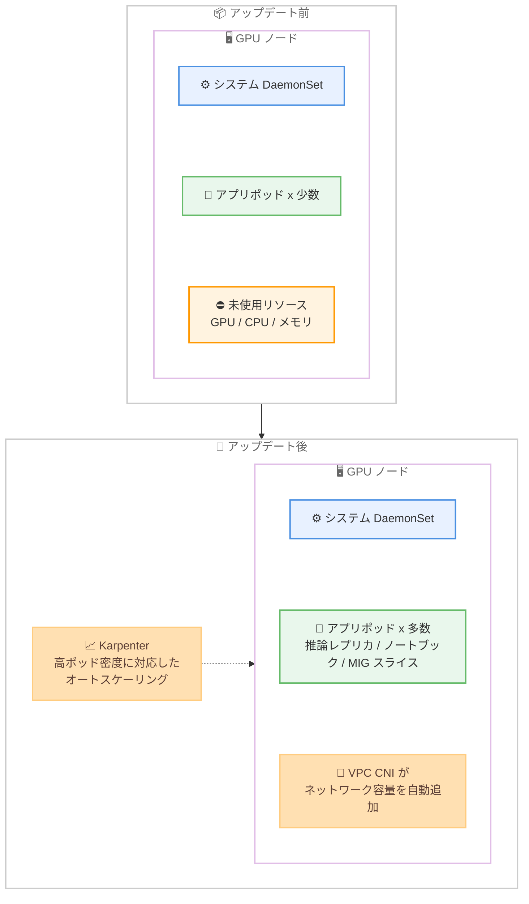

# Amazon SageMaker HyperPod - EKS オーケストレーションクラスターでの高ポッド密度サポート

**リリース日**: 2026 年 11 月 18 日
**サービス**: Amazon SageMaker HyperPod
**機能**: EKS オーケストレーションクラスターにおけるノードあたりのポッド密度向上

📊 [このアップデートのインフォグラフィックを見る](https://takech9203.github.io/aws-news-summary/20261118-sagemaker-hyperpod-higher-pod-density.html)

## 概要

Amazon SageMaker HyperPod が、EKS オーケストレーションクラスターにおいてノードあたりのポッド密度向上をサポートしました。これにより、各インスタンスをより有効に活用できるようになります。モニタリング、ロギング、セキュリティ用のシステム DaemonSet と並行して、アプリケーション用のポッドをより多く配置する余地が生まれ、ノードの GPU、CPU、メモリの使用率を高めることで、同じワークロードをより少ないインスタンス数で実行できます。

ポッドのスケジュール数が増えると、Amazon VPC CNI が自動的にノードへネットワークキャパシティを追加します。また、Karpenter によるオートスケーリングも高いポッドキャパシティに対応しており、クラスターのスケールアウト時に新しいノードがより多くのポッドを受け入れられます。

このアップデートは、大規模な基盤モデルのトレーニングや推論に SageMaker HyperPod の EKS オーケストレーションクラスターを利用しているユーザー、特に 1 つの GPU インスタンス上で複数のモデルレプリカやノートブック環境を稼働させたいユーザーに有用です。

**アップデート前の課題**

- ノードあたりに配置できるポッド数の上限により、GPU や CPU、メモリにまだ余裕があってもポッドを追加配置できなかった
- モニタリングやロギングなどのシステム DaemonSet がポッド数の枠を消費し、アプリケーション用に使える枠が圧迫されていた
- Multi-Instance GPU (MIG) でインスタンスの GPU を多数のスライスに分割しても、ポッド数上限によりすべてのスライスを個別のポッドで活用できない場合があった
- 同じ量のワークロードを処理するために、より多くのインスタンスが必要だった

**アップデート後の改善**

- ノードあたりのポッド密度が向上し、各インスタンスの GPU、CPU、メモリの使用率を高められるようになった
- ポッド数の増加に応じて Amazon VPC CNI が自動的にノードへネットワークキャパシティを追加するようになった
- Karpenter オートスケーリングが高ポッドキャパシティに対応し、スケールアウト時に新しいノードがより多くのポッドを処理できるようになった
- 同じワークロードをより少ないインスタンス数で実行でき、コスト効率が改善された

## アーキテクチャ図



アップデート前はポッド数上限によりノードのリソースを使い切れませんでしたが、アップデート後はより多くのポッドを配置でき、VPC CNI によるネットワーク容量の自動追加と Karpenter のオートスケーリングがこれを支えます。

## サービスアップデートの詳細

### 主要機能

1. **ノードあたりのポッド密度向上**
   - EKS オーケストレーションの HyperPod クラスターで、各ノードにより多くのポッドをスケジュールできる
   - モニタリング、ロギング、セキュリティ用のシステム DaemonSet と共存しながら、アプリケーション用のポッド枠を確保できる
   - ノードの GPU、CPU、メモリの使用率が向上し、同じワークロードをより少ないインスタンスで実行できる

2. **Amazon VPC CNI によるネットワーク容量の自動追加**
   - ポッドのスケジュール数が増えると、Amazon VPC CNI が自動的にノードへネットワークキャパシティを追加する
   - ユーザーが手動でネットワークインターフェイスを管理する必要がない

3. **Karpenter オートスケーリングとの連携**
   - Karpenter によるオートスケーリングが高ポッドキャパシティに対応
   - クラスターのスケールアウト時に、新しく起動するノードもより多くのポッドを受け入れられる

### 高ポッド密度の恩恵を受けるワークロード例

| ワークロード | 内容 |
|------|------|
| モデル推論 | 各 GPU インスタンスからより多くのモデルレプリカ、またはより多くのモデルを提供できる。ml.g5 や ml.g6 などの小規模なインスタンスタイプでも有効 |
| インタラクティブ開発 | ノートブック、IDE、データサイエンス環境を各ノードにより多くホストできる |
| GPU パーティショニング | ml.p5en.48xlarge などのインスタンスで、Multi-Instance GPU (MIG) のすべてのスライスを活用でき、各スライスが独自のポッドを実行できる |
| オペレーターとコントローラー | オペレーター、コントローラー、オブザーバビリティエージェントを CPU ノード上でワークロードと並行して実行でき、ワークロードを圧迫しない |

## 技術仕様

### 利用開始に必要な更新

| 項目 | 内容 |
|------|------|
| IAM アクセス許可 | クラスターの IAM アクセス許可の更新が必要 |
| クラスターソフトウェア | HyperPod クラスターソフトウェアの更新が必要 |
| Amazon VPC CNI アドオン | VPC CNI アドオンの更新が必要 |

具体的な手順やバージョン要件は、[公式ドキュメント](https://docs.aws.amazon.com/sagemaker/latest/dg/sagemaker-hyperpod-eks-dynamic-eni-attachment.html)を参照してください。

### API 変更履歴

本アップデートに直接関連する API 変更は確認されていません。既存クラスターの IAM アクセス許可、クラスターソフトウェア、VPC CNI アドオンの更新により利用できます。

## 設定方法

### 前提条件

1. SageMaker HyperPod の EKS オーケストレーションクラスターが作成済みであること
2. クラスターの IAM ロールを更新できる権限があること
3. クラスターソフトウェアおよび EKS アドオンを更新できる権限があること

### 手順

#### ステップ 1: IAM アクセス許可の更新

クラスターが使用する IAM ロールに、公式ドキュメントで案内されている必要なアクセス許可を追加します。VPC CNI がネットワークキャパシティを動的に追加するために必要です。

#### ステップ 2: クラスターソフトウェアの更新

HyperPod クラスターのソフトウェアを最新バージョンに更新します。クラスターソフトウェアの更新手順は HyperPod のドキュメントに従ってください。

#### ステップ 3: Amazon VPC CNI アドオンの更新

EKS クラスターの Amazon VPC CNI アドオンを、本機能に対応したバージョンへ更新します。更新後、ポッドのスケジュール数の増加に応じてネットワークキャパシティが自動的に追加されます。

具体的なコマンドや対応バージョンなどの詳細は、[公式ドキュメント](https://docs.aws.amazon.com/sagemaker/latest/dg/sagemaker-hyperpod-eks-dynamic-eni-attachment.html)で確認してください。

## メリット

### ビジネス面

- **コスト削減**: 同じワークロードをより少ないインスタンス数で実行できるため、インフラコストを削減できる
- **リソース投資の最大化**: 高価な GPU インスタンスの使用率を高め、投資対効果を向上できる
- **開発環境の集約**: ノートブックや IDE などの開発環境を少ないノードに集約し、運用コストを抑えられる

### 技術面

- **リソース使用率の向上**: ノードの GPU、CPU、メモリをより効率的に活用できる
- **運用の自動化**: VPC CNI によるネットワークキャパシティの自動追加により、手動のネットワーク設定が不要
- **スケーラビリティ**: Karpenter オートスケーリングとの連携により、スケールアウト時も高ポッド密度を維持できる
- **MIG の完全活用**: GPU を分割する MIG のすべてのスライスをそれぞれ独立したポッドで利用できる

## デメリット・制約事項

### 制限事項

- EKS オーケストレーションの HyperPod クラスターが対象であり、Slurm オーケストレーションのクラスターは対象外
- 利用には IAM アクセス許可、クラスターソフトウェア、VPC CNI アドオンの更新が必要

### 考慮すべき点

- 既存クラスターでは、クラスターソフトウェアとアドオンの更新作業の計画が必要
- ポッド密度を高めた場合、1 ノードの障害が影響するポッド数も増えるため、可用性設計を考慮する必要がある
- ノードあたりのポッド数が増えると、DaemonSet やノードエージェントへの負荷も増加する可能性があるため、リソース要求と制限の設定を見直すことが望ましい

## ユースケース

### ユースケース 1: 小規模 GPU インスタンスでのマルチモデル推論

**シナリオ**: ml.g5 や ml.g6 などの小規模な GPU インスタンスで、複数のモデルレプリカや複数の異なるモデルを提供したい。

**実装例**:
```yaml
# 推論用 Deployment のレプリカ数を増やし、1 ノードに複数レプリカを配置
apiVersion: apps/v1
kind: Deployment
metadata:
  name: model-inference
spec:
  replicas: 8
  template:
    spec:
      containers:
        - name: inference
          resources:
            requests:
              cpu: "2"
              memory: 8Gi
```

**効果**: 各 GPU インスタンスからより多くのモデルレプリカを提供でき、推論基盤のインスタンス数を削減できる。

### ユースケース 2: MIG による GPU パーティショニングの完全活用

**シナリオ**: ml.p5en.48xlarge で Multi-Instance GPU (MIG) により GPU を多数のスライスに分割し、各スライスで独立したワークロードを実行したい。

**実装例**:
```yaml
# MIG スライスを要求するポッド定義の例
resources:
  limits:
    nvidia.com/mig-1g.10gb: 1
```

**効果**: ポッド数上限に妨げられることなく、すべての MIG スライスをそれぞれ独自のポッドで活用でき、GPU リソースを余すことなく利用できる。

### ユースケース 3: データサイエンスチームの開発環境集約

**シナリオ**: 多数のデータサイエンティストが利用するノートブックや IDE 環境を、少ないノードに集約してホストしたい。

**実装例**:
```yaml
# ノートブック環境ポッドのリソース要求を適切に設定して高密度に配置
resources:
  requests:
    cpu: "1"
    memory: 4Gi
```

**効果**: 各ノードにより多くの開発環境をホストでき、チーム全体のインフラコストを削減しながら開発者の環境を迅速に提供できる。

## 料金

本機能自体に追加料金はありません。SageMaker HyperPod の利用料金は、クラスターを構成するインスタンスの稼働時間に基づいて課金されます。ポッド密度の向上により同じワークロードを少ないインスタンスで実行できるため、結果としてコスト削減が期待できます。詳細は [Amazon SageMaker の料金ページ](https://aws.amazon.com/sagemaker/pricing/)を参照してください。

## 利用可能リージョン

SageMaker HyperPod が利用可能なすべての AWS リージョンで、EKS オーケストレーションクラスター向けに利用できます。

- アジアパシフィック: ハイデラバード、ジャカルタ、メルボルン、ムンバイ、ソウル、シンガポール、シドニー、東京
- カナダ: 中部
- 欧州: フランクフルト、アイルランド、ロンドン、ストックホルム
- 米国: バージニア北部、オハイオ、オレゴン、北カリフォルニア
- 南米: サンパウロ

## 関連サービス・機能

- **Amazon EKS**: HyperPod クラスターのオーケストレーションレイヤー。本機能は EKS オーケストレーションクラスターが対象
- **Amazon VPC CNI**: ポッド数の増加に応じてノードのネットワークキャパシティを自動的に追加するネットワークプラグイン
- **Karpenter**: 高ポッド密度に対応したオートスケーリングを提供する Kubernetes ノードオートスケーラー
- **NVIDIA Multi-Instance GPU (MIG)**: GPU を複数のスライスに分割する技術。本機能によりすべてのスライスを個別のポッドで活用可能

## 参考リンク

- 📊 [インフォグラフィック](https://takech9203.github.io/aws-news-summary/20261118-sagemaker-hyperpod-higher-pod-density.html)
- [公式発表 (What's New)](https://aws.amazon.com/about-aws/whats-new/2026/11/sagemaker-hyperpod-higher-pod-density/)
- [ドキュメント](https://docs.aws.amazon.com/sagemaker/latest/dg/sagemaker-hyperpod-eks-dynamic-eni-attachment.html)
- [Amazon SageMaker HyperPod](https://aws.amazon.com/sagemaker/ai/hyperpod/)
- [料金ページ](https://aws.amazon.com/sagemaker/pricing/)

## まとめ

SageMaker HyperPod の EKS オーケストレーションクラスターでノードあたりのポッド密度が向上し、GPU、CPU、メモリの使用率を高めて同じワークロードをより少ないインスタンスで実行できるようになりました。推論のマルチレプリカ配置、MIG スライスの完全活用、開発環境の集約など、幅広いワークロードでコスト効率の改善が期待できます。既存クラスターで利用するには、IAM アクセス許可、クラスターソフトウェア、VPC CNI アドオンの更新を計画することを推奨します。
