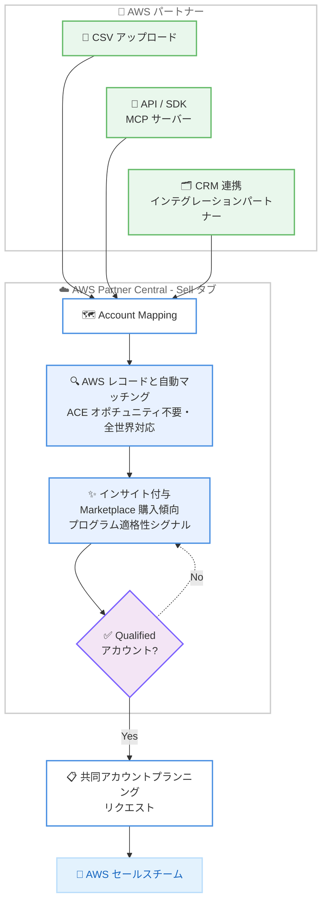

# AWS Partner Central - Account Mapping and Planning

**リリース日**: 2026 年 11 月 20 日
**サービス**: AWS Partner Central
**機能**: Account Mapping and Planning

📊 [このアップデートのインフォグラフィックを見る](https://takech9203.github.io/aws-news-summary/20261120-account-mapping-and-planning.html)

## 概要

AWS Partner Central で Account Mapping and Planning (アカウントマッピングとプランニング) が利用可能になりました。AWS パートナーは、自社のターゲットアカウントリストを AWS のレコードと照合し、ACE (APN Customer Engagements) オポチュニティが存在する前の段階で、AWS との共同 Go-to-Market の協業機会を特定できるようになります。

パートナーは CSV アップロード、API、CRM 連携のいずれかの方法でアカウントリストを登録でき、マッチングは自動的に実行されます。ACE オポチュニティが存在しないアカウントや、あらゆる国のアカウントが照合の対象になります。マッチしたアカウントには、AWS Marketplace の購入傾向インサイト、ソリューションレベルの購入可能性、Partner Greenfield Program や Partner-Led Sales Motion などのプログラム適格性シグナルが付与され、優先度の高いアカウントの絞り込みに活用できます。

さらに、Qualified とマークされたアカウントについては、AWS セールスチームとの共同アカウントプランニングをリクエストできます。本機能は Partner Central コンソールの Sell タブに加え、API / SDK、Partner Central MCP サーバー、CRM 連携を提供するインテグレーションパートナー経由でも利用できます。

**アップデート前の課題**

- 以前はアカウントマッピングをスプレッドシートベースで手作業により行う必要があり、時間と工数がかかっていた
- ACE オポチュニティが存在しないアカウントについて、AWS との協業機会を体系的に特定する手段がなかった
- どのアカウントが AWS Marketplace での購入可能性が高いか、どのプログラムの対象かといった AWS 側のシグナルを参照できず、優先順位付けが困難だった

**アップデート後の改善**

- CSV、API、CRM 連携でアカウントリストをアップロードするだけで、AWS レコードとの照合が自動的に実行されるようになった
- ACE オポチュニティが存在しないアカウントやあらゆる国のアカウントも照合できるようになり、早期段階での協業機会の発見が可能になった
- Marketplace 購入傾向やプログラム適格性などのインサイトに基づき、高い成果が見込めるアカウントを優先できるようになった
- Qualified アカウントに対して AWS セールスとの共同アカウントプランニングをリクエストできるようになった

## アーキテクチャ図



パートナーが CSV、API、CRM 連携のいずれかでターゲットアカウントリストをアップロードすると、AWS レコードとの照合とインサイト付与が自動実行され、Qualified アカウントに対して AWS セールスとの共同アカウントプランニングをリクエストできる流れを示しています。

## サービスアップデートの詳細

### 主要機能

1. **自動アカウントマッチング**
   - ターゲットアカウントリストを CSV アップロード、API、CRM 連携で登録すると、AWS レコードとの照合が自動的に実行される
   - ACE オポチュニティが存在しないアカウントも照合対象となり、協業の初期段階から利用できる
   - あらゆる国のアカウントが照合対象で、グローバルな Go-to-Market 計画に活用できる

2. **インサイトによるアカウントエンリッチメント**
   - マッチしたアカウントに AWS Marketplace の購入傾向インサイトとソリューションレベルの購入可能性が付与される
   - Partner Greenfield Program や Partner-Led Sales Motion などのプログラム適格性シグナルも確認できる
   - 購入可能性が高くプログラム適格性のあるアカウントを優先して、Go-to-Market 活動に集中できる

3. **AWS セールスとの共同アカウントプランニング**
   - Qualified とマークされたアカウントについて、AWS セールスとの共同アカウントプランニングをリクエストできる
   - コンサルティングパートナーは ACE 適格、Premier ティア、AWS Partner Development Manager (PDM) の担当付きであることが条件
   - ISV は ACE 適格、SaaS Co-sell Benefit プログラムへの登録、PDM の担当付きであることが条件

4. **複数のアクセス方法**
   - Partner Central コンソールの Sell タブからの利用に加え、API / SDK によるプログラムからの操作が可能
   - Partner Central MCP サーバー経由で AI エージェントからも利用できる
   - インテグレーションパートナーを通じて、マッチング結果を CRM に連携できる

## 技術仕様

### 利用条件

| 項目 | 詳細 |
|------|------|
| アカウントマッチング・エンリッチメント | すべての ACE 適格パートナーが利用可能 |
| 共同プランニング (コンサルティングパートナー) | ACE 適格、Premier ティア、PDM 担当付き |
| 共同プランニング (ISV) | ACE 適格、SaaS Co-sell Benefit プログラム登録、PDM 担当付き |
| アップロード方法 | CSV、API / SDK、CRM 連携 |
| アクセス方法 | Partner Central コンソール (Sell タブ)、API / SDK、Partner Central MCP サーバー、インテグレーションパートナー |
| 対象アカウント | ACE オポチュニティの有無を問わず、あらゆる国のアカウント |

### API 変更履歴

| 日付 | サービス | 変更内容 |
|------|----------|----------|
| 2026/11/19 | [Partner Central Selling API](https://awsapichanges.com/archive/changes/b8bc94-partnercentral-selling.html) | 18 new 10 updated api methods - Leads API、統計・バルクジョブ付きの顧客アカウント API、SearchOpportunities、アカウントプランニング招待などを追加 |

## 設定方法

### 前提条件

1. AWS Partner Network (APN) に登録済みで、AWS Partner Central へのアクセス権があること
2. ACE 適格パートナーであること (アカウントマッチング・エンリッチメントの利用条件)
3. 共同アカウントプランニングを利用する場合は、前述のパートナー種別ごとの条件を満たすこと

### 手順

#### ステップ 1: Account Mapping ページへのアクセス

AWS Partner Central にサインインし、Sell タブ配下の Account Mapping ページを開きます。

#### ステップ 2: ターゲットアカウントリストのアップロード

CSV ファイルのアップロード、API / SDK、または CRM 連携のいずれかの方法で、ターゲットアカウントリストを登録します。登録後、AWS レコードとの照合が自動的に実行されます。

#### ステップ 3: インサイトの確認と優先順位付け

マッチしたアカウントに付与された AWS Marketplace 購入傾向インサイト、ソリューションレベルの購入可能性、プログラム適格性シグナルを確認し、優先度の高いアカウントを特定します。

#### ステップ 4: 共同アカウントプランニングのリクエスト

Qualified とマークされたアカウントについて、AWS セールスとの共同アカウントプランニングをリクエストします。

## メリット

### ビジネス面

- **協業機会の早期発見**: ACE オポチュニティが存在する前の段階で AWS との共同 Go-to-Market の機会を特定でき、営業パイプラインの早期構築につながる
- **データドリブンな優先順位付け**: Marketplace 購入傾向やプログラム適格性シグナルに基づき、成約可能性の高いアカウントに営業リソースを集中できる
- **AWS セールスとの連携強化**: 共同アカウントプランニングを通じて、AWS セールスチームとの協業体制を体系的に構築できる

### 技術面

- **手作業の排除**: スプレッドシートベースの手動アカウントマッピングが不要になり、照合作業が自動化される
- **柔軟な連携手段**: CSV、API / SDK、MCP サーバー、CRM 連携など、既存の営業ワークフローに合わせた方法で利用できる
- **CRM との統合**: インテグレーションパートナー経由でマッチング結果を CRM に取り込み、既存の営業管理プロセスに組み込める

## デメリット・制約事項

### 制限事項

- アカウントマッチングとエンリッチメントの利用には ACE 適格パートナーであることが必要
- 共同アカウントプランニングのリクエストは Qualified とマークされたアカウントに限定される
- 共同アカウントプランニングには、コンサルティングパートナーは Premier ティアかつ PDM 担当付き、ISV は SaaS Co-sell Benefit プログラム登録かつ PDM 担当付きという条件がある

### 考慮すべき点

- マッチング精度はアップロードするアカウントデータの品質に依存するため、企業名やドメインなどの情報を整備しておくことが望ましい
- CRM 連携を利用する場合は、対応するインテグレーションパートナーのソリューションを確認する必要がある

## ユースケース

### ユースケース 1: ISV による新規ターゲット市場の開拓

**シナリオ**: SaaS を提供する ISV が、新しい業種向けのターゲットアカウントリストを作成し、AWS との共同営業の可能性を評価したい。

**実装例**:
```
1. ターゲットアカウントリストを CSV で Account Mapping ページにアップロード
2. 自動マッチング結果から、Marketplace 購入傾向の高いアカウントを抽出
3. SaaS Co-sell Benefit プログラムの条件を満たしたうえで、
   Qualified アカウントに対して共同アカウントプランニングをリクエスト
```

**効果**: ACE オポチュニティ登録前の早期段階で有望アカウントを特定し、AWS セールスと連携した営業活動を開始できる。

### ユースケース 2: コンサルティングパートナーによる Greenfield アカウントの優先攻略

**シナリオ**: Premier ティアのコンサルティングパートナーが、AWS 利用がまだ少ない Greenfield アカウントを優先的に開拓したい。

**実装例**:
```
1. 自社 CRM のターゲットアカウントを CRM 連携で Account Mapping に登録
2. Partner Greenfield Program の適格性シグナルが付与されたアカウントを抽出
3. PDM と連携し、該当アカウントの共同アカウントプランニングを実施
```

**効果**: プログラム適格性シグナルに基づいて Greenfield アカウントを特定し、AWS のプログラム支援を活用した効率的な開拓が可能になる。

### ユースケース 3: API / MCP サーバーによる営業ワークフローの自動化

**シナリオ**: パートナーの営業オペレーションチームが、アカウントマッピングの結果を定期的に取得し、自社の営業ダッシュボードに反映したい。

**実装例**:
```
1. Partner Central Selling API を使用してアカウントリストをバルク登録
2. マッチング結果とインサイトを API で定期取得し、BI ツールに連携
3. Partner Central MCP サーバー経由で AI エージェントから
   アカウント情報を照会し、営業活動の提案に活用
```

**効果**: 手作業を介さずにマッチング結果を営業ワークフローへ継続的に反映でき、データの鮮度と営業効率が向上する。

## 料金

What's New では本機能に関する追加料金の記載はありません。AWS Partner Central の利用には AWS Partner Network への登録が必要です。アカウントマッチングとエンリッチメントはすべての ACE 適格パートナーが利用できます。

## 利用可能リージョン

AWS Partner Central はグローバルに提供されるパートナー向けポータルであり、アカウントマッチングはあらゆる国のアカウントを対象として利用できます。

## 関連サービス・機能

- **ACE (APN Customer Engagements)**: AWS とパートナーがオポチュニティを共有する共同営業の仕組み。Account Mapping は ACE オポチュニティ登録前の段階を補完する
- **AWS Marketplace**: マッチしたアカウントに付与される購入傾向インサイトの基盤。Marketplace 経由の販売戦略の立案に活用できる
- **Partner Central Selling API**: アカウントの登録・照会やアカウントプランニング招待をプログラムから操作できる API
- **Partner Central MCP サーバー**: AI エージェントから Partner Central の機能にアクセスするためのインターフェース

## 参考リンク

- 📊 [インフォグラフィック](https://takech9203.github.io/aws-news-summary/20261120-account-mapping-and-planning.html)
- [公式発表 (What's New)](https://aws.amazon.com/about-aws/whats-new/2026/11/account-mapping-and-planning/)
- [AWS Partner Central ドキュメント](https://docs.aws.amazon.com/partner-central/latest/getting-started/what-is-partner-central.html)
- [Partner Central Selling API の変更履歴 (awsapichanges.com)](https://awsapichanges.com/archive/changes/b8bc94-partnercentral-selling.html)

## まとめ

Account Mapping and Planning により、AWS パートナーはスプレッドシートによる手動のアカウントマッピングから脱却し、ACE オポチュニティ登録前の早期段階で AWS との協業機会をデータに基づいて特定できるようになりました。ACE 適格パートナーは、まず Sell タブの Account Mapping ページからターゲットアカウントリストをアップロードし、インサイトを活用した優先順位付けと共同アカウントプランニングの活用を検討することを推奨します。
