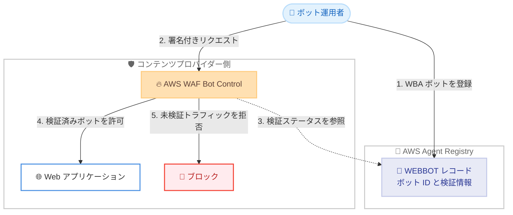

# AWS Agent Registry - WebBotAuth ボット登録サポート

**リリース日**: 2026 年 11 月 20 日
**サービス**: AWS Agent Registry
**機能**: WebBotAuth (WBA) ボットの新しいレコードタイプとしての登録サポート

📊 [このアップデートのインフォグラフィックを見る](https://takech9203.github.io/aws-news-summary/20261120-agent-registry-webbotauth-support.html)

## 概要

AWS Agent Registry が、WebBotAuth (WBA) ボットを新しいレコードタイプとして登録できるようになりました。WebBotAuth は IETF ワーキンググループで標準化が進められているプロトコルで、ボットが暗号学的な署名によって自身の身元とドメイン所有権を証明できるようにします。今回のアップデートにより、標準化されたプロトコルを通じて正当なボットトラフィックを検証することが容易になります。

本機能は AWS WAF Bot Control の検証機能と統合されており、検証ステータスとボット ID を組み合わせた WAF ルールを記述できます。コンテンツプロバイダーやアプリケーション開発者は、どのボットが自社リソースにアクセスできるかをきめ細かく制御できるようになります。たとえば、WBA 検証済みの検索エンジンクローラーを許可しつつ、未検証のトラフィックをブロックするといったポリシーを構築できます。

**アップデート前の課題**

- 検証済みの正当なボットと悪意のあるトラフィックを区別するための標準化された方法がなかった
- ボットの身元確認は User-Agent 文字列や IP アドレスレンジなど、なりすましが容易な情報に依存しがちだった
- ボット運用者側も、自身のボットが正当であることをコンテンツプロバイダーに証明する統一的な手段を持たなかった

**アップデート後の改善**

- WebBotAuth プロトコルを通じて、ボットがドメイン所有権を暗号学的に証明できるようになった
- AWS Agent Registry に WEBBOT レコードタイプとしてボットを登録し、検証情報を一元管理できるようになった
- AWS WAF Bot Control と連携し、検証ステータスとボット ID の両方を使ったカスタムポリシーを記述できるようになった

## アーキテクチャ図



ボット運用者は AWS Agent Registry に WEBBOT レコードとしてボットを登録し、WebBotAuth プロトコルに基づく署名付きリクエストを送信します。AWS WAF Bot Control は検証ステータスとボット ID を評価し、検証済みボットのみを Web アプリケーションに通過させることができます。

## サービスアップデートの詳細

### 主要機能

1. **WEBBOT レコードタイプの追加**
   - AWS Agent Registry に WebBotAuth ボットを新しいレコードタイプとして登録可能
   - ボットは WebBotAuth プロトコルを通じてドメイン所有権を証明
   - WebBotAuth は IETF ワーキンググループで標準化が進行中のプロトコル

2. **AWS WAF Bot Control との検証統合**
   - 検証ステータスとボット ID を組み合わせた WAF ルールを記述可能
   - WBA 検証済みの検索エンジンクローラーを許可し、未検証トラフィックをブロックするといった制御が可能
   - ボット ID と検証ステータスの両方を使用したカスタムポリシーの構築に対応

3. **きめ細かなアクセス制御**
   - コンテンツプロバイダーとアプリケーション開発者が、どのボットにリソースへのアクセスを許可するかを細かく制御可能
   - 正当なボットと悪意のあるアクターを区別し、トラフィック管理を改善

## 技術仕様

### WebBotAuth の概要

| 項目 | 詳細 |
|------|------|
| プロトコル | WebBotAuth (WBA) - IETF ワーキンググループで標準化中 |
| 証明方法 | ボットによるドメイン所有権の証明 |
| レコードタイプ | WEBBOT (AWS Agent Registry の新レコードタイプ) |
| 連携サービス | AWS WAF Bot Control |

### API変更履歴

| 日付 | サービス | 変更内容 |
|------|----------|----------|
| 2026/11/20 | [agent-registry-control](https://awsapichanges.com/archive/changes/e9d2b3-agent-registry-control.html) | 9 new 7 updated api methods - WEBBOT レジストリレコードタイプのサポートを追加。パブリッシャー管理用の API (CreatePublisher、ValidatePublisher、AssociatePublisher など) を新規追加し、CreateRegistryRecord、UpdateRegistryRecord などを更新 |
| 2026/11/20 | [agent-registry](https://awsapichanges.com/archive/changes/e9d2b3-agent-registry.html) | 3 updated api methods - WEBBOT レジストリレコードタイプのサポートを追加。BatchGetDiscoverableRegistryRecord、ListDiscoverableRegistryRecords、SearchDiscoverableRegistryRecords を更新 |

## 設定方法

### 前提条件

1. AWS Agent Registry が利用可能なリージョンで AWS アカウントを保有していること
2. 登録するボットが WebBotAuth プロトコルに対応し、ドメイン所有権を証明できること
3. アクセス制御に利用する場合は、AWS WAF Bot Control が有効化されていること

### 手順

#### ステップ1: ボット運用者のパブリッシャー登録

CreatePublisher および ValidatePublisher API を使用して、ボット運用者をパブリッシャーとして登録し、ドメイン所有権を検証します。これにより、登録されるボットの発行元が正当であることが保証されます。

#### ステップ2: WEBBOT レコードの作成

CreateRegistryRecord API で、レコードタイプに WEBBOT を指定してボットを AWS Agent Registry に登録します。登録されたレコードには、ボットの ID と検証に必要な情報が含まれます。

#### ステップ3: AWS WAF Bot Control でのルール設定

AWS WAF Bot Control のルールで、WBA の検証ステータスとボット ID を条件として指定します。たとえば、検証済みの検索エンジンクローラーのみを許可し、未検証のボットトラフィックをブロックするルールを構成します。

## メリット

### ビジネス面

- **正当なボットの保護**: 検索エンジンクローラーや監視ボットなど、ビジネスに必要なボットトラフィックを誤ってブロックするリスクを低減
- **不正トラフィックの削減**: なりすましボットや悪意のあるスクレイピングを標準化された方法で排除し、インフラコストとセキュリティリスクを削減
- **エコシステムの信頼性向上**: AI エージェントやボットが増加する中で、検証可能な身元情報に基づいた信頼関係を構築可能

### 技術面

- **標準プロトコルへの準拠**: IETF で標準化が進む WebBotAuth に準拠するため、特定ベンダーに依存しない検証が可能
- **暗号学的な検証**: User-Agent や IP アドレスといったなりすまし可能な情報ではなく、ドメイン所有権の証明に基づく検証を実現
- **WAF との統合**: AWS WAF Bot Control のルールで検証ステータスとボット ID を組み合わせた柔軟なポリシー記述が可能

## デメリット・制約事項

### 制限事項

- ボット側が WebBotAuth プロトコルに対応している必要がある
- WebBotAuth は IETF で標準化が進行中のプロトコルであり、今後仕様が変更される可能性がある
- AWS Agent Registry が利用可能なリージョンでのみ使用できる

### 考慮すべき点

- 既存のボット検証の仕組み (IP レンジベースの許可リストなど) からの移行計画が必要
- 検証ステータスのみに依存せず、レートベースルールなど他の WAF 機能と組み合わせた多層防御を検討すべき

## ユースケース

### ユースケース1: 検索エンジンクローラーの選別

**シナリオ**: メディアサイトを運営しており、SEO のために検索エンジンクローラーは許可したいが、クローラーを装ったスクレイピングボットはブロックしたい。

**実装例**:
```
AWS WAF Bot Control ルール:
- 条件: WBA 検証ステータス = 検証済み AND ボットカテゴリ = 検索エンジン
- アクション: 許可
- デフォルト: 未検証のボットシグネチャはブロック
```

**効果**: 正当なクローラーのインデックス作成を妨げることなく、なりすましボットによるコンテンツの不正取得を防止できます。

### ユースケース2: ボット運用者による自社ボットの信頼性確保

**シナリオ**: 価格比較サービスのクローラーを運用しており、クロール先サイトからブロックされることなく、正当なボットであることを証明したい。

**実装例**:
```
1. CreatePublisher でパブリッシャーを登録
2. ValidatePublisher でドメイン所有権を検証
3. CreateRegistryRecord で recordType に WEBBOT を指定してボットを登録
4. ボットのリクエストに WebBotAuth 準拠の署名を付与
```

**効果**: クロール先のコンテンツプロバイダーがボットの身元を検証できるようになり、誤ブロックのリスクが低減します。

### ユースケース3: AI エージェントトラフィックのガバナンス

**シナリオ**: 社内の Web アプリケーションに対して、承認された AI エージェントのみアクセスを許可し、未知のエージェントトラフィックを遮断したい。

**実装例**:
```
AWS WAF Bot Control ルール:
- 条件: WBA 検証ステータス = 検証済み AND ボット ID が承認リストに一致
- アクション: 許可
- その他の自動化トラフィック: ブロックまたはチャレンジ
```

**効果**: AI エージェントの利用が拡大する環境でも、検証可能な ID に基づいたアクセスガバナンスを実現できます。

## 料金

公式発表には本機能に関する料金情報は記載されていません。AWS Agent Registry は Amazon Bedrock AgentCore の一部として提供されるため、最新の料金は Amazon Bedrock AgentCore の料金ページを確認してください。また、AWS WAF Bot Control と組み合わせる場合は、AWS WAF Bot Control の利用料金が別途発生します。

## 利用可能リージョン

AWS Agent Registry が利用可能なすべての AWS リージョンで提供されます。

## 関連サービス・機能

- **AWS WAF Bot Control**: 検証ステータスとボット ID を組み合わせたルールによるボットトラフィック制御を提供
- **Amazon Bedrock AgentCore**: AWS Agent Registry を含む AI エージェント構築・運用のためのプラットフォーム
- **AWS Agent Registry (Agent Discovery)**: 同日に SearchPublicRecords API が追加され、公開されたエージェント、ツール、スキルの検索が可能

## 参考リンク

- 📊 [インフォグラフィック](https://takech9203.github.io/aws-news-summary/20261120-agent-registry-webbotauth-support.html)
- [公式発表 (What's New)](https://aws.amazon.com/about-aws/whats-new/2026/11/agent-registry-webbotauth-support/)
- [AWS Agent Registry ドキュメント](https://docs.aws.amazon.com/bedrock-agentcore/latest/devguide/registry.html)
- [AWS WAF Bot Control ドキュメント](https://docs.aws.amazon.com/waf/latest/developerguide/waf-bot-control.html)
- [WebBotAuth IETF ワーキンググループ](https://datatracker.ietf.org/wg/webbotauth/about/)

## まとめ

AWS Agent Registry の WebBotAuth ボット登録サポートにより、標準化されたプロトコルに基づいて正当なボットと悪意のあるトラフィックを区別できるようになりました。AI エージェントや自動化トラフィックが急増する中、なりすましが容易な従来の識別方法に代わる暗号学的な検証手段として重要なアップデートです。ボットトラフィックの管理に課題を抱えている場合は、AWS WAF Bot Control と組み合わせた検証ベースのアクセス制御の導入を検討することをお勧めします。
