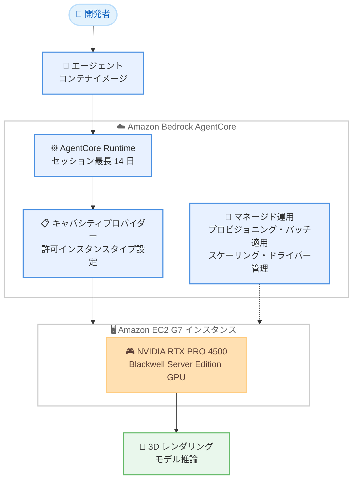

# Amazon Bedrock AgentCore - ランタイムインスタンスの Amazon EC2 G7 インスタンスサポート

**リリース日**: 2026 年 11 月 20 日
**サービス**: Amazon Bedrock AgentCore
**機能**: ランタイムインスタンスにおける Amazon EC2 G7 インスタンスのサポート

📊 [このアップデートのインフォグラフィックを見る](https://takech9203.github.io/aws-news-summary/20261120-agentcore-ec2-g7.html)

## 概要

Amazon Bedrock AgentCore のランタイムインスタンスが、NVIDIA RTX PRO 4500 Blackwell Server Edition GPU を搭載した Amazon EC2 G7 インスタンスをサポートしました。ランタイムインスタンスは、AI エージェントを EC2 上で実行しながら、プロビジョニング、パッチ適用、スケーリング、ライフサイクル管理を AgentCore に任せられる機能です。

今回のアップデートにより、既存の G6e や G7e といった GPU インスタンスファミリーに加えて、G7 がエージェントの実行基盤の選択肢に加わりました。3D レンダリングやモデル推論を実行するエージェントが、最新世代の Blackwell アーキテクチャ GPU を専有して利用できます。キャパシティプロバイダーの許可インスタンスタイプに g7.2xlarge から g7.48xlarge までのインスタンスタイプを追加するだけで利用を開始できます。

**アップデート前の課題**

- 以前は AgentCore ランタイムインスタンスで利用できる GPU ファミリーが G6e や G7e などに限られており、Blackwell 世代の RTX PRO GPU を搭載した G7 は選択できなかった
- GPU ワークロードを EC2 上で自前運用する場合、NVIDIA ドライバーのインストールや更新をコンテナイメージや AMI で管理する必要があった
- 長時間の GPU 処理を行うエージェントのために、インスタンスのライフサイクル管理を独自に構築する必要があった

**アップデート後の改善**

- キャパシティプロバイダーの許可インスタンスタイプに G7 (g7.2xlarge から g7.48xlarge) を追加するだけで、Blackwell 世代 GPU 上でエージェントを実行できるようになった
- NVIDIA ドライバーのインストールは AgentCore が管理するため、標準のコンテナイメージにドライバーを同梱せずに GPU ワークロードを実行できる
- 最長 14 日間のセッションがサポートされ、3D シーンのレンダリングやビジョンモデルの推論など長時間の GPU 処理を専用 GPU 上で継続できる

## アーキテクチャ図



AgentCore がキャパシティプロバイダーの設定に基づいて EC2 G7 インスタンスをプロビジョニングし、NVIDIA ドライバーの管理を含む運用を代行する構成を示しています。

## サービスアップデートの詳細

### 主要機能

1. **EC2 G7 インスタンスのサポート**
   - NVIDIA RTX PRO 4500 Blackwell Server Edition GPU を搭載した G7 インスタンスをランタイムインスタンスとして利用可能
   - g7.2xlarge から g7.48xlarge までのインスタンスサイズに対応
   - 既存の G6e や G7e などの GPU ファミリーに加わる新たな選択肢

2. **マネージドな GPU 環境**
   - NVIDIA ドライバーのインストールを AgentCore が管理
   - 標準のコンテナイメージにドライバーを同梱することなく GPU ワークロードを実行可能
   - プロビジョニング、パッチ適用、スケーリング、ライフサイクル管理も AgentCore が代行

3. **長時間セッションのサポート**
   - 最長 14 日間のセッションをサポート
   - 3D シーンのレンダリングやビジョンモデルの実行など、長時間の GPU 処理を専用 GPU 上で継続可能

## 技術仕様

### G7 インスタンスサポートの概要

| 項目 | 詳細 |
|------|------|
| GPU | NVIDIA RTX PRO 4500 Blackwell Server Edition |
| 対応インスタンスサイズ | g7.2xlarge ～ g7.48xlarge |
| 設定方法 | キャパシティプロバイダーの許可インスタンスタイプに追加 |
| ドライバー管理 | AgentCore が NVIDIA ドライバーのインストールを管理 |
| セッション時間 | 最長 14 日間 |
| 主な用途 | 3D レンダリング、モデル推論 |

## 設定方法

### 前提条件

1. Amazon Bedrock AgentCore Runtime が利用可能なリージョンであること
2. ランタイムインスタンス用のキャパシティプロバイダーが作成済み、または作成可能であること
3. 対象リージョンで EC2 G7 インスタンスが利用可能であること

### 手順

#### ステップ1: キャパシティプロバイダーに G7 インスタンスタイプを追加

```bash
aws bedrock-agentcore-control update-capacity-provider \
  --capacity-provider-id <capacity-provider-id> \
  --instance-configuration '{"allowedInstanceTypes": ["g7.2xlarge", "g7.4xlarge"]}'
```

キャパシティプロバイダーの許可インスタンスタイプに G7 インスタンスタイプを追加します。ワークロードの要件に応じて g7.2xlarge から g7.48xlarge までのサイズを指定できます。

#### ステップ2: エージェントをデプロイして GPU を利用

```bash
aws bedrock-agentcore-control create-agent-runtime \
  --agent-runtime-name my-gpu-agent \
  --agent-runtime-artifact '{"containerConfiguration": {"containerUri": "<ECR イメージ URI>"}}' \
  --role-arn <IAM ロール ARN>
```

標準のコンテナイメージをそのままデプロイします。NVIDIA ドライバーは AgentCore が管理するため、イメージにドライバーを同梱する必要はありません。

#### ステップ3: セッションを実行して動作を確認

エージェントのセッションを開始し、GPU を利用する処理 (3D レンダリングやモデル推論など) が正常に動作することを確認します。セッションは最長 14 日間継続できます。

## メリット

### ビジネス面

- **最新 GPU への迅速なアクセス**: Blackwell 世代の RTX PRO GPU をインフラ構築なしでエージェントワークロードに利用できる
- **運用コストの削減**: プロビジョニング、パッチ適用、スケーリングを AgentCore に任せることで、GPU インフラの運用負荷を軽減できる
- **従量課金**: プロビジョニングされたコンピュートの管理料金と EC2 料金の組み合わせで、必要な分だけ支払う

### 技術面

- **ドライバー管理の不要化**: NVIDIA ドライバーのインストールを AgentCore が管理するため、標準のコンテナイメージをそのまま利用できる
- **幅広いサイズ選択**: g7.2xlarge から g7.48xlarge まで、ワークロードの規模に応じたインスタンスサイズを選択できる
- **長時間処理への対応**: 最長 14 日間のセッションにより、長時間のレンダリングや推論ジョブを中断なく実行できる

## デメリット・制約事項

### 制限事項

- 利用可能なリージョンは 8 リージョンに限定される (下記「利用可能リージョン」を参照)
- セッションの最長時間は 14 日間
- G7 インスタンスの在庫状況はリージョンやアベイラビリティーゾーンによって異なる可能性がある

### 考慮すべき点

- AgentCore の管理料金に加えて EC2 の料金が発生するため、GPU インスタンスの稼働コストを事前に見積もる必要がある
- ワークロードに最新の Blackwell GPU が必要かどうかを評価し、既存の G6e や G7e との費用対効果を比較することが望ましい

## ユースケース

### ユースケース1: 3D シーンレンダリングエージェント

**シナリオ**: 設計データから 3D シーンを生成しレンダリングするエージェントを、長時間にわたり安定して実行したい。

**実装例**:
```
キャパシティプロバイダーに g7.8xlarge を追加し、
レンダリングエージェントのコンテナをデプロイ。
セッションを継続してレンダリングジョブを順次処理。
```

**効果**: Blackwell GPU によるレンダリング性能を活用しつつ、インスタンス運用を AgentCore に任せられる。

### ユースケース2: ビジョンモデルによる画像・映像解析

**シナリオ**: エージェントがビジョンモデルを専用 GPU 上でホストし、大量の画像や映像を解析する。

**実装例**:
```
g7.4xlarge を許可インスタンスタイプに設定し、
ビジョンモデルを含むコンテナイメージをデプロイ。
最長 14 日間のセッションで解析パイプラインを実行。
```

**効果**: モデルのロード済み状態を維持したまま長時間の解析を継続でき、推論レイテンシーを安定させられる。

### ユースケース3: GPU 推論を伴うエージェントワークフロー

**シナリオ**: 自律型エージェントがローカル推論と外部 API 呼び出しを組み合わせた長時間ワークフローを実行する。

**実装例**:
```
標準のコンテナイメージ (ドライバー同梱不要) を用意し、
AgentCore Runtime にデプロイ。
推論処理は G7 の GPU、オーケストレーションはエージェントが担当。
```

**効果**: ドライバー管理なしで GPU 推論を組み込め、エージェント開発に集中できる。

## 料金

プロビジョニングされたコンピュートの管理に対する AgentCore の料金に加えて、Amazon EC2 の料金が発生します。詳細は AgentCore の料金ページを参照してください。

## 利用可能リージョン

以下の AWS リージョンで利用可能です。

- 米国東部 (バージニア北部)
- 米国東部 (オハイオ)
- 米国西部 (オレゴン)
- 欧州 (フランクフルト)
- 欧州 (ロンドン)
- 欧州 (ストックホルム)
- アジアパシフィック (ムンバイ)
- アジアパシフィック (シドニー)

## 関連サービス・機能

- **Amazon EC2 G7 インスタンス**: NVIDIA RTX PRO 4500 Blackwell Server Edition GPU を搭載した GPU インスタンスファミリー。今回ランタイムインスタンスの選択肢に追加
- **Amazon Bedrock AgentCore Runtime**: エージェントの実行環境を提供するマネージドランタイム。ランタイムインスタンスにより EC2 上での実行をサポート
- **Amazon ECR**: エージェントのコンテナイメージの保管に使用。ドライバー同梱不要の標準イメージをそのまま利用可能

## 参考リンク

- 📊 [インフォグラフィック](https://takech9203.github.io/aws-news-summary/20261120-agentcore-ec2-g7.html)
- [公式発表 (What's New)](https://aws.amazon.com/about-aws/whats-new/2026/11/agentcore-ec2-g7/)
- [ドキュメント: GPU インスタンスタイプの利用](https://docs.aws.amazon.com/bedrock-agentcore/latest/devguide/runtime-instances-how-it-works.html#runtime-instances-gpu)
- [ドキュメント: ランタイムインスタンス](https://docs.aws.amazon.com/bedrock-agentcore/latest/devguide/runtime-instances.html)
- [料金ページ](https://aws.amazon.com/bedrock/agentcore/pricing/)

## まとめ

Amazon Bedrock AgentCore のランタイムインスタンスが EC2 G7 をサポートしたことで、Blackwell 世代 GPU を使った 3D レンダリングやモデル推論をマネージドな環境で実行できるようになりました。GPU を必要とするエージェントワークロードを運用しているチームは、キャパシティプロバイダーの許可インスタンスタイプに G7 を追加し、既存の GPU ファミリーとの性能・コストを比較検討することを推奨します。
