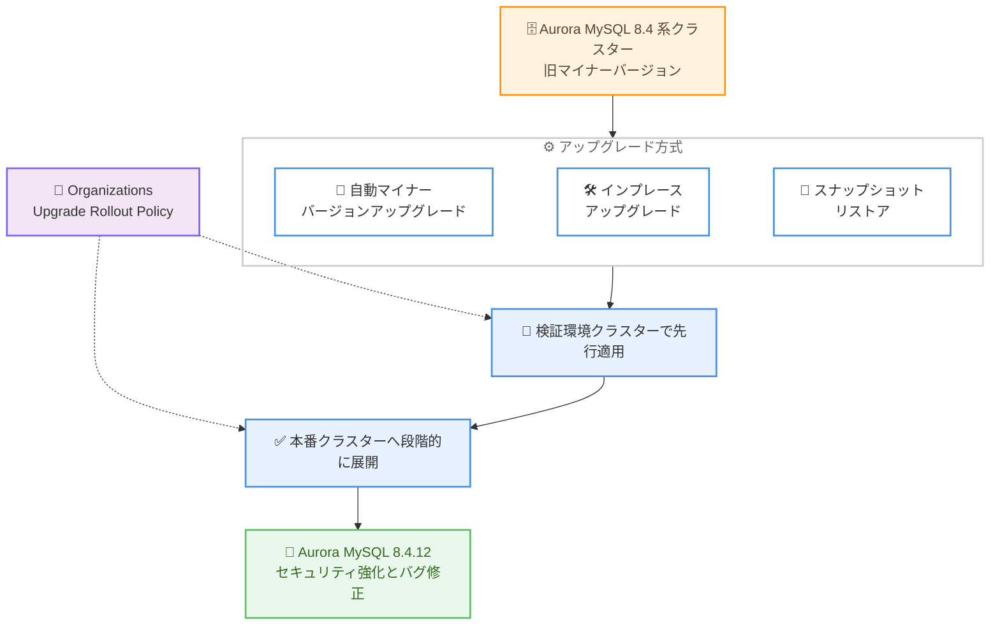

# Amazon Aurora - MySQL 8.4.12 対応の一般提供開始

**リリース日**: 2026 年 11 月 20 日
**サービス**: Amazon Aurora MySQL 互換エディション
**機能**: MySQL 8.4.12 対応 (Aurora MySQL 8.4 系マイナーバージョンアップデート)

📊 [このアップデートのインフォグラフィックを見る](https://takech9203.github.io/aws-news-summary/20261120-amazon-aurora-mysql-8412-available.html)

## 概要

Amazon Aurora MySQL 互換エディションの 8.4 系が、コミュニティ版 MySQL 8.4.12 をサポートしました。本リリースには、複数のセキュリティ強化とバグ修正が含まれています。AWS は、以前の MySQL リリースで発見された CVE (共通脆弱性識別子) への修正、パフォーマンス改善、コミュニティ版 MySQL の新機能を取り込むため、新しいマイナーバージョンへの移行を推奨しています。

このアップデートは、Aurora MySQL 8.4 系を利用しているすべてのユーザーが対象です。アップグレードは、自動マイナーバージョンアップグレードによるメンテナンスウィンドウでの適用のほか、インプレースアップグレードやスナップショットリストアでも実施できます。

**アップデート前の課題**

このアップデート以前は、以下の課題がありました。

- 以前の Aurora MySQL 8.4 系マイナーバージョンには、コミュニティ版 MySQL で発見された CVE に対する修正が取り込まれていなかった
- MySQL 8.4.12 で修正されたバグの影響を受ける可能性があった
- コミュニティ版 MySQL 8.4.12 の修正内容を Aurora 上で利用できなかった

**アップデート後の改善**

今回のアップデートにより、以下が可能になりました。

- セキュリティ強化とバグ修正を含む MySQL 8.4.12 相当の修正を Aurora MySQL で利用できるようになった
- 自動マイナーバージョンアップグレードを有効化することで、メンテナンスウィンドウ中に自動的に最新マイナーバージョンへ更新できる
- AWS Organizations の Upgrade Rollout Policy を利用して、検証環境から本番環境へ段階的にアップグレードを展開できる

## アーキテクチャ図



Aurora MySQL 8.4.12 へのアップグレード方式と、Upgrade Rollout Policy を利用した段階的な展開の流れを示しています。

## サービスアップデートの詳細

### 主要機能

1. **MySQL 8.4.12 相当の修正の取り込み**
   - 複数のセキュリティ強化が含まれる
   - コミュニティ版 MySQL 8.4.12 で修正されたバグへの対応が含まれる
   - 以前のリリースで発見された CVE への修正を取り込める

2. **柔軟なアップグレード方式**
   - 自動マイナーバージョンアップグレードを有効化すると、メンテナンスウィンドウ中に自動適用される
   - インプレースアップグレードによる手動での適用も可能
   - スナップショットリストアによる新クラスターへの移行も選択できる

3. **Upgrade Rollout Policy による段階的展開**
   - AWS Organizations の Upgrade Rollout Policy を利用して、組織内のアップグレードを段階的に展開できる
   - 優先度の低い環境で先に新バージョンをテストし、その後ビジネスクリティカルなクラスターへ適用するアプローチが推奨される

## 技術仕様

### バージョン情報

| 項目 | 詳細 |
|------|------|
| 対象エンジン | Amazon Aurora MySQL 互換エディション |
| 対象メジャーバージョン | Aurora MySQL 8.4 系 |
| 対応コミュニティバージョン | MySQL 8.4.12 |
| 主な変更内容 | セキュリティ強化、バグ修正 |
| アップグレード方式 | 自動マイナーバージョンアップグレード、インプレース、スナップショットリストア |

## 設定方法

### 前提条件

1. Aurora MySQL 8.4 系のクラスターを利用していること
2. アップグレード前に検証環境での動作確認を実施すること
3. 自動適用を利用する場合は、メンテナンスウィンドウの設定を確認しておくこと

### 手順

#### ステップ1: 利用可能なバージョンの確認

```bash
aws rds describe-db-engine-versions \
  --engine aurora-mysql \
  --query "DBEngineVersions[?contains(EngineVersion, '8.4')].{Version:EngineVersion,Description:DBEngineVersionDescription}" \
  --output table
```

Aurora MySQL で利用可能な 8.4 系のエンジンバージョン一覧を表示し、MySQL 8.4.12 対応バージョンが利用可能かを確認します。

#### ステップ2: 自動マイナーバージョンアップグレードの有効化

```bash
aws rds modify-db-instance \
  --db-instance-identifier my-aurora-instance \
  --auto-minor-version-upgrade \
  --apply-immediately
```

対象の DB インスタンスで自動マイナーバージョンアップグレードを有効化します。有効化すると、メンテナンスウィンドウ中に新しいマイナーバージョンが自動的に適用されます。

#### ステップ3: 手動でのインプレースアップグレード

```bash
aws rds modify-db-cluster \
  --db-cluster-identifier my-aurora-cluster \
  --engine-version <新しいエンジンバージョン> \
  --apply-immediately
```

クラスターのエンジンバージョンを指定して、インプレースアップグレードを即時実行します。`--apply-immediately` を省略すると、次のメンテナンスウィンドウで適用されます。

## メリット

### ビジネス面

- **セキュリティリスクの低減**: CVE への修正を取り込むことで、既知の脆弱性に起因するリスクを低減できる
- **運用負荷の軽減**: 自動マイナーバージョンアップグレードにより、手動でのパッチ適用作業を削減できる
- **計画的な展開**: Upgrade Rollout Policy により、組織全体で統制の取れた段階的アップグレードが可能

### 技術面

- **コミュニティ版との整合性**: コミュニティ版 MySQL 8.4.12 の修正内容を Aurora 上で利用できる
- **複数のアップグレード経路**: 自動適用、インプレース、スナップショットリストアから要件に応じて選択できる
- **安定性の向上**: バグ修正の取り込みにより、データベースの安定稼働が期待できる

## デメリット・制約事項

### 制限事項

- 対象は Aurora MySQL 8.4 系のクラスターであり、他のメジャーバージョンは対象外
- アップグレードの適用時には、短時間のダウンタイムや接続断が発生する可能性がある

### 考慮すべき点

- 本番環境へ適用する前に、検証環境でアプリケーションの動作確認を実施することが推奨される
- 自動マイナーバージョンアップグレードを有効化する場合は、メンテナンスウィンドウの時間帯が業務影響の少ない時間に設定されているか確認する
- コミュニティ版 MySQL 8.4.12 のリリースノートを確認し、動作変更の有無を把握する

## ユースケース

### ユースケース1: セキュリティコンプライアンス対応

**シナリオ**: 既知の CVE への対応が社内セキュリティポリシーで義務付けられており、データベースエンジンを常に最新のマイナーバージョンへ維持する必要がある。

**実装例**:
```bash
aws rds modify-db-instance \
  --db-instance-identifier prod-aurora-instance \
  --auto-minor-version-upgrade
```

**効果**: メンテナンスウィンドウ中に自動的にセキュリティ修正が適用され、コンプライアンス要件を継続的に満たせる。

### ユースケース2: 組織全体での段階的アップグレード

**シナリオ**: 多数の AWS アカウントで Aurora MySQL クラスターを運用しており、検証環境から本番環境へ順にアップグレードを展開したい。

**実装例**:
```text
1. AWS Organizations で Upgrade Rollout Policy を設定
2. 検証用 OU のクラスターへ先行してアップグレードを適用
3. 問題がないことを確認後、本番用 OU へ段階的に展開
```

**効果**: ビジネスクリティカルなクラスターへの影響を最小化しながら、組織全体のバージョンを統制できる。

### ユースケース3: スナップショットリストアによる事前検証

**シナリオ**: 本番クラスターをアップグレードする前に、同一データを使用して新バージョンでのアプリケーション動作を検証したい。

**実装例**:
```bash
aws rds restore-db-cluster-from-snapshot \
  --db-cluster-identifier test-aurora-cluster \
  --snapshot-identifier prod-snapshot \
  --engine aurora-mysql \
  --engine-version <新しいエンジンバージョン>
```

**効果**: 本番データと同等の環境で新バージョンを検証でき、アップグレードに伴うリスクを事前に把握できる。

## 料金

マイナーバージョンのアップグレード自体に追加料金は発生しません。Aurora の料金は、インスタンスタイプ、ストレージ、I/O などの使用量に基づく従来の料金体系が適用されます。詳細は [Amazon Aurora の料金ページ](https://aws.amazon.com/rds/aurora/pricing/) を参照してください。

## 利用可能リージョン

Aurora MySQL が利用可能なすべての AWS リージョンで利用できます。リージョンごとの提供状況は [AWS リージョン別サービス一覧](https://aws.amazon.com/about-aws/global-infrastructure/regional-product-services/) を参照してください。

## 関連サービス・機能

- **Amazon RDS**: Aurora と同様にマネージド型のリレーショナルデータベースサービスで、マイナーバージョンアップグレードの仕組みを共有している
- **AWS Organizations**: Upgrade Rollout Policy により、組織全体でのアップグレードの段階的な展開を統制できる
- **Aurora Global Database**: 複数リージョンにまたがる構成でも、各リージョンのクラスターでバージョンアップグレードを計画的に実施する必要がある

## 参考リンク

- 📊 [インフォグラフィック](https://takech9203.github.io/aws-news-summary/20261120-amazon-aurora-mysql-8412-available.html)
- [公式発表 (What's New)](https://aws.amazon.com/about-aws/whats-new/2026/11/amazon-aurora-mysql-8412-available/)
- [Amazon Aurora 製品ページ](https://aws.amazon.com/rds/aurora/)
- [Aurora MySQL バージョンアップグレードのドキュメント](https://docs.aws.amazon.com/AmazonRDS/latest/AuroraUserGuide/AuroraMySQL.Updates.Upgrading.html)
- [MySQL 8.4.12 コミュニティ版リリースノート](https://dev.mysql.com/doc/relnotes/mysql/8.4/en/news-8-4-12.html)
- [Amazon Aurora の料金ページ](https://aws.amazon.com/rds/aurora/pricing/)

## まとめ

Aurora MySQL 8.4 系が MySQL 8.4.12 に対応し、セキュリティ強化とバグ修正を取り込めるようになりました。CVE への対応を含むため、Aurora MySQL 8.4 系を利用中のユーザーは、検証環境での動作確認を経て早期のアップグレードを計画することを推奨します。自動マイナーバージョンアップグレードと Upgrade Rollout Policy を組み合わせることで、組織全体で安全かつ効率的にバージョンを更新できます。
