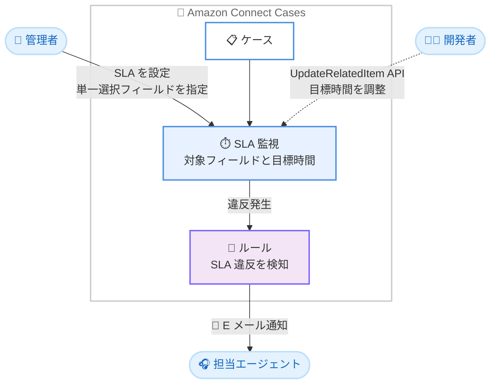

# Amazon Connect - ケースの SLA 管理機能の強化

**リリース日**: 2026 年 11 月 20 日
**サービス**: Amazon Connect (Amazon Connect Cases)
**機能**: ケースの SLA (サービスレベルアグリーメント) トラッキングとアクションの拡張

📊 [このアップデートのインフォグラフィックを見る](https://takech9203.github.io/aws-news-summary/20261120-amazon-connect-cases-sla-enhancements.html)

## 概要

Amazon Connect Customer は、ケース (Cases) における SLA 機能を拡張し、より多くの業務タイプにサービス目標を設定し、ケースが予定より遅れた際に迅速に対応できるようにするアップデートを発表しました。コンタクトセンターのチームは、顧客との約束である SLA をより柔軟に定義し、違反時のアクションを自動化できます。

今回のアップデートでは、(1) ケースステータス以外のフィールドへの SLA 設定、(2) SLA 違反時の担当エージェントへの E メール通知、(3) API による SLA 期限の調整、という 3 つの機能強化が含まれます。カスタマーサービス部門の管理者、スーパーバイザー、および Connect Cases を利用するシステム開発者が対象です。

**アップデート前の課題**

- 以前は SLA の目標をケースのステータス変化に対してのみ設定でき、重要度などの他のフィールドの変化を SLA として追跡できなかった
- SLA 違反が発生しても、担当エージェントへ自動的に通知する仕組みがなく、違反の発見が遅れる可能性があった
- パートナーなど外部の関係者の対応待ちでケースが停滞した場合でも、設定済みの SLA 期限をプログラムから調整できなかった

**アップデート後の改善**

- カスタムフィールドを含む任意の単一選択フィールドに対して SLA を設定できるようになった (例: 「重要度を 24 時間以内に高から中へ下げる」という目標の設定)
- SLA 違反ルールに E メールアクションを設定し、違反発生時に担当エージェントへ即座に通知できるようになった
- `UpdateRelatedItem` API で SLA の目標時間を更新できるようになり、外部要因による遅延時に期限をプログラムから調整できるようになった

## アーキテクチャ図



管理者が設定した SLA に基づいてケースのフィールド変化を監視し、違反が発生するとルール経由で担当エージェントへ E メール通知が送信されます。開発者は API で SLA の目標時間を調整できます。

## サービスアップデートの詳細

### 主要機能

1. **ケースステータス以外のフィールドへの SLA 設定**
   - 従来はケースステータスの変化のみを SLA の対象にできたが、カスタムフィールドを含む任意の単一選択フィールドを対象にできるようになった
   - 例: 「ケースの重要度を 24 時間以内に高から中へ下げる」といった目標を設定可能
   - SLA 設定では対象フィールド ID と目標となるフィールド値、目標時間を指定する

2. **SLA 違反時の E メール通知**
   - 管理者は SLA 違反ルールに E メールアクションを追加できる
   - ケースが SLA を超過した際に、担当エージェントへ即座にアラートが送信される
   - 違反の見逃しを防ぎ、エスカレーションまでの時間を短縮できる

3. **API による SLA 期限の調整**
   - `UpdateRelatedItem` API に `slaUpdateConfiguration` が追加され、`targetSlaMinutes` で SLA の目標時間を更新できる
   - パートナーなど外部の関係者の対応待ちが発生した場合に、期限をプログラムから延長するといった運用が可能

## 技術仕様

### SLA 関連の主な要素

| 項目 | 詳細 |
|------|------|
| SLA タイプ | `CaseField` (ケースフィールドの値変化を追跡) |
| 対象フィールド | ステータスに加え、カスタムフィールドを含む任意の単一選択フィールド |
| SLA ステータス | `Active` / `Overdue` / `Met` / `NotMet` |
| 期限の調整 | `UpdateRelatedItem` API の `slaUpdateConfiguration.targetSlaMinutes` |
| 違反時のアクション | ルールに E メールアクションを設定し担当エージェントへ通知 |

### API変更履歴

| 日付 | サービス | 変更内容 |
|------|----------|----------|
| 2026/11/19 | [Amazon Connect Cases](https://awsapichanges.com/archive/changes/b8bc94-cases.html) | 1 updated api method - カスタムフィールドを含む任意の単一選択フィールドを追跡する SLA のサポートと、`UpdateRelatedItem` API による SLA 目標時間の更新のサポートを追加 |

### UpdateRelatedItem API の呼び出し例

```json
{
  "domainId": "your-cases-domain-id",
  "caseId": "your-case-id",
  "relatedItemId": "your-sla-related-item-id",
  "content": {
    "sla": {
      "slaUpdateConfiguration": {
        "targetSlaMinutes": 2880
      }
    }
  }
}
```

SLA の目標時間を 2,880 分 (48 時間) に更新する例です。外部の関係者待ちでケースが停滞した際に、期限を延長する用途で使用できます。

## 設定方法

### 前提条件

1. Amazon Connect インスタンスが作成済みであること
2. Amazon Connect Cases のドメインが有効化されていること
3. SLA やルールを設定するための管理者権限 (セキュリティプロファイル) があること

### 手順

#### ステップ1: SLA 対象フィールドの確認

Amazon Connect 管理者ウェブサイトでケースのフィールド定義を確認し、SLA の対象とする単一選択フィールド (ステータス、重要度、カスタムフィールドなど) を特定します。

#### ステップ2: SLA の設定

ケーステンプレートまたはケースに対して SLA を設定し、対象フィールド、目標とするフィールド値、目標時間を指定します。これにより、指定したフィールドが目標値に達するまでの時間が追跡されます。

#### ステップ3: SLA 違反時の E メール通知ルールの作成

Amazon Connect のルール機能で SLA 違反をトリガー条件とするルールを作成し、アクションとして E メール通知を追加します。これにより、違反発生時に担当エージェントへ自動的にアラートが送信されます。

#### ステップ4: 必要に応じて API で期限を調整

```bash
aws connectcases update-related-item \
  --domain-id "your-cases-domain-id" \
  --case-id "your-case-id" \
  --related-item-id "your-sla-related-item-id" \
  --content '{"sla": {"slaUpdateConfiguration": {"targetSlaMinutes": 2880}}}'
```

AWS CLI で `UpdateRelatedItem` API を呼び出し、既存の SLA の目標時間を更新します。外部要因で対応が遅延する場合などに期限を調整できます。

## メリット

### ビジネス面

- **SLA 遵守率の向上**: 違反発生時に担当エージェントへ即時通知されるため、対応遅延の早期発見とエスカレーションが可能になる
- **柔軟なサービス目標の定義**: ステータス以外の業務指標 (重要度など) に対しても目標を設定でき、実際の業務プロセスに即した SLA 管理ができる
- **顧客満足度の向上**: ケースの停滞を防ぎ、顧客への約束を守る運用を仕組み化できる

### 技術面

- **カスタムフィールド対応**: 独自に定義した単一選択フィールドも SLA の追跡対象にでき、業務要件に合わせた拡張が容易
- **API によるプログラマブルな期限管理**: 外部システムと連携し、状況に応じて SLA 期限を動的に調整する自動化が可能
- **既存のルール機能との統合**: Connect のルールと E メールアクションを利用するため、追加のインフラ構築が不要

## デメリット・制約事項

### 制限事項

- SLA の対象にできるのは単一選択フィールドであり、自由記述フィールドや数値フィールドの任意の変化は対象として言及されていない
- Amazon Connect Cases が提供されているリージョンでのみ利用可能

### 考慮すべき点

- E メール通知を利用するには、違反時の通知先となるエージェントがケースに割り当てられている必要がある
- API で期限を調整する運用を行う場合、変更の理由や履歴を監査できる仕組みを別途検討することが望ましい

## ユースケース

### ユースケース1: 重要度に基づくインシデント対応の SLA 管理

**シナリオ**: 社内 IT ヘルプデスクで、高重要度のインシデントを 24 時間以内に中重要度まで引き下げる (一次対応を完了する) ことを目標としている。

**実装例**:
```
1. ケーステンプレートに単一選択フィールド「重要度」(高/中/低) を定義
2. SLA として「重要度が中または低になるまで 24 時間」を設定
3. SLA 違反ルールに E メールアクションを追加し、担当エージェントへ通知
```

**効果**: 一次対応の遅延を自動検知し、重大インシデントの放置を防止できる。

### ユースケース2: パートナー対応待ちによる期限の自動延長

**シナリオ**: 修理受付のケースで部品の取り寄せが必要になり、サプライヤーの回答待ちの間は SLA 期限を延長したい。

**実装例**:
```
1. 外部システムがサプライヤーへの発注イベントを検知
2. Lambda 関数などから UpdateRelatedItem API を呼び出し、
   targetSlaMinutes を延長した値に更新
3. サプライヤー回答後は通常の SLA 管理に戻す
```

**効果**: 外部要因による遅延を SLA 違反として誤検知せず、実態に即した SLA 運用ができる。

### ユースケース3: SLA 違反の即時アラートによるスーパーバイザー運用

**シナリオ**: コンタクトセンターで、ケースの解決期限を超過した際に担当エージェントへ即座に通知し、迅速なリカバリーを促したい。

**実装例**:
```
1. ケースの解決に関する SLA を設定
2. SLA 違反をトリガーとするルールを作成し、E メールアクションを設定
3. 通知を受けたエージェントが優先的に対応、必要に応じてエスカレーション
```

**効果**: ダッシュボードの定期確認に頼らず、違反発生と同時にアクションを開始できる。

## 料金

今回の発表では追加料金に関する言及はありません。Amazon Connect Cases の利用には既存の Cases の料金体系が適用されます。最新の料金は料金ページを参照してください。

## 利用可能リージョン

Amazon Connect Cases が提供されている以下のリージョンで利用できます。

- 米国東部 (バージニア北部)
- 米国西部 (オレゴン)
- カナダ (中部)
- 欧州 (フランクフルト)
- 欧州 (ロンドン)
- アジアパシフィック (ソウル)
- アジアパシフィック (シンガポール)
- アジアパシフィック (シドニー)
- アジアパシフィック (東京)
- アフリカ (ケープタウン)

## 関連サービス・機能

- **Amazon Connect ルール**: SLA 違反をトリガーとして E メール通知などのアクションを実行する基盤
- **Amazon Connect Cases API**: `UpdateRelatedItem` などの API を通じてケースや SLA をプログラムから操作可能
- **Amazon EventBridge**: ケースイベントを外部システムへ連携し、SLA 調整などの自動化と組み合わせ可能

## 参考リンク

- 📊 [インフォグラフィック](https://takech9203.github.io/aws-news-summary/20261120-amazon-connect-cases-sla-enhancements.html)
- [公式発表 (What's New)](https://aws.amazon.com/about-aws/whats-new/2026/11/amazon-connect-cases-sla-enhancements/)
- [ドキュメント: ケースの SLA](https://docs.aws.amazon.com/connect/latest/adminguide/cases-sla.html)
- [Amazon Connect Cases 製品ページ](https://aws.amazon.com/products/connect/customer/cases/)

## まとめ

Amazon Connect Cases の SLA 機能が強化され、任意の単一選択フィールドへの目標設定、違反時の E メール通知、API による期限調整が可能になりました。ケース管理で SLA 運用を行っているチームは、ステータス以外の業務指標への SLA 適用と違反通知ルールの設定を検討することを推奨します。外部要因で期限調整が必要なワークフローでは、`UpdateRelatedItem` API を使った自動化も有効です。
