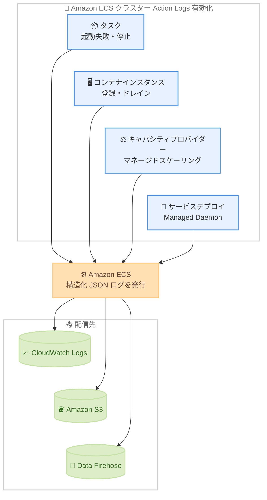

# Amazon ECS - Action Logs の対象がタスク、コンテナインスタンス、キャパシティプロバイダーに拡大

**リリース日**: 2026 年 11 月 20 日
**サービス**: Amazon Elastic Container Service (Amazon ECS)
**機能**: Amazon ECS Action Logs の対象リソース拡大

📊 [このアップデートのインフォグラフィックを見る](https://takech9203.github.io/aws-news-summary/20261120-amazon-ecs-action-logs-expanded-troubleshooting.html)

## 概要

Amazon ECS は、Action Logs の対象をタスク、コンテナインスタンス、クラスター、キャパシティプロバイダーへ拡大したことを発表しました。Action Logs は、Amazon ECS がユーザーに代わって実行するアクションをタイムスタンプ付きで記録する詳細ログで、これまではサービスデプロイと Managed Daemon の更新が対象でした。今回の拡大により、「なぜタスクが失敗したのか」「なぜクラスターが期待どおりにスケールしなかったのか」を AWS サポートに問い合わせることなく自力で調査できるようになります。

タスクの起動失敗については、コンテナイメージの取得の問題、EBS ボリュームに対する権限不足、サブネットの IP アドレス不足などの理由が記録されます。タスクの停止については、コンテナの終了コードや、停止の原因となったヘルスチェックが示されます。クラスターインフラストラクチャについては、インスタンスの登録とドレイン、EC2 インスタンスの登録失敗、キャパシティプロバイダーの変更、マネージドスケーリングのアクション (Auto Scaling グループが最大サイズに達した場合など) が記録されます。

すでに Action Logs を利用しているユーザーは、設定変更なしで新しいイベントを自動的に受け取ることができます。各ログエントリには、イベント名、ログレベル (INFO、WARN、ERROR)、関連リソースの ARN、ステータス理由が含まれます。

**アップデート前の課題**

- Action Logs の対象はサービスデプロイと Managed Daemon の操作に限定されており、タスクやクラスターインフラの問題は可視化されなかった
- タスクの起動失敗や予期しない停止の原因を特定するには、停止済みタスクのメタデータ (標準では 1 時間しか保持されない) を期限内に確認するか、AWS サポートへの問い合わせが必要だった
- Auto Scaling グループが最大サイズに達してスケールしないなど、キャパシティプロバイダーやマネージドスケーリングの内部動作を追跡する手段がなかった
- EC2 インスタンスがクラスターへの登録に失敗した場合、その理由を把握することが困難だった

**アップデート後の改善**

- タスクの起動失敗 (イメージ取得エラー、EBS ボリューム権限不足、サブネットの IP 枯渇など) の理由がログで確認できるようになった
- タスク停止時にコンテナの終了コードや、停止を引き起こしたヘルスチェックを特定できるようになった
- インスタンスの登録・ドレイン、キャパシティプロバイダーの変更、マネージドスケーリングの動作がタイムスタンプ付きで記録されるようになった
- 既存の Action Logs ユーザーは設定変更なしで新しいイベントを自動的に受信できる

## アーキテクチャ図



クラスターレベルで Action Logs を有効化すると、タスク、コンテナインスタンス、キャパシティプロバイダー、サービスデプロイの各アクションが構造化 JSON ログとして CloudWatch Logs、Amazon S3、Amazon Data Firehose のいずれかに配信されます。

## サービスアップデートの詳細

### 主要機能

1. **タスクライフサイクルの記録**
   - 起動に失敗したタスク、実行中に予期せず停止したタスク、停止時にリソースを解放できなかったタスクを記録
   - ロードバランサーまたはコンテナのヘルスチェック失敗によりサービススケジューラがタスクを停止した場合も対象
   - エントリには停止コード、ステータス理由、失敗の原因となったコンテナやボリュームアタッチメントが含まれる

2. **コンテナインスタンスライフサイクルの記録**
   - EC2 インスタンスおよび外部インスタンスの登録失敗、Amazon ECS が開始したドレイン、登録解除を記録
   - ドレインのエントリには Amazon ECS がドレインを開始した理由が含まれる
   - ユーザー自身が実施したドレインは記録対象外

3. **キャパシティプロバイダーとスケーリングの記録**
   - キャパシティプロバイダーの作成・更新・削除操作を記録 (インスタンスプロファイルの欠落や無効なセキュリティグループなどの非同期の失敗を含む)
   - Auto Scaling グループの希望キャパシティを増減するマネージドスケーリングのリクエストを記録 (グループが最大サイズに達した場合を含む)
   - 起動したもののクラスターに登録されなかったインスタンスも対象

4. **クラスターライフサイクルの記録**
   - クラスターの更新・削除操作と、それらに伴う非同期の失敗を記録

## 技術仕様

### ログエントリのスキーマ

| フィールド | 詳細 |
|------|------|
| `eventTimestamp` | イベント発生時刻 (Unix ミリ秒) |
| `logLevel` | 重要度レベル: `INFO`、`WARN`、`ERROR` |
| `account` | AWS アカウント ID |
| `region` | イベントが発生した AWS リージョン |
| `resourceArn` | オプトイン範囲を表すクラスター ARN |
| `actionSourceId` | サブリソースの識別子 (サービス ARN、デーモン ARN など) |
| `eventName` | アクション識別子 (例: `DAEMON_DEPLOYMENT_IN_PROGRESS`) |
| `detail` | イベント固有の追加コンテキストを含む JSON ペイロード |

### 配信先ごとの動作

| 配信先 | 詳細 |
|------|------|
| CloudWatch Logs | ロググループ `/aws/vendedlogs/ecs/action-logs/{resourceId}` に保存。サブリソースごとに `{actionSourceId}` を名前とするログストリームを作成 |
| Amazon S3 | アカウント、リージョン、5 分単位の時間ウィンドウでパーティション化し、gzip 圧縮して保存 |
| Amazon Data Firehose | 改行区切りの JSON レコードとしてニアリアルタイムに配信 |

## 設定方法

### 前提条件

1. Amazon ECS クラスターが存在すること
2. 配信先 (CloudWatch Logs、Amazon S3、Amazon Data Firehose のいずれか) を利用できること
3. CloudWatch Logs の配信設定 API (`PutDeliverySource`、`PutDeliveryDestination`、`CreateDelivery`) を呼び出す IAM 権限があること

### 手順

#### ステップ1: ECS コンソールで有効化する場合

Amazon ECS コンソールで対象クラスターを開き、Action Logs を有効化します。コンソールから有効化した場合、CloudWatch Logs のデフォルト保持期間は 7 日間に設定されます。

#### ステップ2: CloudWatch API で有効化する場合

```bash
# 配信ソースとして ECS クラスターを登録
aws logs put-delivery-source \
  --name ecs-action-logs-source \
  --resource-arn arn:aws:ecs:ap-northeast-1:123456789012:cluster/my-cluster \
  --log-type ACTION_LOGS
```

対象の ECS クラスターをログ配信元として登録しています。Action Logs のオプトインはクラスター単位です。

```bash
# 配信先を登録し、配信を作成
aws logs put-delivery-destination \
  --name ecs-action-logs-destination \
  --delivery-destination-configuration \
  destinationResourceArn=arn:aws:logs:ap-northeast-1:123456789012:log-group:/aws/vendedlogs/ecs/action-logs/my-cluster

aws logs create-delivery \
  --delivery-source-name ecs-action-logs-source \
  --delivery-destination-arn arn:aws:logs:ap-northeast-1:123456789012:delivery-destination:ecs-action-logs-destination
```

配信先 (この例では CloudWatch Logs のロググループ) を登録し、配信ソースと配信先を関連付けてログ配信を開始しています。具体的なパラメータは開発者ガイドの Getting Started を参照してください。

#### ステップ3: ログの確認

CloudWatch Logs コンソールで `/aws/vendedlogs/ecs/action-logs/{resourceId}` ロググループを開き、`eventName` や `logLevel` でフィルタリングして障害イベントを確認します。既存の Action Logs ユーザーは、今回追加されたタスクやキャパシティプロバイダーのイベントを設定変更なしで受信できます。

## メリット

### ビジネス面

- **トラブルシューティング時間の短縮**: タスク失敗やスケーリング不全の原因を AWS サポートへの問い合わせなしで特定でき、障害対応の MTTR を短縮できる
- **運用の自律性向上**: 運用チームがセルフサービスで調査を完結でき、サポートケースの起票や回答待ちによる遅延を削減できる
- **監査性の向上**: Amazon ECS が実行したアクションの履歴がタイムスタンプ付きで残るため、障害の事後分析や報告に活用できる

### 技術面

- **失敗メタデータの長期保持**: 標準では 1 時間しか保持されない停止済みタスクのメタデータを超えて、失敗の詳細情報を任意の期間保持できる
- **構造化 JSON による分析のしやすさ**: イベント名、ログレベル、ARN、ステータス理由を含む構造化ログのため、CloudWatch Logs Insights などでのクエリが容易
- **ワークロードへの影響なし**: ログ発行はファイアアンドフォーゲット方式であり、配信の一時的な失敗が ECS のリソース操作をブロックまたは劣化させることはない

## デメリット・制約事項

### 制限事項

- オプトインはクラスターレベルであり、サービスやタスク単位での有効化はできない
- ユーザー自身が実施したコンテナインスタンスのドレインは記録されない
- 有料機能であり、ログ量に応じて CloudWatch vended logs の料金が発生する

### 考慮すべき点

- ログ量はクラスターのアクティビティに比例するため、大規模クラスターでは取り込みと保存のコストを見積もる必要がある
- 保持期間は配信先の設定に依存する (コンソールから有効化した場合の CloudWatch Logs のデフォルトは 7 日間)。要件に応じて調整が必要
- 配信先ごとにフォーマットとパーティション方式が異なるため、既存の分析基盤に合わせて選択する必要がある

## ユースケース

### ユースケース1: タスク起動失敗の原因特定

**シナリオ**: サービスのタスクが起動と停止を繰り返しているが、停止済みタスクの情報がすぐに消えてしまい原因を特定できない。

**実装例**:
```
1. クラスターで Action Logs を有効化し、CloudWatch Logs に配信
2. CloudWatch Logs Insights で logLevel = "ERROR" のエントリを抽出
3. detail ペイロードからイメージ取得エラー、EBS 権限不足、
   サブネットの IP アドレス不足などの理由を確認
```

**効果**: 1 時間のメタデータ保持期限を気にすることなく、起動失敗の根本原因を自分のペースで分析できる。

### ユースケース2: クラスターがスケールしない問題の調査

**シナリオ**: キャパシティプロバイダーのマネージドスケーリングを使用しているが、タスクが PROVISIONING のまま進まず、クラスターがスケールアウトしない。

**実装例**:
```
1. Action Logs でマネージドスケーリングのリクエストを確認
2. Auto Scaling グループが最大サイズに達したイベントや、
   起動したもののクラスターに登録されなかったインスタンスを特定
3. ASG の最大サイズ引き上げやインスタンス設定の修正を実施
```

**効果**: スケーリングが停止した正確な理由 (ASG の上限到達、インスタンスの登録失敗など) を即座に把握し、適切な対処ができる。

### ユースケース3: ヘルスチェック起因のタスク停止の分析

**シナリオ**: ロードバランサー配下のサービスでタスクが断続的に入れ替わっており、どのヘルスチェックが原因か分からない。

**実装例**:
```
1. Action Logs でタスク停止イベントを確認
2. エントリに含まれる停止コード、コンテナの終了コード、
   停止の原因となったヘルスチェックを特定
3. ヘルスチェックの閾値やアプリケーションの起動時間を調整
```

**効果**: ロードバランサーのヘルスチェックとコンテナのヘルスチェックのどちらが停止を引き起こしたかを切り分けられる。

## 料金

Action Logs は有料機能で、CloudWatch vended logs の標準料金が適用されます。クラスターが生成するログ量に基づいて、ログの取り込みと保存に対して課金されます。追加の機能料金はなく、選択した配信先 (CloudWatch Logs、Amazon S3、Amazon Data Firehose) ごとの標準料金が適用されます。保持期間は配信先の設定で調整でき、ECS コンソールから有効化した場合の CloudWatch Logs のデフォルト保持期間は 7 日間です。

## 利用可能リージョン

AWS GovCloud (US) リージョンを含む AWS リージョンで利用可能です。最新のリージョン対応状況は [リージョン別サービス一覧](https://aws.amazon.com/about-aws/global-infrastructure/regional-product-services/) を参照してください。

## 関連サービス・機能

- **Amazon CloudWatch Logs**: Action Logs の主要な配信先。Logs Insights によるクエリ分析や保持期間の管理が可能
- **Amazon S3**: ログの長期保存やデータレイクへの取り込みに利用できる配信先。5 分単位のパーティションと gzip 圧縮で保存
- **Amazon Data Firehose**: ニアリアルタイムで外部の分析基盤や SIEM にログを転送できる配信先
- **ECS キャパシティプロバイダー**: 今回のアップデートでライフサイクル操作とマネージドスケーリングの動作が Action Logs の記録対象になった

## 参考リンク

- 📊 [インフォグラフィック](https://takech9203.github.io/aws-news-summary/20261120-amazon-ecs-action-logs-expanded-troubleshooting.html)
- [公式発表 (What's New)](https://aws.amazon.com/about-aws/whats-new/2026/11/amazon-ecs-action-logs-expanded-troubleshooting)
- [ドキュメント: Monitor Amazon ECS operations with Action Logs](https://docs.aws.amazon.com/AmazonECS/latest/developerguide/action-logs.html)
- [Amazon ECS 製品ページ](https://aws.amazon.com/ecs/)

## まとめ

Action Logs の対象がタスク、コンテナインスタンス、クラスター、キャパシティプロバイダーに拡大され、Amazon ECS のトラブルシューティングの多くをセルフサービスで完結できるようになりました。既存ユーザーは設定変更なしで新しいイベントを受信できるため、まだ有効化していないクラスターでは、本番環境を中心にクラスターレベルでのオプトインを検討することを推奨します。
