# Amazon EventBridge - Custom イベントバスの Amazon MSK ターゲットサポート

**リリース日**: 2026 年 11 月 20 日
**サービス**: Amazon EventBridge
**機能**: Custom イベントバスにおける Amazon MSK ターゲットのサポート

📊 [このアップデートのインフォグラフィックを見る](https://takech9203.github.io/aws-news-summary/20261120-amazon-eventbridge-msk-target.html)

## 概要

Amazon EventBridge の拡張された Custom イベントバスが、Amazon MSK (Managed Streaming for Apache Kafka) をターゲットとしてサポートするようになりました。これにより、独自の Kafka プロデューサーを実装・運用することなく、Custom イベントバス上のイベントを Kafka トピックへ直接配信できます。

Subscriber の設定でクラスターの ARN とトピックを指定するだけで、EventBridge が配信されたイベントごとに 1 つの Kafka レコードを生成してトピックへ書き込みます。パーティションキー、確認応答レベル (Acks)、レコードヘッダー、圧縮コーデックなどの Kafka プロデューサー設定も構成可能です。プロビジョンドクラスターと MSK Serverless クラスターの両方、およびパブリック接続とプライベート接続の両方に対応しており、プライベートクラスターの場合は EventBridge が自動的にプライベート接続をセットアップします。

イベント駆動アーキテクチャと Kafka ベースのストリーミング基盤を併用している組織にとって、両者をマネージドに接続できる重要なアップデートです。

**アップデート前の課題**

このアップデート以前は、EventBridge のイベントを Kafka トピックへ届けるために追加の実装が必要でした。

- EventBridge から MSK へイベントを送るには、Lambda 関数などで独自の Kafka プロデューサーを実装・運用する必要があった
- プライベートクラスターへの接続には、VPC 内のコンピューティングリソースやネットワーク設定を自前で管理する必要があった
- パーティションキーの制御や順序保証を自前のコードで実装する必要があり、運用負荷が高かった

**アップデート後の改善**

今回のアップデートにより、以下が可能になりました。

- Subscriber にクラスター ARN とトピック名を指定するだけで、コードを書かずにイベントを Kafka トピックへ配信できるようになった
- プライベートクラスターに対しては EventBridge が AWS PrivateLink による接続を自動的に確立し、ネットワークリソースの管理が不要になった
- パーティションキー、Acks、圧縮、レコードヘッダーなどのプロデューサー設定を宣言的に構成できるようになった
- FIFO Subscriber と組み合わせることで、イベントグループ単位の順序を保ったまま同一パーティションへ配信できるようになった

## アーキテクチャ図

```mermaid
flowchart LR
    subgraph Source["📤 イベント発行元"]
        App["🖥️ アプリケーション"]
    end

    subgraph EB["🚌 Amazon EventBridge"]
        Bus["🚌 Custom イベントバス"]
        Sub["📬 Subscriber<br/>MskParameters 設定"]
    end

    subgraph MSKCluster["🗄️ Amazon MSK クラスター"]
        Topic["📋 Kafka トピック"]
        Consumer["⚙️ 既存コンシューマー"]
    end

    App -->|PutEvents| Bus
    Bus -->|フィルタリング・変換| Sub
    Sub -->|"1 イベント = 1 レコード<br/>PrivateLink または パブリック接続"| Topic
    Topic --> Consumer

    classDef input fill:#E9F7EC,stroke:#66BB6A,stroke-width:2px,color:#333333
    classDef process fill:#FFFFFF,stroke:#4A90E2,stroke-width:2px,color:#333333
    classDef internal fill:#E8F1FF,stroke:#4A90E2,stroke-width:2px,color:#333333
    classDef storage fill:#DCEDC8,stroke:#C5E1A5,stroke-width:2px,color:#33691E
    classDef layer fill:none,stroke:#CCCCCC,stroke-width:2px,color:#666666

    class App input
    class Bus process
    class Sub internal
    class Topic,Consumer storage
    class Source,EB,MSKCluster layer
```



アプリケーションが Custom イベントバスに発行したイベントを、Subscriber がフィルタリングし、Kafka レコードとして MSK クラスターのトピックへ配信する流れを示しています。

## サービスアップデートの詳細

### 主要機能

1. **MSK クラスターへのダイレクト配信**
   - Subscriber の `TargetArn` に MSK クラスターの ARN を設定し、`MskParameters` で配信先トピックを指定する
   - EventBridge は配信されたイベントごとに 1 つの Kafka レコードを生成し、イベント本文をレコード値として書き込む
   - トピック名には固定値のほか、イベントごとに評価される JSONata 式も使用できる

2. **Kafka プロデューサー設定の構成**
   - `PartitionKey`: レコードキーを固定値または JSONata 式で指定し、パーティションを制御できる。FIFO Subscriber で省略した場合はイベントグループ ID がレコードキーとなり、同一グループのイベントが同一パーティションに配信される
   - `Acks`: `ALL` (デフォルト、全 ISR の確認を待機) または `LEADER` (パーティションリーダーのみ) を選択できる
   - `Compression`: `NONE` (デフォルト)、`GZIP`、`SNAPPY`、`LZ4`、`ZSTD` から圧縮コーデックを選択できる
   - `Headers`: 最大 100 個の Kafka レコードヘッダーを付与できる
   - `ClientId`: ブローカー側のログ・メトリクス・クォータでプロデューサーを識別する client.id を設定できる

3. **パブリック・プライベート両接続のサポート**
   - `Connectivity` に `PUBLIC` または `PRIVATE` を指定する
   - `PRIVATE` の場合、EventBridge が AWS PrivateLink の VPC エンドポイントを自動的に作成してクラスターへ接続する。ユーザーによるネットワークリソースの作成・管理は不要
   - 同一クラスターをターゲットとする複数の Subscriber は 1 つのエンドポイントを共有する
   - MSK Serverless クラスターは `PRIVATE` のみサポートする

4. **接続ライフサイクルの管理**
   - Subscriber の接続状態は `SubscriberDetails.MskDetails.ConnectivityState` (`PROVISIONING`、`ACTIVE`、`PROVISION_FAILED`) で確認できる
   - 接続障害時もイベントのマッチングは継続され、リトライポリシーを超過したイベントはデッドレターキューへ送られる
   - `PROVISION_FAILED` となった場合は、クラスターを修復後に `UpdateSubscriber` を呼び出すことで接続が再確立され、保持されていたイベントの配信が再開される

## 技術仕様

### MskParameters の設定項目

| 項目 | 詳細 |
|------|------|
| TopicName | 必須。配信先の Kafka トピック。固定値または JSONata 式 |
| Connectivity | 必須。`PUBLIC` または `PRIVATE`。MSK Serverless は `PRIVATE` のみ |
| PartitionKey | Kafka レコードキー。固定値または JSONata 式 |
| Compression | `NONE` (デフォルト)、`GZIP`、`SNAPPY`、`LZ4`、`ZSTD` |
| Acks | `ALL` (デフォルト) または `LEADER` |
| Headers | レコードヘッダー。最大 100 個 |
| ClientId | プロデューサーの client.id |

### 前提となるクラスター設定

| 接続方式 | 必要な設定 |
|----------|-----------|
| PUBLIC | プロビジョンドクラスターのパブリックアクセスを有効化 (IAM アクセスコントロール必須) |
| PRIVATE (プロビジョンド) | マルチ VPC プライベート接続を IAM で有効化し、EventBridge の接続を許可するクラスターポリシーを追加 |
| PRIVATE (Serverless) | EventBridge の接続を許可するクラスターポリシーを追加 (マルチ VPC 設定は不要) |

### API 変更履歴

| 日付 | サービス | 変更内容 |
|------|----------|----------|
| 2026/11/19 | [Amazon EventBridgeV2](https://awsapichanges.com/archive/changes/b8bc94-eventsv2.html) | 1 new 7 updated api methods - `CreateSubscriber` / `UpdateSubscriber` / `DescribeSubscriber` に `MskParameters` と `MskDetails` が追加 (同リリースには Webhook イベントソース対応も含まれる) |

### プライベート接続用クラスターポリシーの例

`PRIVATE` 接続では、EventBridge がプライベート接続をセットアップできるように、以下のようなクラスターポリシーをクラスターに添付します。`aws:SourceAccount` と `aws:SourceArn` 条件でアクセス元を Subscriber に限定します。

```json
{
    "Version": "2012-10-17",
    "Statement": [
        {
            "Sid": "AllowEventBridgePrivateConnectivity",
            "Effect": "Allow",
            "Principal": {
                "Service": "events.amazonaws.com"
            },
            "Action": [
                "kafka:CreateVpcConnection",
                "kafka:GetBootstrapBrokers",
                "kafka:DescribeClusterV2"
            ],
            "Resource": "arn:aws:kafka:us-east-1:111122223333:cluster/MyCluster/abcd1234-0abc-def0-1234-abcd1234abcd-25",
            "Condition": {
                "StringEquals": {
                    "aws:SourceAccount": "111122223333"
                },
                "ArnLike": {
                    "aws:SourceArn": "arn:aws:events:us-east-1:111122223333:subscriber/my-subscriber/*"
                }
            }
        }
    ]
}
```

## 設定方法

### 前提条件

1. 拡張された Custom イベントバスが作成済みであること
2. MSK クラスター (プロビジョンドまたは Serverless) で IAM アクセスコントロールが有効化されていること
3. 使用する接続方式 (パブリックアクセスまたはプライベート接続) がクラスター側で有効化されていること
4. EventBridge が引き受ける配信ロール (IAM ロール) が準備されていること

### 手順

#### ステップ 1: 配信ロールに MSK への書き込み権限を付与

```json
{
    "Version": "2012-10-17",
    "Statement": [
        {
            "Sid": "LookupBrokers",
            "Effect": "Allow",
            "Action": "kafka:GetBootstrapBrokers",
            "Resource": "arn:aws:kafka:us-east-1:111122223333:cluster/MyCluster/abcd1234-0abc-def0-1234-abcd1234abcd-25"
        },
        {
            "Sid": "Connect",
            "Effect": "Allow",
            "Action": "kafka-cluster:Connect",
            "Resource": "arn:aws:kafka:us-east-1:111122223333:cluster/MyCluster/abcd1234-0abc-def0-1234-abcd1234abcd-25"
        },
        {
            "Sid": "Produce",
            "Effect": "Allow",
            "Action": [
                "kafka-cluster:DescribeTopic",
                "kafka-cluster:WriteData"
            ],
            "Resource": "arn:aws:kafka:us-east-1:111122223333:topic/MyCluster/abcd1234-0abc-def0-1234-abcd1234abcd-25/my-topic"
        }
    ]
}
```

配信ロールに、ブートストラップブローカーの取得、クラスターへの接続、対象トピックへの書き込みを許可するポリシーを設定します。EventBridge はこのロールを引き受けてクラスターへレコードを書き込むため、ロールの信頼ポリシーで EventBridge からの AssumeRole を許可しておく必要があります。

#### ステップ 2: クラスターポリシーの追加 (PRIVATE 接続の場合)

前述のクラスターポリシー例を参考に、EventBridge がプライベート接続を確立できるようにクラスターポリシーを追加します。`aws:SourceArn` の条件は、Subscriber の ARN に生成 ID が含まれるため、`subscriber/*` のように末尾ワイルドカードを使用した `ArnLike` で指定します。

#### ステップ 3: Subscriber の作成

```bash
aws events create-subscriber \
  --name my-msk-subscriber \
  --event-bus-arn arn:aws:events:us-east-1:111122223333:event-bus/my-custom-bus \
  --invoke-configuration '{
    "RoleArn": "arn:aws:iam::111122223333:role/my-delivery-role",
    "TargetArn": "arn:aws:kafka:us-east-1:111122223333:cluster/MyCluster/abcd1234-0abc-def0-1234-abcd1234abcd-25",
    "MskParameters": {
      "TopicName": "my-topic",
      "Connectivity": "PRIVATE",
      "Acks": "ALL",
      "Compression": "NONE"
    }
  }' \
  --type FIFO \
  --starting-position LATEST
```

Custom イベントバスに対して MSK クラスターをターゲットとする Subscriber を作成します。`TargetArn` にクラスター ARN、`MskParameters` に配信先トピックと接続方式を指定します。FIFO タイプを指定すると、イベントグループ単位の順序を保って配信されます。

#### ステップ 4: 接続状態の確認

```bash
aws events describe-subscriber \
  --subscriber-arn <Subscriber の ARN> \
  --query "SubscriberDetails.MskDetails"
```

Subscriber の接続状態を確認します。`PRIVATE` 接続の場合、作成直後は `ConnectivityState` が `PROVISIONING` となり、`ACTIVE` になるとイベントのマッチングと配信が開始されます。`PROVISION_FAILED` の場合は `StateReason` に失敗理由が表示されます。

## メリット

### ビジネス面

- **開発・運用コストの削減**: 独自の Kafka プロデューサー実装とその運用が不要になり、イベント連携の構築工数を大幅に削減できる
- **チーム間連携の促進**: 共有の Custom イベントバスに発行されたイベントを、他チームが既に利用している Kafka トピックへそのまま届けられる
- **運用の信頼性向上**: リトライポリシー、デッドレターキュー、接続状態の管理が EventBridge のマネージド機能として提供される

### 技術面

- **ネットワーク管理の自動化**: プライベート接続では EventBridge が PrivateLink の VPC エンドポイントを自動作成・管理し、ユーザー側のネットワーク構成が不要
- **順序保証とパーティション制御**: FIFO Subscriber とパーティションキーの組み合わせで、関連イベントを同一パーティションへ順序通りに配信できる
- **柔軟なプロデューサー設定**: Acks、圧縮コーデック、レコードヘッダー、client.id を宣言的に構成でき、JSONata 式による動的なトピック名・キーの指定も可能

## デメリット・制約事項

### 制限事項

- 拡張された Custom イベントバス (Subscriber モデル) 専用の機能であり、従来のルールベースのターゲットとしては利用できない
- MSK クラスター側で IAM アクセスコントロールの有効化が必須 (SASL/SCRAM や mTLS のみのクラスターでは利用できない)
- MSK Serverless クラスターは `PRIVATE` 接続のみサポートし、MSK Serverless が利用可能なリージョンに限定される
- レコードヘッダーは最大 100 個まで

### 考慮すべき点

- プライベート接続で作成される PrivateLink VPC エンドポイントの料金は、クラスターを所有する AWS アカウントに課金される
- 同一クラスターへ配信するプライベート Subscriber は接続を共有するため、接続障害は該当クラスターの全 Subscriber に影響する
- `PRIVATE` Subscriber は初回の接続確立 (`PROVISIONING`) が完了するまでイベントのマッチング・配信を行わない
- 接続障害時にリトライポリシーを超過したイベントは、デッドレターキュー未設定の場合は破棄される

## ユースケース

### ユースケース 1: 部門横断のイベント連携

**シナリオ**: 注文管理チームが共有の Custom イベントバスに購買イベントを発行しており、決済チームは既存の Kafka コンシューマー群で MSK トピックからデータを処理している。

**実装例**:
```
1. 決済チームの MSK クラスターに EventBridge 用のクラスターポリシーを追加
2. 購買イベントのフィルターを設定した Subscriber を作成し、決済用トピックを指定
3. PartitionKey に注文 ID の JSONata 式を設定し、同一注文のイベントを同一パーティションへ集約
```

**効果**: 決済チームは既存のコンシューマーを変更することなく購買イベントを受信でき、チーム間のインテグレーションコードが不要になる。

### ユースケース 2: イベントのストリーミング分析基盤への取り込み

**シナリオ**: アプリケーションのビジネスイベントを、Apache Flink や Kafka Streams を利用したリアルタイム分析パイプラインへ取り込みたい。

**実装例**:
```
1. 分析対象イベントのフィルターを設定した Subscriber を作成
2. Compression に ZSTD を指定してネットワーク転送量を削減
3. Transformer (JSONata) で分析に必要な属性のみに変換してから配信
```

**効果**: Lambda などの中間コンポーネントなしでイベントがストリーミング基盤へ届き、レイテンシーと運用対象が削減される。

### ユースケース 3: MSK Serverless へのセキュアなプライベート配信

**シナリオ**: パブリックアクセスを持たない MSK Serverless クラスターに対し、VPC リソースを管理せずにイベントを配信したい。

**実装例**:
```
1. MSK Serverless クラスターに EventBridge の接続を許可するクラスターポリシーを追加
2. Connectivity に PRIVATE を指定した Subscriber を作成
3. DescribeSubscriber で ConnectivityState が ACTIVE になったことを確認
```

**効果**: EventBridge が PrivateLink 接続を自動構築するため、インターネットを経由しないセキュアな配信を最小限の設定で実現できる。

## 料金

MSK ターゲットへの配信は、Custom イベントバスの標準のイベント送信 (egress) として課金されます。配信前の圧縮をオプションで有効にした場合、圧縮処理はイベント評価 (Event Evaluation) として課金されます。

また、プライベート接続で作成される AWS PrivateLink VPC エンドポイントの料金は、MSK クラスターを所有する AWS アカウントに課金されます。同一クラスターをターゲットとする Subscriber 間でエンドポイントは共有されます。

詳細は [Amazon EventBridge 料金ページ](https://aws.amazon.com/eventbridge/pricing/) を参照してください。

## 利用可能リージョン

拡張された Custom イベントバスが利用可能なすべての AWS リージョンで利用できます。なお、MSK Serverless クラスターへのプライベート配信は、Amazon MSK Serverless が利用可能なリージョンに限られます。

## 関連サービス・機能

- **Amazon MSK / MSK Serverless**: 配信先となるマネージド Apache Kafka サービス。IAM アクセスコントロールとの組み合わせで利用する
- **AWS PrivateLink**: プライベート接続時に EventBridge が自動的に作成する VPC エンドポイントの基盤技術
- **AWS Lambda / Amazon SQS / Amazon SNS / Amazon Kinesis**: Custom イベントバスの Subscriber がサポートする他のターゲット。ユースケースに応じて使い分けられる
- **Amazon EventBridge Pipes**: 逆方向 (Kafka からのイベント取り込み) を含むポイントツーポイント連携を提供する関連機能

## 参考リンク

- 📊 [インフォグラフィック](https://takech9203.github.io/aws-news-summary/20261120-amazon-eventbridge-msk-target.html)
- [公式発表 (What's New)](https://aws.amazon.com/about-aws/whats-new/2026/11/amazon-eventbridge-msk-target/)
- [ドキュメント: Amazon MSK cluster target](https://docs.aws.amazon.com/eventbridge/latest/userguide/eb-custom-bus-target-msk.html)
- [Amazon EventBridge 製品ページ](https://aws.amazon.com/eventbridge/)
- [料金ページ](https://aws.amazon.com/eventbridge/pricing/)

## まとめ

EventBridge の Custom イベントバスから Amazon MSK へ、プロデューサーコードやネットワーク管理なしでイベントを直接配信できるようになりました。イベント駆動アーキテクチャと Kafka ストリーミング基盤を併用している場合は、Lambda などの中間実装を本機能に置き換えることで、運用負荷とレイテンシーの削減を検討することを推奨します。導入時は IAM アクセスコントロールの有効化、クラスターポリシー、デッドレターキューの設定を忘れずに行ってください。
