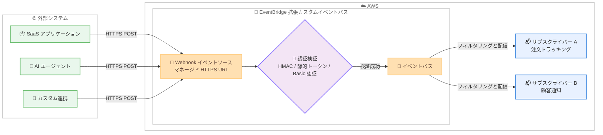

# Amazon EventBridge - カスタムイベントバスの Webhook Events サポート

**リリース日**: 2026 年 11 月 20 日
**サービス**: Amazon EventBridge
**機能**: Webhook Events (拡張カスタムイベントバス)

📊 [このアップデートのインフォグラフィックを見る](https://takech9203.github.io/aws-news-summary/20261120-amazon-eventbridge-webhook-events.html)

## 概要

Amazon EventBridge の拡張カスタムイベントバス (enhanced Custom event bus) が Webhook Events をサポートしました。SaaS アプリケーション、AI エージェント、カスタムインテグレーションから、HTTPS 経由でイベントを直接イベントバスに送信できるようになります。

カスタムイベントバスは、アプリケーション間、SaaS 連携、AWS サービス間でイベントをルーティングするイベント駆動型アプリケーションを構築するためのサーバーレスイベントブローカーです。今回のアップデートにより、イベントバス上に Webhook イベントソースを作成すると、EventBridge がマネージド型の HTTPS URL を提供します。受信した各リクエストは HMAC 署名、静的トークン、Basic 認証のいずれかの方法で検証され、受け入れられたイベントはバスに発行されて、他のイベントと同様にサブスクライバーがフィルタリングと配信を行います。

外部システムからの Webhook を受信するために、独自の API エンドポイントやコンピューティングリソースをデプロイ・運用する必要がなくなるため、外部連携のアーキテクチャを大幅に簡素化できます。

**アップデート前の課題**

- 外部の SaaS や AI エージェントから Webhook を受信するには、Amazon API Gateway や AWS Lambda などで独自の受信エンドポイントを構築・運用する必要があった
- Webhook の認証 (署名検証やトークン検証) のロジックを自前で実装・保守する必要があった
- 受信エンドポイントのスケーリング、監視、認証情報のローテーションなどの運用負荷が発生していた

**アップデート後の改善**

- EventBridge がマネージド型の HTTPS URL を提供するため、独自のエンドポイントやコンピューティングのデプロイ・運用が不要になった
- HMAC 署名、静的トークン、Basic 認証の 3 種類の認証方式が組み込みで提供され、リクエスト検証を EventBridge に任せられるようになった
- 受信したイベントは通常のイベントと同様にサブスクライバーでフィルタリング・配信できるため、既存のイベント駆動アーキテクチャにそのまま統合できるようになった

## アーキテクチャ図



外部システムが EventBridge のマネージド HTTPS URL にイベントを送信すると、認証検証を経てイベントバスに発行され、サブスクライバーがフィルタリングして配信します。

## サービスアップデートの詳細

### 主要機能

1. **マネージド HTTPS エンドポイント**
   - イベントバス上に Webhook イベントソースを作成すると、EventBridge がマネージド型の HTTPS URL を自動的に提供
   - 独自の API エンドポイントやコンピューティングリソースのデプロイ・運用が不要
   - SaaS アプリケーション、AI エージェント、カスタム連携からのイベントを直接受信可能

2. **組み込みの認証機能**
   - 受信した各リクエストを 3 種類の認証方式のいずれかで検証
     - HMAC 署名: ペイロードの署名を共有シークレットで検証
     - 静的トークン: リクエストに含まれる固定トークンを検証
     - Basic 認証: ユーザー名とパスワードによる HTTP Basic 認証
   - `RotateWebhookCredentials` API により認証情報のローテーションが可能 (シークレットは AWS Secrets Manager で管理)

3. **既存のイベント処理フローとのシームレスな統合**
   - 検証に成功したイベントはイベントバスに発行され、他のイベントと同様に扱われる
   - サブスクライバーによるフィルタリングと配信がそのまま利用可能
   - 例: 物流パートナーからの配送ステータス更新を、送信と同時に注文トラッキングと顧客通知のサブスクライバーに直接配信

## 技術仕様

### Webhook イベントソースの構成要素

| 項目 | 詳細 |
|------|------|
| イベントソースタイプ | Webhook (拡張カスタムイベントバスのイベントソースとして作成) |
| エンドポイント | EventBridge が提供するマネージド HTTPS URL (`WebhookUrl`) |
| 認証方式 | HMAC 署名、静的トークン、HTTP Basic 認証のいずれか |
| 認証情報の管理 | AWS Secrets Manager にシークレットとして保存、`RotateWebhookCredentials` API でローテーション |
| イベント配信 | 検証成功後にイベントバスへ発行、サブスクライバーがフィルタリング・配信 |

### API変更履歴

| 日付 | サービス | 変更内容 |
|------|----------|----------|
| 2026/11/19 | [Amazon EventBridgeV2](https://awsapichanges.com/archive/changes/b8bc94-eventsv2.html) | 1 new 7 updated api methods - Webhook イベントソース (静的トークン、HTTP Basic 認証、HMAC 署名による認証) と Amazon MSK サブスクライバーの追加 |

主な API 変更は以下のとおりです。

- **新規**: `RotateWebhookCredentials` - Webhook イベントソースの認証情報 (静的トークン、Basic 認証パスワード、HMAC シークレット) をローテーション
- **更新**: `CreateEventSource` / `UpdateEventSource` / `DescribeEventSource` / `ListEventSources` - Webhook 設定 (`WebhookEventsConfiguration`、`WebhookDetails`、`WebhookUrl` など) に対応
- **更新**: `CreateSubscriber` / `UpdateSubscriber` / `DescribeSubscriber` - 同リリースで追加された Amazon MSK サブスクライバーに対応

### RotateWebhookCredentials の例

```json
{
  "EventSourceArn": "arn:aws:events:us-east-1:123456789012:event-source/my-webhook-source",
  "Credential": {
    "HmacSecretValue": "new-hmac-secret-value"
  },
  "ClientToken": "unique-idempotency-token"
}
```

## 設定方法

### 前提条件

1. 拡張カスタムイベントバスが利用可能なリージョンであること
2. EventBridge のイベントソースおよびサブスクライバーを操作できる IAM 権限があること
3. Webhook を送信する外部システム側で、認証方式 (HMAC 署名、静的トークン、Basic 認証のいずれか) を設定できること

### 手順

#### ステップ1: Webhook イベントソースの作成

```bash
aws events create-event-source \
  --name my-webhook-source \
  --event-bus-arn arn:aws:events:us-east-1:123456789012:event-bus/my-custom-bus \
  --configuration '{"WebhookEventsConfiguration": {...}}'
```

拡張カスタムイベントバス上に Webhook イベントソースを作成します。作成が完了すると、EventBridge がマネージド HTTPS URL を払い出します。認証方式 (HMAC 署名、静的トークン、Basic 認証) は設定内で指定します。

#### ステップ2: Webhook URL と認証情報の確認

```bash
aws events describe-event-source \
  --event-source-arn arn:aws:events:us-east-1:123456789012:event-source/my-webhook-source
```

作成したイベントソースの詳細を取得し、外部システムに設定する Webhook URL (`WebhookUrl`) を確認します。認証情報は AWS Secrets Manager に保存されるため、シークレットの ARN から値を取得して外部システム側に設定します。

#### ステップ3: 外部システムへの Webhook 設定とサブスクライバーの構成

外部の SaaS アプリケーションや AI エージェントに、確認した Webhook URL と認証情報を設定します。あわせて、イベントバス上にサブスクライバーを作成し、受信したイベントのフィルタリングルールと配信先 (ターゲット) を構成します。イベントが送信されると、認証検証を経てサブスクライバーに配信されます。

#### ステップ4: 認証情報のローテーション (運用時)

```bash
aws events rotate-webhook-credentials \
  --event-source-arn arn:aws:events:us-east-1:123456789012:event-source/my-webhook-source \
  --credential '{"HmacSecretValue": "new-secret"}' \
  --client-token unique-token
```

セキュリティ運用の一環として、Webhook の認証情報を定期的にローテーションします。レスポンスとして新しいシークレットの ARN が返却されます。

## メリット

### ビジネス面

- **開発コストの削減**: Webhook 受信のためのエンドポイント構築・認証実装が不要になり、外部連携の開発工数を削減できる
- **運用負荷の軽減**: エンドポイントのスケーリングや可用性の確保を AWS に任せられるため、運用チームの負担が減る
- **追加コストなし**: Webhook 自体に追加料金はなく、通常のカスタムイベントバスのイベント受信料金のみで利用できる

### 技術面

- **マネージドな認証検証**: HMAC 署名、静的トークン、Basic 認証の検証ロジックを自前で実装する必要がない
- **既存アーキテクチャとの統合**: 受信イベントは通常のイベントと同様にサブスクライバーでフィルタリング・配信でき、既存のイベント駆動設計を変更する必要がない
- **安全な認証情報管理**: 認証情報は AWS Secrets Manager で管理され、専用 API によるローテーションが可能

## デメリット・制約事項

### 制限事項

- 拡張カスタムイベントバス (enhanced Custom event bus) が利用可能なリージョンに限定される
- 認証方式は HMAC 署名、静的トークン、HTTP Basic 認証の 3 種類であり、OAuth などの他方式を利用する場合は別途検討が必要
- 従来のカスタムイベントバスではなく、拡張カスタムイベントバスの機能である点に注意が必要

### 考慮すべき点

- 外部システム側が指定の認証方式 (特に HMAC 署名) に対応しているかを事前に確認する必要がある
- 認証情報のローテーション時は、外部システム側の設定更新とタイミングを調整する運用設計が必要
- イベント量が多い場合は、カスタムイベントバスのイベント受信料金 (ingress) がコストに影響するため見積もりが必要

## ユースケース

### ユースケース1: 物流パートナーからの配送ステータス連携

**シナリオ**: EC サイトで、外部の物流パートナーからの配送ステータス更新をリアルタイムに注文トラッキングシステムと顧客通知システムへ反映したい。

**実装例**:
```
物流パートナー → Webhook URL (HMAC 署名認証)
  → 拡張カスタムイベントバス
    → サブスクライバー A: 注文トラッキング (ステータス更新イベントをフィルタリング)
    → サブスクライバー B: 顧客通知 (配送完了イベントのみフィルタリング)
```

**効果**: パートナーがステータスを送信した時点で、注文トラッキングと顧客通知の両方に即時配信され、独自の受信 API を構築することなくリアルタイム連携を実現できる。

### ユースケース2: SaaS アプリケーションのイベント統合

**シナリオ**: CRM や決済サービスなど複数の SaaS からの Webhook を一元的に受信し、社内のイベント駆動型マイクロサービスに配信したい。

**実装例**:
```
SaaS A (静的トークン認証) → Webhook イベントソース 1 ─┐
SaaS B (Basic 認証)      → Webhook イベントソース 2 ─┼→ カスタムイベントバス → 各マイクロサービス
SaaS C (HMAC 署名認証)   → Webhook イベントソース 3 ─┘
```

**効果**: SaaS ごとに受信エンドポイントを個別構築する必要がなくなり、認証方式の違いも EventBridge 側の設定で吸収できるため、統合アーキテクチャがシンプルになる。

### ユースケース3: AI エージェントからのイベント発行

**シナリオ**: 社外やマルチクラウド環境で動作する AI エージェントの処理結果や通知を、AWS 上のワークフローに取り込みたい。

**実装例**:
```
AI エージェント → HTTPS POST (HMAC 署名付き)
  → Webhook イベントソース → カスタムイベントバス
    → サブスクライバー: Step Functions ワークフロー起動、監視システムへの通知
```

**効果**: AWS 外部で動作するエージェントからでも、認証された安全な経路でイベント駆動ワークフローを起動でき、エージェント連携の実装が容易になる。

## 料金

Webhook 自体に追加料金はありません。Webhook 経由で受信したイベントは、通常のカスタムイベントバスのイベント受信 (ingress) として課金されます。

詳細は [Amazon EventBridge の料金ページ](https://aws.amazon.com/eventbridge/pricing/) を参照してください。

## 利用可能リージョン

拡張カスタムイベントバス (enhanced Custom event bus) が利用可能なすべての AWS リージョンで利用できます。

## 関連サービス・機能

- **AWS Secrets Manager**: Webhook の認証情報 (静的トークン、Basic 認証パスワード、HMAC シークレット) の保存先として使用される
- **Amazon API Gateway + AWS Lambda**: 従来の Webhook 受信パターン。本機能によりシンプルな Webhook 受信用途ではこれらの構築が不要になる
- **Amazon MSK**: 同じ API リリースで、イベントを Amazon MSK および MSK Serverless クラスターのトピックに配信する MSK サブスクライバーも追加されている

## 参考リンク

- 📊 [インフォグラフィック](https://takech9203.github.io/aws-news-summary/20261120-amazon-eventbridge-webhook-events.html)
- [公式発表 (What's New)](https://aws.amazon.com/about-aws/whats-new/2026/11/amazon-eventbridge-webhook-events)
- [Webhook Events ドキュメント (EventBridge ユーザーガイド)](https://docs.aws.amazon.com/eventbridge/latest/userguide/eb-custom-bus-webhook-sources.html)
- [Amazon EventBridge 製品ページ](https://aws.amazon.com/eventbridge/)
- [料金ページ](https://aws.amazon.com/eventbridge/pricing/)
- [API 変更履歴 (awsapichanges.com)](https://awsapichanges.com/archive/changes/b8bc94-eventsv2.html)

## まとめ

Amazon EventBridge の拡張カスタムイベントバスが Webhook Events をサポートし、SaaS や AI エージェントからのイベントを独自エンドポイントなしで直接受信できるようになりました。HMAC 署名などの認証検証と認証情報のローテーションが組み込みで提供されるため、外部連携のセキュリティと運用性も向上します。現在 API Gateway + Lambda で Webhook を受信している場合は、本機能への移行によるアーキテクチャの簡素化を検討することをお勧めします。
