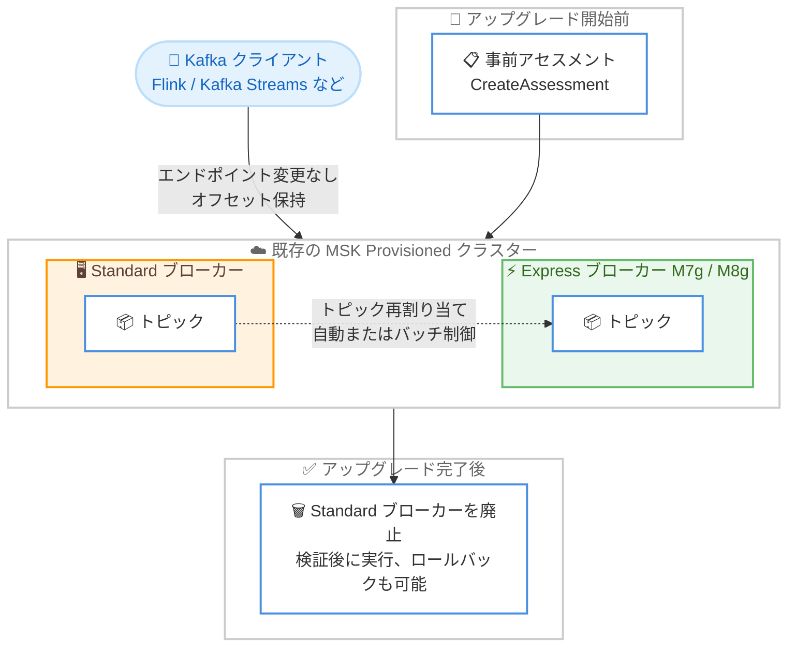

# Amazon MSK - Standard ブローカーから Express ブローカーへのインプレースアップグレード

**リリース日**: 2026 年 11 月 20 日
**サービス**: Amazon Managed Streaming for Apache Kafka (Amazon MSK)
**機能**: Standard ブローカーから Express ブローカーへのインプレースアップグレード

📊 [このアップデートのインフォグラフィックを見る](https://takech9203.github.io/aws-news-summary/20261120-amazon-msk-standard-brokers-to-express-brokers-in-place-upgrade.html)

## 概要

Amazon MSK は、MSK Provisioned クラスターを Standard ブローカーから Express ブローカーへインプレース (稼働中のクラスター内) でアップグレードする機能を発表しました。データ移行はフルマネージドで実行され、アプリケーションの変更は不要です。クラスターのエンドポイントは変わらないため、クライアント側の切り替え作業なしで Express ブローカーへ移行できます。

Express ブローカーは Standard ブローカーと比較して、ブローカーあたり最大 3 倍のスループット、最大 20 倍高速なスケーリング、最大 90% 高速な障害復旧を実現します。さらに、ストレージは自動的にスケールする従量課金制で、回復性に関するベストプラクティスがデフォルトで組み込まれています。既存の MSK Provisioned ユーザーにとって、クラスター再構築なしでこれらのメリットを得られる重要なアップデートです。

**アップデート前の課題**

このアップデート以前は、Standard ブローカーから Express ブローカーへの移行に大きな手間がかかっていました。

- Express ブローカーへ移行するには、新しいクラスターを作成し、ワークロードを移行する必要があった
- MirrorMaker 2 などを使ったレプリケーションや、クライアントの接続先切り替え (カットオーバー) の計画・実施が必要だった
- コンシューマーオフセットの引き継ぎや、ステートフルアプリケーションの再処理・重複のリスクに対処する必要があった

**アップデート後の改善**

今回のアップデートにより、移行プロセスが大幅に簡素化されました。

- 既存クラスター内に Express ブローカーが追加され、トピックが自動またはユーザーが制御するバッチ単位で移動されるため、クラスターの再作成が不要になった
- クラスターエンドポイントが維持されるため、アプリケーションのカットオーバーが不要になった
- コンシューマーオフセットが保持されるため、Apache Flink や Kafka Streams などのステートフルアプリケーションも再処理や重複なしで稼働を継続できるようになった
- Standard ブローカーは廃止 (デコミッション) するまでクラスターに残るため、検証と必要に応じたロールバックが可能になった

## アーキテクチャ図



既存クラスター内に Express ブローカーを追加し、トピックを段階的に再割り当てする流れを示しています。クライアントはエンドポイント変更なしで接続を継続でき、検証完了後に Standard ブローカーを廃止します。

## サービスアップデートの詳細

### 主要機能

1. **フルマネージドなインプレースアップグレード**
   - 既存の MSK Provisioned クラスターに Express ブローカーが追加され、トピックが Express ブローカーへ移動される
   - トピックの移動は自動実行、またはユーザーが制御するバッチ単位での実行を選択可能
   - アップグレードは数時間で完了し、新規クラスター作成とワークロード移行という従来のプロセスが不要

2. **アプリケーション無停止・無変更での移行**
   - クラスターエンドポイントが維持されるため、アプリケーション側の接続先変更が不要
   - コンシューマーオフセットが保持されるため、Apache Flink や Kafka Streams などのステートフルアプリケーションも再処理や重複なしで継続稼働

3. **検証とロールバックのサポート**
   - Standard ブローカーはユーザーが廃止するまでクラスター内に残る
   - Express ブローカーでの動作を検証した上で廃止でき、必要に応じてロールバックも可能

4. **事前アセスメント機能**
   - 移行前にクラスターを評価する API (CreateAssessment など) が追加され、アップグレードの準備状況を確認可能

## 技術仕様

### アップグレード要件

| 項目 | 詳細 |
|------|------|
| 対象クラスター | MSK Provisioned クラスター (Standard ブローカー) |
| Kafka バージョン | Apache Kafka 3.9 (KRaft モード) |
| 移行先インスタンス | Express ブローカー M7g または M8g |
| コスト効率 | M8g は M7g と比較して最大 30% のコスト削減 |
| 性能向上 | スループット最大 3 倍、スケーリング最大 20 倍高速、復旧最大 90% 高速 |

### API変更履歴

| 日付 | サービス | 変更内容 |
|------|----------|----------|
| 2026/11/19 | [kafka](https://awsapichanges.com/archive/changes/b8bc94-kafka.html) | 9 new 7 updated api methods - Standard から Express ブローカーへのインプレース移行をサポート。移行前のクラスターアセスメント API とトピック再割り当て API を追加 |

**新規 API (9 件):**

- `CreateAssessment` / `DescribeAssessment` / `DeleteAssessment` / `ListAssessments` / `ListAssessmentFindings`: 移行前のクラスターアセスメントの作成・照会
- `StartTopicReassignment` / `StopTopicReassignment` / `DescribeTopicReassignment` / `ListTopicReassignments`: Express ブローカーへのトピック再割り当ての開始・停止・照会

**更新 API (7 件):**

- `UpdateBrokerType`: ブローカータイプのアップグレードに対応
- `DescribeClusterOperation` / `DescribeClusterOperationV2` / `ListClusterOperations`: ブローカータイプアップグレードの詳細を返却
- `DescribeTopic` / `ListTopics` / `ListNodes`: トピックとノード情報の照会を拡張

## 設定方法

### 前提条件

1. MSK Provisioned クラスターが Apache Kafka 3.9 (KRaft モード) で稼働していること
2. Express ブローカーが利用可能なリージョンであること
3. 移行先として M7g または M8g インスタンスを選択すること

### 手順

#### ステップ1: 移行前アセスメントの実行

```bash
aws kafka create-assessment \
  --cluster-arn <クラスター ARN>
```

クラスターが Express ブローカーへのアップグレードに適した状態かを評価するアセスメントを作成します。結果は `list-assessment-findings` で確認できます。

#### ステップ2: ブローカータイプのアップグレード開始

```bash
aws kafka update-broker-type \
  --cluster-arn <クラスター ARN> \
  --current-version <現在のクラスターバージョン> \
  --target-instance-type express.m8g.large
```

クラスターに Express ブローカーを追加し、アップグレードプロセスを開始します。進行状況は `describe-cluster-operation-v2` で確認できます。

#### ステップ3: トピック再割り当ての実行と確認

```bash
aws kafka start-topic-reassignment \
  --cluster-arn <クラスター ARN>

aws kafka list-topic-reassignments \
  --cluster-arn <クラスター ARN>
```

トピックを Express ブローカーへ移動する再割り当てを開始し、進行状況 (完了トピック数 / 総トピック数) を確認します。バッチ単位で段階的に移動を制御することも可能です。

#### ステップ4: 検証と Standard ブローカーの廃止

Express ブローカー上でアプリケーションの動作を検証した後、Standard ブローカーを廃止します。問題が発生した場合は、廃止前であればロールバックが可能です。

## メリット

### ビジネス面

- **移行コストの削減**: 新規クラスター作成や二重運用期間の長期化が不要になり、移行プロジェクトの工数とコストを大幅に削減できる
- **ダウンタイムリスクの最小化**: エンドポイント維持とオフセット保持により、サービス停止やデータ重複のリスクなしで移行できる
- **TCO の改善**: Express ブローカーの従量課金ストレージと M8g インスタンスの活用により、長期的な運用コストを最適化できる

### 技術面

- **性能向上**: ブローカーあたり最大 3 倍のスループットにより、少ないブローカー数で同等以上の性能を実現できる
- **運用性の向上**: 最大 20 倍高速なスケーリングと最大 90% 高速な障害復旧により、運用負荷と障害影響を低減できる
- **安全な段階的移行**: アセスメント、バッチ制御、検証、ロールバックという段階的なプロセスにより、リスクを管理しながら移行できる

## デメリット・制約事項

### 制限事項

- Apache Kafka 3.9 (KRaft モード) で稼働する MSK Provisioned クラスターのみが対象
- 移行先は Express ブローカーの M7g または M8g インスタンスに限定される
- Express ブローカーが利用可能なリージョンでのみ利用できる

### 考慮すべき点

- アップグレード進行中は Standard ブローカーと Express ブローカーの両方に料金が発生する
- Standard ブローカーの廃止はユーザー操作で行うため、検証完了後に速やかに廃止しないと二重課金期間が長くなる
- ZooKeeper モードのクラスターや古い Kafka バージョンを使用している場合は、先に Kafka 3.9 (KRaft) へのアップグレードが必要

## ユースケース

### ユースケース1: 高スループットなイベント基盤の性能強化

**シナリオ**: ピーク時にブローカーのスループットが逼迫している大規模なイベントストリーミング基盤を、サービス停止なしで増強したい。

**実装例**:
```
1. create-assessment で移行可否を評価
2. update-broker-type で express.m8g へのアップグレードを開始
3. トピックを自動再割り当てし、ピーク時間帯を避けて段階的に移行
```

**効果**: ブローカーあたり最大 3 倍のスループットにより、ブローカー数を増やさずに性能を強化できます。

### ユースケース2: Flink / Kafka Streams を使うステートフル処理基盤の移行

**シナリオ**: Apache Flink によるリアルタイム集計パイプラインが稼働しており、オフセットのずれによる再処理や重複を避けながら Express ブローカーへ移行したい。

**実装例**:
```
1. インプレースアップグレードを開始 (エンドポイント変更なし)
2. コンシューマーオフセットは自動で保持される
3. Flink ジョブは変更なしで稼働を継続
```

**効果**: 再処理や重複なしでステートフルアプリケーションを継続稼働させたまま移行できます。

### ユースケース3: ストレージ運用の自動化とコスト最適化

**シナリオ**: Standard ブローカーで EBS ストレージのサイジングと監視に運用負荷がかかっており、ストレージ管理を自動化したい。

**実装例**:
```
1. express.m8g.large へインプレースアップグレード
2. Express ブローカーの自動スケールする従量課金ストレージへ移行
3. ストレージ容量の監視・拡張作業を廃止
```

**効果**: ストレージの事前プロビジョニングが不要になり、運用負荷の削減と M8g による最大 30% のコスト削減を実現できます。

## 料金

インプレースアップグレード自体に追加料金はありません。ただし、アップグレードの進行中は Standard ブローカーと Express ブローカーの両方の料金が発生します。アップグレード完了後は、Express ブローカーのインスタンス料金と従量課金ストレージ料金が適用されます。M8g インスタンスは M7g と比較して最大 30% のコスト削減が見込めます。

詳細は [Amazon MSK 料金ページ](https://aws.amazon.com/msk/pricing/) を参照してください。

## 利用可能リージョン

Express ブローカーが利用可能なすべての AWS リージョンで利用できます。

## 関連サービス・機能

- **Amazon MSK Express ブローカー**: 本アップデートの移行先となるブローカータイプ。高スループット、高速スケーリング、自動スケールするストレージを提供
- **Amazon Managed Service for Apache Flink**: MSK と組み合わせて使用されるステートフルなストリーム処理サービス。オフセット保持により移行後も継続稼働が可能
- **AWS Graviton (M7g / M8g)**: Express ブローカーの基盤となる Graviton ベースのインスタンス。M8g は Graviton4 ベースで高いコスト効率を実現

## 参考リンク

- 📊 [インフォグラフィック](https://takech9203.github.io/aws-news-summary/20261120-amazon-msk-standard-brokers-to-express-brokers-in-place-upgrade.html)
- [公式発表 (What's New)](https://aws.amazon.com/about-aws/whats-new/2026/11/amazon-msk-standard-brokers-to-express-brokers-in-place-upgrade)
- [AWS Blog: Announcing in-place upgrades from Standard brokers to Express brokers for Amazon MSK](https://aws.amazon.com/blogs/big-data/announcing-in-place-upgrades-from-standard-brokers-to-express-brokers-for-amazon-msk/)
- [Amazon MSK 開発者ガイド](https://docs.aws.amazon.com/msk/latest/developerguide/what-is-msk.html)
- [Express ブローカー製品ページ](https://aws.amazon.com/msk/features/express-brokers-for-amazon-msk/)
- [料金ページ](https://aws.amazon.com/msk/pricing/)

## まとめ

Amazon MSK のインプレースアップグレード機能により、クラスター再構築やアプリケーション変更なしで Standard ブローカーから Express ブローカーへ移行できるようになりました。Kafka 3.9 (KRaft) で稼働する MSK Provisioned クラスターを運用している場合は、まずアセスメント API で移行可否を評価し、性能向上とコスト最適化の効果を検討することを推奨します。
