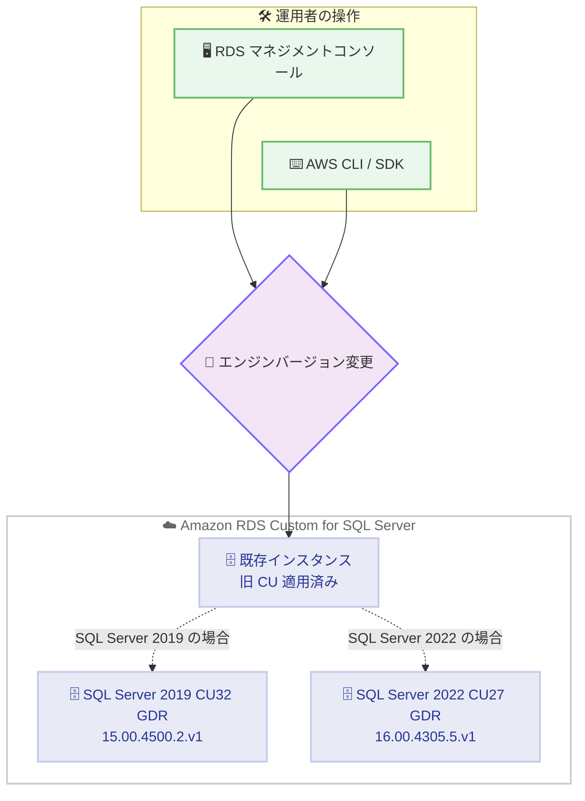

# Amazon RDS Custom - Microsoft SQL Server 最新 Cumulative Update および GDR 更新プログラムのサポート

**リリース日**: 2026 年 11 月 20 日
**サービス**: Amazon RDS Custom for SQL Server
**機能**: Microsoft SQL Server 最新 Cumulative Update および GDR 更新プログラムのサポート

📊 [このアップデートのインフォグラフィックを見る](https://takech9203.github.io/aws-news-summary/20261120-amazon-rds-custom-supports-latest-cumulative-update-gdr-microsoft-sql-server.html)

## 概要

Amazon RDS Custom for SQL Server が、Microsoft SQL Server の最新の Cumulative Update (CU) および GDR (General Distribution Release) 更新プログラムをサポートしました。今回サポートされたのは、SQL Server 2019 向けの CU32 + GDR (KB5128494) と、SQL Server 2022 向けの CU27 + GDR (KB5126934) です。

RDS Custom for SQL Server は、OS やデータベース環境へのアクセスを必要とするレガシーアプリケーションやサードパーティ製アプリケーション向けに、基盤環境のカスタマイズを可能にするマネージドデータベースサービスです。今回のアップデートにより、Microsoft が提供する最新のセキュリティ修正と機能改善を、RDS Custom 環境でも利用できるようになりました。

既存のインスタンスは、Amazon RDS マネジメントコンソール、AWS SDK、または AWS CLI を使用して新しいバージョンにアップグレードできます。各更新プログラムに含まれる修正内容と改善点の詳細は、Microsoft のドキュメント (KB 記事) で確認できます。

**アップデート前の課題**

最新の CU / GDR がサポートされる以前は、以下の課題がありました。

- SQL Server 2019 CU32 + GDR および SQL Server 2022 CU27 + GDR に含まれる最新のセキュリティ修正やバグ修正を RDS Custom 上で適用できなかった
- セキュリティコンプライアンス要件で最新パッチの適用が求められる環境では、RDS Custom でのパッチ提供を待つ必要があった

**アップデート後の改善**

- SQL Server 2019 では CU32 + GDR (RDS バージョン 15.00.4500.2.v1) が利用可能になった
- SQL Server 2022 では CU27 + GDR (RDS バージョン 16.00.4305.5.v1) が利用可能になった
- マネジメントコンソール、AWS CLI、AWS SDK のいずれからでも既存インスタンスをアップグレードできる

## アーキテクチャ図



既存の RDS Custom for SQL Server インスタンスを、コンソールまたは AWS CLI / SDK から最新の CU + GDR 適用済みバージョンへアップグレードする流れを示しています。

## サービスアップデートの詳細

### 主要機能

1. **SQL Server 2019 CU32 + GDR のサポート**
   - Microsoft KB5128494 (2026 年 10 月リリース) に対応
   - RDS エンジンバージョンは 15.00.4500.2.v1
   - CU32 までの累積的な修正と GDR のセキュリティ修正を含む

2. **SQL Server 2022 CU27 + GDR のサポート**
   - Microsoft KB5126934 (2026 年 10 月リリース) に対応
   - RDS エンジンバージョンは 16.00.4305.5.v1
   - CU27 までの累積的な修正と GDR のセキュリティ修正を含む

3. **複数の方法によるアップグレード**
   - Amazon RDS マネジメントコンソールからのアップグレード
   - AWS CLI または AWS SDK を使用したアップグレード
   - 既存インスタンスのエンジンバージョン変更として実行可能

## 技術仕様

### サポートされるバージョン

| SQL Server バージョン | 更新プログラム | Microsoft KB | RDS エンジンバージョン |
|----------------------|---------------|--------------|----------------------|
| SQL Server 2019 | CU32 + GDR | KB5128494 | 15.00.4500.2.v1 |
| SQL Server 2022 | CU27 + GDR | KB5126934 | 16.00.4305.5.v1 |

### CU と GDR の違い

| 更新タイプ | 内容 |
|-----------|------|
| CU (Cumulative Update) | セキュリティ修正に加え、バグ修正や機能改善を含む累積的な更新プログラム |
| GDR (General Distribution Release) | セキュリティ関連の重要な修正に限定した更新プログラム |

## 設定方法

### 前提条件

1. Amazon RDS Custom for SQL Server のインスタンスが稼働していること
2. アップグレード対象のエンジンバージョン (SQL Server 2019 または 2022) を使用していること
3. アップグレード前にスナップショットなどのバックアップを取得しておくこと (推奨)

### 手順

#### ステップ1: 利用可能なエンジンバージョンの確認

```bash
aws rds describe-db-engine-versions \
    --engine custom-sqlserver-ee \
    --query 'DBEngineVersions[].EngineVersion'
```

RDS Custom for SQL Server で利用可能なエンジンバージョンの一覧を取得し、新しいバージョン (15.00.4500.2.v1 または 16.00.4305.5.v1) が表示されることを確認します。エディションに応じて `custom-sqlserver-se` や `custom-sqlserver-web` を指定します。

#### ステップ2: インスタンスのアップグレード

```bash
aws rds modify-db-instance \
    --db-instance-identifier my-custom-sqlserver-instance \
    --engine-version 16.00.4305.5.v1 \
    --apply-immediately
```

既存の RDS Custom インスタンスのエンジンバージョンを新しい CU + GDR 適用済みバージョンに変更します。`--apply-immediately` を指定すると即時に適用され、指定しない場合は次のメンテナンスウィンドウで適用されます。

#### ステップ3: アップグレード結果の確認

```bash
aws rds describe-db-instances \
    --db-instance-identifier my-custom-sqlserver-instance \
    --query 'DBInstances[0].[DBInstanceStatus,EngineVersion]'
```

インスタンスのステータスが `available` に戻り、エンジンバージョンが新しいバージョンになっていることを確認します。

## メリット

### ビジネス面

- **セキュリティコンプライアンスの維持**: 最新のセキュリティ修正を適用することで、組織のパッチ適用ポリシーや監査要件に対応できる
- **安定性の向上**: Microsoft が提供する最新のバグ修正により、データベース障害のリスクを低減できる
- **運用負荷の軽減**: RDS のエンジンバージョン変更の仕組みでパッチ適用が完結し、手動でのパッチ管理作業を削減できる

### 技術面

- **累積的な修正の一括適用**: CU は累積的な更新のため、1 回のアップグレードでこれまでの修正をまとめて適用できる
- **複数のアップグレード手段**: コンソール、CLI、SDK のいずれからも実行でき、自動化パイプラインへの組み込みが容易
- **2019 / 2022 両バージョンへの対応**: 利用中の SQL Server バージョンに関わらず最新パッチを適用できる

## デメリット・制約事項

### 制限事項

- 対象は SQL Server 2019 (CU32 + GDR) と SQL Server 2022 (CU27 + GDR) であり、それ以外のバージョンは今回の発表の対象外
- アップグレードは自動では適用されず、利用者側での実行が必要

### 考慮すべき点

- アップグレード中はインスタンスが一時的に利用できなくなる時間が発生するため、メンテナンスウィンドウの計画が必要
- RDS Custom は OS / DB への変更が可能なサービスであるため、独自のカスタマイズがアップグレードに影響しないか事前検証が推奨される
- 適用前に Microsoft の KB 記事で修正内容と既知の問題を確認することが推奨される

## ユースケース

### ユースケース1: セキュリティパッチ適用ポリシーへの準拠

**シナリオ**: 金融機関などで、公開から一定期間内に最新セキュリティパッチの適用が義務付けられている SQL Server データベースを RDS Custom で運用している。

**実装例**:
```bash
aws rds modify-db-instance \
    --db-instance-identifier prod-sqlserver-2022 \
    --engine-version 16.00.4305.5.v1
```

**効果**: GDR に含まれるセキュリティ修正を適用し、社内のパッチ適用ポリシーと監査要件を満たせる。

### ユースケース2: 検証環境での事前テストを伴う段階的アップグレード

**シナリオ**: 本番適用前に、検証環境で CU32 の修正内容がアプリケーションに影響しないかを確認したい。

**実装例**:
```bash
# 検証環境へ先行適用
aws rds modify-db-instance \
    --db-instance-identifier staging-sqlserver-2019 \
    --engine-version 15.00.4500.2.v1 \
    --apply-immediately
```

**効果**: 検証環境で動作確認を行った上で本番環境に適用でき、アップグレードに伴うリスクを最小化できる。

### ユースケース3: メンテナンスウィンドウでの計画的適用

**シナリオ**: 業務時間外のメンテナンスウィンドウでパッチを適用し、業務影響を避けたい。

**実装例**:
```bash
aws rds modify-db-instance \
    --db-instance-identifier prod-sqlserver-2019 \
    --engine-version 15.00.4500.2.v1 \
    --no-apply-immediately
```

**効果**: 次回のメンテナンスウィンドウでアップグレードが実行され、業務時間中のダウンタイムを回避できる。

## 料金

新しい CU / GDR バージョンの利用による追加料金はありません。Amazon RDS Custom for SQL Server の通常の料金 (インスタンス、ストレージ、ライセンスなど) が適用されます。詳細は [Amazon RDS Custom の料金ページ](https://aws.amazon.com/rds/custom/pricing/) を参照してください。

## 利用可能リージョン

公式発表には対象リージョンの記載はありません。Amazon RDS Custom for SQL Server が利用可能なリージョンについては、[公式ドキュメント](https://docs.aws.amazon.com/AmazonRDS/latest/UserGuide/Concepts.RDS_Fea_Regions_DB-eng.Feature.RDSCustom.html)を参照してください。

## 関連サービス・機能

- **Amazon RDS for SQL Server**: OS アクセスが不要な場合は標準の RDS for SQL Server が選択肢となり、同様に CU / GDR 更新が提供される
- **AWS Systems Manager**: RDS Custom インスタンスの OS レイヤーの運用管理に利用できる
- **Amazon RDS スナップショット**: アップグレード前のバックアップ取得に使用し、問題発生時のロールバックに備えられる

## 参考リンク

- 📊 [インフォグラフィック](https://takech9203.github.io/aws-news-summary/20261120-amazon-rds-custom-supports-latest-cumulative-update-gdr-microsoft-sql-server.html)
- [公式発表 (What's New)](https://aws.amazon.com/about-aws/whats-new/2026/11/amazon-rds-custom-supports-latest-cumulative-update-gdr-microsoft-sql-server/)
- [Amazon RDS Custom 製品ページ](https://aws.amazon.com/rds/custom/)
- [RDS Custom for SQL Server のアップグレードガイド](https://docs.aws.amazon.com/AmazonRDS/latest/UserGuide/custom-upgrading-sqlserver.html)
- [Microsoft KB5128494 - SQL Server 2019 CU32 GDR](https://support.microsoft.com/en-us/servicing/sql/sql-server-2019/cumulative-update/kb5128494-cu32-gdr-october-2026)
- [Microsoft KB5126934 - SQL Server 2022 CU27 GDR](https://support.microsoft.com/en-us/servicing/sql/sql-server-2022/cumulative-update/kb5126934-cu27-gdr-october-2026)
- [料金ページ](https://aws.amazon.com/rds/custom/pricing/)

## まとめ

Amazon RDS Custom for SQL Server で、SQL Server 2019 CU32 + GDR および SQL Server 2022 CU27 + GDR の最新更新プログラムが利用可能になりました。セキュリティ修正と安定性向上を含む重要なアップデートであるため、RDS Custom for SQL Server を利用中の場合は、検証環境でのテストを経て計画的にアップグレードすることを推奨します。
