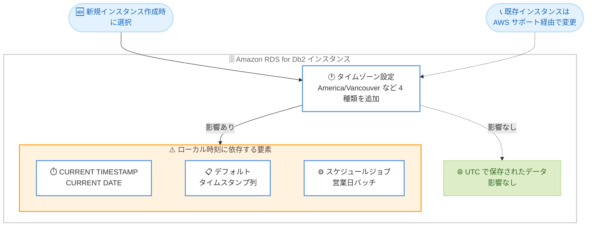

# Amazon RDS for Db2 - カナダの新しいタイムゾーンのサポート

**リリース日**: 2026 年 11 月 20 日
**サービス**: Amazon RDS for Db2
**機能**: カナダの新しいタイムゾーン (America/Vancouver、America/Edmonton、America/Inuvik、America/Winnipeg) のサポート

📊 [このアップデートのインフォグラフィックを見る](https://takech9203.github.io/aws-news-summary/20261120-amazon-rds-db2-supports-new-canadian-time.html)

## 概要

Amazon RDS for Db2 が、カナダの 4 つの新しいタイムゾーン (America/Vancouver、America/Edmonton、America/Inuvik、America/Winnipeg) をサポートするようになりました。これは、ブリティッシュコロンビア州、アルバータ州、ノースウェスト準州、マニトバ州において、2026 年 11 月 1 日より恒久的なサマータイム (永続 DST) が採用され、時計を 1 時間戻す運用が廃止されたことを反映したアップデートです。

UTC で保存されたデータはこの変更の影響を受けませんが、インスタンスのローカル時刻に依存する値、すなわち CURRENT TIMESTAMP、CURRENT DATE、デフォルトのタイムスタンプ列、スケジュールされたジョブ、営業日ベースのバッチロジックなどは影響を受ける可能性があります。新しいタイムゾーンを使用することで、これらの地域向けワークロードにおけるローカル時刻の値を正確に保つことができます。

カナダのこれらの地域にサービスを提供するデータベースを運用しているお客様は、対象インスタンスを確認し、誤ったローカル時刻の使用を避けるために設定を更新することが推奨されます。

**アップデート前の課題**

このアップデート以前には、以下の課題がありました。

- カナダの一部の州・準州における恒久的なサマータイム採用 (2026 年 11 月 1 日施行) を反映したタイムゾーンを RDS for Db2 インスタンスに設定できなかった
- 従来のタイムゾーン設定のままでは、11 月以降に CURRENT TIMESTAMP やデフォルトのタイムスタンプ列が実際のローカル時刻と 1 時間ずれる可能性があった
- スケジュールジョブや営業日ベースのバッチ処理が、意図しない時刻に実行されるリスクがあった

**アップデート後の改善**

今回のアップデートにより、以下が可能になりました。

- 新規インスタンスの作成時に America/Vancouver、America/Edmonton、America/Inuvik、America/Winnipeg の各タイムゾーンを選択できるようになった
- 対象地域の最新のローカル時刻ルールに準拠した正確なタイムスタンプ値を取得できるようになった
- ローカル時刻に依存するジョブやバッチロジックを、実際の地域時刻に合わせて正しく動作させられるようになった

## アーキテクチャ図



インスタンスのタイムゾーン設定が影響する範囲を示した図です。UTC で保存されたデータは影響を受けませんが、ローカル時刻に依存する機能はタイムゾーン設定の正確性に依存します。

## サービスアップデートの詳細

### 主要機能

1. **4 つの新しいカナダタイムゾーンの追加**
   - America/Vancouver (ブリティッシュコロンビア州)
   - America/Edmonton (アルバータ州)
   - America/Inuvik (ノースウェスト準州)
   - America/Winnipeg (マニトバ州)

2. **恒久的なサマータイムへの対応**
   - 対象の州・準州では 2026 年 11 月 1 日より恒久的なサマータイムを採用し、時計を 1 時間戻す運用を廃止
   - 新しいタイムゾーンは、この最新のローカル時刻ルールを反映

3. **新規インスタンス作成時のタイムゾーン選択**
   - 新しい RDS for Db2 インスタンスの作成時に、追加されたタイムゾーンを選択可能
   - 既存インスタンスのタイムゾーン変更は AWS CLI、API、SDK ではサポートされておらず、AWS サポートへの問い合わせが必要

## 技術仕様

### 追加されたタイムゾーン

| タイムゾーン | 対象地域 |
|------|------|
| America/Vancouver | ブリティッシュコロンビア州 |
| America/Edmonton | アルバータ州 |
| America/Inuvik | ノースウェスト準州 |
| America/Winnipeg | マニトバ州 |

### タイムゾーン設定の影響範囲

| 項目 | 影響 |
|------|------|
| UTC で保存されたデータ | 影響なし |
| CURRENT TIMESTAMP / CURRENT DATE | 影響あり |
| デフォルトのタイムスタンプ列 | 影響あり |
| スケジュールされたジョブ | 影響あり |
| 営業日ベースのバッチロジック | 影響あり |

## 設定方法

### 前提条件

1. Amazon RDS for Db2 を利用できる AWS アカウント
2. RDS インスタンスを作成するための IAM 権限
3. 対象ワークロードが依存するローカル時刻の要件の確認

### 手順

#### ステップ1: 新規インスタンス作成時にタイムゾーンを指定

```bash
aws rds create-db-instance \
    --db-instance-identifier my-db2-instance \
    --engine db2-se \
    --db-instance-class db.m6i.large \
    --allocated-storage 100 \
    --master-username admin \
    --manage-master-user-password \
    --timezone "America/Vancouver"
```

新規の RDS for Db2 インスタンスを作成し、タイムゾーンとして America/Vancouver を指定するコマンドです。タイムゾーンはインスタンス作成時にのみ指定できます。

#### ステップ2: 既存インスタンスのタイムゾーン変更

既存インスタンスのタイムゾーン変更は AWS CLI、API、SDK ではサポートされていません。変更が必要な場合は、AWS サポートに問い合わせてください。

#### ステップ3: 影響を受けるワークロードの確認

対象地域にサービスを提供しているインスタンスを確認し、CURRENT TIMESTAMP、デフォルトのタイムスタンプ列、スケジュールジョブ、営業日ベースのバッチロジックなど、ローカル時刻に依存する処理が正しい時刻で動作するかを検証します。

## メリット

### ビジネス面

- **正確な業務時刻の維持**: 対象地域の最新の時刻ルールに準拠することで、営業日ベースの処理や帳票の時刻を正確に保てる
- **コンプライアンス対応**: 州・準州の法制度変更に合わせたシステム運用が可能になる
- **運用リスクの低減**: ローカル時刻のずれに起因するジョブの誤実行やデータの時刻不整合を防止できる

### 技術面

- **マネージドな時刻ルール対応**: タイムゾーン定義の更新をデータベースエンジン側で個別に管理する必要がない
- **タイムスタンプの一貫性**: CURRENT TIMESTAMP やデフォルトのタイムスタンプ列が実際のローカル時刻と一致する
- **UTC データへの影響なし**: UTC で保存された既存データはそのまま利用できる

## デメリット・制約事項

### 制限事項

- 新しいタイムゾーンを選択できるのは新規インスタンスの作成時のみ
- 既存インスタンスのタイムゾーン変更は AWS CLI、API、SDK ではサポートされておらず、AWS サポートへの問い合わせが必要
- タイムゾーン変更の影響範囲 (既存のタイムスタンプ値やジョブスケジュール) は事前に十分な検証が必要

### 考慮すべき点

- 対象地域にサービスを提供しているインスタンスを棚卸しし、タイムゾーン設定の更新要否を判断する必要がある
- アプリケーション側でタイムゾーン変換を行っている場合は、データベース側の設定変更と合わせて整合性を確認する必要がある

## ユースケース

### ユースケース1: カナダ西部向け業務システムの時刻整合性の確保

**シナリオ**: ブリティッシュコロンビア州の顧客向けに業務システムを提供しており、データベースのローカル時刻を帳票や監査ログに使用している。

**実装例**:
```bash
aws rds create-db-instance \
    --db-instance-identifier bc-business-db \
    --engine db2-se \
    --db-instance-class db.r6i.xlarge \
    --allocated-storage 200 \
    --master-username admin \
    --manage-master-user-password \
    --timezone "America/Vancouver"
```

**効果**: 恒久的なサマータイム採用後も、帳票や監査ログの時刻が実際のローカル時刻と一致する。

### ユースケース2: 営業日ベースのバッチ処理の正確な実行

**シナリオ**: マニトバ州の金融系ワークロードで、営業日の締め処理を毎日ローカル時刻の深夜に実行している。

**実装例**:
```sql
-- インスタンスのタイムゾーンが America/Winnipeg に設定されている場合、
-- CURRENT TIMESTAMP は対象地域の正しいローカル時刻を返す
SELECT CURRENT TIMESTAMP FROM SYSIBM.SYSDUMMY1;
```

**効果**: 時刻ルール変更後も締め処理が意図したローカル時刻に実行され、営業日判定の誤りを防止できる。

### ユースケース3: 既存インスタンスのタイムゾーン移行計画

**シナリオ**: アルバータ州向けの既存 RDS for Db2 インスタンスが従来のタイムゾーン設定のままで、ローカル時刻が 1 時間ずれるリスクがある。

**実装例**:
```text
1. 対象インスタンスとローカル時刻依存処理の棚卸し
2. AWS サポートへタイムゾーン変更を依頼 (America/Edmonton)
3. 変更後にタイムスタンプ値とジョブスケジュールを検証
```

**効果**: 計画的な移行により、ローカル時刻のずれに起因する業務影響を最小化できる。

## 料金

本アップデートに伴う追加料金の記載はありません。タイムゾーンの選択は Amazon RDS for Db2 の標準機能であり、通常のインスタンス料金・ストレージ料金が適用されます。

## 利用可能リージョン

Amazon RDS for Db2 が提供されているすべての AWS リージョンで利用可能です。

## 関連サービス・機能

- **Amazon RDS**: マネージドリレーショナルデータベースサービス。Db2 のほか、MySQL、PostgreSQL、Oracle、SQL Server などをサポート
- **AWS Support**: 既存インスタンスのタイムゾーン変更には AWS サポートへの問い合わせが必要
- **Amazon CloudWatch**: スケジュールジョブやバッチ処理の実行時刻の監視に活用可能

## 参考リンク

- 📊 [インフォグラフィック](https://takech9203.github.io/aws-news-summary/20261120-amazon-rds-db2-supports-new-canadian-time.html)
- [公式発表 (What's New)](https://aws.amazon.com/about-aws/whats-new/2026/11/amazon-rds-db2-supports-new-canadian-time)
- [ドキュメント: Amazon RDS for Db2 でサポートされるタイムゾーン](https://docs.aws.amazon.com/AmazonRDS/latest/UserGuide/db2-time-zone.html)
- [料金ページ](https://aws.amazon.com/rds/db2/pricing/)

## まとめ

カナダの 4 つの州・準州における恒久的なサマータイム採用を反映し、Amazon RDS for Db2 で新しいタイムゾーンが利用可能になりました。対象地域にサービスを提供しているインスタンスでは、CURRENT TIMESTAMP やスケジュールジョブなどローカル時刻に依存する処理が 1 時間ずれるリスクがあるため、インスタンスの棚卸しとタイムゾーン設定の見直しを推奨します。既存インスタンスの変更には AWS サポートへの問い合わせが必要な点に注意してください。
