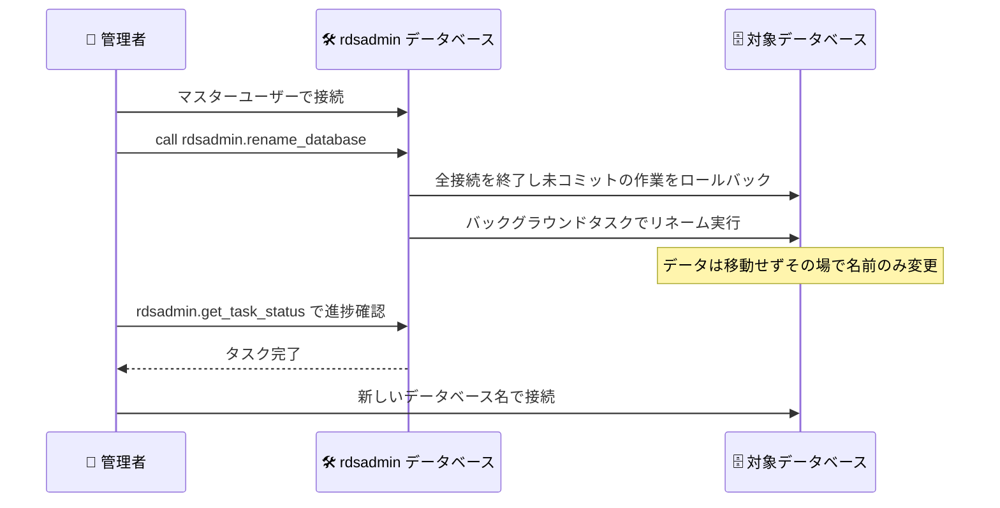

# Amazon RDS for Db2 - データベース名の変更サポート

**リリース日**: 2026 年 11 月 20 日
**サービス**: Amazon RDS for Db2
**機能**: データベースのリネーム (rdsadmin.rename_database ストアドプロシージャ)

📊 [このアップデートのインフォグラフィックを見る](https://takech9203.github.io/aws-news-summary/20261120-amazon-rds-db2-supports-rename-databases.html)

## 概要

Amazon RDS for Db2 が、DB インスタンス上のデータベース名をその場で変更 (リネーム) する機能をサポートしました。新しいストアドプロシージャ `rdsadmin.rename_database` を呼び出すことで、データを移動せずにデータベース名のみを変更できます。

リネーム処理はデータをインスタンス上に保持したまま実行されるため、従来のバックアップとリストアによる名前変更よりも高速です。処理はバックグラウンドタスクとして実行され、`rdsadmin.get_task_status` で進捗を監視できます。

この機能は、バックアップからリストアしたデータベースのコピーを本番用に切り替えるようなシナリオを効率化します。元のデータベースを別名にリネームし、リストアしたコピーに元の名前を割り当てることで、アプリケーションの接続文字列を変更することなくデータベースを入れ替えられます。

**アップデート前の課題**

- 以前はデータベース名を変更するには、データベースをバックアップし、別名でリストアする必要があった
- バックアップとリストアはデータ量に比例して時間がかかり、大規模データベースでは長時間の作業となっていた
- リストアしたコピーに元の名前を付け替える手段がなく、名前を変えたい場合はアプリケーション側の接続文字列の変更が必要になるケースがあった

**アップデート後の改善**

- `rdsadmin.rename_database` を呼び出すだけで、データを移動せずにデータベース名を変更できるようになった
- データはそのままの位置に保持されるため、バックアップとリストアによる方法よりも高速に名前を変更できる
- リストアしたコピーに元のデータベース名を割り当てることで、アプリケーションの接続文字列を変更せずにデータベースを入れ替えられるようになった

## アーキテクチャ図



マスターユーザーが `rdsadmin` データベース経由でリネームを依頼し、バックグラウンドタスクとして名前変更が実行される流れを示しています。

## サービスアップデートの詳細

### 主要機能

1. **rdsadmin.rename_database ストアドプロシージャ**
   - DB インスタンス上のデータベース名をその場で変更する新しいストアドプロシージャ
   - RDS for Db2 ではマスターユーザーに `SYSADM` 権限がないため、Amazon RDS が提供するストアドプロシージャ経由で操作する
   - データはインスタンス上に保持されるため、バックアップとリストアより高速

2. **バックグラウンドタスクとしての実行**
   - リネームはバックグラウンドタスクとして実行され、完了まで数分かかる場合がある
   - `rdsadmin.get_task_status` ユーザー定義関数でタスクの状態を監視できる

3. **リストアしたコピーとの入れ替え**
   - バックアップからリストアしたデータベースに元の名前を割り当てる運用が可能
   - アプリケーションの接続文字列を変更せずにデータベースを入れ替えられる

## 技術仕様

### リネーム操作の仕様

| 項目 | 詳細 |
|------|------|
| 実行方法 | `rdsadmin.rename_database` ストアドプロシージャ |
| 接続先 | `rdsadmin` データベース (マスターユーザーで接続) |
| 実行形態 | バックグラウンドタスク (完了まで数分かかる場合あり) |
| 監視方法 | `rdsadmin.get_task_status` |
| 接続への影響 | 対象データベースへの全接続が終了し、未コミットの作業はロールバックされる |
| 事前条件 | リードレプリカの削除、リネーム可否の確認が必要 |

### 構文

```sql
db2 "call rdsadmin.rename_database(?, '{{current_database_name}}', '{{new_database_name}}')"
```

第 1 引数は出力パラメータ、第 2 引数に現在のデータベース名、第 3 引数に新しいデータベース名を指定します。新しい名前がすでに存在する場合は `Database already exists` エラーが返されるため、別の名前を指定する必要があります。

## 設定方法

### 前提条件

1. リネーム可能な状態であることを事前に確認する (ドキュメントの「Checking when you can rename a database」を参照)
2. DB インスタンスのリードレプリカをすべて削除する
3. DB インスタンスのマスターユーザー名とマスターパスワードを用意する
4. 作業をコミットしておく (リネームは対象データベースへの全接続を終了し、未コミットの作業をロールバックする)

### 手順

#### ステップ 1: rdsadmin データベースへ接続

```bash
db2 "connect to rdsadmin user {{master_username}} using {{master_password}}"
```

マスターユーザーの認証情報を使用して、ストアドプロシージャの実行に必要な `rdsadmin` データベースへ接続します。

#### ステップ 2: データベースのリネームを実行

```bash
db2 "call rdsadmin.rename_database(?, '{{current_database_name}}', '{{new_database_name}}')"
```

現在のデータベース名と新しいデータベース名を指定して `rdsadmin.rename_database` を呼び出します。エラーが返された場合は原因を解消して再実行します。

#### ステップ 3: タスクの完了を確認

```bash
db2 "select varchar(r.task_type,25) as task_type, r.database_name,
    varchar(r.lifecycle,15) as lifecycle, r.created_at
    from table(rdsadmin.get_task_status(null,null,'rename_database'))
    as r order by created_at desc"
```

`rdsadmin.get_task_status` でバックグラウンドタスクの状態を確認します。タスクはバックグラウンドで実行され、完了まで数分かかる場合があります。完了後、アプリケーションは新しいデータベース名で接続します。

## メリット

### ビジネス面

- **ダウンタイムの短縮**: バックアップとリストアを伴わないため、名前変更に要する時間が大幅に短縮され、メンテナンスウィンドウを小さくできる
- **運用コストの削減**: バックアップ用の Amazon S3 連携設定やリストア作業が不要になり、運用負荷が軽減される
- **アプリケーション変更不要の切り替え**: リストアしたコピーに元の名前を付与することで、接続文字列を変更せずにデータベースを入れ替えられる

### 技術面

- **高速な処理**: データをその場に保持したまま名前のみを変更するため、データ量に依存するバックアップとリストアより高速
- **監視可能な非同期実行**: `rdsadmin.get_task_status` によりタスクの進捗や結果を確認でき、自動化にも組み込みやすい
- **既存の運用モデルとの一貫性**: 他のデータベース管理操作と同様に `rdsadmin` ストアドプロシージャで統一的に操作できる

## デメリット・制約事項

### 制限事項

- リネームの実行前に、DB インスタンスのリードレプリカをすべて削除する必要がある
- リネームは対象データベースへのすべての接続を終了させ、未コミットの作業はロールバックされる
- 新しい名前のデータベースがすでに存在する場合はエラーとなる

### 考慮すべき点

- タスクはバックグラウンドで実行され完了まで数分かかる場合があるため、完了を確認してからアプリケーションを接続する必要がある
- 実行前にリネーム可能な状態かどうかをドキュメントの手順に従って確認することが推奨される
- アプリケーション側では新しいデータベース名への接続切り替えのタイミングを計画しておく必要がある

## ユースケース

### ユースケース 1: リストアしたコピーへの切り替え

**シナリオ**: 障害や論理破損からの復旧のためにバックアップからデータベースをリストアし、アプリケーションの接続文字列を変更せずに本番データベースとして切り替えたい。

**実装例**:
```sql
-- 1. バックアップから PRODDB のコピーを PRODDB2 としてリストア済みとする
-- 2. 元のデータベースを退避用の名前へ変更
call rdsadmin.rename_database(?, 'PRODDB', 'PRODDBOLD')
-- 3. リストアしたコピーに元の名前を割り当て
call rdsadmin.rename_database(?, 'PRODDB2', 'PRODDB')
```

**効果**: アプリケーションは従来どおり `PRODDB` へ接続するだけでよく、接続文字列の変更なしで復旧したデータベースへ切り替えられる。

### ユースケース 2: 命名規則の統一

**シナリオ**: 組織のデータベース命名規則が変更され、既存のデータベース名を新しい規則に合わせたい。

**実装例**:
```sql
call rdsadmin.rename_database(?, 'TESTDB', 'DEVAPPDB')
```

**効果**: バックアップとリストアによる長時間の作業なしで、短時間で命名規則に準拠した名前へ変更できる。

### ユースケース 3: 環境移行時の名前調整

**シナリオ**: 検証環境で構築したデータベースを本番相当の名前に変更して利用を開始したい。

**実装例**:
```sql
-- 検証用の名前から本番用の名前へ変更
call rdsadmin.rename_database(?, 'STAGEDB', 'APPDB')
-- タスクの完了を確認
select * from table(rdsadmin.get_task_status(null,null,'rename_database'))
```

**効果**: データ移行作業を行わずに環境の切り替えを完了でき、移行作業の時間とリスクを削減できる。

## 料金

この機能自体に追加料金は発生しません。Amazon RDS for Db2 の通常のインスタンス料金、ストレージ料金、および IBM Db2 ライセンス料金が適用されます。

## 利用可能リージョン

Amazon RDS for Db2 が提供されているすべての AWS リージョンで利用できます。

## 関連サービス・機能

- **rdsadmin.restore_database**: Amazon S3 上のバックアップからデータベースをリストアするストアドプロシージャ。リストアしたコピーと組み合わせてリネームを活用できる
- **rdsadmin.get_task_status**: リネームを含むバックグラウンドタスクの状態を確認するユーザー定義関数
- **rdsadmin.backup_database**: データベースを Amazon S3 へバックアップするストアドプロシージャ。リネーム前の保全に利用できる

## 参考リンク

- 📊 [インフォグラフィック](https://takech9203.github.io/aws-news-summary/20261120-amazon-rds-db2-supports-rename-databases.html)
- [公式発表 (What's New)](https://aws.amazon.com/about-aws/whats-new/2026/11/amazon-rds-db2-supports-rename-databases)
- [ドキュメント: Renaming a database without restoring it](https://docs.aws.amazon.com/AmazonRDS/latest/UserGuide/db2-managing-databases.html#db2-renaming-database)
- [料金ページ: Amazon RDS for Db2](https://aws.amazon.com/rds/db2/pricing/)

## まとめ

Amazon RDS for Db2 でデータベース名をその場で変更できるようになり、従来必要だったバックアップとリストアによる長時間の作業が不要になりました。特にバックアップからリストアしたコピーを接続文字列の変更なしで本番へ切り替えられる点は、復旧手順の簡素化に直結します。RDS for Db2 を運用しているチームは、復旧手順書や運用手順に `rdsadmin.rename_database` の活用を組み込むことを推奨します。
