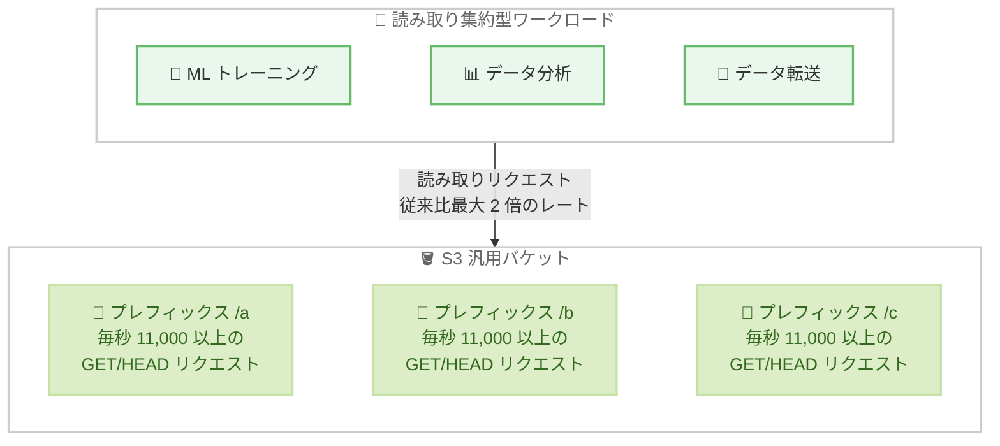

# Amazon S3 - 汎用バケットの読み取りリクエストレートを最大 2 倍に向上

**リリース日**: 2026 年 11 月 20 日
**サービス**: Amazon S3 (Simple Storage Service)
**機能**: 汎用バケットにおける GET/HEAD リクエストレートの引き上げ

📊 [このアップデートのインフォグラフィックを見る](https://takech9203.github.io/aws-news-summary/20261120-amazon-s3-increases-read-request-rate.html)

## 概要

Amazon S3 は、汎用バケット (general purpose buckets) における読み取りリクエストレートを最大 2 倍に引き上げたことを発表しました。これまでプレフィックスあたり毎秒 5,500 リクエストだった GET/HEAD リクエストの性能が、毎秒 11,000 リクエスト以上に向上します。

この性能向上は、すべての AWS リージョンの既存の読み取りリクエストに自動的に適用されます。アプリケーションの変更や追加設定は一切不要で、標準の S3 リクエスト料金以外の追加コストも発生しません。

機械学習のトレーニング、データ分析、データ転送など、読み取り集約型のワークロードを運用するユーザーは、このアップデートによりデータをより高速に取得できるようになります。さらに高いスループットが必要な場合は、従来どおり複数のプレフィックスにリクエストを分散することで、S3 がプレフィックスごとに独立してスケールします。

**アップデート前の課題**

- 汎用バケットの GET/HEAD リクエストは、プレフィックスあたり毎秒 5,500 リクエストが性能の目安であった
- 読み取り集約型のワークロードでは、スループットを確保するために多数のプレフィックスへの分散設計が早い段階で必要になることがあった
- ML トレーニングや大規模分析など、短時間に大量の読み取りが発生するワークロードでは、リクエストレートが制約になる場合があった

**アップデート後の改善**

- プレフィックスあたりの GET/HEAD リクエストレートが毎秒 11,000 リクエスト以上に向上し、従来比で最大 2 倍となった
- すべての AWS リージョンで自動的に適用されるため、アプリケーション変更や設定作業が不要になった
- 追加料金なしで読み取り性能が向上し、同じプレフィックス設計のままでより高いスループットを実現できるようになった

## アーキテクチャ図



各プレフィックスが毎秒 11,000 以上の GET/HEAD リクエストを独立して処理できるため、複数のプレフィックスに分散することでバケット全体のスループットをさらにスケールできます。

## サービスアップデートの詳細

### 主要機能

1. **GET/HEAD リクエストレートの引き上げ**
   - プレフィックスあたり毎秒 5,500 リクエストから 11,000 リクエスト以上へ向上
   - 従来比で最大 2 倍の読み取り性能
   - 対象は S3 汎用バケット

2. **自動適用**
   - すべての AWS リージョンで既存の読み取りリクエストに自動的に適用
   - アプリケーションコードや設定の変更は不要
   - 新規リクエストだけでなく既存ワークロードもそのまま恩恵を受けられる

3. **プレフィックス単位の独立スケーリング**
   - リクエストレートはプレフィックス単位で適用される
   - 複数のプレフィックスにリクエストを分散することで、S3 が各プレフィックスを独立してスケール
   - バケット全体では事実上の上限なくスループットを拡張可能

## 技術仕様

### リクエストレートの比較

| 項目 | アップデート前 | アップデート後 |
|------|----------------|----------------|
| GET/HEAD リクエストレート (プレフィックスあたり) | 毎秒 5,500 リクエスト | 毎秒 11,000 リクエスト以上 |
| 対象バケットタイプ | 汎用バケット | 汎用バケット |
| 適用方法 | - | 自動適用 (設定変更不要) |
| 追加料金 | - | なし (標準のリクエスト料金のみ) |

### スループット拡張の考え方

| プレフィックス数 | バケット全体の GET/HEAD レートの目安 |
|------------------|--------------------------------------|
| 1 | 毎秒 11,000 リクエスト以上 |
| 5 | 毎秒 55,000 リクエスト以上 |
| 10 | 毎秒 110,000 リクエスト以上 |

## 設定方法

### 前提条件

1. S3 汎用バケットを使用していること (今回の対象は汎用バケット)
2. 特別な設定は不要 (自動適用)

### 手順

#### ステップ 1: 何もする必要はありません

今回の性能向上は、すべての AWS リージョンの既存の読み取りリクエストに自動的に適用されます。アプリケーションの変更、API の変更、設定作業は一切不要です。

#### ステップ 2: さらに高いスループットが必要な場合はプレフィックスを分散する

```text
s3://my-bucket/dataset-a/images/0001.jpg
s3://my-bucket/dataset-b/images/0001.jpg
s3://my-bucket/dataset-c/images/0001.jpg
```

オブジェクトキーの先頭部分 (プレフィックス) を分けてリクエストを分散すると、S3 は各プレフィックスを独立してスケールするため、バケット全体のスループットをさらに引き上げられます。

#### ステップ 3: リクエストレートの状況を確認する

```bash
# CloudWatch で S3 の 5xx エラー (スロットリングを含む) を確認
aws cloudwatch get-metric-statistics \
  --namespace AWS/S3 \
  --metric-name 5xxErrors \
  --dimensions Name=BucketName,Value=my-bucket Name=FilterId,Value=EntireBucket \
  --start-time 2026-11-19T00:00:00Z \
  --end-time 2026-11-20T00:00:00Z \
  --period 3600 \
  --statistics Sum
```

S3 リクエストメトリクスを有効にしたバケットで 5xx エラー数を取得し、503 Slow Down などのスロットリングが発生していないかを確認します。アップデート後もスロットリングが続く場合は、プレフィックスの分散を検討します。

## メリット

### ビジネス面

- **追加コストなしの性能向上**: 標準の S3 リクエスト料金のまま、読み取り性能が最大 2 倍になる
- **移行作業が不要**: 自動適用のため、エンジニアリングリソースを使わずに恩恵を受けられる
- **ワークロードの高速化**: ML トレーニングや分析ジョブの実行時間短縮により、ビジネスの意思決定サイクルを加速できる

### 技術面

- **シンプルなプレフィックス設計**: 同じスループット要件に対して必要なプレフィックス数が半分で済み、キー設計を簡素化できる
- **スロットリングの低減**: 毎秒 5,500 リクエスト超でも 503 エラーが発生しにくくなり、リトライ処理の負荷が減る
- **スケーラビリティの向上**: プレフィックス分散と組み合わせることで、より少ない工夫で大規模な読み取りスループットを実現できる

## デメリット・制約事項

### 制限事項

- 対象は GET/HEAD リクエスト (読み取り) であり、PUT などの書き込みリクエストレートの変更は発表されていない
- 対象は汎用バケットであり、他のバケットタイプについては言及されていない
- リクエストレートはプレフィックス単位で適用されるため、単一プレフィックスに集中するアクセスパターンでは上限に達する可能性が残る

### 考慮すべき点

- 毎秒 11,000 を超える読み取りが必要な場合は、引き続き複数プレフィックスへの分散設計が推奨される
- 急激なリクエスト増加時には S3 の内部スケーリングが追従するまで一時的に 503 が返る場合があるため、エクスポネンシャルバックオフによるリトライは引き続き実装しておくべきである

## ユースケース

### ユースケース 1: 機械学習トレーニングデータの読み込み

**シナリオ**: 大量の画像ファイルを S3 から読み込んで GPU クラスターで分散トレーニングを実行する。トレーニングの開始時に数百万オブジェクトの読み取りが集中する。

**実装例**:
```text
s3://ml-training-data/shard-00/...
s3://ml-training-data/shard-01/...
s3://ml-training-data/shard-02/...
```

**効果**: 各シャード (プレフィックス) が毎秒 11,000 以上の読み取りを処理できるため、データロードのボトルネックが緩和され、GPU の待機時間を削減できる。

### ユースケース 2: データレイクに対する大規模分析クエリ

**シナリオ**: Amazon Athena や Apache Spark から S3 上の Parquet ファイルに対して多数の並列スキャンを実行する。

**実装例**:
```text
s3://datalake/table/dt=2026-11-19/...
s3://datalake/table/dt=2026-11-20/...
```

**効果**: パーティションごとのプレフィックスで毎秒 11,000 以上の GET を処理できるため、高並列クエリでもスロットリングが起きにくく、クエリ実行時間を短縮できる。

### ユースケース 3: 大容量データの移行・転送

**シナリオ**: S3 から別リージョンやオンプレミスへ大量のオブジェクトを並列転送する。転送ツールが多数の同時 GET を発行する。

**実装例**:
```bash
# AWS CLI の並列度を高めて転送する例
aws configure set default.s3.max_concurrent_requests 256
aws s3 sync s3://source-bucket/ s3://dest-bucket/
```

**効果**: 読み取りレートの上限が 2 倍になったことで、同じプレフィックス構成のままより高い並列度で転送でき、移行時間を短縮できる。

## 料金

追加料金はありません。向上した読み取り性能は、標準の S3 リクエスト料金の範囲内で利用できます。GET などのリクエスト料金はリージョンとストレージクラスにより異なるため、詳細は料金ページを参照してください。

## 利用可能リージョン

すべての AWS リージョンで利用可能です。既存の読み取りリクエストに自動的に適用されます。

## 関連サービス・機能

- **Amazon S3 Express One Zone**: さらに高いリクエスト性能と低レイテンシーが必要な場合の選択肢となるディレクトリバケット
- **Amazon CloudWatch**: S3 リクエストメトリクスにより、リクエストレートや 5xx エラーを監視可能
- **Amazon Athena / AWS Glue**: S3 上のデータレイクに対する分析で、読み取りレート向上の恩恵を受けやすいサービス

## 参考リンク

- 📊 [インフォグラフィック](https://takech9203.github.io/aws-news-summary/20261120-amazon-s3-increases-read-request-rate.html)
- [公式発表 (What's New)](https://aws.amazon.com/about-aws/whats-new/2026/11/amazon-s3-increases-read-request-rate/)
- [ドキュメント: Best practices design patterns - optimizing Amazon S3 performance](https://docs.aws.amazon.com/AmazonS3/latest/userguide/optimizing-performance.html)
- [Amazon S3 製品ページ](https://aws.amazon.com/s3/)
- [料金ページ](https://aws.amazon.com/s3/pricing/)

## まとめ

Amazon S3 汎用バケットの GET/HEAD リクエストレートが、プレフィックスあたり毎秒 5,500 から 11,000 以上へと最大 2 倍に向上しました。すべてのリージョンで追加料金なし・設定変更なしで自動適用されるため、ユーザー側の対応は不要です。ML トレーニングや大規模分析などの読み取り集約型ワークロードを運用している場合は、現在のスロットリング状況を確認し、必要に応じてプレフィックス分散設計を見直すことを推奨します。
