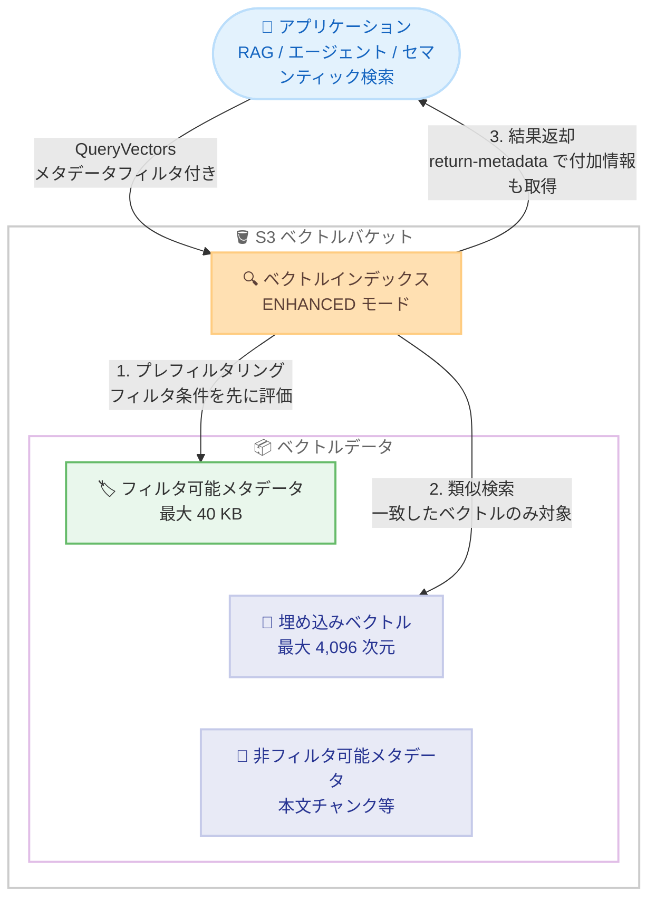

# Amazon S3 Vectors - フィルタ可能メタデータの上限をベクトルあたり 40 KB に引き上げ

**リリース日**: 2026 年 11 月 20 日
**サービス**: Amazon S3 Vectors
**機能**: フィルタ可能メタデータ上限の 40 KB への拡大

📊 [このアップデートのインフォグラフィックを見る](https://takech9203.github.io/aws-news-summary/20261120-amazon-s3-vectors-raises-filterable-metadata-40kb-per-vector.html)

## 概要

Amazon S3 Vectors は、ベクトルあたりのフィルタ可能メタデータの上限を従来の 2 KB から 40 KB に引き上げました。これにより、カテゴリ、アクセス権限、タイムスタンプ、タグなど、より多くの属性をベクトルに付与し、クエリ時の絞り込み条件として利用できるようになります。

S3 Vectors は、Amazon S3 上でベクトルの保存とクエリをネイティブにサポートするサービスで、数十億規模のベクトルに対してコスト最適化されたストレージとクエリを提供します。今回の拡大は、RAG (Retrieval-Augmented Generation)、エージェント型アプリケーション、セマンティック検索など、豊富なメタデータによる絞り込みが重要なワークロードに特に有効です。

拡大された上限は「enhanced index mode (ENHANCED)」のベクトルインデックスで適用されます。新規に作成したベクトルバケットのインデックスはデフォルトで新しい上限に対応し、既存のインデックスは `UpdateIndexMode` API でその場で ENHANCED モードに更新できます。`PutVectors` (書き込み) や `QueryVectors` (フィルタ付きクエリ) の使い方に変更はありません。

**アップデート前の課題**

このアップデート以前は、フィルタ可能メタデータの容量制限が厳しく、設計上の工夫が必要でした。

- 以前はフィルタ可能メタデータがベクトルあたり 2 KB に制限されており、付与できる属性の数や文字列長が限られていた
- アクセス権限リストや多数のタグなど、サイズの大きい属性でフィルタリングしたい場合、メタデータを外部のデータストアに分離して二段階で絞り込む必要があった
- フィルタに使用する属性を厳選するため、アプリケーション側でメタデータの取捨選択やサイズ管理の実装が必要だった

**アップデート後の改善**

今回のアップデートにより、より豊富な属性によるフィルタリングが可能になりました。

- ENHANCED インデックスでは、フィルタ可能メタデータをベクトルあたり最大 40 KB まで付与できるようになった (従来比 20 倍)
- カテゴリ、権限、タイムスタンプ、タグなど多数の属性を 1 つのベクトルに持たせ、`QueryVectors` のフィルタで直接絞り込めるようになった
- 既存のインデックスも `UpdateIndexMode` API により再インジェスト不要・追加料金なしでその場で ENHANCED モードへ移行できる

## アーキテクチャ図



ENHANCED インデックスでは、メタデータフィルタを先に評価してからベクトル検索を実行するプレフィルタリングが適用され、最大 40 KB のフィルタ可能メタデータで高い再現率の絞り込みが可能です。

## サービスアップデートの詳細

### 主要機能

1. **フィルタ可能メタデータ上限の拡大 (2 KB → 40 KB)**
   - ENHANCED インデックスでは、ベクトルあたり最大 40 KB のメタデータをフィルタ可能として扱える
   - フィルタ可能な文字列値は 1 値あたり最大 2 KB (文字列リストの各要素を含む)
   - ベクトルあたりの合計メタデータは ENHANCED インデックスで最大 100 KB、メタデータキーは最大 50 個

2. **既存 API との互換性**
   - `PutVectors` によるメタデータ付きベクトルの書き込み方法に変更なし
   - `QueryVectors` によるフィルタ付きクエリの書き方にも変更なし
   - サイズ上限を超えるメタデータを書き込もうとした場合、`PutVectors` は `400 Bad Request` エラーを返す

3. **既存インデックスのその場での移行**
   - 2026 年 9 月 30 日より前に作成されたベクトルバケットのインデックスは CLASSIC モードで動作
   - `UpdateIndexMode` API で ENHANCED モードへ再インジェスト不要・クエリ変更不要・追加料金なしで移行可能
   - 新規に作成したベクトルバケットのインデックスはデフォルトで ENHANCED モードとなり、最初から 40 KB の上限が適用される

4. **プレフィルタリングによる高い再現率**
   - ENHANCED インデックスはフィルタ条件を先に評価し、一致したベクトルのみを類似検索の対象とする
   - フィルタに一致するベクトルが全体のごく一部でも、高い再現率 (recall) を維持できる
   - `$startsWith` 演算子によるプレフィックスマッチも ENHANCED モードで利用可能

## 技術仕様

### CLASSIC モードと ENHANCED モードの比較

| 項目 | CLASSIC | ENHANCED |
|------|---------|----------|
| フィルタ可能メタデータ/ベクトル | 最大 2 KB | 最大 40 KB |
| 合計メタデータ/ベクトル | 最大 40 KB | 最大 100 KB |
| 非フィルタ可能メタデータの単一フィールド | 最大 40 KB | 最大 100 KB |
| フィルタ評価方式 | 検索と同時評価 | プレフィルタリング (フィルタを先に評価) |
| `$startsWith` 演算子 | `queryMode=ENHANCED` 指定時のみ | 利用可能 |
| クエリあたりのフィルタ制約数 | 制限対象外 | 最大 100 |
| デフォルト適用 | 2026 年 9 月 30 日より前に作成されたバケット | それ以降に作成されたバケット |

### メタデータ関連の主な制限 (ENHANCED インデックス)

| 項目 | 詳細 |
|------|------|
| フィルタ可能メタデータ/ベクトル | 最大 40 KB |
| 合計メタデータ/ベクトル | 最大 100 KB |
| メタデータキー数/ベクトル | 最大 50 |
| フィルタ可能な文字列値 | 1 値あたり最大 2 KB (文字列リストの各要素を含む) |
| 非フィルタ可能メタデータキー数/インデックス | 最大 10 |
| サポートされる型 | string、number、boolean、list |
| フィルタ演算子 | `$eq` `$ne` `$gt` `$gte` `$lt` `$lte` `$startsWith` `$in` `$nin` `$exists` `$and` `$or` |

### API変更履歴

今回のアップデートは既存 API の上限緩和であり、新規 API の追加や API シグネチャの変更はありません。既存インデックスの移行に使用する `UpdateIndexMode` API は、2026 年 9 月 30 日のメタデータプレフィルタリング発表時に導入済みのものです。

## 設定方法

### 前提条件

1. S3 Vectors が利用可能なリージョンでベクトルバケットとベクトルインデックスを作成済みであること
2. AWS CLI または AWS SDK が最新バージョンに更新されていること
3. `s3vectors:GetIndex`、`s3vectors:UpdateIndexMode`、`s3vectors:PutVectors`、`s3vectors:QueryVectors` などの IAM 権限が付与されていること

### 手順

#### ステップ1: 既存インデックスのモードを確認する

```bash
aws s3vectors get-index \
  --vector-bucket-name "amzn-s3-demo-vector-bucket" \
  --index-name "my-index"
```

対象インデックスの現在のインデックスモード (CLASSIC または ENHANCED) を確認します。Amazon S3 コンソールのインデックス詳細ページでも確認できます。

#### ステップ2: インデックスを ENHANCED モードに更新する

```bash
aws s3vectors update-index-mode \
  --vector-bucket-name "amzn-s3-demo-vector-bucket" \
  --index-name "my-index" \
  --index-mode "ENHANCED"
```

CLASSIC モードのインデックスを ENHANCED モードへその場で更新します。再インジェストやクエリの変更は不要で、更新後はフィルタ可能メタデータの上限が 40 KB に拡大されます。コンソールの場合は、インデックス詳細ページで [Enable enhanced index mode] を選択します。

#### ステップ3: バケットのデフォルトインデックスモードを設定する

```bash
aws s3vectors put-vector-bucket-default-index-mode \
  --vector-bucket-name "amzn-s3-demo-vector-bucket" \
  --default-index-mode "ENHANCED"
```

バケットのデフォルトインデックスモードを ENHANCED に設定し、以降に作成するインデックスが自動的に新しい上限を利用できるようにします。この設定は既存のインデックスには影響しないため、既存分はステップ 2 の `update-index-mode` で個別に移行します。

#### ステップ4: 拡大された上限でメタデータ付きベクトルを書き込む

```bash
aws s3vectors put-vectors \
  --vector-bucket-name "amzn-s3-demo-vector-bucket" \
  --index-name "my-index" \
  --vectors '[{
    "key": "doc-001",
    "data": {"float32": [0.12, 0.34, 0.56]},
    "metadata": {
      "category": "engineering",
      "allowed_groups": ["team-a", "team-b", "team-c"],
      "updated_at": 1763596800,
      "tags": ["architecture", "serverless", "best-practice"]
    }
  }]'
```

従来どおりの `PutVectors` API で、より多くの属性を含むフィルタ可能メタデータを付与してベクトルを書き込みます。API の使い方に変更はなく、上限のみが拡大されています。

## メリット

### ビジネス面

- **追加コストなしの機能拡大**: 既存インデックスの移行も含めて追加料金なしで利用でき、外部メタデータストアの運用コストを削減できる
- **アクセス制御の高度化**: ユーザーやグループごとの権限リストをメタデータとして保持し、検索結果をテナントや権限単位で安全に絞り込める
- **アプリケーション開発の高速化**: メタデータのサイズ制約を回避するための回避策が不要になり、RAG やエージェント型アプリケーションの開発に集中できる

### 技術面

- **アーキテクチャの簡素化**: フィルタ用属性を外部データベースに分離する二段階検索の構成が不要になり、S3 Vectors 単体で類似検索と属性フィルタを完結できる
- **高い再現率の維持**: プレフィルタリングにより、フィルタに一致するベクトルが少数でも top-K の検索品質を維持できる
- **移行の容易さ**: `UpdateIndexMode` によるその場での移行は再インジェスト不要であり、`queryMode=ENHANCED` を使えば移行前に CLASSIC インデックス上で挙動をテストできる

## デメリット・制約事項

### 制限事項

- 40 KB の上限は ENHANCED インデックスのみに適用され、CLASSIC インデックスのままでは従来どおり 2 KB に制限される
- フィルタ可能な文字列値は 1 値あたり最大 2 KB (文字列リストの各要素を含む) であり、単一の長大な文字列でのフィルタリングには向かない
- ENHANCED インデックスでは 1 クエリあたりのフィルタ制約数が最大 100 に制限され、超過するとバリデーションエラーが返る
- ENHANCED から CLASSIC への差し戻しは、2026 年 9 月 30 日より前に作成されたバケットで、かつ 2 KB を超えるフィルタ可能メタデータを受け入れていないインデックスに限られる (コンソールからは不可)

### 考慮すべき点

- ENHANCED インデックスではフィルタを先に評価するため、インデックスが大きい場合、フィルタの一致率が高い場合、制約数が多い場合はクエリレイテンシーが増加する可能性があり、代表的なデータとクエリでの事前テストが推奨される
- 移行前に、既存のクエリが 100 フィルタ制約以内に収まっているかの確認が必要 (`$in` の各要素や `$and` 内の各条件がそれぞれ 1 制約としてカウントされる)
- 大きな本文チャンクなどフィルタ不要なデータは、非フィルタ可能メタデータ (ENHANCED では単一フィールド最大 100 KB) として保存する設計が引き続き有効

## ユースケース

### ユースケース1: 権限ベースのフィルタリングを伴う社内 RAG

**シナリオ**: 社内ドキュメントの RAG システムで、ユーザーの所属グループに応じて検索対象ドキュメントを制限したい。従来の 2 KB 制限では許可グループのリストを十分に保持できなかった。

**実装例**:
```json
{
  "metadata": {
    "allowed_groups": ["hr", "finance", "exec", "legal", "eng-leads"],
    "classification": "internal",
    "department": "finance"
  }
}
```
```json
{
  "$and": [
    {"allowed_groups": {"$in": ["finance"]}},
    {"classification": {"$ne": "restricted"}}
  ]
}
```

**効果**: 許可グループの一覧をベクトル自体に保持し、クエリ時にユーザーの所属グループでプレフィルタリングすることで、権限外のドキュメントが検索結果に混入しない RAG を外部データストアなしで実現できる。

### ユースケース2: 多数の属性を持つ EC 商品のセマンティック検索

**シナリオ**: EC サイトの商品検索で、商品説明の埋め込みベクトルに加えて、カテゴリ、ブランド、価格、在庫状況、多数のタグなど豊富な属性で絞り込みたい。

**実装例**:
```json
{
  "$and": [
    {"category": {"$eq": "electronics"}},
    {"price": {"$gte": 100, "$lte": 500}},
    {"tags": {"$in": ["wireless", "noise-canceling"]}},
    {"in_stock": {"$eq": true}}
  ]
}
```

**効果**: 類似検索と属性フィルタを 1 回の `QueryVectors` 呼び出しで完結でき、属性が多い商品カタログでも検索基盤を S3 Vectors に集約できる。

### ユースケース3: 既存 CLASSIC インデックスの段階的移行

**シナリオ**: 2026 年 9 月 30 日より前に構築した S3 Vectors ベースのアプリケーションがあり、ダウンタイムなしで 40 KB 上限とプレフィルタリングの恩恵を受けたい。

**実装例**:
```bash
# 移行前に CLASSIC インデックス上で ENHANCED のクエリ挙動をテスト
aws s3vectors query-vectors \
  --vector-bucket-name "amzn-s3-demo-vector-bucket" \
  --index-name "my-index" \
  --query-vector '{"float32": [0.1, 0.2, 0.3]}' \
  --top-k 10 \
  --filter '{"genre": {"$eq": "documentary"}}' \
  --query-mode "ENHANCED"

# 問題なければインデックスモードを更新
aws s3vectors update-index-mode \
  --vector-bucket-name "amzn-s3-demo-vector-bucket" \
  --index-name "my-index" \
  --index-mode "ENHANCED"
```

**効果**: `queryMode=ENHANCED` で事前にプレフィルタリングの挙動とレイテンシーを検証したうえで、再インジェストなしに本番インデックスを移行できる。

## 料金

今回の上限拡大による追加料金はありません。既存インデックスの ENHANCED モードへの移行にも追加料金は発生しません。

S3 Vectors 自体の料金は、従来どおりストレージ容量、PUT リクエスト、クエリリクエストに基づく従量課金です。詳細は [Amazon S3 の料金ページ](https://aws.amazon.com/s3/pricing/) を参照してください。

## 利用可能リージョン

Amazon S3 Vectors が利用可能なすべての AWS リージョンで利用できます。

## 関連サービス・機能

- **Amazon Bedrock Knowledge Bases**: S3 Vectors をベクトルストアとして利用でき、RAG のメタデータフィルタリングで今回の拡大が活用できる
- **Amazon OpenSearch Service**: より低レイテンシーが求められる場合の代替ベクトル検索基盤。S3 Vectors からのエクスポートにも対応
- **S3 Vectors ハイブリッド検索**: 2026 年 11 月 16 日に発表されたメタデータの全文検索機能。メタデータフィルタリングと組み合わせて検索品質を向上できる
- **S3 Vectors メタデータプレフィルタリング**: 2026 年 9 月 30 日に発表された ENHANCED インデックスモードの基盤機能。今回の 40 KB 上限はこのモード上で提供される

## 参考リンク

- 📊 [インフォグラフィック](https://takech9203.github.io/aws-news-summary/20261120-amazon-s3-vectors-raises-filterable-metadata-40kb-per-vector.html)
- [公式発表 (What's New)](https://aws.amazon.com/about-aws/whats-new/2026/11/amazon-s3-vectors-raises-filterable-metadata-40kb-per-vector/)
- [ドキュメント: Metadata filtering](https://docs.aws.amazon.com/AmazonS3/latest/userguide/s3-vectors-metadata-filtering.html)
- [ドキュメント: Changing a vector index's mode](https://docs.aws.amazon.com/AmazonS3/latest/userguide/s3-vectors-index-mode.html)
- [ドキュメント: Limitations and restrictions](https://docs.aws.amazon.com/AmazonS3/latest/userguide/s3-vectors-limitations.html)
- [UpdateIndexMode API リファレンス](https://docs.aws.amazon.com/AmazonS3/latest/API/API_S3VectorBuckets_UpdateIndexMode.html)
- [料金ページ](https://aws.amazon.com/s3/pricing/)

## まとめ

Amazon S3 Vectors のフィルタ可能メタデータ上限が 2 KB から 40 KB へ 20 倍に拡大され、権限リストや多数のタグなど豊富な属性による絞り込みが S3 Vectors 単体で実現できるようになりました。追加料金なしで利用でき、既存インデックスも `UpdateIndexMode` API で再インジェスト不要のまま移行できます。CLASSIC インデックスを運用中の場合は、`queryMode=ENHANCED` での事前テストを経て ENHANCED モードへの移行を検討することを推奨します。
