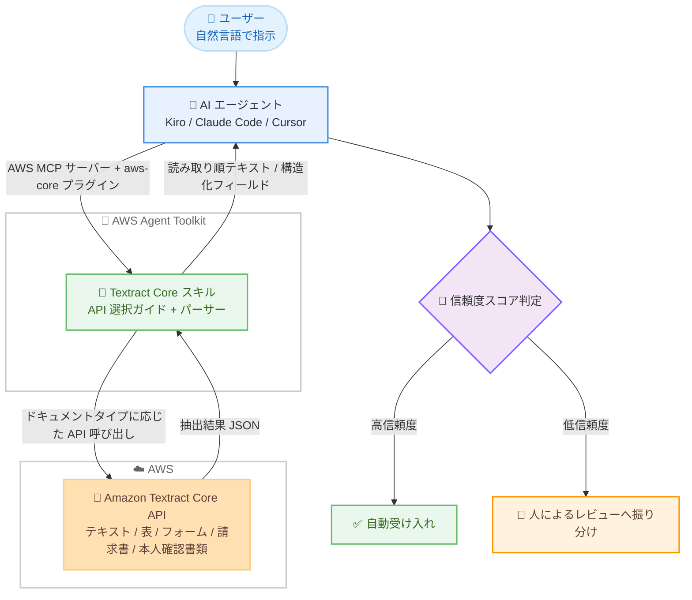

# Amazon Textract Core - AI エージェント向けスキルの提供開始

**リリース日**: 2026 年 11 月 20 日
**サービス**: Amazon Textract
**機能**: Amazon Textract Core 向け AI エージェントスキル

📊 [このアップデートのインフォグラフィックを見る](https://takech9203.github.io/aws-news-summary/20261120-amazon-textract-core-skill-ai-agents.html)

## 概要

AWS は、AI エージェントが Amazon Textract Core を使用してドキュメントからデータを抽出するための新しいスキルを発表しました。このスキルを利用することで、AI エージェントはサーバーやインフラストラクチャを一切デプロイすることなく、テキスト、表、フォーム、領収書、請求書、本人確認書類などのドキュメントからデータを抽出できます。

スキルは AWS Agent Toolkit で公開されており、Kiro、Claude Code、Cursor などのエージェントから利用できます。AWS MCP サーバーと aws-core プラグインを使用している場合、エージェントはこのスキルを自動的に読み込みます。ユーザーは自然言語でエージェントに指示するだけで、エージェントがドキュメント処理を実行し、回答を直接返します。

ドキュメント処理のワークフローをエージェントに組み込みたい開発者や、OCR・データ抽出処理の自動化を検討している企業にとって、導入障壁を大きく下げるアップデートです。

**アップデート前の課題**

このアップデート以前は、AI エージェントから Amazon Textract を利用する際に以下の課題がありました。

- エージェントと Textract を接続するためのカスタムインテグレーションを独自に構築・保守する必要があった
- ドキュメントタイプごとに適切な Textract API を選択するロジックを自前で実装する必要があった
- Textract API の出力 (JSON) を読み取り順のテキストや構造化フィールドに変換するパーサーを自作する必要があった

**アップデート後の改善**

今回のアップデートにより、以下が可能になりました。

- サーバーやインフラストラクチャのデプロイなしで、エージェントがドキュメントからデータを抽出できるようになった
- スキルがドキュメントタイプに基づいて適切な Textract Core API へエージェントを誘導するため、API 選択ロジックの実装が不要になった
- テスト済みのパーサーが同梱され、API 出力を読み取り順のテキストや構造化フィールド (質問への回答、請求書・領収書の明細、本人確認書類のフィールドなど) に変換できるようになった
- 信頼度スコアに基づき、高信頼度の結果は自動的に受け入れ、低信頼度の結果は人によるレビューへ振り分けるワークフローを構築できるようになった

## アーキテクチャ図



AI エージェントが AWS Agent Toolkit のスキルを通じて Amazon Textract Core API を呼び出し、抽出結果を構造化データとしてユーザーに返す流れを示しています。信頼度スコアに基づいて自動受け入れと人によるレビューを振り分けられます。

## サービスアップデートの詳細

### 主要機能

1. **ドキュメントタイプに応じた API ルーティング**
   - スキルがドキュメントタイプ (一般文書、フォーム、領収書、請求書、本人確認書類など) に基づいて、適切な Textract Core API へエージェントを誘導
   - 開発者が API 選択ロジックを実装する必要がない
   - 複数ページの PDF にも対応し、全ページを読み取り順で返却

2. **テスト済みパーサーの同梱**
   - Textract API の出力を読み取り順のテキストと構造化フィールドに変換
   - フォームの質問への回答、請求書・領収書の明細、本人確認書類のフィールドなどを抽出
   - 自前でのパーサー実装・保守が不要

3. **信頼度スコアによるレビューワークフロー**
   - 高信頼度の結果は自動的に受け入れ
   - 低信頼度の結果はフラグを立てて人によるレビュープロセスへ振り分け
   - 例: 患者の問診票を構造化データに変換し、不明瞭なフィールドにスタッフレビュー用のフラグを付与

4. **主要なエージェントとの統合**
   - AWS MCP サーバーと aws-core プラグインを使用すると、エージェントがスキルを自動的に読み込み
   - AWS Agent Toolkit で公開されており、Kiro、Claude Code、Cursor などのエージェントから利用可能

## 技術仕様

### スキルの構成要素

| 項目 | 詳細 |
|------|------|
| 配布元 | AWS Agent Toolkit (GitHub) |
| 読み込み方法 | AWS MCP サーバー + aws-core プラグインで自動読み込み |
| 対応エージェント | Kiro、Claude Code、Cursor など |
| 対応ドキュメント | テキスト、表、フォーム、領収書、請求書、本人確認書類 |
| 複数ページ PDF | 対応 (全ページを読み取り順で返却) |
| 出力 | 読み取り順テキスト、構造化フィールド、信頼度スコア |
| 追加インフラ | 不要 (サーバーレス、デプロイ不要) |

## 設定方法

### 前提条件

1. AWS アカウントと Amazon Textract を利用可能な IAM 権限
2. MCP 対応の AI エージェント (Kiro、Claude Code、Cursor など)
3. AWS MCP サーバーと aws-core プラグインのセットアップ

### 手順

#### ステップ1: AWS MCP サーバーと aws-core プラグインの設定

エージェントの MCP 設定に AWS MCP サーバーを追加し、aws-core プラグインを有効化します。これにより、エージェントが Textract Core スキルを自動的に読み込みます。

#### ステップ2: スキルの確認

AWS Agent Toolkit のリポジトリ (https://github.com/aws/agent-toolkit-for-aws) でスキルの内容と利用方法を確認します。スキルには API の選択ガイドとパーサーが含まれています。

#### ステップ3: 自然言語でドキュメント処理を指示

```text
この請求書 PDF から請求金額、支払期日、明細を抽出してください。
信頼度が低いフィールドにはレビュー用のフラグを付けてください。
```

エージェントに自然言語で指示すると、スキルが適切な Textract Core API を呼び出し、抽出結果を構造化データとして返します。

## メリット

### ビジネス面

- **導入コストの削減**: カスタムインテグレーションの構築・保守が不要になり、ドキュメント処理の自動化を短期間で開始できる
- **業務プロセスの効率化**: 問診票、請求書、本人確認書類などの手入力作業をエージェント経由で自動化できる
- **品質管理の組み込み**: 信頼度スコアに基づくレビュー振り分けにより、自動化と人によるチェックを両立できる

### 技術面

- **インフラ不要**: サーバーやインフラストラクチャのデプロイなしで利用できる
- **実装負荷の軽減**: API 選択ロジックとパーサーがスキルに同梱されており、Textract API の仕様を深く理解していなくても利用できる
- **エコシステムとの親和性**: AWS MCP サーバー経由で主要な AI エージェントにシームレスに統合できる

## デメリット・制約事項

### 制限事項

- Amazon Textract が利用可能な商用リージョンでのみ使用できる
- スキルの利用には MCP 対応のエージェント環境が必要
- 抽出精度は Amazon Textract Core API の性能に依存する

### 考慮すべき点

- スキル自体は無料だが、裏側で呼び出される Amazon Textract API には標準料金が発生するため、処理量に応じたコスト見積もりが必要
- 低信頼度の結果を扱う人によるレビュープロセスは別途設計が必要
- 機密性の高いドキュメント (本人確認書類など) を扱う場合は、IAM 権限やデータ取り扱いポリシーの整備が必要

## ユースケース

### ユースケース1: 医療機関の問診票のデジタル化

**シナリオ**: 医療機関で紙の問診票をスキャンし、電子カルテシステムに取り込むためのデータ化を行いたい。

**実装例**:
```text
エージェントへの指示:
「この患者の問診票を構造化データに変換し、
不明瞭なフィールドにはスタッフレビュー用のフラグを付けてください」
```

**効果**: 高信頼度のフィールドは自動で取り込み、不明瞭な項目のみスタッフが確認することで、入力作業を大幅に削減しながらデータ品質を維持できる。

### ユースケース2: 経理部門の請求書処理の自動化

**シナリオ**: 取引先から受領した請求書 PDF から、請求金額、支払期日、明細を抽出して会計システムに連携したい。

**実装例**:
```text
エージェントへの指示:
「受領した請求書 PDF から請求元、請求金額、支払期日、明細行を
抽出して JSON で出力してください」
```

**効果**: スキルが請求書向けの Textract API を自動選択し、構造化された明細データを返すため、手入力によるミスと工数を削減できる。

### ユースケース3: 本人確認書類を使ったオンボーディングの効率化

**シナリオ**: 金融サービスの口座開設フローで、本人確認書類から氏名、住所、生年月日などを抽出して申込情報と照合したい。

**実装例**:
```text
エージェントへの指示:
「アップロードされた本人確認書類からフィールドを抽出し、
申込フォームの入力内容と一致するか確認してください」
```

**効果**: 本人確認書類向けの抽出とフィールド構造化がスキル側で行われるため、照合ロジックの開発に集中でき、オンボーディングの所要時間を短縮できる。

## 料金

スキル自体の利用に追加料金はかかりません。スキルが呼び出す Amazon Textract API の使用に対して、標準の Amazon Textract 料金が適用されます。

詳細は [Amazon Textract 料金ページ](https://aws.amazon.com/textract/pricing/) を参照してください。

## 利用可能リージョン

Amazon Textract が利用可能なすべての AWS 商用リージョンで利用できます。主なリージョンは以下の通りです。

- 米国東部 (オハイオ、バージニア北部)
- 米国西部 (北カリフォルニア、オレゴン)
- アジアパシフィック (ムンバイ、ソウル、シンガポール、シドニー、東京)
- カナダ (中部)
- 欧州 (フランクフルト、アイルランド、ロンドン、パリ、スペイン、チューリッヒ)

## 関連サービス・機能

- **Amazon Textract**: ドキュメントからテキスト、表、フォームデータを抽出するマネージド OCR サービス。本スキルの基盤となる API を提供
- **AWS Agent Toolkit**: AI エージェント向けのスキルやツールを集約した AWS 公式ツールキット。本スキルの配布元
- **AWS MCP サーバー**: Model Context Protocol を通じて AI エージェントに AWS の機能を提供するサーバー。aws-core プラグインと組み合わせてスキルを自動読み込み
- **Kiro**: AWS が提供する AI 搭載 IDE。本スキルを利用できるエージェントの 1 つ

## 参考リンク

- 📊 [インフォグラフィック](https://takech9203.github.io/aws-news-summary/20261120-amazon-textract-core-skill-ai-agents.html)
- [公式発表 (What's New)](https://aws.amazon.com/about-aws/whats-new/2026/11/amazon-textract-core-skill-ai-agents/)
- [AWS Agent Toolkit (GitHub)](https://github.com/aws/agent-toolkit-for-aws)
- [Amazon Textract 料金ページ](https://aws.amazon.com/textract/pricing/)

## まとめ

AI エージェントからインフラ不要で Amazon Textract Core を利用できるスキルが登場し、ドキュメント処理ワークフローのエージェント統合が大幅に容易になりました。カスタムインテグレーションや独自パーサーの保守から解放されるため、Textract をエージェントから利用したい場合はまず AWS Agent Toolkit のスキルを確認することを推奨します。信頼度スコアによるレビュー振り分けを活用すれば、自動化と品質管理を両立したワークフローを短期間で構築できます。
