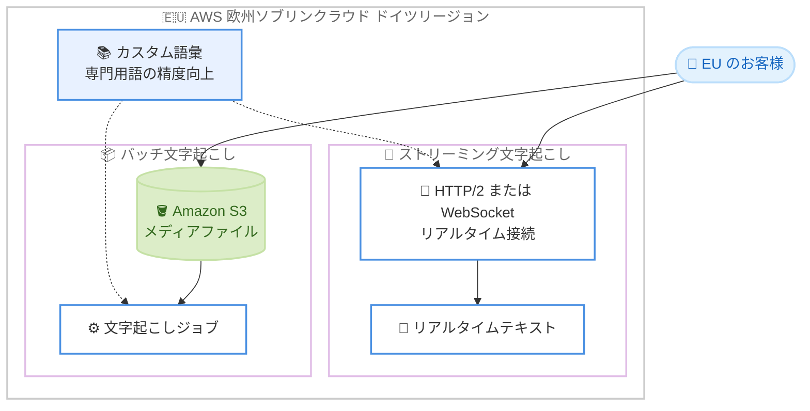

# Amazon Transcribe - AWS 欧州ソブリンクラウドでの提供開始

**リリース日**: 2026 年 11 月 20 日
**サービス**: Amazon Transcribe
**機能**: AWS 欧州ソブリンクラウド (ドイツ) リージョンでの Amazon Transcribe 提供開始

📊 [このアップデートのインフォグラフィックを見る](https://takech9203.github.io/aws-news-summary/20261120-amazon-transcribe-germany.html)

## 概要

Amazon Transcribe が AWS 欧州ソブリンクラウド (AWS European Sovereign Cloud) のドイツリージョンで利用可能になりました。Amazon Transcribe は自動音声認識 (ASR) サービスであり、音声データをテキストに変換する機能を提供します。今回のアップデートにより、EU 域内でのデータ保持と運用が求められるお客様が、規制コンプライアンスやデータ主権の要件を満たしながら音声認識機能を利用できるようになりました。

AWS 欧州ソブリンクラウドは、EU のデータ主権要件に対応するために設計された、既存の AWS リージョンから独立したクラウド環境です。公共部門や規制の厳しい業界 (金融、医療、通信など) のお客様が、EU 域内にデータと運用を保持したままクラウドサービスを活用できます。

今回の提供開始では、バッチ文字起こしとストリーミング文字起こしの両方のモードがサポートされ、カスタム語彙 (custom vocabularies) による精度向上も利用できます。

**アップデート前の課題**

AWS 欧州ソブリンクラウドでは Amazon Transcribe が利用できず、以下の制約がありました。

- データ主権要件を持つ EU のお客様は、ソブリンクラウド環境内で音声認識機能を利用できなかった
- 音声データの文字起こしのために、ソブリンクラウド外のリージョンへデータを転送する必要があり、規制コンプライアンス上の懸念があった
- コールセンター記録の分析や議事録作成などの音声活用ユースケースを、データ主権要件と両立させることが困難だった

**アップデート後の改善**

- AWS 欧州ソブリンクラウド内で Amazon Transcribe のバッチおよびストリーミング文字起こしが利用可能になった
- 音声データと文字起こし処理を EU 域内に保持したまま、規制コンプライアンスとデータ主権の要件を満たせるようになった
- カスタム語彙を使用して、製品名、業界用語、固有名詞などの専門用語の認識精度を向上できるようになった

## アーキテクチャ図



音声データの保存から文字起こし処理まで、すべてが AWS 欧州ソブリンクラウドの境界内で完結します。バッチとストリーミングの両モードでカスタム語彙を適用できます。

## サービスアップデートの詳細

### 主要機能

1. **バッチ文字起こし**
   - Amazon S3 に保存されたメディアファイルを処理して文字起こしを実行
   - 録音済みのコールセンター記録、会議録音、動画コンテンツなどの一括処理に適している
   - 処理対象のデータはソブリンクラウド内の S3 に保持される

2. **ストリーミング文字起こし**
   - ライブ音声からリアルタイムにテキストを生成
   - HTTP/2 または WebSocket 経由で接続
   - ライブ字幕やリアルタイムのエージェント支援などのユースケースに対応

3. **カスタム語彙**
   - バッチとストリーミングの両モードでサポート
   - 製品名、業界用語、固有名詞など、ドメイン固有の用語の認識精度を向上
   - 業界特有の用語が多い金融、医療、公共部門などでの利用に有効

## 技術仕様

### 提供内容

| 項目 | 詳細 |
|------|------|
| 提供リージョン | AWS 欧州ソブリンクラウド (ドイツ) |
| 文字起こしモード | バッチ (S3 上のメディアファイル)、ストリーミング (リアルタイム) |
| ストリーミング接続方式 | HTTP/2、WebSocket |
| 精度向上機能 | カスタム語彙 (両モードでサポート) |
| 対応言語 | [サポート言語ドキュメント](https://docs.aws.eu/transcribe/latest/dg/supported-languages.html)を参照 |

## 設定方法

### 前提条件

1. AWS 欧州ソブリンクラウドのアカウントを保有していること
2. バッチ文字起こしの場合、ソブリンクラウド内の Amazon S3 バケットにメディアファイルが保存されていること
3. Amazon Transcribe へのアクセスを許可する IAM 権限が設定されていること

### 手順

#### ステップ1: メディアファイルを S3 にアップロード

```bash
aws s3 cp ./meeting-recording.mp3 s3://my-sovereign-bucket/audio/meeting-recording.mp3
```

バッチ文字起こしの対象となるメディアファイルを、ソブリンクラウド内の S3 バケットにアップロードします。

#### ステップ2: 文字起こしジョブを開始

```bash
aws transcribe start-transcription-job \
  --transcription-job-name my-transcription-job \
  --language-code de-DE \
  --media MediaFileUri=s3://my-sovereign-bucket/audio/meeting-recording.mp3 \
  --output-bucket-name my-sovereign-output-bucket
```

S3 上のメディアファイルを指定して文字起こしジョブを開始します。言語コードと出力先バケットを指定します。

#### ステップ3: ジョブのステータスを確認

```bash
aws transcribe get-transcription-job \
  --transcription-job-name my-transcription-job
```

文字起こしジョブの進行状況を確認します。ステータスが `COMPLETED` になると、出力バケットに文字起こし結果が保存されます。

## メリット

### ビジネス面

- **データ主権要件への対応**: 音声データと文字起こし処理を EU 域内に保持したまま、音声認識機能を活用できる
- **規制コンプライアンスの維持**: 公共部門や規制の厳しい業界のお客様が、コンプライアンス要件を満たしながら音声活用ユースケースを実現できる
- **ユースケースの拡大**: コールセンター分析、議事録作成、コンテンツの字幕付与など、音声を活用した業務改善を EU 域内で展開できる

### 技術面

- **2 つの文字起こしモード**: バッチとストリーミングの両方に対応し、録音済みデータとライブ音声の両方のユースケースをカバーできる
- **カスタム語彙による精度向上**: ドメイン固有の用語を登録することで、専門性の高い音声でも認識精度を高められる
- **標準的な接続方式**: ストリーミングは HTTP/2 または WebSocket で接続でき、既存アプリケーションへの統合が容易

## デメリット・制約事項

### 制限事項

- 提供されるのは AWS 欧州ソブリンクラウド (ドイツ) リージョンであり、他のソブリンクラウドリージョンの展開状況は明記されていない
- 対応言語や言語ごとの機能サポート状況は、ソブリンクラウド向けのドキュメントで個別に確認する必要がある

### 考慮すべき点

- AWS 欧州ソブリンクラウドは標準の AWS リージョンとは独立した環境であり、専用のアカウントとエンドポイント (docs.aws.eu、aws.eu) を使用する
- 料金は標準リージョンと異なる場合があるため、欧州ソブリンクラウドの料金ページで確認が必要
- 標準リージョンで提供されている Transcribe の全機能が利用できるとは限らないため、必要な機能のサポート状況を事前に確認することを推奨

## ユースケース

### ユースケース1: 公共部門でのコールセンター記録の文字起こし

**シナリオ**: EU の政府機関が、市民からの問い合わせ通話の録音を文字起こしして分析したいが、データを EU 域外に転送できない。

**実装例**:
```
1. 通話録音をソブリンクラウド内の S3 バケットに保存
2. バッチ文字起こしジョブを実行
3. 文字起こし結果を分析基盤に連携して問い合わせ傾向を分析
```

**効果**: データ主権要件を満たしながら、問い合わせ内容の分析による市民サービスの改善を実現できる。

### ユースケース2: 金融機関でのリアルタイムエージェント支援

**シナリオ**: EU の金融機関が、コンタクトセンターの通話をリアルタイムに文字起こしし、オペレーターへの情報提示に活用したい。

**実装例**:
```
1. 通話音声を WebSocket 経由でストリーミング文字起こしに送信
2. リアルタイムに生成されるテキストをナレッジ検索システムに連携
3. 関連情報をオペレーター画面に表示
```

**効果**: 規制コンプライアンスを維持しながら、応対品質の向上と処理時間の短縮を実現できる。

### ユースケース3: 医療分野での専門用語を含む音声記録の文字起こし

**シナリオ**: EU の医療関連組織が、医療用語を多く含む音声記録を高精度で文字起こししたい。

**実装例**:
```
1. 医薬品名や医療用語を登録したカスタム語彙を作成
2. カスタム語彙を指定してバッチ文字起こしジョブを実行
3. 文字起こし結果をレビューして記録システムに保存
```

**効果**: カスタム語彙により専門用語の認識精度を高め、修正作業の負担を軽減しながら EU 域内でデータを完結できる。

## 料金

AWS 欧州ソブリンクラウドにおける Amazon Transcribe の料金は、[欧州ソブリンクラウドの料金ページ](https://www.aws.eu/european-sovereign-cloud/pricing/)で確認できます。標準リージョンとは料金が異なる場合があるため、利用前に確認することを推奨します。

## 利用可能リージョン

- AWS 欧州ソブリンクラウド (ドイツ) リージョン

## 関連サービス・機能

- **Amazon S3**: バッチ文字起こしの入力メディアファイルおよび出力結果の保存先として使用
- **AWS 欧州ソブリンクラウド**: EU のデータ主権要件に対応する独立したクラウド環境。Amazon Managed Service for Prometheus など他のサービスも順次提供が拡大している
- **Amazon Connect**: コンタクトセンターの通話記録と組み合わせた文字起こし・分析ユースケースで連携可能

## 参考リンク

- 📊 [インフォグラフィック](https://takech9203.github.io/aws-news-summary/20261120-amazon-transcribe-germany.html)
- [公式発表 (What's New)](https://aws.amazon.com/about-aws/whats-new/2026/11/amazon-transcribe-germany/)
- [Amazon Transcribe 入門ガイド (欧州ソブリンクラウド)](https://docs.aws.eu/transcribe/latest/dg/getting-started.html)
- [サポート言語と言語別機能 (欧州ソブリンクラウド)](https://docs.aws.eu/transcribe/latest/dg/supported-languages.html)
- [欧州ソブリンクラウド料金ページ](https://www.aws.eu/european-sovereign-cloud/pricing/)

## まとめ

Amazon Transcribe が AWS 欧州ソブリンクラウドで利用可能になり、EU のデータ主権要件を持つお客様が、バッチとストリーミングの両モードで音声認識機能を EU 域内で完結して利用できるようになりました。規制の厳しい業界や公共部門で音声活用ユースケースを検討している場合は、サポート言語と機能範囲をドキュメントで確認したうえで、導入を検討することを推奨します。
